# Architecture diagrams

Visual companion to [`architecture.md`](architecture.md). The text there explains *why*; these diagrams show *how the parts connect*. All diagrams are Mermaid, so GitHub renders them.

1. [System context](#1-system-context)
2. [Layers and the rules between them](#2-layers-and-the-rules-between-them)
3. [Backend modules](#3-backend-modules)
4. [Domain dependencies](#4-domain-dependencies) (two views)
5. [The series core](#5-the-series-core)
6. [Frontend structure](#6-frontend-structure)
7. [A change, end to end (with undo)](#7-a-change-end-to-end-with-undo)
8. [Opening and saving a project](#8-opening-and-saving-a-project)
9. [App start](#9-app-start)
10. [Native menu and close confirmation](#10-native-menu-and-close-confirmation)
11. [Insights charts](#11-insights-charts)
12. [Project file and data on disk](#12-project-file-and-data-on-disk)
13. [Sale of a house with linked debts](#13-sale-of-a-house-with-linked-debts)
14. [Test layers](#14-test-layers)

## 1. System context

One desktop process, no network, no server. Data lives in two places on the user's disk: the project file they choose, and the app config folder.

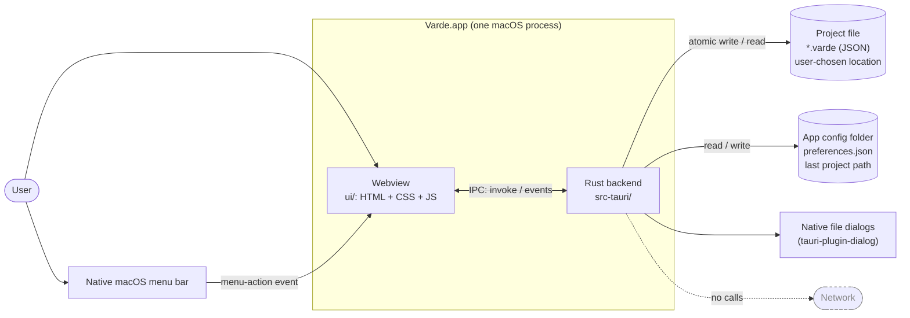

## 2. Layers and the rules between them

Dependencies point one way. `domain/` knows nothing about Tauri or IO, and the frontend never computes a financial figure.

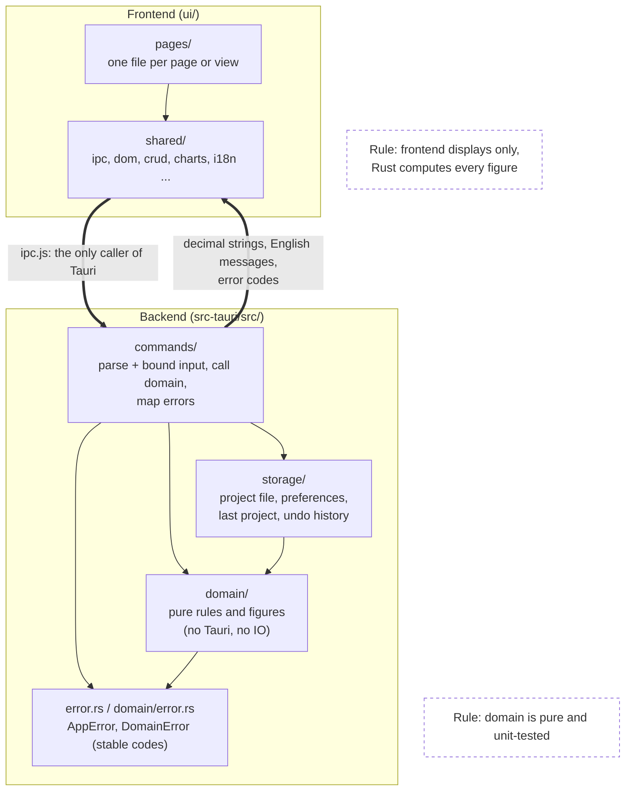

## 3. Backend modules

`AppState` holds the one open `Project` behind a mutex. Every command reaches it through `state.project()` (read) or `state.edit(label)` (an undoable change).

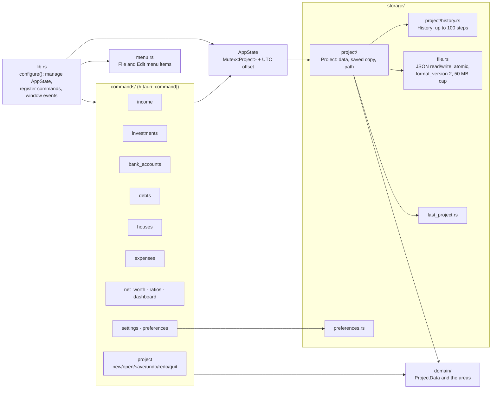

## 4. Domain dependencies

Two views of `domain/`, because one diagram with every edge is unreadable. Arrows mean "uses".

**4a. What the areas build on.** Each area uses the shared building blocks; the four series areas also share the series core. Edges go from a whole group, not from each area.

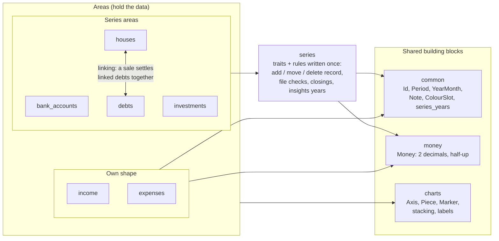

**4b. Where the figures come from.** Net worth, ratios and the dashboard keep no data. They combine the figures the areas already give.

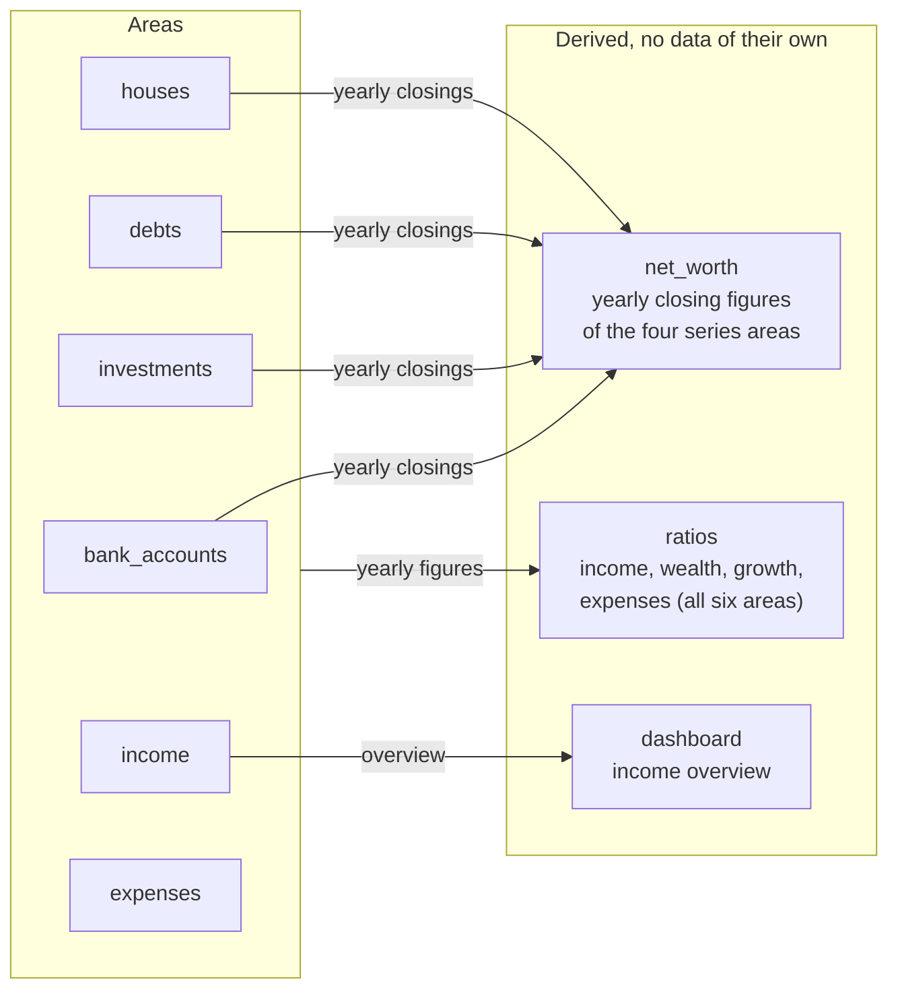

All areas and the project settings are collected in `ProjectData` (`domain/project_data.rs`), which is what the project file stores.

## 5. The series core

One set of rules written once on traits. An area supplies its own types and hooks and calls one-line wrappers.

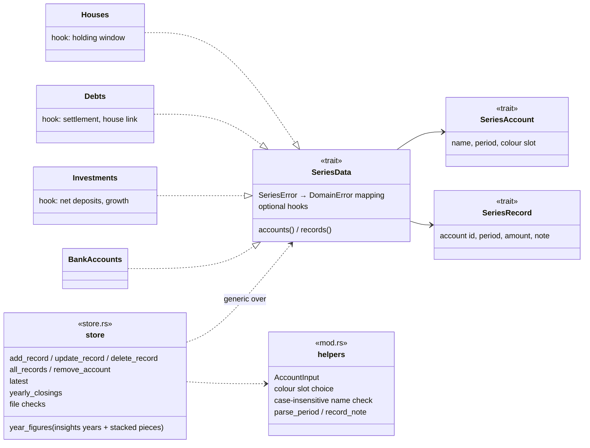

## 6. Frontend structure

`main.js` wires every page once at start and reloads them whenever the project changes. Pages with two tabs have an overview file and an insights file.

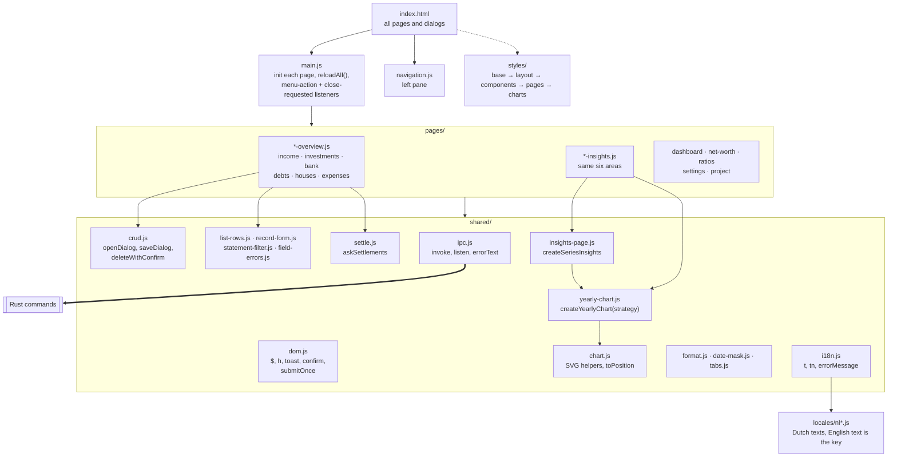

## 7. A change, end to end (with undo)

Every command that changes project data goes through `AppState::edit(label)`. The guard snapshots the data first; when it drops after a change that altered something, the snapshot becomes one undo step. A rejected change records nothing.

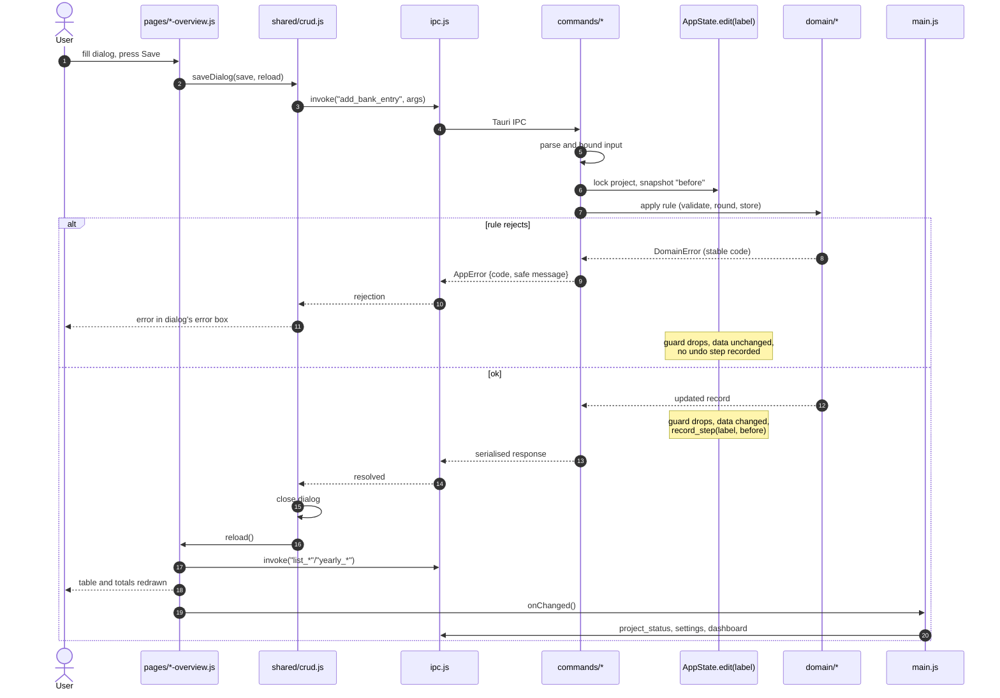

Undo and redo use the same `History` in `storage/project/history.rs`:

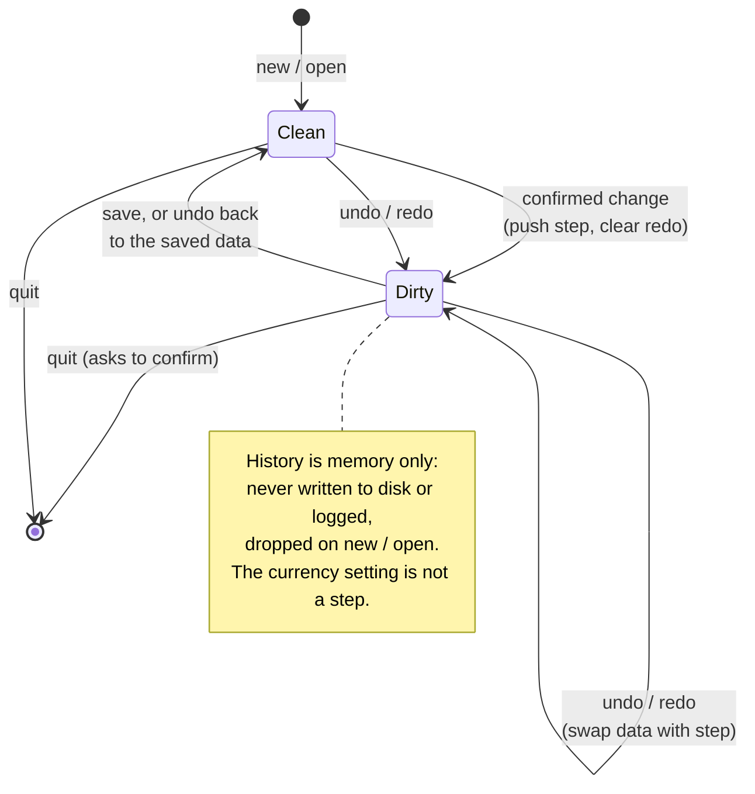

## 8. Opening and saving a project

Native dialogs run without the project lock held, so closing the window never deadlocks.

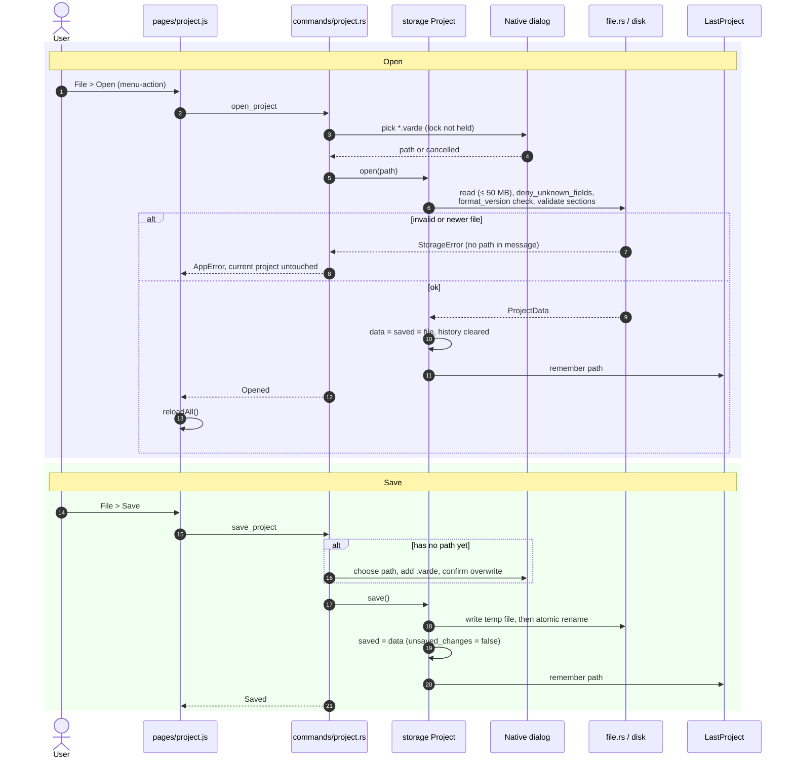

## 9. App start

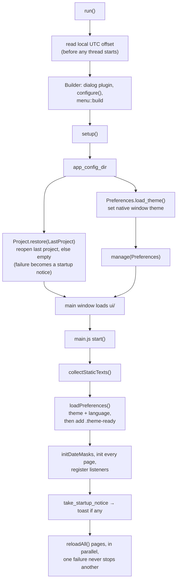

## 10. Native menu and close confirmation

Menu items and quit requests are forwarded to the frontend, which owns the confirmation dialogs.

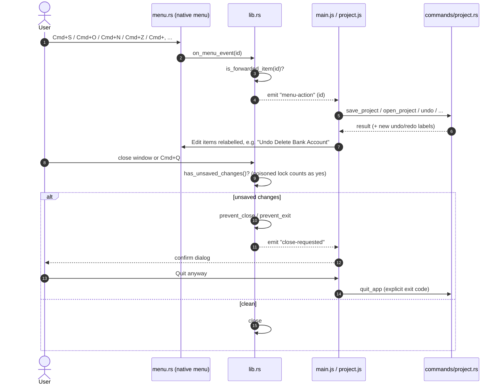

## 11. Insights charts

Rust decides everything a chart shows. The frontend only places received values.

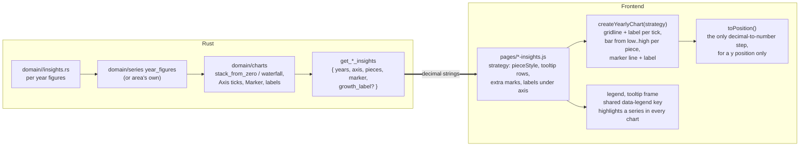

## 12. Project file and data on disk

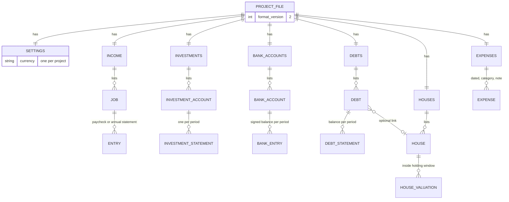

Outside the project file, in the app config folder (apart from any project):

| File | Holds |
|---|---|
| `preferences.json` | theme (System, Light, Dark) and language (English, Dutch) |
| last project path | which `.varde` to reopen at start |

## 13. Sale of a house with linked debts

`domain/houses/linking` is the only way to change a sale, so a house and its debts change together or not at all (CSD-019, CSD-020, CSD-026).

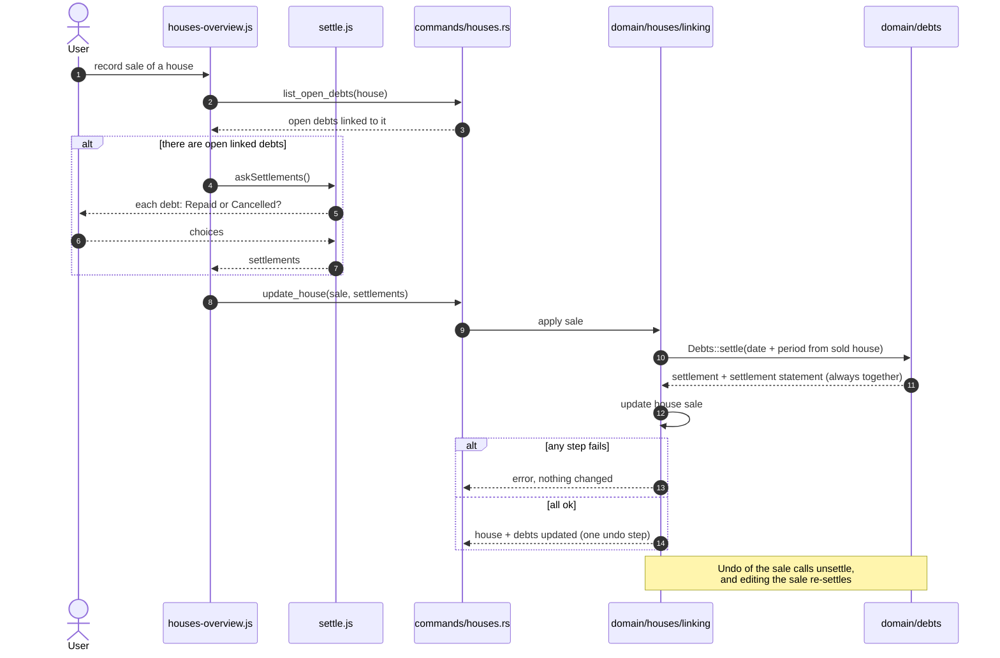

## 14. Test layers

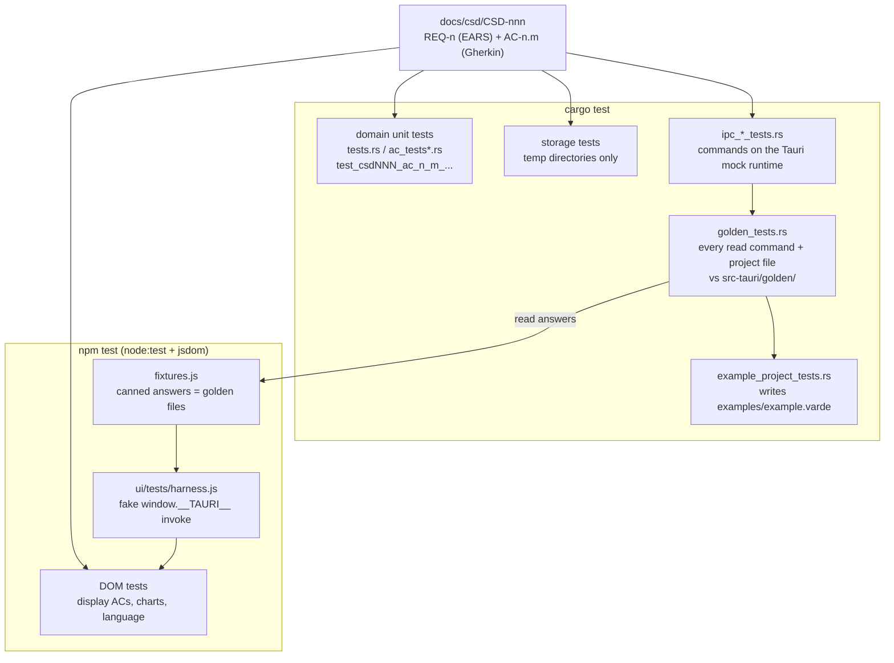
