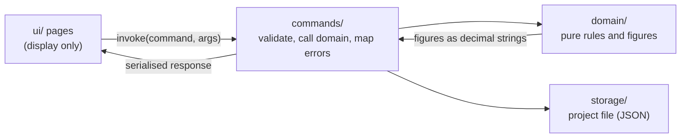

# Architecture

How the code is organised and the conventions it follows. For *what* the app must do, read the capability specifications in [`csd/`](csd/); this page is about *where things live* and *why*.

## The big picture

Varde is a Tauri app: a Rust backend and a vanilla HTML, CSS and JS frontend, with nothing in between (no framework, no build step, no server). All data lives in one project file the user chooses.



Two rules shape everything:

- **`domain/` is pure.** No Tauri, no IO. Every financial figure is computed there and unit-tested.
- **The frontend only displays.** It never computes a financial figure. The only arithmetic in `ui/` is turning a value into a position on a chart.

## Backend (`src-tauri/src/`)

| Folder | Holds |
|---|---|
| `domain/income/` | Jobs, paychecks, annual statements, yearly totals, dashboard overview, insights |
| `domain/investments/` | Accounts, statements, net deposits, capital growth, yearly totals, insights |
| `domain/houses/` | Houses with one purchase and at most one sale, valuations with non-negative values inside the holding window, the change per valuation, colour slots, yearly values with the change (houses held at year end), insights per house, and `linking` (debts linked to a house, the Repaid/Cancelled settlement on a sale, undo; it changes houses and debts together or not at all). A settlement and its settlement statement only come to be together: the fields `settlement`, `category`, `house_id` and the kind of a statement are private to `domain/debts`, `Debts::settle` (which takes the date and the period from the sold house) and `unsettle` are the only way to change them, and `Houses::update_house` and `delete_house` are private to `domain/houses`, so `linking` is the only way to change a sale; `Debts::validate_links` checks only what a file can hold. Reuses `common` (`Period`, `Note`) |
| `domain/debts/` | Debts, statements with non-negative balances, the change per statement, colour slots, yearly totals with the amount repaid, the optional house link and settlement of a debt, insights per debt. Reuses `common` (`Period`, `Note`) |
| `domain/expenses/` | Expenses (dated, with a fixed category and a note), the year and month filter, yearly totals with the largest expense, insights per category. Reuses `common` (`Note`) |
| `domain/bank_accounts/` | Bank accounts, entries with signed balances, colour slots, yearly totals, insights per bank. Reuses `common` (`Period`, `Note`) |
| `domain/net_worth/` | The yearly net worth: combines the yearly closing figures of houses, investments, bank accounts and debts (it keeps no data of its own) |
| `domain/ratios/` | The yearly ratios between income, wealth, growth and expenses, built from the figures the other areas already give. The bank accounts add one figure of their own, the increase of a year |
| `domain/common/` | What every area shares, owned by none: `Id<T>` (one typed UUID id; `JobId`, `DebtId` and the other area ids are aliases such as `Id<Job>`, and each kind maps a bad text to its own not-found error), `Period` (month or year of a statement), `PayPeriod`, `YearMonth` and `Year`, `Note`, `series_years` (the one rule for the years of every Insights series: from the earliest record to the later of the current year and the latest record, at most 50 slots back from the last year; an older record has no slot but still counts in every total), `ColourSlot` (one of the 8 chart colours, checked when built or read from a file), `wire_name` (the serde names of plain enums, the one source for parsing them) and the limit `MAX_NAME_CHARS` |
| `domain/charts/` | What every yearly chart needs from Rust (CSD-025): `Axis` (equally spaced ticks at a step of 1, 2 or 5 times a power of ten that reach every piece and marker and include 0.00), `Piece` and `Marker` per year, `stack_from_zero` and `waterfall` (stack the figures of a year into pieces), and the labels `short_label`, `axis_label` and `percent_label`. The frontend only draws what it receives |
| `domain/series/` | The core of the series areas: bank accounts, investments, debts and houses are lists of named accounts with one record per period. `store.rs` holds the traits `SeriesData` (the data struct of an area), `SeriesAccount` and `SeriesRecord` and the rules written once on them: name and period rules, add, move and delete a record, the checks of a file, the latest record, the yearly closing figures and the insights years with their stacked pieces. An area keeps its own types, field names, errors (`SeriesError` maps each kind to the area's `DomainError`) and figures, and adds what differs through hooks (the holding window of a house, the settlement of a debt, the net deposits of an investment). `mod.rs` holds the helpers: the colour slot choice, the case-insensitive name check, the alphabetical order, `AccountInput` (the name and period of an account, aliased as `BankAccountInput`, `InvestmentAccountInput` and `DebtInput`), `parse_period` and `record_note`. Expenses and income have another shape and do not use it |
| `domain/preferences.rs` | The application preferences, `Theme` (System, Light, Dark) and `Language` (English, Dutch), parsed from their lowercase names (CSD-008, CSD-022) |
| `domain/number_format.rs` | `NumberFormat` (`point_comma`, `comma_point`, `apostrophe_comma`) and the strict reading of a typed amount into its canonical form (CSD-029). `commands/` call it before the area validates and rounds the amount |
| `domain/money/` (`Money`, the one amount type with two decimals, carried by every area type, total, overview and insights figure, summed only with `checked_add` or the bounded `saturating_add` and `saturating_sum`, never with `+`, and left as a `Decimal` only for percentages, ratios and chart positions; typed text is rounded half-up on its digits, never rejected for its decimals, while a project file amount stays strict; the currency, the paycheck amounts and `percent_of`), `settings.rs`, `error.rs`, `project_data.rs` | Amounts and currency, project settings, the domain error enum, the project's data sections |
| `commands/` | `#[tauri::command]` handlers, one file per area. Thin: parse and bound the input, call `domain`, map errors |
| `storage/` | Reading and writing the project file (atomic write), remembering the last project, and `preferences.json` (theme, language and number format) in the app config folder, which belongs to the app and not to a project. `storage/project/` keeps the tests of each area in its own file |

A big domain module is a folder. Its `mod.rs` holds the data struct (`Income`, `Investments`) and the rules for changing it. The other files add value types (`dates`, `job`, `entry`; `period`, `amounts`, `account`, `statement`) and the figures derived from the data (`totals`, `insights`, `overview`, `growth`). Each file starts with a one-line `//!` comment saying what it is. Tests sit next to the code in `tests.rs`.

**Naming.**

- Types that exist for both capabilities carry the capability: `IncomeInsightsYear` and `InvestmentInsightsYear`, `IncomeYearlyTotal` and `InvestmentYearlyTotal`. The income annual statement is `AnnualStatement`, the investment one `InvestmentStatement`.
- IPC command names and JSON fields are the contract with the frontend and appear in the approved specs, so they are not renamed lightly.
- Errors are one `DomainError` enum with a stable `code()` per variant (for example `INVESTMENT_BALANCE_NEGATIVE`). The frontend shows the safe message and never sees paths or internals.

**Tests.** Test names point at the specification: `test_csd005_ac_23_3_...` proves AC-23.3 of CSD-005. `cargo test test_csd005_` runs one spec's tests.

**Golden tests.** `golden_tests.rs` builds one synthetic example project through the IPC commands, then compares its project file and the output of every read command with the files in `src-tauri/golden/` (`example-project.json` is a project file kept under a `.json` name because `*.varde` is git-ignored). They pin behaviour for refactorings that must not change it. Ids are replaced by `id-n` and "today" is fixed. A deliberate change of behaviour updates them with `GOLDEN_UPDATE=1 cargo test golden`, and the diff is reviewed. A new read command or a new field in the project file needs a line in `read_everything` or `build_example_project`.

## Frontend (`ui/`)

```
index.html          all pages and dialogs in one file
main.js             entry point: wires every page and reloads them when a project opens
navigation.js       left-pane navigation (a plain script, no imports)
pages/              one file per page or view
shared/             helpers pages share
locales/            Dutch texts, one file per area
styles/             CSS by area
tests/              DOM tests and their harness (not part of the app)
```

**`pages/`** files are named `<page>-<view>.js`: `income-overview.js`, `income-insights.js`, `investments-overview.js`, `investments-insights.js`, `bank-overview.js`, `bank-insights.js`, `houses-overview.js`, `houses-insights.js`, `debts-overview.js`, `debts-insights.js`, `expenses-overview.js`, `expenses-insights.js`. Each exports `init<Page><View>()` (wire the events once) and `reload<Page><View>()` (fetch from Rust and render). `dashboard.js`, `net-worth.js`, `ratios.js`, `settings.js` and `project.js` are pages without views; `ratios.js` lays out the table of the Ratios page; `net-worth.js` draws the one chart of the Net worth page with `createYearlyChart`.

**Element ids** follow `<page>-<view>-<part>`: `income-insights-chart`, `investments-insights-legend`, `investments-tab-insights`. The shared chart code finds its parts from the one id it is given.

**`shared/`** has one job per file:

| File | Job |
|---|---|
| `ipc.js` | `invoke`, `listen`, `errorText`: the only place that talks to Tauri |
| `dom.js` | `$` (element by id, defined once), `h` (element builder), icons, toast, the confirm dialog, `showError`, `submitOnce` (one submit at a time per form) and `reloadAfterSave` (a failing reload after a save goes to the toast) |
| `crud.js` | The three steps of every overview dialog: `openDialog` (reset, title, fill, show, focus), `saveDialog` (run the save, close, reload, show an error in the dialog's error box) and `deleteWithConfirm` (confirm, invoke, reload, show an error in the toast) |
| `list-rows.js` | Overview building blocks: `accountRow`, `latestAmount`, `recordActions` (edit and delete buttons), `renderTable` (rows plus the empty note), `toggleEmpty`, `showTotal`, `numCell`, `rowHeader` |
| `record-form.js` | `createRecordForm`: the record dialog of the series areas (parent dropdown, month or year that follows it, open and fill), with hooks for what one area adds |
| `insights-page.js` | What the Insights pages share: `fillLegend`, `tooltipFrame`, `initInsightsTabs`, `yearLabelLines`, `markerDecorator`, and `createSeriesInsights` (the whole page of bank accounts, debts and houses) |
| `format.js` | Display formatting, `noteSummary` and today's year or month. No figures are computed |
| `number-format.js` | The number format the user chose (CSD-029): writes amounts and Rust-built labels in it, and writes an amount typed in an open form again when the format changes. Rust reads every typed amount |
| `chart.js` | Chart building blocks: SVG helper, `toPosition` (the one place a received decimal string becomes a number, for a position only), bar segments, tooltip rows (listed top to bottom like the bar, using the `hangs` of the received pieces), legend items, the highlight |
| `yearly-chart.js` | The frame every insights chart shares: one size rule (`CHART_SIZE` and a plot height that follows the window), the axis, bars and marker drawn from the received `axis`, `pieces` and `marker`, tooltip, loading, resize |
| `date-mask.js` | Types the `/` or `-` of a date or month field while the user types (fields marked `data-mask`). Display only; Rust validates |
| `tabs.js` | Tabs such as Overview and Insights |
| `i18n.js` | The language of the app's own texts (CSD-022): `t`, `tn` (singular or plural), `errorMessage`, `currentLanguage`, and the translation of the static texts of `index.html` |
| `settle.js` | `askSettlements`: the "Settle linked debts" prompt where each open debt of a sold house becomes Repaid or Cancelled (CSD-026) |

**Composition, not inheritance.** The insights charts differ only in their data, so `createYearlyChart(strategy)` takes a small object (how a received piece looks, tooltip rows, extra marks, labels under the axis) and draws the rest. The overview pages use small shared functions with option objects, not a generic dialog class: `openDialog`, `saveDialog` and `deleteWithConfirm` (`crud.js`) hold the steps that are identical, `createRecordForm` holds the record dialog of the four series areas, and a page keeps what is its own (its fields, commands, texts, the locks and the settle flows of debts and houses, the balance and growth calculation of investments). Income and expenses use only `crud.js` and `list-rows.js`: their forms do not follow the parent-and-period shape. `createSeriesInsights` builds the Insights page of bank accounts, debts and houses from a config of field names and texts; the pages of income, investments, expenses and net worth call `createYearlyChart` themselves and use the shared legend, tooltip frame and tabs.

**Language (CSD-022).** The English text written in the code is also the key of its Dutch version in `locales/`: one file per area (`nl-income-expenses.js`, `nl-investments-bank.js`, `nl-debts-houses.js`, `nl-shared.js`, `nl-static.js` for `index.html`, `nl-errors.js` for error codes written as `code:<CODE>`), merged by `nl.js`. A text without a Dutch version shows in English. `collectStaticTexts` notes the static texts of `index.html` once at start. Project data (names, notes) is never translated, and Rust sends no translated text: it sends English messages and stable error codes.

**Preferences flow.** At start `settings.js` calls `get_preferences`, which returns the saved theme, language and number format (System, English and 1,234.50 when there is no file), and applies all three before the pages load. Choosing one calls `set_theme`, `set_language` or `set_number_format`; Rust saves first, and the page changes only after a successful answer, so a failed save changes nothing. A language or number format change draws every page again. Preferences live in `preferences.json` in the app config folder, apart from the project file.

**Styles** are loaded in order by `<link>` tags: `base` (tokens, light and dark), `layout`, `components`, `pages`, `charts`. Colours come from CSS variables so both modes work. Motion uses CSS transitions of 140 ms and is switched off under `prefers-reduced-motion`.

**Charts are drawn from what Rust returns (CSD-025).** Every `get_*_insights` answer holds `axis.ticks` (`value`, `label`), per year `pieces` (`series`, `low`, `high`, `hangs`, `rounding`) and `marker` (`value`, `label`) or `null`, and income and investments add `growth_label`; `get_ratios` adds a `<percent field>_label` (such as `wealth_percent_label`) per percentage of a year, which the Ratios table shows as received. The frontend draws a gridline for every tick with its label, a bar of the pieces in the order received, between their `low` and `high`, and the marker line at its value with its label. It does not stack, round, sum, compare or label: no tick, no piece, no marker text and no percentage is built in JS. The only arithmetic is turning a received value into a y position (`toPosition`, then a proportion of the plot height), and the pixel box over a bar. A page decides only how a series looks (`pieceStyle`: the colour class and the accessible name of a piece, from its `series`) and which received amounts the tooltip lists. Amounts in tooltips and screen-reader texts are the received decimal strings with the digit grouping of `format.js`. A tooltip lists its rows like the bar by the `hangs` of the received pieces, not by comparing amounts.

**Charts, in short.** Items in a legend, a tooltip row and a bar segment share a `data-legend` key. Hovering a legend item or a segment highlights that series in every year of every chart, and a tooltip lists its rows in the order the bar shows them, top to bottom.

**Frontend tests.** `ui/tests/` (also `language.test.js` for the language flow) holds the DOM tests (`npm test`, Node's `node:test` with `jsdom`, the one tests-only dev dependency). `harness.js` builds the page of `index.html` in jsdom, installs a fake `window.__TAURI__` (`core.invoke` backed by a table of canned answers, `event.listen`, and `emit` for events such as `menu-action`) before it imports the real `navigation.js` and `main.js`, and gives every test its own module registry (`hooks.js`), so no state leaks between tests. `fixtures.js` serves the read answers of the golden files in `src-tauri/golden/` as the example project, and an empty project derived from them. `charts.test.js` feeds the charts those answers, or small series made for one AC, and checks that bars, ticks, labels and markers are the received ones (a label that differs from what a computation would give must be shown as received). `settle()` waits until no command is in flight, so tests never sleep. jsdom has no layout, no `<dialog>` behaviour (the harness adds `showModal` and `close`) and no real keyboard activation; what needs them stays on the manual checklist of the CSDs. Test titles carry the AC id, as the Rust tests do (`test_csd024_ac_3_1_...`).

## How to add...

**A yearly chart for a new area.** Add a Rust command that returns `{ years }`, add the panel markup with ids `<page>-insights-{legend,empty,scroll,chart}`, have the command deliver `axis`, `pieces` and `marker` from `domain/charts`, write `pages/<page>-insights.js` with a strategy for `createYearlyChart`, and register its init and reload in `main.js`.

**A new page.** Add a `<section>` in `index.html` and a nav item, a `pages/<page>-overview.js` with `init…` and `reload…`, and wire both in `main.js`. Build the page from the shared parts: `renderTable`, `accountRow` and `toggleEmpty` for the lists, `openDialog`, `saveDialog` and `deleteWithConfirm` for the dialogs, and for a series area `createRecordForm` for the record dialog and `createSeriesInsights` for the Insights page (a config with the command, the field names and the texts, as in `pages/debts-insights.js`).

**A new series area** (named accounts with a record per month or year). Give the data struct two lists and implement `SeriesData` (the accessors, the `SeriesError` mapping and, only when the area differs, a hook), `SeriesAccount` for the account and `SeriesRecord` for the record; then write the public methods of the area as one-line calls to `add_record`, `update_record`, `delete_record`, `all_records`, `remove_account` and the others of `domain/series/store.rs`, and build the overview, totals and insights from `latest`, `yearly_closings` and `year_figures`. Keep what differs in the area, not in the core.

**A new command.** Write the rule and its tests in `domain/`, a thin handler in `commands/`, register it in `lib.rs`, add an IPC test in `ipc_tests.rs`, and call it from a page through `invoke`.

## Workflow

Behaviour changes start with a specification in `csd/` (draft, then approved), then tests, then code. Pure refactors need no specification. Work happens on the `development` branch in small commits, one concern each, with fmt, clippy and tests green.
