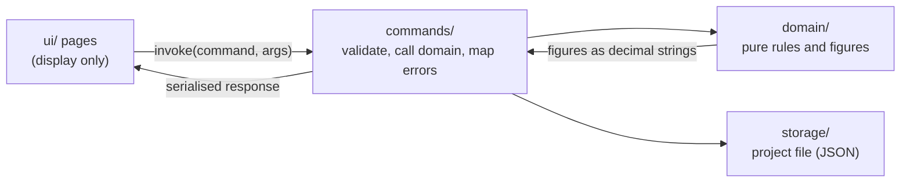

# Architecture

How the code is organised and the conventions it follows. For *what* the app must do, read the capability specifications in [`csd/`](csd/); this page is about *where things live* and *why*.

## The big picture

Varde is a Tauri app: a Rust backend and a vanilla HTML, CSS and JS frontend, with nothing in between (no framework, no build step, no server). All data lives in one project file the user chooses.



Two rules shape everything:

- **`domain/` is pure.** No Tauri, no IO. Every financial figure is computed there and unit-tested.
- **The frontend only displays.** It never computes a financial figure. The only arithmetic in `ui/` is turning a value into a position on a chart.

## Backend (`src-tauri/src/`)

| Folder | Holds |
|---|---|
| `domain/income/` | Jobs, paychecks, annual statements, yearly totals, dashboard overview, insights |
| `domain/investments/` | Accounts, statements, net deposits, capital growth, yearly totals, insights |
| `domain/houses/` | Houses with one purchase and at most one sale, valuations with non-negative values inside the holding window, the change per valuation, colour slots, yearly values with the change (houses held at year end), insights per house, and `linking` (debts linked to a house, the Repaid/Cancelled settlement on a sale, undo; it changes houses and debts together or not at all). Reuses `common` (`Period`, `Note`) |
| `domain/debts/` | Debts, statements with non-negative balances, the change per statement, colour slots, yearly totals with the amount repaid, the optional house link and settlement of a debt, insights per debt. Reuses `common` (`Period`, `Note`) |
| `domain/expenses/` | Expenses (dated, with a fixed category and a note), the year and month filter, yearly totals with the largest expense, insights per category. Reuses `common` (`Note`) |
| `domain/bank_accounts/` | Bank accounts, entries with signed balances, colour slots, yearly totals, insights per bank. Reuses `common` (`Period`, `Note`) |
| `domain/net_worth/` | The yearly net worth: combines the yearly closing figures of houses, investments, bank accounts and debts (it keeps no data of its own) |
| `domain/ratios/` | The yearly ratios between income, wealth, growth and expenses, built from the figures the other areas already give. The bank accounts add one figure of their own, the increase of a year |
| `domain/common/` | What every area shares, owned by none: `Id<T>` (one typed UUID id; `JobId`, `DebtId` and the other area ids are aliases such as `Id<Job>`, and each kind maps a bad text to its own not-found error), `Period` (month or year of a statement), `PayPeriod`, `YearMonth` and `Year`, `Note`, `series_years` (the one rule for the years of every Insights series: from the earliest record to the later of the current year and the latest record, at most 50 slots back from the last year; an older record has no slot but still counts in every total), `ColourSlot` (one of the 8 chart colours, checked when built or read from a file), `wire_name` (the serde names of plain enums, the one source for parsing them) and the limit `MAX_NAME_CHARS` |
| `domain/series.rs` | What the named series share: the colour slot choice, the case-insensitive name check and the alphabetical order (investment accounts, bank accounts, debts, houses, expenses) |
| `domain/money/` (`Money`, the one amount type with two decimals and half-up rounding; the currency, the paycheck amounts and `percent_of`), `settings.rs`, `error.rs`, `project_data.rs` | Amounts and currency, project settings, the domain error enum, the project's data sections |
| `commands/` | `#[tauri::command]` handlers, one file per area. Thin: parse and bound the input, call `domain`, map errors |
| `storage/` | Reading and writing the project file (atomic write), remembering the last project. `storage/project/` keeps the tests of each area in its own file |

A big domain module is a folder. Its `mod.rs` holds the data struct (`Income`, `Investments`) and the rules for changing it. The other files add value types (`dates`, `job`, `entry`; `period`, `amounts`, `account`, `statement`) and the figures derived from the data (`totals`, `insights`, `overview`, `growth`). Each file starts with a one-line `//!` comment saying what it is. Tests sit next to the code in `tests.rs`.

**Naming.**

- Types that exist for both capabilities carry the capability: `IncomeInsightsYear` and `InvestmentInsightsYear`, `IncomeYearlyTotal` and `InvestmentYearlyTotal`. The income annual statement is `AnnualStatement`, the investment one `InvestmentStatement`.
- IPC command names and JSON fields are the contract with the frontend and appear in the approved specs, so they are not renamed lightly.
- Errors are one `DomainError` enum with a stable `code()` per variant (for example `INVESTMENT_BALANCE_NEGATIVE`). The frontend shows the safe message and never sees paths or internals.

**Tests.** Test names point at the specification: `test_csd005_ac_23_3_...` proves AC-23.3 of CSD-005. `cargo test test_csd005_` runs one spec's tests.

**Golden tests.** `golden_tests.rs` builds one synthetic example project through the IPC commands, then compares its project file and the output of every read command with the files in `src-tauri/golden/` (`example-project.json` is a project file kept under a `.json` name because `*.varde` is git-ignored). They pin behaviour for refactorings that must not change it. Ids are replaced by `id-n` and "today" is fixed. A deliberate change of behaviour updates them with `GOLDEN_UPDATE=1 cargo test golden`, and the diff is reviewed. A new read command or a new field in the project file needs a line in `read_everything` or `build_example_project`.

## Frontend (`ui/`)

```
index.html          all pages and dialogs in one file
main.js             entry point: wires every page and reloads them when a project opens
navigation.js       left-pane navigation (a plain script, no imports)
pages/              one file per page or view
shared/             helpers pages share
styles/             CSS by area
tests/              DOM tests and their harness (not part of the app)
```

**`pages/`** files are named `<page>-<view>.js`: `income-overview.js`, `income-insights.js`, `investments-overview.js`, `investments-insights.js`, `bank-overview.js`, `bank-insights.js`, `houses-overview.js`, `houses-insights.js`, `debts-overview.js`, `debts-insights.js`, `expenses-overview.js`, `expenses-insights.js`. Each exports `init<Page><View>()` (wire the events once) and `reload<Page><View>()` (fetch from Rust and render). `dashboard.js`, `net-worth.js`, `ratios.js`, `settings.js` and `project.js` are pages without views; `ratios.js` lays out the table of the Ratios page; `net-worth.js` draws the one chart of the Net worth page with `createYearlyChart`.

**Element ids** follow `<page>-<view>-<part>`: `income-insights-chart`, `investments-insights-legend`, `investments-tab-insights`. The shared chart code finds its parts from the one id it is given.

**`shared/`** has one job per file:

| File | Job |
|---|---|
| `ipc.js` | `invoke`, `listen`, `errorText`: the only place that talks to Tauri |
| `dom.js` | `h` (element builder), icons, toast, the confirm dialog, `showError` |
| `format.js` | Display formatting and today's year or month. No figures are computed |
| `chart.js` | Chart building blocks: SVG helper, bar segments, tooltip rows (listed top to bottom like the bar), legend items, the highlight |
| `yearly-chart.js` | The frame every insights chart shares: one size rule (`CHART_SIZE` and a plot height that follows the window), axis, bars, closing-balance marker, tooltip, loading, resize |
| `date-mask.js` | Types the `/` or `-` of a date or month field while the user types (fields marked `data-mask`). Display only; Rust validates |
| `tabs.js` | Tabs such as Overview and Insights |

**Composition, not inheritance.** The insights charts differ only in their data, so `createYearlyChart(strategy)` takes a small object (the stacked pieces, tooltip rows, extra marks, labels under the axis) and draws the rest. The CRUD dialogs of the two overview pages stay separate on purpose: their forms differ (the statement form calculates balance and growth), and one generic dialog would be harder to read than two plain files.

**Styles** are loaded in order by `<link>` tags: `base` (tokens, light and dark), `layout`, `components`, `pages`, `charts`. Colours come from CSS variables so both modes work. Motion uses CSS transitions of 140 ms and is switched off under `prefers-reduced-motion`.

**Charts, in short.** Items in a legend, a tooltip row and a bar segment share a `data-legend` key. Hovering a legend item or a segment highlights that series in every year of every chart, and a tooltip lists its rows in the order the bar shows them, top to bottom.

**Frontend tests.** `ui/tests/` holds the DOM tests (`npm test`, Node's `node:test` with `jsdom`, the one tests-only dev dependency). `harness.js` builds the page of `index.html` in jsdom, installs a fake `window.__TAURI__` (`core.invoke` backed by a table of canned answers, `event.listen`, and `emit` for events such as `menu-action`) before it imports the real `navigation.js` and `main.js`, and gives every test its own module registry (`hooks.js`), so no state leaks between tests. `fixtures.js` serves the read answers of the golden files in `src-tauri/golden/` as the example project, and an empty project derived from them. `settle()` waits until no command is in flight, so tests never sleep. jsdom has no layout, no `<dialog>` behaviour (the harness adds `showModal` and `close`) and no real keyboard activation; what needs them stays on the manual checklist of the CSDs. Test titles carry the AC id, as the Rust tests do (`test_csd024_ac_3_1_...`).

## How to add...

**A yearly chart for a new area.** Add a Rust command that returns `{ years }`, add the panel markup with ids `<page>-insights-{legend,empty,scroll,chart}`, write `pages/<page>-insights.js` with a strategy for `createYearlyChart`, and register its init and reload in `main.js`.

**A new page.** Add a `<section>` in `index.html` and a nav item, a `pages/<page>-overview.js` with `init…` and `reload…`, and wire both in `main.js`.

**A new command.** Write the rule and its tests in `domain/`, a thin handler in `commands/`, register it in `lib.rs`, add an IPC test in `ipc_tests.rs`, and call it from a page through `invoke`.

## Workflow

Behaviour changes start with a specification in `csd/` (draft, then approved), then tests, then code. Pure refactors need no specification. Work happens on the `development` branch in small commits, one concern each, with fmt, clippy and tests green.
