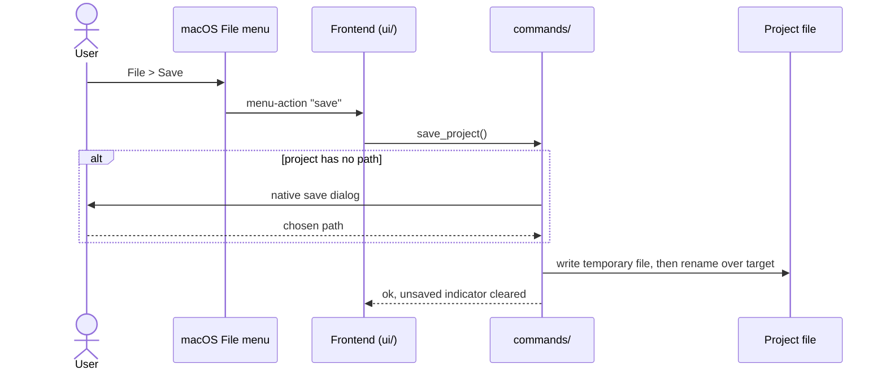

# CSD-002: Project file (save, open, new)

## 1. Intent
The app keeps all of the user's data in one local project file instead of a database. Without a clear save model, users can lose edits or overwrite good data with bad. This capability defines how a project is created, opened, saved and protected against accidental loss. It applies to all app data, starting with the employment income of CSD-001, and it is for a single user working on one project at a time.

## 2. Scope
### 2.1 In scope
- New, Open, Save and Save As for the project file, as items of the native macOS File menu.
- Unsaved-changes tracking and the confirmations that protect unsaved data.
- Safe writing, so a failed save never damages an existing file.
- The project file format: its sections, the strict schema and its versioning.
- Saving never overwriting another file without confirmation, and the file extension.
- Reopening the last used project when the app starts.

### 2.2 Non-goals
- NG-1: Encryption of the project file. (Remembering the last used file moved into scope in v0.4: REQ-8, REQ-10, REQ-11.)
- NG-2: Autosave and backup or recovery copies (no `.bak`).
- NG-3: Multiple projects open at once.
- NG-4: Cloud sync or sharing of the file.
- NG-5: Buttons for these actions inside the app window, and an Open Recent list.
- NG-6: Remembering more than one file, and opening a file by double-clicking it in Finder.
- NG-7: Migrating project files of an older or newer format. The app is not released yet, so there is no legacy, and there is no migration framework.

## 3. Definitions
| Term | Meaning |
|---|---|
| **Project** | All app data held in memory, plus an optional path to its file. |
| **Project file** | A JSON file with the extension `.varde` holding the project. Its sections and versioning are in REQ-16 to REQ-18. |
| **Gone for good** | The remembered project file does not exist while its parent folder exists and can be read (for example the file was deleted). Any other reason the file cannot be opened is *transient* or a problem of the file itself, and the remembered path is kept (REQ-13). |
| **Unsaved changes** | The in-memory project differs from the last saved or opened state. |

## 4. Requirements

### 4.0 Overview flow


**REQ-1: Save** *(event-driven)*
When the user saves, the app shall write all project data to the project file and clear the unsaved indicator, asking for a path in a native save dialog when the project has no path yet or when the user chose Save As.

```gherkin
@AC-1.1
Scenario: Save and reload round-trips
  Given 2 jobs with 5 paychecks in total
  When the user saves to a chosen path and then opens that file in a fresh session
  Then the same 2 jobs and 5 paychecks exist with identical values

@AC-1.2
Scenario: Write failure keeps changes unsaved
  Given unsaved changes
  And the chosen path is not writable
  When the user saves
  Then an error with code "PROJECT_SAVE_FAILED" and no file path or OS detail is shown
  And the unsaved indicator remains

@AC-1.3
Scenario: Path is asked once, then reused
  Given a new project with a job and no path
  When the user saves
  Then a native save dialog is shown and the file is written to the chosen path
  When the user adds a second job and saves again
  Then no dialog is shown and the same file is overwritten

@AC-1.4
Scenario: Save As asks again
  Given a project saved to "example-a.varde"
  When the user chooses Save As and picks "example-b.varde"
  Then "example-b.varde" contains the data
  And later saves go to "example-b.varde"

@AC-1.5
Scenario: Cancelling the dialog saves nothing
  Given a new project with a job and no path
  When the user saves and cancels the native save dialog
  Then no file is written
  And the unsaved indicator remains

@AC-1.6
Scenario: The project is saved with the extension .varde
  Given a new project with a job and no path
  When the user saves it as "example-a"
  Then the file "example-a.varde" is written
```

**REQ-2: Open** *(event-driven)*
When the user opens a project file through a native open dialog, the app shall replace the in-memory project with the file's contents.

```gherkin
@AC-2.1
Scenario: Open valid file
  Given a valid project file with 1 job and 2 paychecks
  When the user opens it
  Then 1 job and 2 paychecks are shown

@AC-2.2
Scenario: Invalid file is rejected
  Given a file that is not a valid project file
  And the app holds 1 job in memory
  When the user opens it
  Then an error with code "PROJECT_INVALID_FILE" is shown
  And the 1 job in memory is unchanged

# @AC-2.3 (removed in v1.0): a file from a newer app version has its own error, see AC-18.1.
```

**REQ-3: Unsaved-changes indicator** *(state-driven)*
While the in-memory project differs from the last saved or opened state, the app shall show an unsaved-changes indicator.

```gherkin
@AC-3.1
Scenario: Indicator follows edits
  Given a freshly opened project
  Then no unsaved indicator is shown
  When the user adds a job
  Then the unsaved indicator is shown
  When the user saves
  Then the unsaved indicator is cleared
```

**REQ-4: Confirm close with unsaved changes** *(event-driven)*
When the user closes the app while the unsaved-changes indicator is shown, the app shall ask for confirmation before closing.

```gherkin
@AC-4.1
Scenario: Close prompts
  Given unsaved changes
  When the user closes the app
  Then a confirmation is asked
  And choosing "cancel" keeps the app open with its data

@AC-4.2
Scenario: Close without changes
  Given no unsaved changes
  When the user closes the app
  Then the app closes without asking
```

**REQ-5: Failed save leaves the file intact** *(unwanted behaviour)*
If writing the project file fails, then the app shall leave any existing file at that path unchanged.

```gherkin
@AC-5.1
Scenario: Interrupted write does not corrupt the file
  Given "example-a.varde" holds 1 job
  And the project in memory has 2 jobs
  When the write fails part-way
  Then "example-a.varde" still holds exactly 1 job
  And the error code "PROJECT_SAVE_FAILED" is shown
```

**REQ-6: New project** *(event-driven)*
When the user starts a new project, the app shall replace the in-memory project with an empty one that has no path.

```gherkin
@AC-6.1
Scenario: New project is empty
  Given a project with 1 job saved to "example-a.varde"
  When the user starts a new project
  Then no jobs exist
  And the next save asks for a path

@AC-6.2
Scenario: Saved file is untouched by New
  Given a project with 1 job saved to "example-a.varde"
  When the user starts a new project and then closes it without saving
  Then "example-a.varde" still holds 1 job
```

**REQ-7: Confirm before replacing unsaved data** *(event-driven)*
When the user starts a new project or opens a file while the unsaved-changes indicator is shown, the app shall ask for confirmation before replacing the in-memory project.

```gherkin
@AC-7.1
Scenario: Open prompts when unsaved
  Given unsaved changes
  When the user chooses Open
  Then a confirmation is asked before the open dialog
  And choosing "cancel" keeps the current data

@AC-7.2
Scenario: New project without unsaved changes
  Given no unsaved changes
  When the user starts a new project
  Then no confirmation is asked
```

**REQ-8: Reopen last project** *(event-driven)*
When the app starts, the app shall open the project file that was last opened or saved, or start with an empty project that has no path if there is none.

```gherkin
@AC-8.1
Scenario: First launch has nothing to reopen
  Given no project file was ever opened or saved
  When the app starts
  Then no jobs exist
  And no path is set

@AC-8.2
Scenario: The last project is reopened
  Given a project with 1 job was saved to "example-a.varde" in an earlier session
  When the app starts
  Then 1 job exists
  And the path is "example-a.varde"
  And no unsaved indicator is shown
```

**REQ-9: File menu** *(ubiquitous)*
The app shall offer New, Open, Save and Save As as items of the native macOS File menu with the shortcuts ⌘N, ⌘O, ⌘S and ⇧⌘S, and shall not offer them as buttons in the app window.

```gherkin
@AC-9.1
Scenario: Menu items and shortcuts exist
  Given the app has started
  Then the File menu contains "New" with ⌘N, "Open…" with ⌘O, "Save" with ⌘S and "Save As…" with ⇧⌘S

@AC-9.2
Scenario: Choosing a menu item runs the action
  Given a new project with a job and no path
  When the user chooses File > Save
  Then a native save dialog is shown
  And after choosing a path the unsaved indicator is cleared

@AC-9.3
Scenario: No buttons in the window
  Given the app has started
  Then the app window has no New, Open, Save or Save As buttons
  And the unsaved-changes indicator is still shown in the window

@AC-9.4
Scenario: Menu actions respect unsaved changes
  Given unsaved changes
  When the user chooses File > New or File > Open…
  Then a confirmation is asked before the project is replaced
```

**REQ-10: Remember the last project** *(event-driven)*
When a project is opened, saved or saved under a new name, the app shall remember its path for the next start, and shall leave the remembered path unchanged when the user starts a new project.

```gherkin
@AC-10.1
Scenario: Save remembers the path
  Given a new project with a job
  When the user saves it to "example-a.varde"
  Then the next start reopens "example-a.varde"

@AC-10.2
Scenario: Open and Save As move the remembered path
  Given "example-a.varde" and "example-b.varde" exist
  When the user opens "example-a.varde" and then saves it as "example-c.varde"
  Then the next start reopens "example-c.varde"

@AC-10.3
Scenario: New project keeps the remembered path
  Given a project saved to "example-a.varde"
  When the user starts a new project and quits without saving
  Then the next start reopens "example-a.varde"

@AC-10.4
Scenario: A failed save does not change the remembered path
  Given a project saved to "example-a.varde"
  When the user chooses a path that is not writable and saving fails
  Then the next start still reopens "example-a.varde"
```

**REQ-11: Remembered file cannot be reopened** *(unwanted behaviour)*
If the remembered project file cannot be opened at start, then the app shall start with an empty project that has no path and show a notice once for that start, without the file path.

```gherkin
@AC-11.1
Scenario Outline: The file cannot be opened
  Given the remembered file "example-a.varde" is <problem>
  When the app starts
  Then no jobs exist and no path is set
  And a notice with code "<code>" is available once
  And the notice text does not contain the file path

  Examples:
    | problem                                              | code                 |
    | deleted, while its folder still exists               | PROJECT_OPEN_FAILED  |
    | on a drive that is not mounted                       | PROJECT_OPEN_FAILED  |
    | in a folder that no longer exists                    | PROJECT_OPEN_FAILED  |
    | not a valid project file                             | PROJECT_INVALID_FILE |
    | from a newer version of the app (format_version 2)   | PROJECT_FILE_NEWER   |

# @AC-11.2 (removed in v1.0): the notice is not repeated once the path is forgotten, see AC-12.2.
```

**REQ-12: Forget a remembered file that is gone for good** *(unwanted behaviour)*
If the remembered project file cannot be opened at start because its parent folder exists and the file does not, then the app shall forget the remembered path.

```gherkin
@AC-12.1
Scenario: A deleted file in an existing folder is forgotten
  Given the remembered file "example-a.varde" was deleted
  And its folder "example-folder" exists
  When the app starts
  Then a notice with code "PROJECT_OPEN_FAILED" is shown once
  And the remembered path is forgotten

@AC-12.2
Scenario: The error is not repeated
  Given the remembered path was forgotten at the last start (AC-12.1)
  When the app starts again
  Then no notice is shown
  And no jobs exist and no path is set
```

**REQ-13: Keep the remembered path in every other case** *(unwanted behaviour)*
If the remembered project file cannot be opened at start for any reason other than the one of REQ-12 (its parent folder is missing or cannot be read, or the file exists but is invalid or from a newer version of the app), then the app shall keep the remembered path.

```gherkin
@AC-13.1
Scenario: An unmounted drive does not make the app forget the project
  Given the remembered file "example-a.varde" is on a drive that is not mounted
  When the app starts
  Then an error notice with code "PROJECT_OPEN_FAILED" is shown once
  And the remembered path is still "example-a.varde"

@AC-13.2
Scenario: The project is back at the next start
  Given the remembered file was on a drive that was not mounted at the last start
  And the drive is mounted again
  When the app starts
  Then the project of "example-a.varde" is opened
  And no notice is shown

@AC-13.3
Scenario Outline: A file that exists but cannot be used keeps its path
  Given the remembered file "example-a.varde" exists and is <problem>
  When the app starts
  Then an error notice with code "<code>" is shown once
  And the remembered path is still "example-a.varde"

  Examples:
    | problem                                            | code                 |
    | not a valid project file                           | PROJECT_INVALID_FILE |
    | from a newer version of the app (format_version 2) | PROJECT_FILE_NEWER   |

@AC-13.4
Scenario Outline: A parent folder that is missing or unreadable keeps the path
  Given the remembered file is "example-folder/example-a.varde"
  And the folder "example-folder" is <state>
  When the app starts
  Then an error notice with code "PROJECT_OPEN_FAILED" is shown once
  And the remembered path is still "example-folder/example-a.varde"

  Examples:
    | state                  |
    | missing                |
    | not readable           |
```

**REQ-14: Saving never overwrites another file silently** *(event-driven)*
When the user chooses a path in the save dialog (first save or Save As) where a file already exists, the app shall ask for confirmation before overwriting it, and shall leave the existing file unchanged when the user declines.

```gherkin
@AC-14.1
Scenario: Save As onto an existing file asks first
  Given a project saved to "example-a.varde"
  And a file "example-b.varde" exists
  When the user chooses Save As and picks "example-b.varde"
  Then a confirmation is asked before "example-b.varde" is overwritten

@AC-14.2
Scenario: Declining keeps the existing file
  Given a file "example-b.varde" holding 1 job
  And a project with 2 jobs
  When the user saves it to "example-b.varde" and declines the confirmation
  Then "example-b.varde" still holds exactly 1 job
  And the unsaved indicator remains

@AC-14.3
Scenario: Saving to the project's own file needs no confirmation
  Given a project saved to "example-a.varde"
  When the user chooses Save
  Then no confirmation is asked
```

**REQ-15: The extension .varde** *(event-driven)*
When the user saves under a name that does not end in `.varde`, the app shall append `.varde` to the name before writing.

```gherkin
@AC-15.1
Scenario Outline: The extension is appended
  Given a new project with a job
  When the user saves it as "<typed>"
  Then the file "<written>" is written

  Examples:
    | typed           | written             |
    | example-a       | example-a.varde     |
    | example-a.varde | example-a.varde     |

@AC-15.2
Scenario: A name that exists only after appending asks first
  Given a file "example-a.varde" exists
  When the user saves a project as "example-a"
  Then a confirmation is asked before "example-a.varde" is overwritten
```

**REQ-16: Sections of the project file** *(ubiquitous)*
The project file shall hold a `format_version` and the sections `income`, `investments`, `bank_accounts`, `debts`, `expenses`, `houses` and `settings`, and every section shall be present in every file the app writes.

```gherkin
@AC-16.1
Scenario: A saved empty project has every section
  Given a new project
  When the user saves it to "example-a.varde"
  Then the file has "format_version" 1
  And the file has the sections "income", "investments", "bank_accounts", "debts", "expenses", "houses" and "settings"
```

**REQ-17: Strict schema** *(unwanted behaviour)*
If a project file lacks a section, or holds a field the app does not know, then the app shall reject the file with the error code `PROJECT_INVALID_FILE` and leave the in-memory project unchanged.

```gherkin
@AC-17.1
Scenario Outline: A file that does not match the schema is rejected
  Given a project file <problem>
  And the app holds 1 job in memory
  When the user opens it
  Then an error with code "PROJECT_INVALID_FILE" is shown
  And the 1 job in memory is unchanged

  Examples:
    | problem                                             |
    | without the section "settings"                      |
    | without the section "houses"                        |
    | with an extra top-level field "notes"               |
    | with an extra field inside the section "income"     |
```

**REQ-18: Newer file version** *(unwanted behaviour)*
If the `format_version` of a project file is higher than the version the app understands, then the app shall reject the file with the error code `PROJECT_FILE_NEWER`, whose message says that the file was made by a newer version of the app, and leave the in-memory project unchanged.

```gherkin
@AC-18.1
Scenario: File from a newer app version is rejected with its own message
  Given a project file with "format_version" 2 and the app understands version 1
  And the app holds 1 job in memory
  When the user opens it
  Then an error with code "PROJECT_FILE_NEWER" is shown
  And the message says the file is from a newer version of the app
  And the 1 job in memory is unchanged

@AC-18.2
Scenario Outline: A missing or zero version is an invalid file
  Given a project file with "format_version" <version>
  When the user opens it
  Then an error with code "PROJECT_INVALID_FILE" is shown

  Examples:
    | version |
    | 0       |
    | absent  |
```

## 5. Interfaces and contracts

Menu: Rust builds the File menu items `project-new`, `project-open`, `project-save` and `project-save-as`. Choosing one emits the event `menu-action` with the item id to the frontend, which runs the flow of the action, including the confirmations of REQ-7.

Commands: `take_startup_notice()` (returns the REQ-11 notice once, then nothing), `new_project()`, `open_project()`, `save_project()`, `save_project_as()`, `project_status()` (returns whether there are unsaved changes and whether a path is set) and `quit_app()` (quits without asking: the frontend has already confirmed, REQ-4). The save and open commands show the native dialog themselves and take no path from the frontend.

Project file: JSON with the extension `.varde`, a top-level integer `format_version` (currently 1) and amounts as decimal strings with at most two decimals (CSD-000 CON-8). Each capability owns one section, and all sections are required (REQ-16):

| Section | Capability |
|---|---|
| `income` | Employment income (CSD-001) |
| `investments` | Investments (CSD-005) |
| `bank_accounts` | Bank accounts (CSD-009) |
| `debts` | Debts (CSD-011) |
| `expenses` | Expenses (CSD-013) |
| `houses` | Houses (CSD-015, CSD-020) |
| `settings` | Project settings (CSD-003) |

Every period field in a section is called `period` (the pay period of a job, which was `pay_period` and now holds the same Monthly or Yearly value under the name `period`, and the period of an investment account, bank account, debt or house), so the names `pay_period`, `entry_period`, `statement_period` and `valuation_period` do not exist. The preferences of the person (theme, language) are not in the file (CSD-008, CSD-022). A house keeps its purchase as `purchase_date` and `purchase_amount` and its optional sale as `sell_date` and `sell_amount` (CSD-015, CSD-020).

Versioning policy: the version is 1 at the first release. The first change of the schema after 1.0 raises `format_version`, and an older app then shows the `PROJECT_FILE_NEWER` error (REQ-18) instead of a generic parse error. There is no migration (NG-7) and no backup copy (NG-2).

Error codes (code plus safe message): `PROJECT_SAVE_FAILED`, `PROJECT_INVALID_FILE`, `PROJECT_OPEN_FAILED`, `PROJECT_FILE_NEWER`.

## 6. Constraints
- CON-1: The project file is plain, unencrypted JSON, written by writing a temporary file and renaming it over the target. It is never committed (`*.varde` is git-ignored). Rationale: it holds real financial data and the repo is public. The atomic write backs REQ-5.
- CON-2: File access uses only the Tauri dialog plugin, opened from Rust, so no dialog permission is granted to the webview. There is no `fs` plugin, and file paths never come from the frontend. Rationale: least privilege per `CLAUDE.md`. Adding the plugin still needs approval at implementation time.
- CON-3: Amounts in the file are decimal strings with at most two decimals (CSD-000 CON-8) and the file carries `format_version`. A newer version than the app knows is rejected (REQ-18). Rationale: no float rounding, and a clear message instead of a parse error.
- CON-4: Errors shown to the user never contain file paths or OS details. Rationale: `CLAUDE.md` error rules.
- CON-5: Tests use a temporary directory and synthetic data only, never real app data or real financial data. Rationale: `CLAUDE.md` testing and privacy rules, and the repo is public.
- CON-6: The menu uses Tauri's built-in menu API: no plugin and no extra permission. It keeps the standard macOS menus (app, Edit, View, Window), because the Edit menu is what makes copy, paste and undo work in text fields. Rationale: least privilege per `CLAUDE.md`, and no loss of standard behaviour.
- CON-7: The remembered path is kept in `last-project.json` in the app's own config folder, outside the project file, written like the project file (atomic, owner-only). It holds the path only, never project data, and is never committed. Rationale: it must be readable before any project is open, and it can reveal a user name through the path. It uses Tauri's built-in path API: no plugin and no permission. The application preferences of CSD-008 live in a second file, `preferences.json`, in the same folder under the same rules.

## 7. Verification
The unsaved flag and the project state live in Rust, so they are proven by `cargo test`, with file round-trips in a temporary directory. Tests are named `test_csd002_ac_<n>_<m>_<description>` (CSD-000 REQ-6).

| What | How |
|---|---|
| Rust tests | `cargo test test_csd002_`. One requirement, e.g. REQ-1: `cargo test test_csd002_ac_1_` |
| AC-9.1 | `cargo test test_csd002_ac_9_` checks the table the menu is built from (ids, labels, shortcuts). Native menus can only be created on the main thread, so the built menu is on the manual checklist |
| DOM tests (`npm test`) | `dialogs.test.js`: AC-3.1, AC-4.1, AC-7.1, AC-7.2, AC-9.3 (indicator, close, Open and New with and without unsaved changes, no buttons in the window) |
| Manual checklist (native parts only) | The real File menu items and shortcuts (AC-9.2 to AC-9.4) and the native save dialog |

Not covered by a named test yet (6 of 42 ACs; no test carries the AC id): AC-1.6, AC-4.2, AC-9.2, AC-9.4, AC-16.1, AC-18.2.

Done means fmt, clippy (`-D warnings`), `cargo test --all-features` and `npm test` pass.

## 8. Open questions
- OQ-1: (resolved) Tests include the CSD number, `test_csd<NNN>_ac_n_m_...`. CSD-000 is now 2.1 and `CLAUDE.md` uses the same naming.
- OQ-2: (removed in v1.0) Obsolete: the SQLite text in `CLAUDE.md` is gone.
- OQ-3: (resolved 03/11/2026) A typed name without `.varde` gets the extension appended, it is not rejected (REQ-15 stays as written).
- OQ-4: (resolved 03/11/2026) A remembered file is gone for good only when its parent folder exists and the file does not (REQ-12). When the parent folder is missing or cannot be read, the error is transient and the path is kept (REQ-13).
- OQ-5: (resolved 03/11/2026) A remembered file that exists but is invalid or from a newer app version keeps its remembered path and shows the error (REQ-13, AC-13.3).

## 9. Changelog
- 1.2 (03/11/2026): Verification (section 7) lists the real test filters and the ACs that no named test covers yet; claims of tests that do not exist are removed. Section 5 lists the command `quit_app`, and `related` adds CSD-004, CSD-017, CSD-018 and CSD-022. Back to `draft` until re-approved.
- 1.1 (03/11/2026): Owner decisions. REQ-11 lists the five failure cases with their codes (AC-11.1; the newer version case is new) and the notice is shown once per start. REQ-12 is now exact: the path is forgotten only when the parent folder exists and the file does not (AC-12.1 is the deleted-file scenario, the old AC-12.1 became AC-12.2). REQ-13 keeps the path in every other case, including a file that exists but is invalid or from a newer version (behaviour change: it used to be forgotten; new AC-13.3, AC-13.4). Definition "Gone for good" added. Section 5 names the `period` field of a job and the `sell_date` and `sell_amount` house fields. `PROJECT_FILE_NEWER` confirmed. OQ-3 to OQ-5 resolved. Back to `draft` until re-approved.
- 1.0 (03/11/2026): First release, strict schema. The project file extension is `.varde` (was `.wealth`). New REQ-16 to REQ-18: the sections of the file are listed and all required (`income`, `investments`, `bank_accounts`, `debts`, `expenses`, `houses`, `settings`), unknown fields and missing sections are rejected, a newer `format_version` has its own error `PROJECT_FILE_NEWER` (AC-2.3 removed, see AC-18.1); `format_version` stays 1, with the policy that the first schema change after 1.0 raises it; no migration (NG-7), no `.bak`. The `period` field replaces `pay_period`, `entry_period`, `statement_period` and `valuation_period`. New REQ-14 and REQ-15: saving never overwrites another file without confirmation, and `.varde` is appended. REQ-11 split: the remembered path is forgotten only when the file is gone for good (REQ-12), and kept on a transient error such as an unmounted drive (REQ-13); AC-11.2 moved to AC-12.1. OQ-2 removed as obsolete, OQ-3 to OQ-5 added. Display and dialog ACs are covered by DOM tests. Back to `draft` until re-approved.
- 0.14 (30/10/2026): The `assets` section is renamed `houses`; the reader also accepts `assets` and the app writes `houses` (CSD-015 REQ-24, AC-24.6). Debts may carry a link to a house and a settlement (CSD-020). `format_version` stays 1. Back to `draft` until re-approved (GitHub issue 31).
- 0.13 (29/10/2026): The project file gets a `houses` section (CSD-015). `format_version` stays 1: a file without it opens with no houses, as the app is not released yet. Back to `draft` until the owner approves.
- 0.12 (29/10/2026): Wording only: the `expenses` section belongs to the expenses (CSD-013), no longer called "major expenses". No behaviour change.
- 0.11 (29/10/2026): The project file gets an `expenses` section (CSD-013). `format_version` stays 1: a file without it opens with no expenses, as the app is not released yet. Back to `draft` until the owner approves.
- 0.10 (28/10/2026): The project file gets a `debts` section (CSD-011). `format_version` stays 1: a file without it opens with no debts, as the app is not released yet. Back to `draft` until the owner approves.
- 0.9 (28/10/2026): The project file gets a `bank_accounts` section (CSD-009). `format_version` stays 1: a file without it opens with no bank accounts, as the app is not released yet. Back to `draft` until the owner approves.
- 0.8 (28/10/2026): CON-7 notes that the application preferences of CSD-008 live next to `last-project.json`. No behaviour change.
- 0.7 (26/10/2026): The project file gets an `investments` section (CSD-005). `format_version` stays 1: a file without it opens with no investment accounts, as the app is not released yet.
- 0.6 (25/10/2026): The project file gets a `settings` section (CSD-003). `format_version` stays 1: a file without it opens with the defaults, as the app is not released yet.
- 0.5 (25/10/2026): Dates are written dd/mm/yyyy (CSD-000 2.2, CON-7). No behaviour change: the project file keeps ISO 8601 dates internally.
- 0.4 (25/10/2026): The app reopens the last used project at start. REQ-8 changes from "Start empty" to "Reopen last project" (AC-8.1 reworded, AC-8.2 added), new REQ-10 and REQ-11, NG-1 narrowed, NG-6 and CON-7 added, command `take_startup_notice`.
- 0.3 (25/10/2026): Project actions move from four in-window buttons to the native macOS File menu (REQ-9, NG-5, CON-6, menu event in section 5). Behaviour of REQ-1 to REQ-8 is unchanged. CON-2 reworded: dialogs open from Rust, so no webview permission is needed.
- 0.2 (25/10/2026): Resolved OQ-1. Verification uses the `test_csd002_` filter.
- 0.1 (25/10/2026): initial draft, split out of CSD-001 v0.3 (its REQ-14 to REQ-21 and CON-7 to CON-9).
