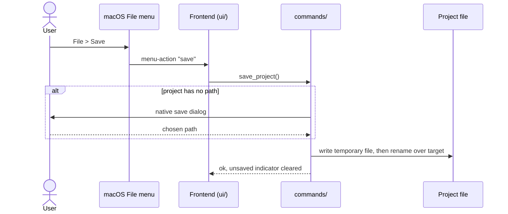
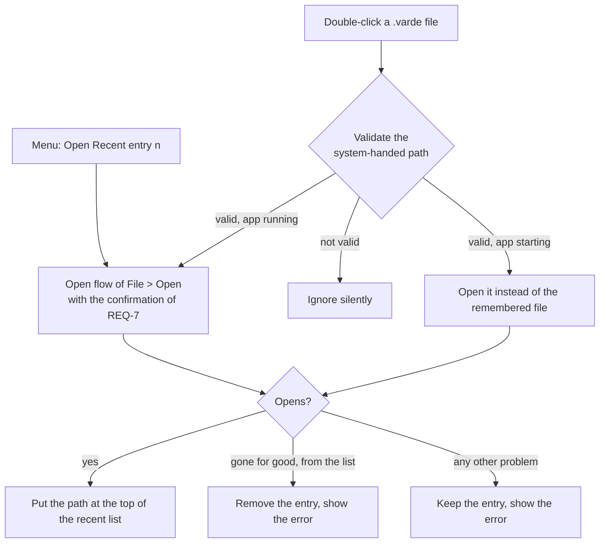

# CSD-002: Project file (save, open, new)

## 1. Intent
The app keeps all of the user's data in one local project file instead of a database. Without a clear save model, users can lose edits or overwrite good data with bad. This capability defines how a project is created, opened, saved and protected against accidental loss. It applies to all app data, starting with the employment income of CSD-001, and it is for a single user working on one project at a time.

## 2. Scope
### 2.1 In scope
- New, Open, Save and Save As for the project file, as items of the native macOS File menu.
- Unsaved-changes tracking and the confirmations that protect unsaved data.
- Safe writing, so a failed save never damages an existing file.
- The project file format: its sections, the strict schema and its versioning.
- Saving never overwriting another file without confirmation, and the file extension.
- Reopening the last used project when the app starts.
- An Open Recent list in the File menu and opening a `.varde` file by double-clicking it in Finder or Explorer (REQ-31 to REQ-36, GitHub issue 69).
- Autosave: writing the project file after every change of project data, as an application preference that is on by default (REQ-23 to REQ-26, GitHub issue 71).
- A synthetic example project file in the repository that shows every area (REQ-21, REQ-22).

### 2.2 Non-goals
- NG-1: Encryption of the project file. (Remembering the last used file moved into scope in v0.4: REQ-8, REQ-10, REQ-11.)
- NG-2: Recovery features beyond one backup copy (no history of backups, no restore button, no hidden scratch file for a project without a path). Since v3.3 the app keeps one backup copy of a project file per session (REQ-28). Autosave itself is in scope since v3.2 (REQ-23 to REQ-26); it writes the project file, and the backup of REQ-28 once per session. The one-off script of REQ-20 writes its own backup copy before it changes a file. The in-memory undo history of CSD-027 is not a backup: it is never written to disk and ends when the project is replaced or the app quits.
- NG-3: Multiple projects open at once.
- NG-4: Cloud sync or sharing of the file.
- NG-5: Buttons for these actions inside the app window, and a recent list shown inside the app window. (The Open Recent submenu of the native File menu is in scope since v3.5, REQ-31 to REQ-33.)
- NG-6: (removed in v3.5) Remembering more than one file and opening a file by double-clicking it are in scope: REQ-31 to REQ-36, GitHub issue 69.
- NG-7: Migrating project files of an older or newer format inside the app. There is no migration framework in the app. The one exception inside the app is the upgrade of a version 4 file to version 5 on opening, which only adds an empty section (REQ-30, owner decision of 22/11/2026, after the first release). The one exception outside the app is a one-off script outside the app that upgrades a file by hand (REQ-20), because the first changes of the schema after the release (the opening of a debt, CSD-011 REQ-30, and the origin of a settlement, CSD-026 v3.0) make older files with debts invalid.
- NG-8: An "Open example project" item or any other way to reach the example file from inside the app (GitHub issue 30 follow-up). The example is a file in the repository.

## 3. Definitions
| Term | Meaning |
|---|---|
| **Project** | All app data held in memory, plus an optional path to its file. |
| **Project file** | A JSON file with the extension `.varde` holding the project. Its sections and versioning are in REQ-16 to REQ-18. |
| **Gone for good** | The remembered project file does not exist while its parent folder exists and can be read (for example the file was deleted). Any other reason the file cannot be opened is *transient* or a problem of the file itself, and the remembered path is kept (REQ-13). |
| **Recent list** | The paths of the last 10 project files that were opened or saved, newest first, without duplicates (REQ-31). Its first entry is the remembered project of REQ-8 and REQ-10. |
| **System-handed path** | A path the operating system gives the app because the user double-clicked a `.varde` file (macOS: the open-file event; Windows: the command line argument). It is untrusted input (REQ-35). |
| **Unsaved changes** | The in-memory project differs from the last saved or opened state. |
| **Unsaved indicator** | The dot `●` after the file name in the window title (CSD-024 REQ-9). It is the only indicator: the app shows no status text in the left pane. |
| **Autosave** | The application preference "Autosave" (REQ-24). While it is on and the project has a path, the app writes the project file after every step (REQ-23). |
| **Step** | One confirmed user action that changed project data, as defined in CSD-027 (one saved form, one confirmed delete, one import), however many records it changed. |

Unless a scenario says "autosave is on", the scenarios of this CSD, and those of CSD-024 and CSD-027 that mention saving, describe the app with autosave off, where only the user's own Save writes the file. With autosave on, REQ-23 to REQ-26 apply on top.

## 4. Requirements

### 4.0 Overview flow


**REQ-1: Save** *(event-driven)*
When the user saves, the app shall write all project data to the project file and clear the unsaved indicator, asking for a path in a native save dialog when the project has no path yet or when the user chose Save As.

```gherkin
@AC-1.1
Scenario: Save and reload round-trips
  Given 2 jobs with 5 paychecks in total
  When the user saves to a chosen path and then opens that file in a fresh session
  Then the same 2 jobs and 5 paychecks exist with identical values

@AC-1.2
Scenario: Write failure keeps changes unsaved
  Given unsaved changes
  And the chosen path is not writable
  When the user saves
  Then an error with code "PROJECT_SAVE_FAILED" and no file path or OS detail is shown
  And the unsaved indicator remains

@AC-1.3
Scenario: Path is asked once, then reused
  Given a new project with a job and no path
  When the user saves
  Then a native save dialog is shown and the file is written to the chosen path
  When the user adds a second job and saves again
  Then no dialog is shown and the same file is overwritten

@AC-1.4
Scenario: Save As asks again
  Given a project saved to "example-a.varde"
  When the user chooses Save As and picks "example-b.varde"
  Then "example-b.varde" contains the data
  And later saves go to "example-b.varde"

@AC-1.5
Scenario: Cancelling the dialog saves nothing
  Given a new project with a job and no path
  When the user saves and cancels the native save dialog
  Then no file is written
  And the unsaved indicator remains

@AC-1.6
Scenario: The project is saved with the extension .varde
  Given a new project with a job and no path
  When the user saves it as "example-a"
  Then the file "example-a.varde" is written
```

**REQ-2: Open** *(event-driven)*
When the user opens a project file through a native open dialog, the app shall replace the in-memory project with the file's contents.

```gherkin
@AC-2.1
Scenario: Open valid file
  Given a valid project file with 1 job and 2 paychecks
  When the user opens it
  Then 1 job and 2 paychecks are shown

@AC-2.2
Scenario: Invalid file is rejected
  Given a file that is not a valid project file
  And the app holds 1 job in memory
  When the user opens it
  Then an error with code "PROJECT_INVALID_FILE" is shown
  And the 1 job in memory is unchanged

# @AC-2.3 (removed in v1.0): a file from a newer app version has its own error, see AC-18.1.
```

**REQ-3: Unsaved-changes indicator (the dot in the window title)** *(state-driven)*
While the in-memory project differs from the last saved or opened state, the app shall show the unsaved indicator, the dot after the file name in the window title (CSD-024 REQ-9).

```gherkin
@AC-3.1
Scenario: Indicator follows edits
  Given a freshly opened project
  Then no unsaved indicator is shown
  When the user adds a job
  Then the unsaved indicator is shown
  When the user saves
  Then the unsaved indicator is cleared

@AC-3.2
Scenario: Indicator follows undo and redo (CSD-027)
  Given a freshly opened project
  When the user adds a job and chooses Edit > Undo
  Then no unsaved indicator is shown
  When the user chooses Edit > Redo
  Then the unsaved indicator is shown

@AC-3.3
Scenario: With autosave on the indicator stays off for a saved project
  Given autosave is on and the project file "example-a.varde" is open
  When the user adds a job
  Then no unsaved indicator is shown

@AC-3.4
Scenario: With autosave on a project without a path still shows the indicator
  Given autosave is on and a new project with no path
  When the user adds a job
  Then the unsaved indicator is shown
```

**REQ-4: Confirm close with unsaved changes** *(event-driven)*
When the user closes the app while the unsaved-changes indicator is shown, the app shall ask for confirmation before closing.

```gherkin
@AC-4.1
Scenario: Close prompts
  Given unsaved changes
  When the user closes the app
  Then a confirmation is asked
  And choosing "cancel" keeps the app open with its data

@AC-4.2
Scenario: Close without changes
  Given no unsaved changes
  When the user closes the app
  Then the app closes without asking

@AC-4.3
Scenario: With autosave on a saved project closes without asking
  Given autosave is on and the project file "example-a.varde" is open
  When the user adds a job and closes the app
  Then the app closes without asking
  And "example-a.varde" holds the job

@AC-4.4
Scenario: A failed autosave still asks before closing
  Given autosave is on and the last autosave failed (AC-26.1)
  When the user closes the app
  Then a confirmation is asked
```

**REQ-5: Failed save leaves the file intact** *(unwanted behaviour)*
If writing the project file fails, then the app shall leave any existing file at that path unchanged.

```gherkin
@AC-5.1
Scenario: Interrupted write does not corrupt the file
  Given "example-a.varde" holds 1 job
  And the project in memory has 2 jobs
  When the write fails part-way
  Then "example-a.varde" still holds exactly 1 job
  And the error code "PROJECT_SAVE_FAILED" is shown
```

**REQ-6: New project** *(event-driven)*
When the user starts a new project, the app shall replace the in-memory project with an empty one that has no path.

```gherkin
@AC-6.1
Scenario: New project is empty
  Given a project with 1 job saved to "example-a.varde"
  When the user starts a new project
  Then no jobs exist
  And the next save asks for a path

@AC-6.2
Scenario: Saved file is untouched by New
  Given a project with 1 job saved to "example-a.varde"
  When the user starts a new project and then closes it without saving
  Then "example-a.varde" still holds 1 job
```

**REQ-7: Confirm before replacing unsaved data** *(event-driven)*
When the user starts a new project or opens a file while the unsaved-changes indicator is shown, the app shall ask for confirmation before replacing the in-memory project.

```gherkin
@AC-7.1
Scenario: Open prompts when unsaved
  Given unsaved changes
  When the user chooses Open
  Then a confirmation is asked before the open dialog
  And choosing "cancel" keeps the current data

@AC-7.2
Scenario: New project without unsaved changes
  Given no unsaved changes
  When the user starts a new project
  Then no confirmation is asked
```

**REQ-8: Reopen last project** *(event-driven)*
When the app starts, the app shall open the project file that was last opened or saved (the first entry of the recent list, REQ-31), or start with an empty project that has no path if there is none. A file handed over by the system comes first (REQ-36).

```gherkin
@AC-8.1
Scenario: First launch has nothing to reopen
  Given no project file was ever opened or saved
  When the app starts
  Then no jobs exist
  And no path is set

@AC-8.2
Scenario: The last project is reopened
  Given a project with 1 job was saved to "example-a.varde" in an earlier session
  When the app starts
  Then 1 job exists
  And the path is "example-a.varde"
  And no unsaved indicator is shown
```

**REQ-9: File menu** *(ubiquitous)*
The app shall offer New, Open, Save and Save As as items of the native macOS File menu with the shortcuts ⌘N, ⌘O, ⌘S and ⇧⌘S, and shall not offer them as buttons in the app window.

```gherkin
@AC-9.1
Scenario: Menu items and shortcuts exist
  Given the app has started
  Then the File menu contains "New" with ⌘N, "Open…" with ⌘O, "Save" with ⌘S and "Save As…" with ⇧⌘S

@AC-9.2
Scenario: Choosing a menu item runs the action
  Given a new project with a job and no path
  When the user chooses File > Save
  Then a native save dialog is shown
  And after choosing a path the unsaved indicator is cleared

@AC-9.3
Scenario: No buttons in the window
  Given the app has started
  Then the app window has no New, Open, Save or Save As buttons
  And the window title still shows the unsaved dot when there are unsaved changes (CSD-024 REQ-9)

@AC-9.4
Scenario: Menu actions respect unsaved changes
  Given unsaved changes
  When the user chooses File > New or File > Open…
  Then a confirmation is asked before the project is replaced
```

**REQ-10: Remember the last project** *(event-driven)*
When a project is opened, saved or saved under a new name, the app shall remember its path for the next start (it becomes the first entry of the recent list, REQ-31), and shall leave the remembered path unchanged when the user starts a new project.

```gherkin
@AC-10.1
Scenario: Save remembers the path
  Given a new project with a job
  When the user saves it to "example-a.varde"
  Then the next start reopens "example-a.varde"

@AC-10.2
Scenario: Open and Save As move the remembered path
  Given "example-a.varde" and "example-b.varde" exist
  When the user opens "example-a.varde" and then saves it as "example-c.varde"
  Then the next start reopens "example-c.varde"

@AC-10.3
Scenario: New project keeps the remembered path
  Given a project saved to "example-a.varde"
  When the user starts a new project and quits without saving
  Then the next start reopens "example-a.varde"

@AC-10.4
Scenario: A failed save does not change the remembered path
  Given a project saved to "example-a.varde"
  When the user chooses a path that is not writable and saving fails
  Then the next start still reopens "example-a.varde"
```

**REQ-11: Remembered file cannot be reopened** *(unwanted behaviour)*
If the remembered project file (the first entry of the recent list) cannot be opened at start, then the app shall start with an empty project that has no path and show a notice once for that start, without the file path.

```gherkin
@AC-11.1
Scenario Outline: The file cannot be opened
  Given the remembered file "example-a.varde" is <problem>
  When the app starts
  Then no jobs exist and no path is set
  And a notice with code "<code>" is available once
  And the notice text does not contain the file path

  Examples:
    | problem                                              | code                 |
    | deleted, while its folder still exists               | PROJECT_OPEN_FAILED  |
    | on a drive that is not mounted                       | PROJECT_OPEN_FAILED  |
    | in a folder that no longer exists                    | PROJECT_OPEN_FAILED  |
    | not a valid project file                             | PROJECT_INVALID_FILE |
    | from a newer version of the app (format_version 6)   | PROJECT_FILE_NEWER   |

# @AC-11.2 (removed in v1.0): the notice is not repeated once the path is forgotten, see AC-12.2.
```

**REQ-12: Forget a remembered file that is gone for good** *(unwanted behaviour)*
If the remembered project file cannot be opened at start because its parent folder exists and the file does not, then the app shall forget the remembered path.

```gherkin
@AC-12.1
Scenario: A deleted file in an existing folder is forgotten
  Given the remembered file "example-a.varde" was deleted
  And its folder "example-folder" exists
  When the app starts
  Then a notice with code "PROJECT_OPEN_FAILED" is shown once
  And the remembered path is forgotten

@AC-12.2
Scenario: The error is not repeated
  Given the remembered path was forgotten at the last start (AC-12.1)
  When the app starts again
  Then no notice is shown
  And no jobs exist and no path is set
```

**REQ-13: Keep the remembered path in every other case** *(unwanted behaviour)*
If the remembered project file cannot be opened at start for any reason other than the one of REQ-12 (its parent folder is missing or cannot be read, or the file exists but is invalid or from a newer version of the app), then the app shall keep the remembered path.

```gherkin
@AC-13.1
Scenario: An unmounted drive does not make the app forget the project
  Given the remembered file "example-a.varde" is on a drive that is not mounted
  When the app starts
  Then an error notice with code "PROJECT_OPEN_FAILED" is shown once
  And the remembered path is still "example-a.varde"

@AC-13.2
Scenario: The project is back at the next start
  Given the remembered file was on a drive that was not mounted at the last start
  And the drive is mounted again
  When the app starts
  Then the project of "example-a.varde" is opened
  And no notice is shown

@AC-13.3
Scenario Outline: A file that exists but cannot be used keeps its path
  Given the remembered file "example-a.varde" exists and is <problem>
  When the app starts
  Then an error notice with code "<code>" is shown once
  And the remembered path is still "example-a.varde"

  Examples:
    | problem                                            | code                 |
    | not a valid project file                           | PROJECT_INVALID_FILE |
    | from a newer version of the app (format_version 6) | PROJECT_FILE_NEWER   |

@AC-13.4
Scenario Outline: A parent folder that is missing or unreadable keeps the path
  Given the remembered file is "example-folder/example-a.varde"
  And the folder "example-folder" is <state>
  When the app starts
  Then an error notice with code "PROJECT_OPEN_FAILED" is shown once
  And the remembered path is still "example-folder/example-a.varde"

  Examples:
    | state                  |
    | missing                |
    | not readable           |
```

**REQ-14: Saving never overwrites another file silently** *(event-driven)*
When the user chooses a path in the save dialog (first save or Save As) where a file already exists, the app shall ask for confirmation before overwriting it, and shall leave the existing file unchanged when the user declines.

```gherkin
@AC-14.1
Scenario: Save As onto an existing file asks first
  Given a project saved to "example-a.varde"
  And a file "example-b.varde" exists
  When the user chooses Save As and picks "example-b.varde"
  Then a confirmation is asked before "example-b.varde" is overwritten

@AC-14.2
Scenario: Declining keeps the existing file
  Given a file "example-b.varde" holding 1 job
  And a project with 2 jobs
  When the user saves it to "example-b.varde" and declines the confirmation
  Then "example-b.varde" still holds exactly 1 job
  And the unsaved indicator remains

@AC-14.3
Scenario: Saving to the project's own file needs no confirmation
  Given a project saved to "example-a.varde"
  When the user chooses Save
  Then no confirmation is asked
```

**REQ-15: The extension .varde** *(event-driven)*
When the user saves under a name that does not end in `.varde`, the app shall append `.varde` to the name before writing.

```gherkin
@AC-15.1
Scenario Outline: The extension is appended
  Given a new project with a job
  When the user saves it as "<typed>"
  Then the file "<written>" is written

  Examples:
    | typed           | written             |
    | example-a       | example-a.varde     |
    | example-a.varde | example-a.varde     |

@AC-15.2
Scenario: A name that exists only after appending asks first
  Given a file "example-a.varde" exists
  When the user saves a project as "example-a"
  Then a confirmation is asked before "example-a.varde" is overwritten
```

**REQ-16: Sections of the project file** *(ubiquitous)*
The project file shall hold a `format_version` and the sections `income`, `investments`, `bank_accounts`, `debts`, `expenses`, `houses`, `settings`, `transactions`, `transaction_accounts`, `transaction_categories`, `transaction_rules` and `budgets`, and every section shall be present in every file the app writes.

```gherkin
@AC-16.1
Scenario: A saved empty project has every section
  Given a new project
  When the user saves it to "example-a.varde"
  Then the file has "format_version" 5
  And the file has the sections "income", "investments", "bank_accounts", "debts", "expenses", "houses", "settings", "transactions", "transaction_accounts", "transaction_categories", "transaction_rules" and "budgets"
```

**REQ-17: Strict schema** *(unwanted behaviour)*
If a project file lacks a section, or holds a field the app does not know, then the app shall reject the file with the error code `PROJECT_INVALID_FILE` and leave the in-memory project unchanged.

```gherkin
@AC-17.1
Scenario Outline: A file that does not match the schema is rejected
  Given a project file <problem>
  And the app holds 1 job in memory
  When the user opens it
  Then an error with code "PROJECT_INVALID_FILE" is shown
  And the 1 job in memory is unchanged

  Examples:
    | problem                                             |
    | without the section "settings"                      |
    | without the section "houses"                        |
    | with an extra top-level field "notes"               |
    | with an extra field inside the section "income"     |
    | with a debt that has no "opening_date"              |
    | with a debt that has no "opening_amount"            |
```

**REQ-18: Newer file version** *(unwanted behaviour)*
If the `format_version` of a project file is higher than the version the app understands, then the app shall reject the file with the error code `PROJECT_FILE_NEWER`, whose message says that the file was made by a newer version of the app, and leave the in-memory project unchanged.

```gherkin
@AC-18.1
Scenario: File from a newer app version is rejected with its own message
  Given a project file with "format_version" 6 and the app understands version 5
  And the app holds 1 job in memory
  When the user opens it
  Then an error with code "PROJECT_FILE_NEWER" is shown
  And the message says the file is from a newer version of the app
  And the 1 job in memory is unchanged

@AC-18.2
Scenario Outline: A missing or zero version is an invalid file
  Given a project file with "format_version" <version>
  When the user opens it
  Then an error with code "PROJECT_INVALID_FILE" is shown

  Examples:
    | version |
    | 0       |
    | absent  |

@AC-18.3
Scenario: A version 1 file is refused as older until the script has upgraded it
  Given a project file with "format_version" 1
  When the user opens it
  Then an error with code "PROJECT_FILE_OLDER" is shown
  And the in-memory project is unchanged
```

**REQ-19: Amounts in the file are strict** *(unwanted behaviour)*
If a project file holds an amount that is not a decimal string with at most two decimals, then the app shall reject the file with the error code `PROJECT_INVALID_FILE` and leave the in-memory project unchanged, without rounding the amount.

```gherkin
@AC-19.1
Scenario Outline: A file amount with more than two decimals is rejected, not rounded
  Given a project file with a bank account entry whose balance is "<balance>"
  And the app holds 1 job in memory
  When the user opens it
  Then an error with code "PROJECT_INVALID_FILE" is shown
  And the 1 job in memory is unchanged

  Examples:
    | balance  |
    | 2500.505 |
    | 0.001    |
    | -1.234   |

@AC-19.2
Scenario: Trailing zeros in a file amount are accepted
  Given a project file with a bank account entry whose balance is "2500.500"
  When the user opens it
  Then the project opens and the entry has balance 2500.50
```

Only text typed in a form is rounded (CSD-000 CON-8), because the app itself only ever writes amounts with two decimals.

**REQ-20: A one-off script upgrades a file with debts to the current format** *(event-driven)*
When the owner runs the script `scripts/migrate-debt-opening.mjs` on a project file with a `format_version` below 2, or in which a debt has no `opening_date` and `opening_amount`, the script shall first write a copy of the file next to it with the extension `.bak` added, and then write, for each debt without an opening, the opening date as the first day of the period of its first statement (`2025-03` gives `2025-03-01`, `2025` gives `2025-01-01`) and the opening amount as the balance of that statement, and for a debt without statements the day the script runs and `0.00`, and shall list the names of the debts without statements. The script shall also give every settlement the `origin` `Sale` when its debt has a house link and `Manual` when it has none, and set `format_version` to 2. The script shall also add the `transactions`, `transaction_categories` and `transaction_rules` sections (no transactions, the default categories and rules of CSD-032 REQ-8 and REQ-9) when they are missing, and set `format_version` to 3 (CSD-032 REQ-17); the `.bak` rule is unchanged. The script shall not run when the file has `format_version` 3 and every debt has an opening and every settlement an origin, and shall leave the original file unchanged when anything fails.

```gherkin
@AC-20.1
Scenario: Opening derived from the first statement
  Given a project file with the monthly debt "Example Mortgage" with statements for 2025-03 (balance 190000.00) and 2025-04 (balance 189000.00) and no opening
  When the owner runs the script on it
  Then the file holds for "Example Mortgage" the "opening_date" "2025-03-01" and the "opening_amount" "190000.00"
  And a copy of the original exists beside it with the extension ".bak" added
  And the app opens the upgraded file

@AC-20.2
Scenario: A yearly debt
  Given a project file with the yearly debt "Example Student Loan" with a statement for 2024 (balance 8000.00) and no opening
  When the owner runs the script on it
  Then the debt has the "opening_date" "2024-01-01" and the "opening_amount" "8000.00"

@AC-20.3
Scenario: A debt without statements
  Given a project file with the debt "Example Card" without statements and without an opening
  When the owner runs the script on it on 04/11/2026
  Then the debt has the "opening_date" "2026-11-04" and the "opening_amount" "0.00"
  And the script lists "Example Card" as a debt to correct in the app

@AC-20.6
Scenario: Settlements get an origin
  Given a project file with "format_version" 1 in which the debt "Example Loan" is linked to "Example House" and has a settlement, and the debt "Example Card" has no house link and has a settlement, and every debt has an opening
  When the owner runs the script on it
  Then the settlement of "Example Loan" has the "origin" "Sale" and the settlement of "Example Card" has the "origin" "Manual"
  And the file has "format_version" 2
  And a copy of the original exists beside it with the extension ".bak" added
  And the app opens the upgraded file

@AC-20.4
Scenario: Nothing to do
  Given a project file with "format_version" 2 in which every debt has an opening and every settlement an origin
  When the owner runs the script on it
  Then the script reports that nothing needs upgrading
  And the file and its modification time are unchanged and no copy is made

@AC-20.5
Scenario: A failure changes nothing
  Given a project file that is not valid JSON
  When the owner runs the script on it
  Then the script reports an error
  And the original file is unchanged
```

**REQ-21: The example project file** *(ubiquitous)*
The repository shall contain one synthetic project file, `examples/example.varde`, that the app opens, that holds records in every area, that shows every state the approved CSDs describe for each area, and that has only fake names (each starting with "Example") and dates and periods from 2023-01 to 2026-10, and it shall be the only `*.varde` file tracked by git.

```gherkin
@AC-21.1
Scenario: The example opens and every area has records
  Given the file "examples/example.varde"
  When the app opens it
  Then the project has no unsaved changes
  And the project currency is "EUR"
  And jobs, paychecks, investment accounts and statements, bank accounts and entries, debts and statements, houses and valuations and expenses are listed

@AC-21.2
Scenario: The example shows every state
  Given the file "examples/example.varde"
  Then it holds a monthly and a yearly job, a job with an end date and a job without a title
  And a monthly and a yearly investment account and bank account
  And an expense in each of the 8 categories
  And a house that was sold on 10/06/2026 and a house that is held
  And debts of the categories "Mortgage", "Loan", "Scholarship" and "Other"
  And a debt settled as "Repaid" and a debt settled as "Cancelled" by the sale of their house
  And a debt closed by hand

@AC-21.3
Scenario: The example is synthetic and inside its window
  Given the file "examples/example.varde"
  Then every employer and every name starts with "Example"
  And no date or period lies before 2023-01 or after 2026-10

@AC-21.4
Scenario: Only the example is tracked
  Given the git repository
  When the tracked files with the extension ".varde" are listed
  Then the list is exactly "examples/example.varde"
```

**REQ-22: The example is generated** *(unwanted behaviour)*
If `examples/example.varde` differs from the output of its generator, then the Rust tests shall fail, and a run with the environment variable `EXAMPLE_UPDATE` set shall rewrite the file.

```gherkin
@AC-22.1
Scenario: The committed example is what the generator writes
  Given the generator builds the example project through the commands the UI calls, with fixed ids and a fixed "today" of 15/10/2026
  When the generated text is compared with "examples/example.varde"
  Then they are identical
  And a difference fails the test with the hint "EXAMPLE_UPDATE=1 cargo test example"
```

### 4.1 Autosave (GitHub issue 71)

**REQ-23: Autosave after every step** *(state-driven)*
While autosave is on and the project has a path, when a step changes project data, the app shall write all project data to the project file as in REQ-1, once per step and straight after it, and clear the unsaved indicator. Project data is everything in the project file (REQ-16), including the project currency (CSD-003). Undo and redo (CSD-027) are steps. Application preferences (theme, language, number format, discrete mode, autosave) are not project data and never write the project file.

```gherkin
@AC-23.1
Scenario: A change is written at once
  Given autosave is on and the project file "example-a.varde" is open
  When the user adds a job
  Then "example-a.varde" holds the job
  And no unsaved indicator is shown

@AC-23.2
Scenario: One step is one write
  Given autosave is on and the project file "example-a.varde" is open
  When the user imports a transaction file with 100 rows (CSD-032)
  Then the project file was written once
  When the user deletes a bank account with 5 statements
  Then the project file was written once more

@AC-23.3
Scenario: Undo and redo are written
  Given autosave is on and the user added a job to "example-a.varde"
  When the user chooses Edit > Undo
  Then "example-a.varde" holds no job
  When the user chooses Edit > Redo
  Then "example-a.varde" holds the job

@AC-23.4
Scenario: The project currency is written
  Given autosave is on and the project file "example-a.varde" is open
  When the user changes the project currency
  Then "example-a.varde" holds the new currency

@AC-23.5
Scenario: A project without a path writes nothing
  Given autosave is on and a new project with no path
  When the user adds a job
  Then no file is written and no dialog is shown
  And the unsaved indicator is shown

@AC-23.6
Scenario: After the first Save, autosave takes over
  Given autosave is on and a new project with a job and no path
  When the user saves to "example-a.varde" through the native save dialog
  And adds a second job
  Then "example-a.varde" holds both jobs
  And no dialog is shown

@AC-23.7
Scenario: Save As moves autosave to the new path
  Given autosave is on and the project was saved to "example-a.varde"
  When the user chooses Save As and picks "example-b.varde" and then adds a job
  Then "example-b.varde" holds the job
  And "example-a.varde" is unchanged

@AC-23.8
Scenario: Opening, preferences and failed forms write nothing
  Given autosave is on and the project file "example-a.varde" is open
  When the user changes the theme or the language
  Or a form is rejected with a validation error
  Or the user opens another project file
  Then no project file is written because of it
```

**REQ-24: The Autosave preference** *(ubiquitous)*
The app shall offer a switch "Autosave" on the Settings page, kept as an application preference in the preference file (CSD-008 CON-1), outside the project file. It is on when the preference file is missing, unreadable or holds no valid `autosave` value, so it is on by default, also for users whose preference file predates it. With autosave off the app behaves as before v3.2: only Save and Save As write the project file.

```gherkin
@AC-24.1
Scenario Outline: Autosave is on by default
  Given the preference file is <case>
  When the app starts
  Then the "Autosave" switch is on

  Examples:
    | case                              |
    | missing                           |
    | {"theme": "dark"}                 |
    | {"autosave": "yes"}               |
    | not JSON                          |

@AC-24.2
Scenario: The choice is remembered
  Given the "Autosave" switch is on
  When the user switches it off and restarts the app
  Then the "Autosave" switch is off

@AC-24.3
Scenario: With autosave off only Save writes
  Given autosave is off and the project file "example-a.varde" is open
  When the user adds a job
  Then "example-a.varde" does not hold the job
  And the unsaved indicator is shown
  When the user saves
  Then "example-a.varde" holds the job

@AC-24.4
Scenario: The preference cannot be saved
  Given the config folder is read-only and the "Autosave" switch is on
  When the user switches it off
  Then the switch shows on again
  And a message with the error code "PREFERENCES_SAVE_FAILED" and no file path is shown

@AC-24.5
Scenario: The switch is in Dutch and English
  Given the language is Dutch
  When the user opens the Settings page
  Then the switch is labelled in Dutch
```

**REQ-25: Switching autosave on or off** *(event-driven)*
When the user switches autosave on while the project has a path and unsaved changes, the app shall write the project file at once and clear the unsaved indicator. When the user switches it off, the app shall change nothing on disk.

```gherkin
@AC-25.1
Scenario: Switching on saves what is pending
  Given autosave is off and "example-a.varde" is open with an unsaved job
  When the user switches autosave on
  Then "example-a.varde" holds the job
  And no unsaved indicator is shown

@AC-25.2
Scenario: Switching on without a path writes nothing
  Given autosave is off and a new project with a job and no path
  When the user switches autosave on
  Then no file is written and no dialog is shown
  And the unsaved indicator is shown

@AC-25.3
Scenario: Switching off changes nothing on disk
  Given autosave is on and "example-a.varde" is open
  When the user switches autosave off
  Then "example-a.varde" is unchanged
```

**REQ-26: A failed autosave keeps the change** *(unwanted behaviour)*
If an autosave write fails, then the app shall keep the change in memory, leave any existing file at that path unchanged (REQ-5), keep the unsaved indicator, show a non-blocking message with the error code `PROJECT_SAVE_FAILED` and no file path or OS detail, and write again after the next step. The user can also retry with Save.

```gherkin
@AC-26.1
Scenario: The write fails
  Given autosave is on and "example-a.varde" is open and its folder is read-only
  When the user adds a job
  Then the job is still shown in the app
  And "example-a.varde" is unchanged
  And the unsaved indicator is shown
  And a non-blocking message with the error code "PROJECT_SAVE_FAILED" is shown, without a file path

@AC-26.2
Scenario: The next step retries
  Given the last autosave failed and the folder is writable again
  When the user adds a second job
  Then "example-a.varde" holds both jobs
  And no unsaved indicator is shown

@AC-26.3
Scenario: Save retries by hand
  Given the last autosave failed and the folder is writable again
  When the user saves
  Then "example-a.varde" holds the job
  And no unsaved indicator is shown
```

**REQ-27: A saved project can always be opened again** *(unwanted behaviour)*
If saving a project would write a file larger than 50 MiB, the largest file the app opens (REQ-2), then the app shall not write it, leave any existing file unchanged (REQ-5), keep the unsaved changes, and show the error code `PROJECT_TOO_LARGE` with a message that says the project is too large and suggests removing data. If an import of transactions (CSD-032 REQ-1) would make the file larger than that, then the app shall add nothing, record no undo step and show the same error.

```gherkin
@AC-27.1
Scenario: A save over the limit writes nothing
  Given "example-a.varde" is open and its file would be larger than 50 MiB after the next save
  When the project is saved, by the user or by autosave
  Then the error code "PROJECT_TOO_LARGE" is shown without a file path
  And "example-a.varde" is unchanged
  And the unsaved indicator is shown

@AC-27.2
Scenario: An import over the limit adds nothing
  Given a project whose file would be larger than 50 MiB with the transactions of "October.csv"
  When the user imports "October.csv"
  Then the error code "PROJECT_TOO_LARGE" is shown
  And no transaction is added and no undo step is recorded

@AC-27.3
Scenario: The limit of saving is the limit of opening
  Then the largest file the app writes is the largest file the app opens, 50 MiB
```

**REQ-28: One backup per file per session** *(event-driven)*
When a project is saved to a file that already exists and the app has not yet saved to that file in this session, the app shall first copy the existing file to the same name with `.bak` appended (`example-a.varde.bak`), replacing an older backup, and shall then write the project. If the copy fails, then the save shall fail with `PROJECT_SAVE_FAILED` and leave the file unchanged. Later saves of the same session do not touch the backup.

```gherkin
@AC-28.1
Scenario: The first save keeps the state the session started with
  Given "example-a.varde" holds 1 job and the user opens it and adds a second job
  When the project is saved
  Then "example-a.varde.bak" holds the file as it was opened, with 1 job
  And "example-a.varde" holds 2 jobs

@AC-28.2
Scenario: Later saves leave the backup alone
  Given the first save of the session made "example-a.varde.bak"
  When the user adds more jobs and saves twice more
  Then "example-a.varde.bak" still holds the file as it was opened

@AC-28.3
Scenario: A new file has no backup
  Given a project saved for the first time to "example-a.varde", a file that did not exist
  When the user saves again
  Then no "example-a.varde.bak" exists

@AC-28.4
Scenario: Save As over another file backs that file up
  Given "example-b.varde" exists with 1 job
  When the user saves another project as "example-b.varde" and confirms
  Then "example-b.varde.bak" holds the old file

@AC-28.5
Scenario: A new project saved over the same file backs it up again
  Given the session already saved "example-a.varde"
  When the user starts a new project and saves it as "example-a.varde" and confirms
  Then "example-a.varde.bak" holds the file as it was before

@AC-28.6
Scenario: The copy fails
  Given the backup cannot be written
  When the project is saved
  Then the error code "PROJECT_SAVE_FAILED" is shown
  And "example-a.varde" is unchanged and the unsaved indicator is shown
```

**REQ-29: An older file has its own error** *(unwanted behaviour)*
If the `format_version` of a project file is at least 1, lower than the version the app understands and not 4 (REQ-30), then the app shall reject the file with the error code `PROJECT_FILE_OLDER`, whose message says that the file was made by an older version of the app and has to be upgraded first, and leave the in-memory project unchanged. A missing or zero version stays `PROJECT_INVALID_FILE` (REQ-18).

```gherkin
@AC-29.1
Scenario Outline: An older file is refused with its own message
  Given a project file with "format_version" <version> and the app understands version 5
  And the app holds 1 job in memory
  When the user opens it
  Then an error with code "PROJECT_FILE_OLDER" is shown
  And the message says the file is from an older version and has to be upgraded first
  And the 1 job in memory is unchanged

  Examples:
    | version |
    | 1       |
    | 2       |
    | 3       |
```

**REQ-30: A version 4 file is upgraded on opening** *(event-driven)*
When the user opens a project file with `format_version` 4, the app shall open it as a version 5 project with an empty `budgets` section (CSD-037 REQ-12), without changing the file on disk and without marking the project unsaved, and the next save shall write it as version 5 after the backup copy of REQ-28. A file with `format_version` 4 that already holds a `budgets` section is invalid (REQ-17).

```gherkin
@AC-30.1
Scenario: A version 4 file opens
  Given a valid project file "old.varde" with "format_version" 4 and a job "Example Employer"
  When the user opens it
  Then the project opens with the job "Example Employer" and no budgets
  And "old.varde" is unchanged and the unsaved indicator is not shown

@AC-30.2
Scenario: The first save writes version 5
  Given the project of AC-30.1 is open
  When the user saves it
  Then "old.varde.bak" is the original version 4 file
  And "old.varde" has "format_version" 5 and the section "budgets"

@AC-30.3
Scenario: A version 4 file with a budgets section
  Given a project file with "format_version" 4 and a "budgets" section
  When the user opens it
  Then it is rejected with error code "PROJECT_INVALID_FILE"

@AC-30.4
Scenario: Older versions are still refused
  Given a project file with "format_version" 3
  When the user opens it
  Then it is rejected with error code "PROJECT_FILE_OLDER"
```

### 4.2 Open Recent and opening a file from the system (GitHub issue 69)



**REQ-31: The recent list** *(event-driven)*
When a project is opened, saved or saved under a new name, the app shall put its path at the top of the recent list, remove an earlier entry of the same path, and keep at most the 10 newest entries. The list is kept in the app's config folder (CON-7), holds paths only, and is the one place where the remembered project of REQ-8 and REQ-10 lives: its first entry is the project reopened at start.

```gherkin
@AC-31.1
Scenario: Open and save put the path on top
  Given the recent list holds "example-a.varde"
  When the user opens "example-b.varde"
  Then the recent list is "example-b.varde", "example-a.varde"
  When the user saves a new project as "example-c.varde"
  Then the recent list is "example-c.varde", "example-b.varde", "example-a.varde"

@AC-31.2
Scenario: A path is listed once
  Given the recent list is "example-b.varde", "example-a.varde"
  When the user opens "example-a.varde"
  Then the recent list is "example-a.varde", "example-b.varde"

@AC-31.3
Scenario: The list keeps 10 entries
  Given the recent list holds 10 entries
  When the user opens an 11th file
  Then the list holds 10 entries, the new one on top
  And the oldest entry is gone

@AC-31.4
Scenario: New project and a failed save change nothing
  Given the recent list holds "example-a.varde"
  When the user starts a new project
  Then the recent list is unchanged
  When the user saves to a path that is not writable and the save fails
  Then the recent list is unchanged

@AC-31.5
Scenario: The first entry is reopened at start
  Given the recent list is "example-b.varde", "example-a.varde"
  When the app starts
  Then the project of "example-b.varde" is opened

@AC-31.6
Scenario: The old single remembered path becomes the list
  Given the config folder holds "last-project.json" with the path "example-a.varde" and no recent list
  When the app starts
  Then "example-a.varde" is opened
  And the recent list holds only "example-a.varde"

@AC-31.7
Scenario: An unusable list file is an empty list
  Given the recent list file is missing, oversized, malformed or holds a relative path
  When the app starts
  Then no project is opened and no notice is shown
  And entries with a relative path are not used

@AC-31.8
Scenario: Only paths are stored, privately
  When the recent list is saved
  Then the file holds paths only, no project data
  And it is written atomically and readable by the owner only
  And no path appears in a log line or in an error message shown to the user
```

**REQ-32: The Open Recent submenu** *(ubiquitous)*
The app shall offer an Open Recent submenu in the native File menu, directly below Open…, on macOS and on Windows. It lists the recent entries newest first by file name, followed by a separator and Clear Menu. It is disabled while the list is empty. When two entries have the same file name, their labels also show the name of the parent folder. The menu is rebuilt after every change of the list.

```gherkin
@AC-32.1
Scenario: The submenu lists the recent files
  Given the recent list is "folder-1/example-a.varde", "folder-2/example-b.varde"
  When the user opens the File menu
  Then Open Recent comes directly below Open…
  And it lists "example-a.varde" and "example-b.varde", then a separator and "Clear Menu"
  And no label shows a full path

@AC-32.2
Scenario: Equal file names are told apart
  Given the recent list is "folder-1/example.varde", "folder-2/example.varde"
  Then the labels are "example.varde — folder-1" and "example.varde — folder-2"

@AC-32.3
Scenario: An empty list disables the submenu
  Given the recent list is empty
  Then Open Recent is disabled

@AC-32.4
Scenario: The menu follows the list
  Given the app is running
  When the user opens a file that is not in the list
  Then the next time the menu is shown it lists that file on top

@AC-32.5
Scenario: Clear Menu empties the list
  Given the recent list holds 3 entries and a project is open
  When the user chooses Clear Menu
  Then the recent list is empty and Open Recent is disabled
  And the open project and its unsaved changes are untouched
  And the next start opens an empty project, because the remembered project was the first entry

@AC-32.6
Scenario: Windows has the same submenu
  Given the app runs on Windows
  Then the File menu lists New, Open…, Open Recent, Save, Save As…, Settings… and Exit (CSD-038 REQ-7)
```

**REQ-33: Choosing a recent file** *(event-driven)*
When the user chooses an entry of the Open Recent submenu, the app shall open that file through the same flow as File > Open, including the confirmation of REQ-7 when there are unsaved changes. The menu item carries the index of the entry, never its path, and the path never reaches the frontend. If the file cannot be opened, then the app shall leave the open project unchanged and show the error of the failure (`PROJECT_OPEN_FAILED`, `PROJECT_INVALID_FILE`, `PROJECT_FILE_NEWER`, `PROJECT_FILE_OLDER`, `PROJECT_TOO_LARGE`) without the path; the entry is removed when the file is gone for good (REQ-12) and kept in every other case (REQ-13).

```gherkin
@AC-33.1
Scenario: A recent file opens
  Given the recent list holds "example-a.varde" with 1 job
  When the user chooses it in Open Recent
  Then 1 job is shown and the path is "example-a.varde"
  And "example-a.varde" is on top of the list

@AC-33.2
Scenario: Unsaved changes are asked about first
  Given unsaved changes
  When the user chooses a recent file
  Then a confirmation is asked before the project is replaced
  And when the user declines, the open project is unchanged and the list is unchanged

@AC-33.3
Scenario: A file that is gone for good is forgotten
  Given the recent list holds "example-a.varde", which was deleted from its existing folder
  And 1 job is open
  When the user chooses it
  Then the error "PROJECT_OPEN_FAILED" is shown without a path
  And the 1 job is unchanged
  And "example-a.varde" is removed from the list

@AC-33.4
Scenario Outline: Any other problem keeps the entry
  Given the recent list holds "example-a.varde", which is <problem>
  When the user chooses it
  Then the error "<code>" is shown without a path and the open project is unchanged
  And "example-a.varde" is still in the list

  Examples:
    | problem                                          | code                 |
    | on a drive that is not mounted                   | PROJECT_OPEN_FAILED  |
    | not a valid project file                         | PROJECT_INVALID_FILE |
    | from a newer version of the app                  | PROJECT_FILE_NEWER   |

@AC-33.5
Scenario: The event carries an index only
  When the user chooses the 3rd entry of Open Recent
  Then the menu event is "recent-open-2"
  And the frontend calls a command with the index and no path
  And an index outside the list is rejected without effect
```

**REQ-34: The .varde file association** *(ubiquitous)*
The app shall register the extension `.varde` with the operating system, so that double-clicking a project file in Finder (macOS) or in Explorer (Windows) starts Varde with that file. The macOS bundle declares the document type, and the per-user Windows installer registers the association and removes it again when the app is uninstalled (CSD-038 REQ-10).

```gherkin
@AC-34.1
Scenario: The bundle declares the document type
  Given the bundle configuration
  Then it declares the extension "varde" with the app as its role
  And it adds no network access and no permission

@AC-34.2
Scenario: Double-clicking starts the app
  Given Varde is installed and not running
  When the user double-clicks "example-a.varde"
  Then Varde starts and opens that file (REQ-36)

@AC-34.3
Scenario: Uninstalling removes the association on Windows
  Given Varde is installed per user on Windows
  When the user uninstalls it
  Then ".varde" no longer opens with Varde
  And the user's project files are untouched
```

**REQ-35: Opening a file while the app runs** *(event-driven)*
When the system hands the running app a file, the app shall open it through the same flow as File > Open, including the confirmation of REQ-7, and shall not open a second window or process: on Windows a second launch passes the path to the running app and exits, and the running window comes to the front. The app shall use a system-handed path only if it is absolute, ends in `.varde` and is a regular file; if several paths are handed over, only the first is used (NG-3); anything else is ignored without a dialog. Errors of opening show as for File > Open.

```gherkin
@AC-35.1
Scenario: A file opens in the running app
  Given the app runs with an empty project
  When the system hands it "example-a.varde" with 1 job
  Then 1 job is shown and "example-a.varde" is on top of the recent list

@AC-35.2
Scenario: Unsaved changes are asked about first
  Given unsaved changes
  When the system hands the app another project file
  Then a confirmation is asked before the project is replaced
  And when the user declines, the open project is unchanged

@AC-35.3
Scenario: Windows keeps one instance
  Given the app runs on Windows
  When the user double-clicks "example-a.varde"
  Then the running window comes to the front and opens that file
  And no second Varde process remains

@AC-35.4
Scenario Outline: A path that is not valid is ignored
  When the system hands the app <path>
  Then nothing is opened, no dialog is shown and the open project is unchanged

  Examples:
    | path                                   |
    | a relative path                        |
    | "example-a.txt"                        |
    | a folder named "example-folder.varde"  |
    | a path that does not exist             |

@AC-35.5
Scenario: Several files open the first one
  When the system hands the app "example-a.varde" and "example-b.varde"
  Then only "example-a.varde" is opened

@AC-35.6
Scenario: The file that is opened has an invalid content
  When the system hands the app a valid path whose content is not a project file
  Then the error "PROJECT_INVALID_FILE" is shown without a path
  And the open project is unchanged and the list is unchanged
```

**REQ-36: Opening a file at start** *(event-driven)*
When the app is started by the system with a file, the app shall open that file instead of the remembered project of REQ-8. If it cannot be opened, then the app shall start with an empty project that has no path, show the startup notice of REQ-11 once without the path, and leave the recent list unchanged.

```gherkin
@AC-36.1
Scenario: The double-clicked file wins
  Given the recent list is "example-a.varde"
  When the app is started by double-clicking "example-b.varde"
  Then the project of "example-b.varde" is opened
  And the recent list is "example-b.varde", "example-a.varde"

@AC-36.2
Scenario: A file that cannot be opened leaves the app empty
  Given the recent list is "example-a.varde"
  When the app is started by double-clicking a file that is not a valid project file
  Then no jobs exist and no path is set
  And a notice with code "PROJECT_INVALID_FILE" is available once, without the path
  And the recent list is still "example-a.varde"

@AC-36.3
Scenario: An invalid path is ignored at start
  Given the recent list is "example-a.varde"
  When the app is started with a path that is not valid (AC-35.4)
  Then the project of "example-a.varde" is opened as at any start (REQ-8)
```

## 5. Interfaces and contracts

Menu: Rust builds the File menu items `project-new`, `project-open`, `project-save` and `project-save-as`. Choosing one emits the event `menu-action` with the item id to the frontend, which runs the flow of the action, including the confirmations of REQ-7.

Open Recent (REQ-31 to REQ-33): Rust builds the submenu from the recent list and rebuilds it after every change of the list. Its items have the ids `recent-open-<index>` (index from 0) and `recent-clear`; `recent-clear` is handled in Rust, and `recent-open-<index>` emits `menu-action` like the other items, so the frontend runs the confirmation of REQ-7 and then calls `open_recent_project(index)`. The command takes the index only and rejects one outside the list. A system-handed path (REQ-35, REQ-36) is validated in Rust and held there as the pending file: it is never sent to the frontend. While the app runs, Rust emits the event `open-file-requested` without a payload, the frontend runs the confirmation of REQ-7 and calls `open_pending_file()`, which opens the pending file and returns like `open_project()`. At start, Rust opens a pending file before the remembered project (REQ-36).

Commands: `take_startup_notice()` (returns the REQ-11 notice once, then nothing), `new_project()`, `open_project()`, `open_recent_project(index)`, `open_pending_file()`, `save_project()`, `save_project_as()`, `project_status()` (returns whether there are unsaved changes and whether a path is set) and `quit_app()` (quits without asking: the frontend has already confirmed, REQ-4). The save and open commands show the native dialog themselves and take no path from the frontend. `open_recent_project` takes an index, never a path.

Project file: JSON with the extension `.varde`, a top-level integer `format_version` (currently 5) and amounts as decimal strings with at most two decimals (CSD-000 CON-8, REQ-19). Each capability owns one section, and all sections are required (REQ-16):

| Section | Capability |
|---|---|
| `income` | Employment income (CSD-001) |
| `investments` | Investments (CSD-005) |
| `bank_accounts` | Bank accounts (CSD-009) |
| `debts` | Debts (CSD-011) |
| `expenses` | Expenses (CSD-013) |
| `houses` | Houses (CSD-015, CSD-019) |
| `settings` | Project settings (CSD-003) |
| `transactions` | Bank transactions (CSD-032) |
| `transaction_categories` | Categories of transactions (CSD-032) |
| `transaction_rules` | Categorisation rules (CSD-032) |
| `budgets` | Budgets per category and month (CSD-037) |

Every period field in a section is called `period` (the pay period of a job, which was `pay_period` and now holds the same Monthly or Yearly value under the name `period`, and the period of an investment account, bank account, debt or house), so the names `pay_period`, `entry_period`, `statement_period` and `valuation_period` do not exist. The preferences of the person (theme, language) are not in the file (CSD-008, CSD-022). A house keeps its purchase as `purchase_date` and `purchase_amount` and its optional sale as `sell_date` and `sell_amount` (CSD-015, CSD-019).

Since `format_version` 3 the file also holds the sections of CSD-032 (`transactions`, `transaction_categories`, `transaction_rules`). A version 2 file is invalid in this app until the script of REQ-20 has upgraded it, and an older app that opens a version 3 file shows `PROJECT_FILE_NEWER`. Transactions can make the file several MB, and it is still saved as one file (CSD-032 CON-5). Since `format_version` 5 the file also holds the section `budgets` (CSD-037 REQ-12); a version 4 file is opened and upgraded in memory with an empty section (REQ-30), and written as version 5 on the next save.

A debt keeps its opening as `opening_date` and `opening_amount`, both required (CSD-011 REQ-30); its closing is the existing `settlement` (CSD-026), which since `format_version` 2 also holds a required `origin`, `Sale` or `Manual`.

Versioning policy: the version is 1 at the first release. The first change of the schema after 1.0 would normally raise `format_version`, so that an older app shows the `PROJECT_FILE_NEWER` error (REQ-18) instead of a generic parse error. Owner decision of 04/11/2026: the opening of a debt (CSD-011 v3.0) does not raise it, and `format_version` stays 1. An older app that opens a file with the new keys therefore shows `PROJECT_INVALID_FILE` (REQ-17), and a version 1 file without openings is invalid in this app until the one-off script of REQ-20 has upgraded it. The next schema change shall raise the version, and the `origin` of a settlement (CSD-026 v3.0) is that change: `format_version` is 2 from v2.0 of this CSD, a version 1 file is invalid in this app until the script of REQ-20 has upgraded it (AC-18.3), and an older app that opens a version 2 file shows `PROJECT_FILE_NEWER`. There is no migration in the app (NG-7). The app keeps one backup copy per file per session (REQ-28, NG-2).

The script `scripts/migrate-debt-opening.mjs` has no dependency (Node only), takes the path of the file as its argument, upgrades a file to `format_version` 3 (openings of debts, the `origin` of settlements and the empty transaction sections with their default categories and rules, REQ-20 and CSD-032 REQ-17), prints the names of debts without statements and no amounts, and is tested with a synthetic file ("Example Mortgage", round amounts) by `node:test` in `npm test`.

Autosave (REQ-23 to REQ-26): Rust does the autosave, inside the command layer, after a command or an undo or redo has changed the project and before it returns, with the same atomic write as Save. The frontend never triggers it and never writes a file. A command whose autosave failed still succeeds (the change is kept) and reports the failed write next to its result, so the frontend can show the non-blocking message; `project_status()` keeps returning the unsaved flag. The preference is `autosave` (boolean) in `preferences.json`, read on its own like the other preferences (CSD-008 section 5); `get_preferences()` also returns it and `set_autosave(enabled)` saves it, and when it switches autosave on with a path and unsaved changes it writes the project file before it returns (REQ-25). The window title and the confirmations follow the unsaved flag and need no change (CSD-024 REQ-9, REQ-4, REQ-7).

Error codes (code plus safe message): `PROJECT_SAVE_FAILED` (Save and a failed autosave alike, and a failed backup), `PROJECT_TOO_LARGE`, `PROJECT_INVALID_FILE`, `PROJECT_OPEN_FAILED`, `PROJECT_FILE_NEWER`, `PROJECT_FILE_OLDER`. `PREFERENCES_SAVE_FAILED` (CSD-008) is shown when the Autosave preference cannot be saved.

## 6. Constraints
- CON-1: The project file is plain, unencrypted JSON, written by writing a temporary file and renaming it over the target. It is never committed (`*.varde` is git-ignored), with one exception: the synthetic `examples/example.varde` (REQ-21), which `.gitignore` re-includes by its exact path. Rationale: a project file holds real financial data and the repo is public. The atomic write backs REQ-5.
- CON-2: File access uses only the Tauri dialog plugin, opened from Rust, so no dialog permission is granted to the webview. There is no `fs` plugin, and file paths never come from the frontend. Rationale: least privilege per `CLAUDE.md`. Adding the plugin still needs approval at implementation time.
- CON-3: Amounts in the file are decimal strings with at most two decimals (CSD-000 CON-8) and are never rounded when read: a file amount with more than two decimals is invalid (REQ-19), only typed text is rounded. The file carries `format_version`. A newer version than the app knows is rejected (REQ-18). Rationale: no float rounding, and a clear message instead of a parse error.
- CON-4: Errors shown to the user never contain file paths or OS details. Rationale: `CLAUDE.md` error rules.
- CON-5: Tests use a temporary directory and synthetic data only, never real app data or real financial data. Rationale: `CLAUDE.md` testing and privacy rules, and the repo is public.
- CON-6: The menu, including the Open Recent submenu, uses Tauri's built-in menu API: no plugin and no extra permission. It keeps the standard macOS menus (app, Edit, View, Window), because the Edit menu is what makes copy, paste and undo work in text fields. Its predefined Undo and Redo items are replaced by the project Undo and Redo of CSD-027, which leave ⌘Z and ⇧⌘Z to a focused text field. Rationale: least privilege per `CLAUDE.md`, and no loss of standard behaviour.
- CON-7: The recent list (REQ-31), which also holds the remembered path, is kept in `recent-projects.json` in the app's own config folder, outside the project file, written like the project file (atomic, owner-only). It holds paths only, never project data, and is never committed. An old `last-project.json` is read once when there is no list and becomes its only entry (AC-31.6). Rationale: it must be readable before any project is open, and it can reveal a user name through the path. It uses Tauri's built-in path API: no plugin and no permission. The application preferences of CSD-008 live in a second file, `preferences.json`, in the same folder under the same rules.

- CON-8: Paths are never logged, never put in an event or a command argument that crosses to the frontend, and never shown in an error (CON-4). Rationale: a path can reveal a user name; `CLAUDE.md` privacy rules.
- CON-9: The file association is a bundle setting in `tauri.conf.json`, and the single instance of REQ-35 on Windows needs `tauri-plugin-single-instance` (a new plugin, Windows only, no webview permission). Both need the owner's approval at implementation time, and the plugin must pass `cargo deny check` (CSD-038 CON-2 and CON-4). The app makes no network call for either. Rationale: `CLAUDE.md` Ask first.

## 7. Verification
The unsaved flag and the project state live in Rust, so they are proven by `cargo test`, with file round-trips in a temporary directory. Tests are named `test_csd002_ac_<n>_<m>_<description>` (CSD-000 REQ-6).

| What | How |
|---|---|
| Rust tests | `cargo test test_csd002_`. One requirement, e.g. REQ-1: `cargo test test_csd002_ac_1_` |
| AC-9.1 | `cargo test test_csd002_ac_9_` checks the table the menu is built from (ids, labels, shortcuts). Native menus can only be created on the main thread, so the built menu is on the manual checklist |
| DOM tests (`npm test`) | `dialogs.test.js`: AC-4.1, AC-7.1, AC-7.2, AC-9.3 (close, Open and New with and without unsaved changes, no buttons in the window); `ac-d-preferences.test.js`: AC-9.2, AC-9.4 (File > Save calls the save, File > New and Open ask first). The unsaved indicator (AC-3.1, AC-3.2) is the dot in the native window title, so it is proven in Rust with CSD-024 AC-9.1 to AC-9.4 (`cargo test test_csd002_ac_3_` and `test_csd024_ac_9_`), no longer by a DOM test. AC-4.2 is decided in Rust (`test_csd002_ac_4_2_...`, the close asks only when `has_unsaved_changes`) |
| Script (REQ-20, AC-20.1 to AC-20.5) | `npm test`: `scripts/tests/migrate-debt-opening.test.js` (`node:test`, synthetic fixtures in a temporary directory) |
| Autosave (REQ-23, REQ-25, REQ-26, AC-3.3, AC-3.4, AC-4.3, AC-4.4) | `cargo test test_csd002_ac_23_` and so on, on a project in a temporary directory with a counting writer for AC-23.2, a read-only folder for AC-26.1 and the Tauri mock runtime for the window title. Synthetic data only |
| Autosave preference (REQ-24) | `cargo test test_csd002_ac_24_` (default, missing or invalid key, remembered, read-only config folder) and a DOM test in `ui/tests/` for the switch, its Dutch label and the message of AC-26.1 and AC-24.4 (`test_csd002_ac_24_...`), with canned answers from the fake bridge |
| Size limit, backup, older file (REQ-27 to REQ-29) | `cargo test test_csd002_ac_27_`, `test_csd002_ac_28_` and `test_csd002_ac_29_` (`storage/project/safety_tests.rs`, and `ipc_transactions_tests.rs` for AC-27.2). The limit is injected in the tests, so no test builds a 50 MiB project |
| Version 4 file upgraded on opening (REQ-30) | `cargo test test_csd002_ac_30_` (`storage/project/`) |
| Recent list and menu (REQ-31 to REQ-33) | `cargo test test_csd002_ac_31_`, `test_csd002_ac_32_` and `test_csd002_ac_33_`: the list store in a temporary directory, the label and id table the submenu is built from (native menus need the main thread), and the command with the Tauri mock runtime. A DOM test in `ui/tests/` covers the confirmation of AC-33.2 with a fake bridge |
| File association and system-handed paths (REQ-34 to REQ-36) | `cargo test test_csd002_ac_34_` (the bundle configuration), `test_csd002_ac_35_` and `test_csd002_ac_36_` (the path validation and the open flow with the mock runtime). The real double-click on macOS and Windows and the single instance (AC-34.2, AC-34.3, AC-35.3) are on the manual checklist and in the first Windows test build |
| Example project (REQ-21, REQ-22) | `cargo test example_project` (`src-tauri/src/example_project_tests.rs`: `test_csd002_ac_21_1_...` to `test_csd002_ac_21_4_...` and `test_csd002_ac_22_1_...`). After a deliberate change of the generator or of the format: `EXAMPLE_UPDATE=1 cargo test example`, then review the diff of `examples/` |
| Manual checklist (native parts only) | The real File menu items and shortcuts (AC-9.1 to AC-9.4), the native save dialog, and a real window close without unsaved changes (AC-4.2: the mock runtime has no event loop to send it) |

Not covered by a named test yet: the new ACs of v3.2 (AC-3.3, AC-3.4, AC-4.3, AC-4.4, AC-23.1 to AC-23.8, AC-24.1 to AC-24.5, AC-25.1 to AC-25.3, AC-26.1 to AC-26.3), because the CSD is `draft` and not implemented yet. Every earlier AC has a test that carries its id; the native parts are on the manual list above.

Done means fmt, clippy (`-D warnings`), `cargo test --all-features` and `npm test` pass.

## 8. Open questions
- OQ-1: (resolved) Tests include the CSD number, `test_csd<NNN>_ac_n_m_...`. CSD-000 is now 2.1 and `CLAUDE.md` uses the same naming.
- OQ-2: (removed in v1.0) Obsolete: the SQLite text in `CLAUDE.md` is gone.
- OQ-3: (resolved 03/11/2026) A typed name without `.varde` gets the extension appended, it is not rejected (REQ-15 stays as written).
- OQ-4: (resolved 03/11/2026) A remembered file is gone for good only when its parent folder exists and the file does not (REQ-12). When the parent folder is missing or cannot be read, the error is transient and the path is kept (REQ-13).
- OQ-5: (resolved 03/11/2026) A remembered file that exists but is invalid or from a newer app version keeps its remembered path and shows the error (REQ-13, AC-13.3).
- OQ-6: (resolved 18/11/2026) Should the app give an older file its own message instead of the generic `PROJECT_INVALID_FILE`? Yes: `PROJECT_FILE_OLDER` (REQ-29).

## 9. Changelog
- 3.5 (27/11/2026): Open Recent and opening a file by double-click (GitHub issue 69): new section 4.2 with REQ-31 to REQ-36 (recent list of 10 paths, the Open Recent submenu with Clear Menu, choosing a recent file, the `.varde` file association, opening while the app runs, opening at start); NG-5 narrowed, NG-6 removed; REQ-8, REQ-10 and REQ-11 point to the recent list; CON-7 moves the remembered path to `recent-projects.json`; new CON-8, CON-9 (single-instance plugin and `tauri.conf.json` need approval); section 5 and 7 follow. Amends CSD-038 (NG-4, REQ-7, CON-2). Owner decisions from the grill-me interview of 27/11/2026. Back to `draft` until re-approved.
- 3.4 (22/11/2026): The project file holds the section `budgets` and has `format_version` 5 (CSD-037 REQ-12, GitHub issue 82); the example of a newer file is version 6 and a version 4 file is upgraded in the app on opening (new REQ-30, AC-30.1 to AC-30.4; NG-7 and REQ-29 give way for it), by owner decision. Back to `draft` until re-approved.
- 3.3 (18/11/2026): Pre-release audit, owner decisions. New REQ-27 (a project is never saved larger than the app opens: `PROJECT_TOO_LARGE`, import included), REQ-28 (one `.bak` copy per file per session; NG-2 narrowed) and REQ-29 (an older file gets `PROJECT_FILE_OLDER`; AC-18.3 now expects it). Error codes in section 5 extended. Back to `draft` until re-approved.
- 3.2 (18/11/2026): Autosave (GitHub issue 71). NG-2 no longer excludes it (backup and recovery copies stay excluded). New section 4.1 with REQ-23 (write after every step, once per step, undo and redo included, project data only, no write without a path), REQ-24 (the "Autosave" preference, on by default), REQ-25 (switching on writes pending changes) and REQ-26 (a failed write keeps the change, shows `PROJECT_SAVE_FAILED` and retries on the next step); new AC-3.3, AC-3.4, AC-4.3, AC-4.4. New definitions "Autosave" and "Step", and scenarios elsewhere describe autosave off unless they say otherwise. Amends CSD-008 (NG-5), CSD-024 (REQ-9) and CSD-027 (NG-2, REQ-9). Owner decisions from the grill-me interview of 18/11/2026. Back to `draft` until re-approved.
- 3.1 (17/11/2026): The project file holds the section `transaction_accounts` and has `format_version` 4 (CSD-034 REQ-7); the example of a newer file is version 5.
- 3.0 (12/11/2026): Bank transactions (CSD-032, GitHub issue 70): three new required sections `transactions`, `transaction_categories` and `transaction_rules` (REQ-16, section 5), `format_version` is 3, a version 2 file is invalid until the script of REQ-20 has upgraded it, and the script also adds the new sections. The "newer version" examples now use version 4. Back to `draft` until re-approved.
- 2.2 (09/11/2026): The unsaved indicator is the dot after the file name in the window title (CSD-024 v0.5 REQ-9, GitHub issue 20); the status text in the left pane is gone. REQ-3 and AC-9.3 reworded, new definition "Unsaved indicator", Verification says AC-3.1 and AC-3.2 are proven in Rust. Behaviour of saving, opening and the confirmations is unchanged. Back to `draft` until re-approved.
- 2.1 (07/11/2026): Undo and redo of project data (CSD-027, GitHub issue 43): NG-2 says the in-memory undo history is not a backup, CON-6 says the Edit menu's Undo and Redo become the project items, new AC-3.2 (the indicator follows undo and redo). Saving is unchanged and does not clear the history. Back to `draft` until re-approved.
- 2.0 (04/11/2026): A settlement holds a required `origin`, `Sale` or `Manual` (CSD-026 v3.0, CSD-020 REQ-33), so the schema changes and `format_version` becomes 2, as the versioning policy requires for the next schema change: new AC-18.3 (a version 1 file is invalid until the script upgraded it), the newer-version examples now use version 3, AC-16.1 expects version 2. The one-off script of REQ-20 also adds the origin (`Sale` for a settlement on a linked debt, `Manual` otherwise) and sets the version (new AC-20.6, AC-20.4 reworded), and `examples/example.varde` is regenerated (REQ-21, REQ-22). Owner decisions from the grill-me interview of 04/11/2026. Still `draft`.
- 1.5 (04/11/2026): New REQ-21 (AC-21.1 to AC-21.4) and REQ-22 (AC-22.1): the repository holds one synthetic example project, `examples/example.varde`, written by a test through the commands the UI calls and compared with the committed file; it is the one `*.varde` file that is tracked (CON-1 amended, `.gitignore` exception). New NG-8: no way to reach the example from inside the app. Owner decisions from the grill-me interview of 04/11/2026 (GitHub issue 30). Back to `draft` until re-approved.
- 1.4 (04/11/2026): A debt in the file must have `opening_date` and `opening_amount` (CSD-011 v3.0, REQ-17 examples); `format_version` stays 1 by owner decision, so older apps show `PROJECT_INVALID_FILE` for such files and the next schema change raises the version. NG-7 and NG-2 reworded: the app has no migration and makes no backup copy, but a one-off script outside the app upgrades a file (new REQ-20, AC-20.1 to AC-20.5), writing its own `.bak`. Owner decisions from the grill-me interview of 04/11/2026 (GitHub issue 51). Back to `draft` until re-approved.
- 1.3 (04/11/2026): New REQ-19 (AC-19.1, AC-19.2): the file stays strict, an amount with more than two decimals makes it invalid (`PROJECT_INVALID_FILE`) and is not rounded, because only typed amounts are rounded (CSD-000 CON-8, v4.0). The behaviour was already built; it is now stated. Back to `draft` until re-approved.
- 1.2 (03/11/2026): Verification (section 7) lists the real test filters and the ACs that no named test covers yet; claims of tests that do not exist are removed. Section 5 lists the command `quit_app`, and `related` adds CSD-004, CSD-017, CSD-018 and CSD-022. Back to `draft` until re-approved.
- 1.1 (03/11/2026): Owner decisions. REQ-11 lists the five failure cases with their codes (AC-11.1; the newer version case is new) and the notice is shown once per start. REQ-12 is now exact: the path is forgotten only when the parent folder exists and the file does not (AC-12.1 is the deleted-file scenario, the old AC-12.1 became AC-12.2). REQ-13 keeps the path in every other case, including a file that exists but is invalid or from a newer version (behaviour change: it used to be forgotten; new AC-13.3, AC-13.4). Definition "Gone for good" added. Section 5 names the `period` field of a job and the `sell_date` and `sell_amount` house fields. `PROJECT_FILE_NEWER` confirmed. OQ-3 to OQ-5 resolved. Back to `draft` until re-approved.
- 1.0 (03/11/2026): First release, strict schema. The project file extension is `.varde` (was `.wealth`). New REQ-16 to REQ-18: the sections of the file are listed and all required (`income`, `investments`, `bank_accounts`, `debts`, `expenses`, `houses`, `settings`), unknown fields and missing sections are rejected, a newer `format_version` has its own error `PROJECT_FILE_NEWER` (AC-2.3 removed, see AC-18.1); `format_version` stays 1, with the policy that the first schema change after 1.0 raises it; no migration (NG-7), no `.bak`. The `period` field replaces `pay_period`, `entry_period`, `statement_period` and `valuation_period`. New REQ-14 and REQ-15: saving never overwrites another file without confirmation, and `.varde` is appended. REQ-11 split: the remembered path is forgotten only when the file is gone for good (REQ-12), and kept on a transient error such as an unmounted drive (REQ-13); AC-11.2 moved to AC-12.1. OQ-2 removed as obsolete, OQ-3 to OQ-5 added. Display and dialog ACs are covered by DOM tests. Back to `draft` until re-approved.
- 0.14 (30/10/2026): The `assets` section is renamed `houses`; the reader also accepts `assets` and the app writes `houses` (CSD-015 REQ-24, AC-24.6). Debts may carry a link to a house and a settlement (CSD-020). `format_version` stays 1. Back to `draft` until re-approved (GitHub issue 31).
- 0.13 (29/10/2026): The project file gets a `houses` section (CSD-015). `format_version` stays 1: a file without it opens with no houses, as the app is not released yet. Back to `draft` until the owner approves.
- 0.12 (29/10/2026): Wording only: the `expenses` section belongs to the expenses (CSD-013), no longer called "major expenses". No behaviour change.
- 0.11 (29/10/2026): The project file gets an `expenses` section (CSD-013). `format_version` stays 1: a file without it opens with no expenses, as the app is not released yet. Back to `draft` until the owner approves.
- 0.10 (28/10/2026): The project file gets a `debts` section (CSD-011). `format_version` stays 1: a file without it opens with no debts, as the app is not released yet. Back to `draft` until the owner approves.
- 0.9 (28/10/2026): The project file gets a `bank_accounts` section (CSD-009). `format_version` stays 1: a file without it opens with no bank accounts, as the app is not released yet. Back to `draft` until the owner approves.
- 0.8 (28/10/2026): CON-7 notes that the application preferences of CSD-008 live next to `last-project.json`. No behaviour change.
- 0.7 (26/10/2026): The project file gets an `investments` section (CSD-005). `format_version` stays 1: a file without it opens with no investment accounts, as the app is not released yet.
- 0.6 (25/10/2026): The project file gets a `settings` section (CSD-003). `format_version` stays 1: a file without it opens with the defaults, as the app is not released yet.
- 0.5 (25/10/2026): Dates are written dd/mm/yyyy (CSD-000 2.2, CON-7). No behaviour change: the project file keeps ISO 8601 dates internally.
- 0.4 (25/10/2026): The app reopens the last used project at start. REQ-8 changes from "Start empty" to "Reopen last project" (AC-8.1 reworded, AC-8.2 added), new REQ-10 and REQ-11, NG-1 narrowed, NG-6 and CON-7 added, command `take_startup_notice`.
- 0.3 (25/10/2026): Project actions move from four in-window buttons to the native macOS File menu (REQ-9, NG-5, CON-6, menu event in section 5). Behaviour of REQ-1 to REQ-8 is unchanged. CON-2 reworded: dialogs open from Rust, so no webview permission is needed.
- 0.2 (25/10/2026): Resolved OQ-1. Verification uses the `test_csd002_` filter.
- 0.1 (25/10/2026): initial draft, split out of CSD-001 v0.3 (its REQ-14 to REQ-21 and CON-7 to CON-9).
