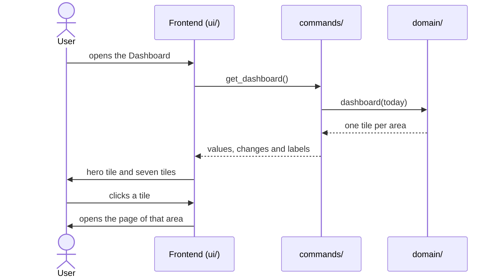

# CSD-004: Dashboard

## 1. Intent
The dashboard is the first page of the app, but it only shows income, while the app now tracks income, expenses, bank accounts, investments, houses and debts, and derives net worth and ratios from them. The owner has to open every page to see how things stand. This capability turns the dashboard into an overview: one tile for each area, showing a single current figure and whether it is up, down or stable compared with the same moment last year. It is for the owner who wants to see at a glance how their finances are doing. It adds no data of its own and reuses the figures of the other areas. The left pane that opens the dashboard and the other pages is specified in CSD-024, not here. It is GitHub issue 40.

## 2. Scope
### 2.1 In scope
- The dashboard page: a hero tile for Net worth and seven tiles for Income, Expenses, Bank accounts, Investments, Houses, Debts and Ratios.
- Per tile: a headline figure, a change against the same moment last year (an arrow, a colour and a percentage), and for balances the period the figure is as of.
- A tile that opens its page, and a tile for an area without data.

### 2.2 Non-goals
- NG-1: *(removed in v2.0: the comparison with last year is now in scope, REQ-10 and REQ-11)*
- NG-2: Charts and other visualisations, sparklines included (as CSD-001 NG-6).
- NG-3: A breakdown per job, account, house or debt.
- NG-4: Forecasts and net pay (CSD-001 NG-1, NG-4).
- NG-5: *(removed in v1.0, moved to CSD-024 NG-1)*
- NG-6: The absolute difference with last year. Only the percentage is shown.
- NG-7: Choosing, hiding or reordering tiles, and choosing the period or the comparison.
- NG-8: A tile for Settings, and any tile other than the eight of REQ-8.
- NG-9: The detailed income figures of the former dashboard (gross salary, holiday pay, bonus, last month). They stay on the Income page and its insights.

## 3. Definitions
| Term | Meaning |
|---|---|
| **Today** | The current date in local time. |
| **This year** | The current calendar year. |
| **Year to date** | From 01/01 of this year up to and including today. For monthly records, from January up to and including the current month. |
| **Period end** | The last day of a month for a monthly record, and 31/12 for a yearly record. |
| **Comparison point** | The same day one year before today. For 29/02 it is 28/02 of the year before. Its month is the **comparison month**. |
| **Same period last year** | Year to date moved back one year: from 01/01 of last year up to and including the comparison point (for monthly records, up to and including the comparison month). An annual statement counts in full in the year it belongs to. |
| **Value now** | For a balance: the total of the area as its own page shows it (CSD-009 REQ-17, CSD-005 REQ-15, CSD-015 REQ-17 with CSD-019 REQ-9, CSD-011 REQ-17). |
| **Value at the comparison point** | For a balance: the same total, counting per account, house or debt only the latest record whose period end is on or before the last day of the comparison month. For houses only houses held at the comparison point count: purchased on or before it, and not sold on or before it (as CSD-019 defines held at the end of a year). |
| **Flow tile** | A tile for a sum over a period: Income and Expenses. |
| **Balance tile** | A tile for a value at a moment: Net worth, Bank accounts, Investments, Houses and Debts. |

## 4. Requirements

### 4.0 Overview flow


**REQ-1: Structure of the left pane** *(removed in v1.0, moved to CSD-024 REQ-1)*
The structure and order of the left pane, and that the app opens on the Dashboard, are now specified in CSD-024 REQ-1 to REQ-4. AC-1.1 is removed (now CSD-024 AC-1.1 and AC-1.2) and AC-1.2 is removed (now CSD-024 AC-1.3).

**REQ-2: This year** *(removed in v2.0, replaced by REQ-9 and REQ-10)*
The "This year" block with the period totals of income is replaced by the Income tile. AC-2.1 to AC-2.5 are removed.

**REQ-3: Last month** *(removed in v2.0, see NG-9)*
The "Last month" block is removed. AC-3.1 to AC-3.4 are removed.

**REQ-4: Periods without entries** *(removed in v2.0, replaced by REQ-14)*
The notes for a period without entries are replaced by the "No data yet" tile. AC-4.1 and AC-4.2 are removed.

**REQ-5: No jobs** *(removed in v2.0, replaced by REQ-14)*
The prompt to add the first job is replaced by the "No data yet" tiles, each of which opens its page. AC-5.1 is removed.

**REQ-6: No currency** *(ubiquitous, rewritten in v2.0)*
The dashboard shall show every amount in the project currency (CSD-003) and shall not name that currency, in a tile or elsewhere.

```gherkin
@AC-6.1
Scenario: No currency in the tiles
  Given a project in "USD" with a job and a paycheck
  When the user views the dashboard
  Then the tile "Income" labelled "Year to date" shows its amount without "USD" or "$"
  And no tile names a currency
```

**REQ-7: Current figures** *(ubiquitous, rewritten in v2.0)*
The dashboard shall show figures computed from the project as it is now, including changes that are not saved yet.

```gherkin
@AC-7.1
Scenario: A new paycheck shows up
  Given today is 09/11/2026
  And the Income tile shows 6000.00
  When the user adds a paycheck for 2026-10 with gross salary 500.00 and opens the dashboard
  Then the Income tile shows 6500.00

@AC-7.2
Scenario: Opening another project refreshes the dashboard
  Given the dashboard shows figures
  When the user starts a new project
  Then every tile says "No data yet"
```

**REQ-8: Tiles and order** *(ubiquitous)*
The dashboard shall show a full-width hero tile "Net worth" at the top, below it a grid of seven tiles in the order of the left pane: "Income", "Expenses", "Bank accounts", "Investments", "Houses", "Debts" and "Ratios", and no other tile.

```gherkin
@AC-8.1
Scenario: The tiles and their order
  When the user views the dashboard
  Then the first tile is "Net worth" and spans the full width
  And the grid below it holds "Income", "Expenses", "Bank accounts", "Investments", "Houses", "Debts" and "Ratios", in that order

@AC-8.2
Scenario: No tile for Settings
  When the user views the dashboard
  Then there are exactly 8 tiles and none is for "Settings"
```

**REQ-9: Headline figure** *(ubiquitous)*
The dashboard shall show on each tile one headline figure, computed in Rust as: Income, the total gross of this year to date over all jobs (an annual statement of this year counts in full, CSD-001 REQ-11); Expenses, the sum of the amounts of the expenses dated in the year to date; Bank accounts, Investments, Houses and Debts, the value now of the area; Net worth, houses plus investments plus bank accounts minus debts of those values now (CSD-017); Ratios, the percentage of income to wealth of this year (CSD-018 REQ-6), shown as a percentage.

```gherkin
@AC-9.1
Scenario: Income year to date
  Given today is 09/11/2026
  And job "Example Employer" has paychecks 2026-09 (gross 3000.00), 2026-10 (gross 3000.00) and 2026-12 (gross 3000.00) read from a project file
  And a paycheck 2025-10 (gross 3000.00)
  When the user views the dashboard
  Then the Income tile shows 6000.00

@AC-9.2
Scenario: An annual statement counts in full
  Given today is 09/11/2026
  And a yearly job with an annual statement for 2026 (gross 40000.00) and a monthly job with a paycheck 2026-09 (gross 3000.00)
  When the user views the dashboard
  Then the Income tile shows 43000.00

@AC-9.3
Scenario: Expenses year to date
  Given today is 09/11/2026
  And expenses 900.00 dated 10/09/2026, 80.00 dated 12/11/2026 and 1200.00 dated 03/10/2025
  When the user views the dashboard
  Then the Expenses tile shows 900.00

@AC-9.4
Scenario: Balances show the value now of the area
  Given a bank account with entries 2026-09 (balance 4000.00) and 2026-10 (balance 5000.00)
  And a yearly bank account with an entry for 2025 (balance 2000.00)
  And a debt with statements 2026-09 (balance 160000.00) and 2026-10 (balance 150000.00)
  When the user views the dashboard
  Then the Bank accounts tile shows 7000.00
  And the Debts tile shows 150000.00

@AC-9.5
Scenario: A sold house is not in the value of the houses
  Given a held house with latest valuation 300000.00
  And a sold house with latest valuation 250000.00
  When the user views the dashboard
  Then the Houses tile shows 300000.00

@AC-9.6
Scenario: Net worth adds up the areas
  Given houses 300000.00, investments 20000.00, bank accounts 7000.00 and debts 150000.00
  When the user views the dashboard
  Then the Net worth tile shows 177000.00

@AC-9.7
Scenario: Ratios shows this year's percentage
  Given today is 09/11/2026
  And the percentage of income to wealth of 2026 is "12.50"
  When the user views the dashboard
  Then the Ratios tile shows "12.50%"
```

**REQ-10: Comparison with last year** *(ubiquitous)*
The dashboard shall compare each tile with the same moment last year, computed in Rust: a flow tile with the same period last year, a balance tile with its value at the comparison point, and the Ratios tile with the percentage of income to wealth of last year.

```gherkin
@AC-10.1
Scenario: Income in the same period last year
  Given today is 09/11/2026
  And paychecks 2025-09 (gross 2800.00), 2025-10 (gross 2800.00), 2025-11 (gross 2800.00) and 2025-12 (gross 2800.00)
  When the dashboard compares the Income tile
  Then the comparison is 8400.00

@AC-10.2
Scenario: Expenses up to the comparison point
  Given today is 09/11/2026
  And expenses 100.00 dated 09/11/2025 and 50.00 dated 10/11/2025
  When the dashboard compares the Expenses tile
  Then the comparison is 100.00

@AC-10.3
Scenario: A balance at the comparison point
  Given today is 09/11/2026
  And a bank account with entries 2025-10 (balance 4000.00), 2025-11 (balance 4500.00) and 2025-12 (balance 6000.00)
  When the dashboard compares the Bank accounts tile
  Then the comparison is 4500.00

@AC-10.4
Scenario: A yearly record counts from its year end
  Given today is 09/11/2026
  And a yearly bank account with entries for 2024 (balance 1800.00) and 2025 (balance 2000.00)
  When the dashboard compares the Bank accounts tile
  Then the comparison is 1800.00

@AC-10.5
Scenario: 29 February looks back to 28 February
  Given today is 29/02/2028
  And expenses 100.00 dated 28/02/2027 and 50.00 dated 01/03/2027
  When the dashboard compares the Expenses tile
  Then the comparison is 100.00

@AC-10.6
Scenario: Houses held at the comparison point
  Given today is 09/11/2026
  And a house bought on 01/03/2025 and sold on 15/12/2025 with valuation 2025-10 (value 280000.00)
  And a house bought on 01/12/2025 with valuation 2025-12 (value 90000.00)
  When the dashboard compares the Houses tile
  Then the comparison is 280000.00

@AC-10.7
Scenario: Net worth at the comparison point
  Given today is 09/11/2026
  And, at the comparison point, houses 280000.00, investments 15000.00, bank accounts 4500.00 and debts 160000.00
  When the dashboard compares the Net worth tile
  Then the comparison is 139500.00

@AC-10.8
Scenario: Ratios compares with last year
  Given the percentage of income to wealth of 2025 is "10.00"
  When the dashboard compares the Ratios tile
  Then the comparison is "10.00%"
```

**REQ-11: Change indicator** *(ubiquitous)*
The dashboard shall show next to the headline figure of each tile a change: the headline minus the comparison, divided by the absolute value of the comparison, times 100, rounded as CSD-000 CON-8 says and labelled by Rust with a sign ("+6.09%", "-2.50%", "0.00%"), with an arrow up when the rounded change is above 0.00, an arrow down when it is below 0.00, and a dash for stable when it is 0.00. If there is no comparison, or it is 0.00, then the tile shall show a grey dash without a percentage and keep its headline figure.

```gherkin
@AC-11.1
Scenario: Up
  Given the Income tile shows 10500.00 and its comparison is 10000.00
  Then the change is "+5.00%" with an arrow up

@AC-11.2
Scenario: Down
  Given the Expenses tile shows 9750.00 and its comparison is 10000.00
  Then the change is "-2.50%" with an arrow down

@AC-11.3
Scenario: Stable
  Given the Bank accounts tile shows 10000.04 and its comparison is 10000.00
  Then the change is "0.00%" with a dash for stable

@AC-11.4
Scenario: A negative comparison
  Given the Net worth tile shows 500.00 and its comparison is -1000.00
  Then the change is "+150.00%" with an arrow up

@AC-11.5
Scenario: A comparison of zero
  Given the Income tile shows 3000.00 and its comparison is 0.00
  Then the tile shows 3000.00 with a grey dash and no percentage

@AC-11.6
Scenario: No data last year
  Given the Debts tile shows 150000.00 and has no record at the comparison point
  Then the tile shows 150000.00 with a grey dash and no percentage
```

**REQ-12: Colour of the change** *(ubiquitous)*
The dashboard shall colour the arrow and the percentage of a change green when the change is good, red when it is bad and grey when it is stable or has no comparison, where up is good for Net worth, Income, Bank accounts, Investments, Houses and Ratios, and down is good for Expenses and Debts. The direction shall also be in the arrow and the text, so it does not depend on colour alone.

```gherkin
@AC-12.1
Scenario: More income is good
  Given the Income tile has an arrow up
  Then the arrow and the percentage are green

@AC-12.2
Scenario: More expenses are bad
  Given the Expenses tile has an arrow up
  Then the arrow and the percentage are red

@AC-12.3
Scenario: Less debt is good
  Given the Debts tile has an arrow down
  Then the arrow and the percentage are green

@AC-12.4
Scenario: Stable is grey
  Given a tile is stable or has no comparison
  Then its dash is grey
```

**REQ-13: Labels and as-of period** *(ubiquitous)*
The dashboard shall label a flow tile "Year to date", the Ratios tile with the current year, and show on each balance tile the period of the latest record the figure counts, as the month (YYYY-MM) or the year (YYYY) of that record, and on Net worth the latest of its four areas.

```gherkin
@AC-13.1
Scenario: As-of period of a balance tile
  Given bank accounts with latest entries 2026-10 (monthly) and 2025 (yearly)
  When the user views the dashboard
  Then the Bank accounts tile says "as of 2026-10"

@AC-13.2
Scenario: Labels of the other tiles
  Given today is 09/11/2026
  When the user views the dashboard
  Then the Income and Expenses tiles say "Year to date"
  And the Ratios tile says "2026"
```

**REQ-14: No data yet** *(state-driven)*
While an area has no record, the dashboard shall show its tile with "No data yet" instead of a figure and a change. Income has no record while no job has a paycheck or an annual statement; Net worth while none of its four areas has a record; Ratios while the series of CSD-018 REQ-11 is empty; the other areas while they have no expense, entry, statement or valuation. An area with records but nothing in the year to date shows 0.00.

```gherkin
@AC-14.1
Scenario: Empty project
  Given a new project
  When the user views the dashboard
  Then all 8 tiles are shown and each says "No data yet"

@AC-14.2
Scenario: A job without paychecks
  Given a job "Example Employer" without paychecks
  When the user views the dashboard
  Then the Income tile says "No data yet"

@AC-14.3
Scenario: Records only last year
  Given today is 09/11/2026
  And only a paycheck 2025-09 (gross 5600.00)
  When the user views the dashboard
  Then the Income tile shows 0.00 with "-100.00%" and an arrow down
```

**REQ-15: A tile opens its page** *(event-driven)*
When the user activates a tile (a click, or Enter or Space on it), the app shall open the page of that area (CSD-024 REQ-3), also when the tile says "No data yet", and every tile shall be a button for keyboard and screen reader users.

```gherkin
@AC-15.1
Scenario: A tile opens its page
  Given the Dashboard is shown
  When the user clicks the "Debts" tile
  Then the Debts page is shown and the Dashboard page is hidden

@AC-15.2
Scenario: An empty tile opens its page
  Given a new project and the Dashboard is shown
  When the user presses Enter on the "Income" tile
  Then the Income page is shown

@AC-15.3
Scenario: Net worth and Ratios open their insight pages
  Given the Dashboard is shown
  When the user clicks the "Ratios" tile
  Then the Ratios page is shown
```

## 5. Interfaces and contracts

Command: `get_dashboard()` returns the eight tiles. It no longer returns `has_jobs`, `year_to_date` or `last_month_totals`:

```json
{
  "net_worth": { "has_data": true, "kind": "amount", "value": "177000.00", "as_of": "2026-10",
                 "change": { "direction": "up", "sentiment": "good", "percent_label": "+26.88%" } },
  "income":    { "has_data": true, "kind": "amount", "value": "6000.00", "as_of": null, "change": null },
  "expenses": {}, "bank_accounts": {}, "investments": {}, "houses": {}, "debts": {},
  "ratios":    { "has_data": true, "kind": "percent", "value": "12.50", "as_of": null,
                 "change": { "direction": "stable", "sentiment": "neutral", "percent_label": "0.00%" } }
}
```

Every tile has the same shape (the `{}` above stands for it). `change` is `null` when there is no comparison (REQ-11) and `value` is `null` when `has_data` is false. `direction` is `up`, `down` or `stable`, `sentiment` is `good`, `bad` or `neutral`. Amounts and the Ratios value are decimal strings, the frontend adds the percent sign to `kind: "percent"`, and `percent_label` is delivered by Rust. Rust decides "today" (local time), the comparison point and the sentiment; the frontend only displays what it receives.

## 6. Constraints
- CON-1: The figures are computed in Rust and displayed as received. Rationale: `CLAUDE.md` layout rule.
- CON-2: Amounts use `rust_decimal::Decimal`. Rationale: `CLAUDE.md` money rules.
- CON-3: No network access. Rationale: `CLAUDE.md` Tauri security rules.
- CON-4: Tests and fixtures use synthetic data only. Rationale: the repo is public.
- CON-5: The dashboard reuses the totals and the yearly series of the other areas and defines no figure of its own beyond REQ-9 to REQ-11. Rationale: one definition per figure, so the dashboard never disagrees with a page.
- CON-6: Styles live in `ui/styles/` and the tiles use no `style=` attribute. Rationale: strict CSP (`CLAUDE.md`).

## 7. Verification
Figures are proven by `cargo test`. Tests are named `test_csd004_ac_<n>_<m>_<description>` (CSD-000 REQ-6).

| What | How |
|---|---|
| Rust tests (headline, comparison, change, colour, no data) | `cargo test test_csd004_` |
| Golden file of `get_dashboard` | `GOLDEN_UPDATE=1 cargo test golden`, diff reviewed |
| Display ACs (tiles, order, labels, no currency, refresh, click) | `npm test`: DOM tests in `ui/tests/`, titles carry the AC id |

Not covered by a named test yet (0 of 38 ACs; nothing is built yet). Existing tests of the removed ACs (`empty-states.test.js`, `ac-a-dashboard.test.js`, `ipc_tests.rs`) are rewritten with the implementation.

Done means fmt, clippy (`-D warnings`), `cargo test --all-features` and `npm test` pass.

## 8. Open questions
None.

## 9. Changelog
- 2.0 (09/11/2026): From income dashboard to overview dashboard (GitHub issue 40, grill-me interview). The dashboard shows one tile per area, with a year-to-date or current figure and an indicator against last year (REQ-8 to REQ-15). REQ-2 to REQ-5 and their ACs are removed (the income blocks and the empty prompt are replaced by the Income tile and REQ-14), REQ-6 and REQ-7 are rewritten, NG-1 is removed, NG-6 to NG-9 are new, `get_dashboard()` changes (section 5), and the file is renamed to `CSD-004-dashboard.md`. Back to `draft` until re-approved.
- 1.1 (03/11/2026): Verification (section 7) lists the real test filters and the ACs that no named test covers yet; claims of tests that do not exist are removed.
- 1.0 (03/11/2026): The navigation moves to the new CSD-024 "Navigation and app shell": REQ-1 (AC-1.1, AC-1.2) and NG-5 are removed here and kept as stubs (CSD-000 CON-6); other CSDs that cite "CSD-004 REQ-1" for the left pane now mean CSD-024 REQ-1. Scope and intent no longer cover the left pane, `related` adds CSD-024, and the verification no longer says there is no frontend test setup: display ACs are covered by DOM tests. Back to `draft` until re-approved.
- 0.8 (30/10/2026): The left-pane entry Assets is renamed Houses: wording only. Back to `draft` until re-approved (GitHub issue 31).
- 0.7 (29/10/2026): The Insights group holds the Ratios page of CSD-018 after Net worth (REQ-1, AC-1.1, NG-5; GitHub issue 25).
- 0.6 (29/10/2026): The Insights group holds the Net worth page of CSD-017 in place of the Reports placeholder (REQ-1, AC-1.1, NG-5; GitHub issue 24).
- 0.5 (29/10/2026): The left pane is grouped under Overview, Finance, Wealth, Liabilities and Insights (REQ-1, AC-1.1), and REQ-1 is the one place that states the order (GitHub issue 21).
- 0.4 (29/10/2026): Entry counts are no longer displayed: the "Entries" card is removed (REQ-2) and the counts are removed from AC-2.1 to AC-2.4, AC-3.1 and AC-3.2. `entry_count` stays in the payload.
- 0.3 (26/10/2026): REQ-6 reversed: the dashboard names no currency (AC-6.1 rewritten). `get_dashboard()` no longer returns `currency`.
- 0.2 (26/10/2026): Annual statements (CSD-001 0.9). "This year" counts the statement of the current year in full (AC-2.4, AC-2.5), "Last month" counts monthly paychecks only (AC-3.4), the count becomes "entries" (`entry_count`, card "Entries").
- 0.1 (25/10/2026): initial draft.
