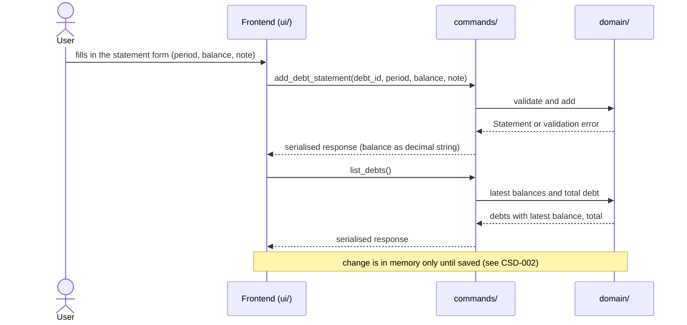
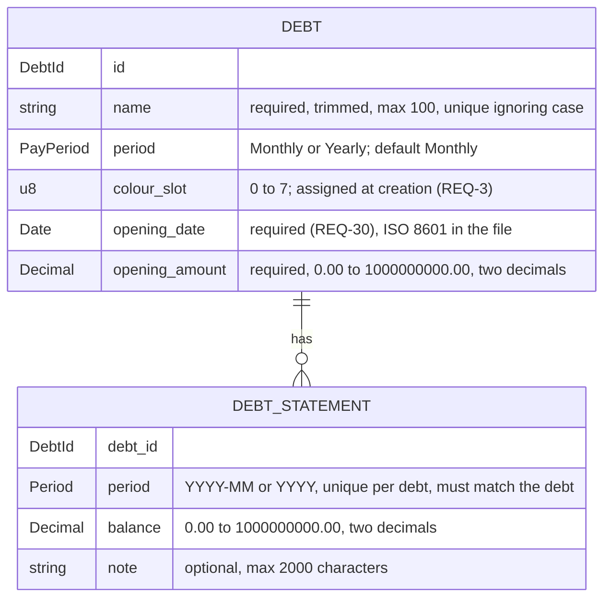

# CSD-011: Debts

## 1. Intent
The app tracks wealth, but has no view of what the user owes: a mortgage, a student loan, a credit card. This capability lets the user record debts and, per debt, one remaining balance per month or per year, with an optional note. From these the app derives, per statement, how much was repaid since the previous one and, per calendar year, the yearly totals with the closing balance and the amount repaid. It is for a single person keeping a private, local history of their debts. It records balances as the user reads them off a statement. It does not model loans: no interest, terms or payments. The result is a balance history per debt that shows how the debts shrink, which the Insights chart of CSD-012 and the Net worth page of CSD-017 build on. It follows the structure of Bank accounts (CSD-009), with a balance that cannot be negative and with the progress derived. Like a house with its purchase and its sale (CSD-019), a debt also holds the day it started and the amount borrowed, its **opening**, and optionally the day it was closed and the amount then still open, its **closing** (GitHub issue 51). The opening is required. The closing is the settlement of CSD-026, entered by hand. Neither changes any figure: balances still come only from statements.

## 2. Scope
### 2.1 In scope
- Create, edit and delete debts, each with a name, a statement period (Monthly or Yearly) and an opening: the opening date and the opening amount (REQ-30, REQ-31).
- The window between the opening and the closing of a debt, inside which its statements lie (REQ-32), and the Opening row of the Statements table (REQ-33).
- The debt form with the opening fields, and the closing fields that enter or clear a manual closing (REQ-34; the closing itself is CSD-026 REQ-15 and REQ-16).
- Create, edit and delete one statement per debt per period: the remaining balance (0.00 or more) and an optional note.
- Change the period of an existing statement (REQ-12).
- Copy the previous statement into the add form.
- The settle dialog that asks Repaid or Cancelled for each open debt when a house is sold or a debt is linked to a sold house (REQ-27, REQ-28; the settlement itself is CSD-026).
- The change per statement: the balance of the previous statement minus this one (REQ-25).
- Yearly totals per calendar year over all debts: closing balance and amount repaid (Cancelled-adjusted, REQ-19).
- One Debts view (tab Overview) with the debts, their latest balances, the total debt, the yearly totals and the statements of all debts. The Insights tab is CSD-012.
- Debt data is part of the project file (CSD-002). Statements count for the currency confirmation of CSD-003 (REQ-24).

### 2.2 Non-goals
- NG-1: Interest rates, terms, monthly payments and repayment schedules.
- NG-2: A forecast of when a debt is paid off, and any percentage of the debt repaid.
- NG-3: (removed in v0.4) A house linked to a debt is now CSD-020. A collateral or a lien stays out of scope.
- NG-4: Netting the debts against bank accounts and investments on the Debts page, and integration with the dashboard (CSD-004). The integration with net worth is specified in CSD-017.
- NG-5: Money owed to the user.
- NG-6: Data fetched from a lender, and import of statements (CSV, PDF, lender export).
- NG-7: Archiving a debt. A debt at 0.00 stays a normal row, marked Repaid (REQ-26). (Marking it Repaid or Cancelled on the sale of its house is CSD-026.)
- NG-8: Lender identifiers and other details: an account or contract number, a lender name apart from the name of the debt, a debt type other than the category of CSD-020 (Mortgage, Loan, Scholarship, Other), and a note on the debt itself.
- NG-9: A currency per debt. All amounts are in the project currency (CSD-003).
- NG-10: Individual payments and negative balances. (A stored original amount is no longer excluded since v3.0: it is the opening amount, REQ-30.)
- NG-11: Aligning the latest balances of different debts to one date, or estimating a balance for a period without a statement.
- NG-12: Moving a statement to another debt. Only the period of a statement can change (REQ-12).
- NG-13: Changing the periods of several statements at once.
- NG-14: Rich text or attachments in notes.
- NG-15: Using the opening amount or the closing amount in any figure (total debt, change, yearly totals, insights, net worth, ratios), and checking either against the statements. The one existing exception is the settled amount of a Cancelled debt (CSD-026 REQ-10, REQ-11), which is the closing amount.
- NG-16: Migrating an older project file inside the app. A debt without an opening makes the file invalid (REQ-23). The one-off script of CSD-002 REQ-20 upgrades such a file outside the app.
- NG-17: An opening or closing statement stored as a statement. The Opening row of the Statements table is shown, never stored (REQ-33), and the closing row is the existing settlement statement (CSD-026).

## 3. Definitions
| Term | Meaning |
|---|---|
| **Debt** | One amount the user owes to one party, identified by a name such as "Example Mortgage". |
| **Statement period** | How a debt is recorded: **Monthly** (one statement per calendar month, `YYYY-MM`) or **Yearly** (one statement per calendar year, `YYYY`). A debt is Monthly unless Yearly is chosen. |
| **Statement** | The record of one debt for one period: the remaining balance and an optional note. |
| **Balance** | What the user still owes on the debt at the end of the period, as one amount of 0.00 or more in the project currency. |
| **Previous statement** | The statement of the same debt that comes right before the statement at hand: the one with the latest period before it, also when periods in between have none, or, for a settlement statement (CSD-026 REQ-3), the regular statement of its own period when there is one. |
| **Change** | For a statement: the balance of its previous statement minus its own balance. Positive when the debt was repaid, negative when it grew. It is derived and never stored. A first statement has no change. |
| **Latest balance** | The balance of the statement with the most recent period of a debt. |
| **Total debt** | The sum of the latest balances of all debts that have at least one statement. |
| **Yearly total** | One row per calendar year: the closing balance and the amount repaid of that year, over all debts. See REQ-19. |
| **Closing balance (of a year)** | The sum, over the debts that have a statement in that year, of the balance of each debt's latest statement in that year. |
| **Opening (of a debt)** | The opening date (the day the debt started, `dd/mm/yyyy`) and the opening amount (the amount borrowed, 0.00 or more) of a debt. Both are required. They are not the opening balance below, which is derived from statements. |
| **Closing (of a debt)** | The settlement of the debt (CSD-026): its outcome (Repaid or Cancelled), its closing date and its closing amount (the amount still open when it was closed). It is optional. A closing made by hand is a manual closing, one made by selling the linked house is a closing by sale. |
| **Window (of a debt)** | The statement periods from the period of the opening date up to and including the period of the closing date, or without an end while the debt has no closing. A period is a month for a Monthly debt and a year for a Yearly one. |
| **Opening balance (of a debt in a year)** | The balance of the latest statement of the debt before that year. A debt without an earlier statement has none. |
| **Repaid (in a year)** | The sum, over the debts that have a statement in that year and an opening balance in it, of the opening balance minus the closing balance of that debt, with the settled amount of a debt Cancelled in that year taken out (CSD-026 REQ-10, REQ-11). It is negative when those debts grew. It is none when no debt has an opening balance in that year. |
| **Colour slot** | A number from 0 to 7 stored with a debt. CSD-012 draws the debt in the colour of its slot. |
| **Note** | Optional plain text, up to 2,000 characters, that goes with one statement. |
| **Settle dialog** | The dialog "Settle linked debts" that asks, for each open debt, whether it was Repaid or Cancelled (CSD-026 REQ-13). |
| **Project file** | The single user-chosen file `.varde` holding all app data (CSD-002). Debts are one of its sections. |

## 4. Requirements

### 4.0 Overview flow


### 4.1 Debts

Shorthand in the scenarios of this CSD: a debt that a scenario creates or names without an opening has the opening date 01/01/2000 and the opening amount 200000.00, and no closing, unless the scenario says otherwise. A scenario that adds a debt through the form gives the opening in its steps only where it matters.

**REQ-1: Add a debt** *(event-driven)*
When the user submits a new debt with a name, a statement period and an opening (REQ-30), the app shall create the debt with statement period Monthly unless Yearly is chosen, and with a colour slot under REQ-3.

```gherkin
@AC-1.1
Scenario: Debt created with the default period
  Given no debts exist
  When the user adds a debt named "Example Mortgage" with opening 15/03/2020 and 200000.00, without choosing a period
  Then the debt "Example Mortgage" exists with statement period "Monthly"
  And it has no statements

@AC-1.2
Scenario: Yearly debt
  Given no debts exist
  When the user adds a debt named "Example Student Loan" with statement period "Yearly" and opening 01/09/2018 and 12000.00
  Then the debt "Example Student Loan" exists with statement period "Yearly"

@AC-1.3
Scenario: Unknown period rejected
  When the user adds a debt named "Example Mortgage" with statement period "Weekly" and opening 15/03/2020 and 200000.00
  Then it is rejected with error code "DEBT_PERIOD_UNSUPPORTED"
  And no debt exists

@AC-1.4
Scenario: A debt without an opening is rejected
  When the user adds a debt named "Example Mortgage" without an opening date and opening amount
  Then it is rejected with error code "DEBT_OPENING_DATE_REQUIRED"
  And no debt exists
```

**REQ-2: Debt name rules** *(unwanted behaviour)*
If the name of a debt is empty after trimming, is longer than 100 characters, or equals the name of another debt when case is ignored, then the app shall reject the debt or edit without storing or changing it, and shall store an accepted name trimmed.

```gherkin
@AC-2.1
Scenario Outline: Invalid names rejected
  Given a debt named "Example Mortgage"
  When the user adds a debt named "<name>"
  Then it is rejected with error code "<code>"
  And only the debt "Example Mortgage" exists

  Examples:
    | name              | code                   |
    | (empty)           | DEBT_NAME_REQUIRED     |
    | (three spaces)    | DEBT_NAME_REQUIRED     |
    | EXAMPLE MORTGAGE  | DEBT_NAME_DUPLICATE    |
    | example mortgage  | DEBT_NAME_DUPLICATE    |

@AC-2.2
Scenario: Name length boundary
  When the user adds a debt with a name of 100 characters
  Then the debt exists
  When the user adds a debt with a name of 101 characters
  Then it is rejected with error code "DEBT_NAME_TOO_LONG"

@AC-2.3
Scenario: The name is stored trimmed
  When the user adds a debt named "  Example Mortgage  "
  Then the debt is named "Example Mortgage"

@AC-2.4
Scenario: Renaming to an existing name is rejected
  Given debts "Example Mortgage" and "Example Student Loan"
  When the user renames "Example Student Loan" to "example mortgage"
  Then the edit is rejected with error code "DEBT_NAME_DUPLICATE"

@AC-2.5
Scenario: Changing only the case of its own name is allowed
  Given a debt "Example Student Loan"
  When the user renames it to "EXAMPLE STUDENT LOAN"
  Then the debt is named "EXAMPLE STUDENT LOAN"
```

**REQ-3: Colour slot** *(event-driven)*
When a debt is created, the app shall give it the lowest colour slot (0 to 7) that is used by the fewest existing debts, and shall keep that slot for the life of the debt, also when other debts are deleted.

```gherkin
@AC-3.1
Scenario: Slots follow creation order
  Given no debts exist
  When the user adds three debts
  Then they have colour slots 0, 1 and 2 in the order they were added

@AC-3.2
Scenario: Slots cycle after eight debts
  Given eight debts with colour slots 0 to 7
  When the user adds a ninth debt
  Then it has colour slot 0

@AC-3.3
Scenario: Deleting a debt does not recolour the others
  Given debts with colour slots 0, 1 and 2
  When the user deletes the debt with colour slot 0 and confirms
  Then the other debts still have colour slots 1 and 2

@AC-3.4
Scenario: A freed slot is used first
  Given debts with colour slots 0, 1 and 2
  When the user deletes the debt with colour slot 1 and confirms
  And adds a debt
  Then the new debt has colour slot 1

@AC-3.5
Scenario: Renaming keeps the slot
  Given a debt with colour slot 2
  When the user renames it
  Then it still has colour slot 2
```

**REQ-4: Edit a debt** *(event-driven)*
When the user edits a debt, the app shall apply a changed name under REQ-2, a changed statement period under REQ-5 and a changed opening or closing under REQ-31 and REQ-32, and shall keep the debt's statements.

```gherkin
@AC-4.1
Scenario: Rename keeps statements
  Given a debt "Example Mortgage" with 2 statements
  When the user renames it to "Example Home Loan"
  Then the debt is named "Example Home Loan"
  And it still has 2 statements

@AC-4.2
Scenario: Period of a debt without statements can change
  Given a "Monthly" debt "Example Mortgage" with no statements
  When the user changes its statement period to "Yearly"
  Then the debt has statement period "Yearly"

@AC-4.3
Scenario: An invalid edit changes nothing
  Given debts "Example Mortgage" and "Example Student Loan"
  When the user renames "Example Student Loan" to "  "
  Then the edit is rejected with error code "DEBT_NAME_REQUIRED"
  And "Example Student Loan" keeps its name
```

**REQ-5: Statement period is locked once statements exist** *(unwanted behaviour)*
If the user changes the statement period of a debt that has at least one statement, then the app shall reject the change with the error code `DEBT_PERIOD_LOCKED`.

```gherkin
@AC-5.1
Scenario: Period change rejected
  Given a "Monthly" debt "Example Mortgage" with a statement for 2026-09
  When the user changes its statement period to "Yearly"
  Then the change is rejected with error code "DEBT_PERIOD_LOCKED"
  And the debt still has statement period "Monthly"

@AC-5.2
Scenario: Period change allowed again after deleting the last statement
  Given a "Monthly" debt "Example Mortgage" with one statement
  When the user deletes the statement and confirms
  And changes the statement period to "Yearly"
  Then the debt has statement period "Yearly"
```

**REQ-6: Delete a debt** *(event-driven)*
When the user confirms deletion of a debt, the app shall remove the debt and all of its statements. The confirmation reads "This debt and all its statements will be deleted.", the same whether or not the debt has statements, and states no number of statements.

```gherkin
@AC-6.1
Scenario: Deletion cascades
  Given a debt "Example Mortgage" with 3 statements
  When the user deletes the debt and confirms
  Then the debt no longer exists
  And none of its 3 statements exist

@AC-6.2
Scenario: Cancelled deletion changes nothing
  Given a debt "Example Mortgage" with 3 statements
  When the user starts deleting the debt and cancels
  Then the debt and its 3 statements still exist

@AC-6.3
Scenario: A debt at 0.00 is deleted like any other
  Given a debt "Example Student Loan" whose latest balance is 0.00
  When the user deletes the debt and confirms
  Then the debt and its statements no longer exist

@AC-6.4
Scenario Outline: The confirmation states no count
  Given a debt "Example Mortgage" with <statements>
  When the user starts deleting the debt
  Then the confirmation reads "This debt and all its statements will be deleted."
  And it states no number of statements

  Examples:
    | statements   |
    | 3 statements |
    | no statements |
```

### 4.2 Statements

**REQ-7: Add a statement** *(event-driven)*
When the user submits a statement for the debt chosen in the add form, a period and a balance, the app shall store it with the given note, or with an empty note if none is given, and shall accept any valid period inside the window of the debt (REQ-32), including periods in the future while the debt has no closing.

```gherkin
@AC-7.1
Scenario: Monthly statement with a note
  Given the current date is 26/10/2026
  And a monthly debt "Example Mortgage"
  When the user adds a statement for 2026-09 with balance 150000.00 and note "Paid extra"
  Then the statement for 2026-09 has balance 150000.00 and note "Paid extra"

@AC-7.2
Scenario: Yearly statement without a note
  Given the current date is 26/10/2026
  And a yearly debt "Example Student Loan"
  When the user adds a statement for 2025 with balance 8000.00 and no note
  Then the statement for 2025 has balance 8000.00 and an empty note

@AC-7.3
Scenario: Old periods inside the window are accepted
  Given a monthly debt "Example Mortgage" with opening 15/03/2018 and 200000.00
  When the user adds a statement for 2019-01 with balance 200000.00
  Then the statement for 2019-01 exists

@AC-7.4
Scenario Outline: Current and future periods are accepted
  Given the current date is 26/10/2026
  And a <period_type> debt "Example Debt"
  When the user adds a statement for "<period>" with balance 1000.00
  Then the statement for "<period>" exists

  Examples:
    | period_type | period  |
    | monthly     | 2026-10 |
    | monthly     | 2026-11 |
    | yearly      | 2026    |
    | yearly      | 2027    |

@AC-7.5
Scenario Outline: Invalid period rejected
  Given a <period_type> debt "Example Debt"
  When the user adds a statement for "<period>" with balance 1000.00
  Then it is rejected with error code "DEBT_STATEMENT_PERIOD_INVALID"

  Examples:
    | period_type | period   |
    | monthly     | 2026-13  |
    | monthly     | 2026-9   |
    | monthly     | abcd     |
    | yearly      | 26       |
    | yearly      | abcd     |

@AC-7.6
Scenario Outline: A period has no date bounds
  Given a <period_type> debt "Example Debt"
  When the user adds a statement for "<period>" with balance 1000.00
  Then the statement for "<period>" exists

  Examples:
    | period_type | period  |
    | monthly     | 1850-03 |
    | yearly      | 1899    |
```

**REQ-8: One regular statement per debt per period** *(unwanted behaviour)*
If the user adds a statement for a debt and period that already has a regular statement, then the app shall reject it with the error code `DEBT_STATEMENT_DUPLICATE` and leave the existing statement unchanged. A period can hold two statements only when the second is the settlement statement that a sale adds (CSD-026 REQ-3), which the user cannot edit.

```gherkin
@AC-8.1
Scenario: Duplicate period rejected
  Given a monthly debt with a statement for 2026-09 with balance 150000.00 and note "First"
  When the user adds another statement for 2026-09 with balance 149000.00
  Then it is rejected with error code "DEBT_STATEMENT_DUPLICATE"
  And the statement for 2026-09 still has balance 150000.00 and note "First"

@AC-8.2
Scenario: Same period on a different debt is allowed
  Given two monthly debts, and the first has a statement for 2026-09
  When the user adds a statement for 2026-09 to the second debt
  Then both debts have a statement for 2026-09

@AC-8.3
Scenario: A settlement statement shares its period with a regular statement
  Given "Example Loan" (monthly) with a regular statement for 2026-06 with balance 3500.00 and settled on the sale of its house on 10/06/2026 (CSD-026 REQ-3)
  Then "Example Loan" has two statements for 2026-06: the regular one and, after it, the settlement statement with balance 0.00
  And the settlement statement cannot be edited
  When the user adds another regular statement for 2026-06
  Then it is rejected with error code "DEBT_STATEMENT_DUPLICATE"
```

**REQ-9: Statements match the statement period** *(unwanted behaviour)*
If the user adds a monthly statement to a yearly debt or a yearly statement to a monthly debt, then the app shall reject it with the error code `DEBT_PERIOD_MISMATCH`.

```gherkin
@AC-9.1
Scenario: Monthly statement for a yearly debt rejected
  Given a "Yearly" debt
  When a statement for 2026-09 with balance 1000.00 is added to it
  Then it is rejected with error code "DEBT_PERIOD_MISMATCH"

@AC-9.2
Scenario: Yearly statement for a monthly debt rejected
  Given a "Monthly" debt
  When a statement for 2025 with balance 1000.00 is added to it
  Then it is rejected with error code "DEBT_PERIOD_MISMATCH"
```

**REQ-10: Balance validation** *(unwanted behaviour)*
If the balance of a statement is not a plain number such as 150000.00, is negative or exceeds 1,000,000,000.00, then the app shall reject the statement or edit without storing it. A balance of 0.00 is valid. The rules apply to the balance after rounding (REQ-29).

```gherkin
@AC-10.1
Scenario Outline: Invalid balances rejected
  Given a monthly debt "Example Mortgage" and the current date 26/10/2026
  When the user adds a statement for 2026-09 with balance "<balance>"
  Then it is rejected with error code "<code>"
  And no statement for 2026-09 exists

  Examples:
    | balance          | code                               |
    | (empty)          | DEBT_STATEMENT_BALANCE_INVALID     |
    | abc              | DEBT_STATEMENT_BALANCE_INVALID     |
    | 1e3              | DEBT_STATEMENT_BALANCE_INVALID     |
    | 2500,50          | DEBT_STATEMENT_BALANCE_INVALID     |
    | -0.01            | DEBT_STATEMENT_BALANCE_NEGATIVE    |
    | 1000000000.01    | DEBT_STATEMENT_BALANCE_TOO_LARGE   |

@AC-10.2
Scenario Outline: Boundary balances accepted
  Given a monthly debt "Example Mortgage" and the current date 26/10/2026
  When the user adds a statement for 2026-09 with balance "<balance>"
  Then the statement for 2026-09 has balance <balance>

  Examples:
    | balance          |
    | 0.00             |
    | 1000000000.00    |

@AC-10.3
Scenario: Invalid balance in an edit rejected
  Given a statement for 2026-09 with balance 150000.00
  When the user sets the balance to -1.00
  Then the edit is rejected with error code "DEBT_STATEMENT_BALANCE_NEGATIVE"
  And the statement still has balance 150000.00
```

The row of AC-10.1 with 1000.999 (`DEBT_STATEMENT_BALANCE_PRECISION`) is removed in v2.0: a typed balance with more than two decimals is rounded, not rejected (REQ-29).

**REQ-29: Typed balances are rounded** *(event-driven)*
When the user enters a balance with more than two decimal places, the app shall round it half-up to two decimals (CSD-000 CON-8) before it applies the rules of REQ-10.

```gherkin
@AC-29.1
Scenario Outline: A typed amount is rounded half-up
  Given a monthly debt "Example Mortgage" and the current date 26/10/2026
  When the user adds a statement for 2026-09 with balance "<typed>"
  Then the statement for 2026-09 has balance <stored>

  Examples:
    | typed | stored |
    | 3000.505 | 3000.51 |
    | 1.004    | 1.00 |
    | 1.005    | 1.01 |
    | 1000.999 | 1001.00 |
    | 0.004    | 0.00 |
    | -0.004   | 0.00 |
    | 150000.5 | 150000.50 |

@AC-29.2
Scenario Outline: The limit is checked after rounding
  Given a monthly debt "Example Mortgage" and the current date 26/10/2026
  When the user adds a statement for 2026-09 with balance "<typed>"
  Then <outcome>

  Examples:
    | typed | outcome |
    | 1000000000.004 | the statement has balance 1000000000.00 |
    | 1000000000.005 | it is rejected with error code "DEBT_STATEMENT_BALANCE_TOO_LARGE" |
    | -0.005         | it is rejected with error code "DEBT_STATEMENT_BALANCE_NEGATIVE" |

@AC-29.3
Scenario: A typed amount in an edit is rounded
  Given a statement for 2026-09 with balance 150000.00
  When the user sets the balance to "1000.999"
  Then the statement has balance 1001.00
```

**REQ-11: Note validation** *(unwanted behaviour)*
If the note of a statement is longer than 2,000 characters, then the app shall reject the statement or edit with the error code `DEBT_STATEMENT_NOTE_TOO_LONG`, without shortening or storing it. Line breaks in a note are kept as typed.

```gherkin
@AC-11.1
Scenario: Note length boundary
  Given a monthly debt "Example Mortgage" and the current date 26/10/2026
  When the user adds a statement for 2026-08 with balance 1000.00 and a note of 2000 characters
  Then the statement for 2026-08 exists with that note
  When the user adds a statement for 2026-09 with balance 1000.00 and a note of 2001 characters
  Then it is rejected with error code "DEBT_STATEMENT_NOTE_TOO_LONG"
  And no statement for 2026-09 exists

@AC-11.2
Scenario: Line breaks are kept
  Given a monthly debt "Example Mortgage"
  When the user adds a statement for 2026-09 with balance 1000.00 and the note "line one" and "line two" on two lines
  Then the note of the statement has two lines
```

**REQ-12: Edit a statement and change its period** *(event-driven)*
When the user edits an existing statement, other than a settlement statement (CSD-026 REQ-3), in the edit form and saves, the app shall give the statement the edited balance and note under REQ-10 and REQ-11 and, when the period was changed, the new period, as one change, without asking for confirmation. The statement stays with its debt, and the latest balances, the changes, the yearly totals and the insights show it under its new period.

```gherkin
@AC-12.1
Scenario: Edit balance and note
  Given a statement for 2026-09 with balance 150000.00 and note "First"
  When the user sets the balance to 149000.00 and the note to "Corrected"
  Then the statement has balance 149000.00 and note "Corrected"

@AC-12.2
Scenario: Clear a note
  Given a statement for 2026-09 with balance 150000.00 and note "First"
  When the user empties the note
  Then the statement has an empty note

@AC-12.3
Scenario: Move a statement to another month
  Given a monthly debt with a statement for 2026-09 with balance 150000.00 and note "First"
  When the user changes its period to 2026-08
  Then the debt has a statement for 2026-08 with balance 150000.00 and note "First"
  And the debt has no statement for 2026-09
  And no confirmation was asked

@AC-12.4
Scenario: Change the period and the balance together
  Given a monthly debt with a statement for 2026-09 with balance 150000.00
  When the user changes its period to 2026-08 and sets the balance to 149000.00
  Then the statement for 2026-08 has balance 149000.00
  And there is no statement for 2026-09

@AC-12.5
Scenario: Move a yearly statement
  Given a yearly debt with a statement for 2025 with balance 8000.00
  When the user changes its period to 2024
  Then the debt has a statement for 2024 with balance 8000.00
  And the debt has no statement for 2025

@AC-12.6
Scenario: The yearly totals follow the move
  Given a monthly debt with statements 2025-11 (balance 10000.00), 2025-12 (balance 9800.00) and 2026-05 (balance 9000.00)
  When the user changes the period of the statement for 2025-12 to 2026-01
  Then 2025 shows closing balance 10000.00
  And 2026 shows closing balance 9000.00

@AC-12.7
Scenario Outline: The edit form offers the period
  Given <statement>
  When the user opens it for editing
  Then the form shows the <field> "<value>" and the debt, which cannot be changed

  Examples:
    | statement                      | field | value   |
    | a monthly statement for 2026-09 | month | 2026-09 |
    | a yearly statement for 2025     | year  | 2025    |

@AC-12.8
Scenario: Keeping the period changes only the values
  Given a monthly debt with a statement for 2026-09 with balance 150000.00
  When the user saves it with the period 2026-09 and balance 149000.00
  Then the statement for 2026-09 has balance 149000.00
  And no error about a duplicate period is shown

@AC-12.9
Scenario: An edit is an unsaved change
  Given a saved project with a monthly statement for 2026-09
  When the user changes its period to 2026-08
  Then the unsaved indicator is shown
```

**REQ-13: Invalid new period** *(unwanted behaviour)*
If the new period of an edited statement is not a valid period, or the debt already has another statement for it, or it does not match the statement period of the debt, or the edit also has an invalid value, then the app shall reject the whole edit with the error code of the violated rule and leave the statement, with its period and its values, as it was. Another debt may have a statement for the same period.

```gherkin
@AC-13.1
Scenario Outline: A period in the future is accepted
  Given the current date is 26/10/2026
  And <debt> with a statement for <old> with balance 1000.00
  When the user changes its period to "<new>"
  Then the statement is for <new> with balance 1000.00

  Examples:
    | debt           | old     | new     |
    | a monthly debt | 2026-09 | 2026-11 |
    | a yearly debt  | 2025    | 2027    |

@AC-13.2
Scenario: A period that already has a statement is rejected
  Given a monthly debt with a statement for 2026-08 with balance 151000.00 and one for 2026-09 with balance 150000.00
  When the user changes the period of the statement for 2026-09 to 2026-08 and sets the balance to 149000.00
  Then the edit is rejected with error code "DEBT_STATEMENT_DUPLICATE"
  And the statement for 2026-08 still has balance 151000.00
  And the statement for 2026-09 still has balance 150000.00

@AC-13.3
Scenario Outline: A period of the wrong kind is rejected
  Given <debt> with a statement for <old>
  When the user changes its period to "<new>"
  Then the edit is rejected with error code "DEBT_PERIOD_MISMATCH"
  And the statement is still for <old>

  Examples:
    | debt           | old     | new     |
    | a monthly debt | 2026-09 | 2026    |
    | a yearly debt  | 2025    | 2024-12 |

@AC-13.4
Scenario: An invalid value rejects the whole edit
  Given a monthly debt with a statement for 2026-09 with balance 150000.00
  When the user changes its period to 2026-08 and sets the balance to -1.00
  Then the edit is rejected with error code "DEBT_STATEMENT_BALANCE_NEGATIVE"
  And the statement is still for 2026-09 with balance 150000.00
  And the unsaved indicator is not shown

@AC-13.5
Scenario: Another debt may have the same period
  Given two monthly debts, the first with a statement for 2026-08 and the second with one for 2026-09
  When the user changes the period of the second debt's statement to 2026-08
  Then both debts have a statement for 2026-08

@AC-13.6
Scenario: An invalid period is rejected
  Given a monthly debt with a statement for 2026-09 with balance 150000.00
  When the user changes its period to "2026-13"
  Then the edit is rejected with error code "DEBT_STATEMENT_PERIOD_INVALID"
  And the statement is still for 2026-09
```

**REQ-14: Delete a statement** *(event-driven)*
When the user confirms deletion of a statement, the app shall remove that statement and no other data.

```gherkin
@AC-14.1
Scenario: Confirmed deletion
  Given a monthly debt with statements for 2026-08 and 2026-09
  When the user deletes the statement for 2026-09 and confirms
  Then only the statement for 2026-08 remains

@AC-14.2
Scenario: Cancelled deletion changes nothing
  Given a monthly debt with statements for 2026-08 and 2026-09
  When the user starts deleting the statement for 2026-09 and cancels
  Then both statements still exist
```

**REQ-15: Copy the previous period** *(event-driven)*
When the user chooses "copy previous month" (monthly debt) or "copy previous year" (yearly debt) in the add form, the app shall pre-fill the balance with that of the debt's most recent statement and leave the note empty, and shall not store anything until the user confirms.

```gherkin
@AC-15.1
Scenario: Form pre-filled from the latest statement
  Given a monthly debt with statements for 2026-07 (balance 151000.00) and 2026-08 (balance 150000.00, note "Paid extra")
  When the user chooses "copy previous month" in the add form for that debt
  Then the form shows balance 150000.00 and an empty note
  And no new statement exists

@AC-15.2
Scenario: Debt without statements
  Given a monthly debt with no statements
  When the user chooses "copy previous month" in the add form for that debt
  Then the form is left empty
  And no error is shown

@AC-15.3
Scenario: A balance of 0.00 is copied as it is
  Given a monthly debt with a statement for 2026-08 with balance 0.00
  When the user chooses "copy previous month" in the add form for that debt
  Then the form shows balance 0.00
```

**REQ-16: The add form follows the statement period** *(event-driven)*
When the user chooses a debt in the add form, the app shall ask for a month if the debt is monthly and for a year if it is yearly, and shall label the copy button "Copy previous month" or "Copy previous year" accordingly.

```gherkin
@AC-16.1
Scenario: Monthly debt
  Given a "Monthly" debt
  When the user chooses it in the add form
  Then the form asks for "Month" with the placeholder "yyyy-mm" (maximum length 7)
  And the copy button reads "Copy previous month"

@AC-16.2
Scenario: Yearly debt
  Given a "Yearly" debt
  When the user chooses it in the add form
  Then the form asks for "Year" with a four-digit year as placeholder (maximum length 4)
  And the copy button reads "Copy previous year"

@AC-16.3
Scenario: Switching debt switches the form
  Given a "Monthly" debt and a "Yearly" debt
  When the user chooses the yearly debt and then the monthly debt in the add form
  Then the form asks for a year and then for a month again
```

### 4.3 Views

**REQ-17: Latest balance and total debt** *(ubiquitous)*
The app shall show for each debt the balance of its most recent statement together with that statement's period, and shall show the total of the latest balances of all debts that have a statement, as computed in Rust, without converting or aligning the periods.

```gherkin
@AC-17.1
Scenario: Latest balance per debt
  Given a monthly debt with statements for 2026-07 (balance 151000.00) and 2026-09 (balance 150000.00)
  Then the debt shows latest balance 150000.00 for 2026-09

@AC-17.2
Scenario: Total over debts with different periods
  Given a monthly debt with latest statement 2026-09 (balance 150000.50)
  And a yearly debt with latest statement 2025 (balance 8000.00)
  Then the total debt is 158000.50
  And the debts show the periods 2026-09 and 2025

@AC-17.3
Scenario: Debts without statements do not count
  Given a monthly debt with latest statement 2026-09 (balance 150000.00)
  And a monthly debt with no statements
  Then the total debt is 150000.00

@AC-17.4
Scenario: A repaid debt counts as 0.00
  Given a monthly debt with latest statement 2026-09 (balance 150000.00)
  And a monthly debt "Example Car Loan" with latest statement 2026-09 (balance 0.00)
  Then the total debt is 150000.00
  And "Example Car Loan" shows latest balance 0.00

@AC-17.5
Scenario: A new latest statement updates the total
  Given a monthly debt with a statement for 2026-09 (balance 150000.00)
  When the user adds a statement for 2026-10 with balance 149000.00
  Then the debt shows latest balance 149000.00 for 2026-10
  And the total debt is 149000.00

@AC-17.6
Scenario: An older statement does not change the latest balance
  Given a monthly debt with a statement for 2026-09 (balance 150000.00)
  When the user adds a statement for 2026-01 with balance 160000.00
  Then the debt still shows latest balance 150000.00 for 2026-09
```

**REQ-18: Ordering** *(ubiquitous)*
The app shall list debts alphabetically by name ignoring case, and the statements of all debts by period, newest first, with a yearly statement counting as December of its year and, within a period, by debt in the alphabetical order of the debts.

```gherkin
@AC-18.1
Scenario: Debts alphabetical
  Given debts "example student loan", "Example Mortgage" and "Example Car Loan"
  Then the debts are listed "Example Car Loan", "Example Mortgage", "example student loan"

@AC-18.2
Scenario: Newest statement first
  Given a monthly debt with statements for 2026-07 and 2026-09
  Then the statement for 2026-09 is listed before the statement for 2026-07

@AC-18.3
Scenario: Yearly statement counts as December
  Given a monthly debt with statements for 2025-11 and 2025-12 and a yearly debt with a statement for 2025
  Then the statement for 2025-12 and the statement for 2025 are listed before the statement for 2025-11

@AC-18.4
Scenario: Same period is ordered by debt
  Given monthly debts "Example Mortgage" and "Example Car Loan", both with a statement for 2026-09
  Then the statement of "Example Car Loan" is listed before that of "Example Mortgage"
```

**REQ-25: Change per statement** *(ubiquitous)*
The app shall show for each statement its change, the balance of the previous statement of the same debt minus its own balance, computed in Rust each time it is needed, and a dash for a statement that has no previous statement.

```gherkin
@AC-25.1
Scenario: Change follows the previous statement
  Given a monthly debt with statements 2026-07 (balance 10000.00), 2026-08 (balance 9500.00) and 2026-09 (balance 9600.00)
  Then the change of 2026-07 is none
  And the change of 2026-08 is 500.00
  And the change of 2026-09 is -100.00

@AC-25.2
Scenario: A gap does not matter
  Given a monthly debt with statements 2026-03 (balance 10000.00) and 2026-09 (balance 8000.00)
  Then the change of 2026-09 is 2000.00

@AC-25.3
Scenario: Yearly statements
  Given a yearly debt with statements 2024 (balance 8000.00) and 2025 (balance 6000.00)
  Then the change of 2025 is 2000.00
  And the change of 2024 is none

@AC-25.4
Scenario: Another debt does not count
  Given a monthly debt "Example Mortgage" with a statement 2026-09 (balance 150000.00)
  And a monthly debt "Example Car Loan" with statements 2026-08 (balance 5000.00) and 2026-09 (balance 4500.00)
  Then the change of "Example Mortgage" 2026-09 is none
  And the change of "Example Car Loan" 2026-09 is 500.00

@AC-25.5
Scenario: Changes follow edits
  Given a monthly debt with statements 2026-07 (balance 10000.00), 2026-08 (balance 9500.00) and 2026-09 (balance 9000.00)
  When the user changes the period of the statement for 2026-08 to 2026-10
  Then the change of 2026-09 is 1000.00
  And the change of 2026-10 is -500.00

@AC-25.6
Scenario: Editing an earlier statement changes the later change
  Given a monthly debt with statements 2026-08 (balance 9500.00) and 2026-09 (balance 9000.00)
  When the user sets the balance of 2026-08 to 9800.00
  Then the change of 2026-09 is 800.00
```

**REQ-19: Yearly totals** *(event-driven)*
When the user views the Debts overview, the app shall show, for each calendar year with at least one statement of any debt and newest year first, in Rust: the closing balance and the amount repaid of that year, without extrapolating partial years and without carrying balances forward, with the amount repaid Cancelled-adjusted as the wealth accumulation from cash has it (CSD-026 REQ-11, CSD-018). A statement counts in the year of its own period only.

```gherkin
@AC-19.1
Scenario: Totals per calendar year
  Given a monthly debt with statements 2025-11 (balance 10000.00), 2025-12 (balance 9800.00) and 2026-05 (balance 9000.00)
  When the user views the yearly totals
  Then 2026 shows closing balance 9000.00, repaid 800.00
  And 2025 shows closing balance 9800.00, repaid none

@AC-19.2
Scenario: No statements
  Given a debt with no statements
  When the user views the yearly totals
  Then the yearly totals list is empty

@AC-19.3
Scenario: Totals add up all debts
  Given debt "Example Mortgage" with statements 2026-08 (balance 150000.00) and 2026-09 (balance 149500.00)
  And debt "Example Student Loan" with a statement 2026-09 (balance 5000.00)
  When the user views the yearly totals
  Then there is one row for 2026 with closing balance 154500.00, repaid none

@AC-19.4
Scenario: Closing balance is the latest balance of the year, not a sum over months
  Given a monthly debt with statements 2026-03 (balance 10000.00) and 2026-09 (balance 8000.00)
  When the user views the yearly totals
  Then 2026 shows closing balance 8000.00

@AC-19.5
Scenario: Monthly and yearly debts add up together
  Given a monthly debt "Example Mortgage" with a statement 2025-12 (balance 10000.00)
  And a yearly debt "Example Student Loan" with statements 2024 (balance 7000.00) and 2025 (balance 6000.00)
  When the user views the yearly totals
  Then 2025 shows closing balance 16000.00, repaid 1000.00
  And 2024 shows closing balance 7000.00, repaid none

@AC-19.6
Scenario: A debt without a statement in a year does not count in it
  Given a monthly debt "Example Mortgage" with statements 2025-12 (balance 10000.00) and 2026-03 (balance 9500.00)
  And a yearly debt "Example Student Loan" with a statement 2025 (balance 6000.00)
  When the user views the yearly totals
  Then 2026 shows closing balance 9500.00, repaid 500.00
  And 2025 shows closing balance 16000.00, repaid none

@AC-19.7
Scenario: A debt that grew shows a negative amount repaid
  Given a monthly debt with statements 2025-12 (balance 5000.00) and 2026-03 (balance 5200.00)
  When the user views the yearly totals
  Then 2026 shows repaid -200.00

@AC-19.8
Scenario: A debt without an opening balance adds no repaid amount
  Given a monthly debt "Example Mortgage" with statements 2025-12 (balance 10000.00) and 2026-03 (balance 9000.00)
  And a monthly debt "Example Car Loan" with a first statement 2026-03 (balance 4000.00)
  When the user views the yearly totals
  Then 2026 shows closing balance 13000.00, repaid 1000.00

@AC-19.9
Scenario: Repaid after a gap counts in the later year
  Given a monthly debt with statements 2024-12 (balance 10000.00) and 2026-06 (balance 8000.00)
  When the user views the yearly totals
  Then 2026 shows repaid 2000.00
  And 2025 is not listed

@AC-19.10
Scenario: A new statement updates the totals
  Given a monthly debt with statements 2025-12 (balance 10000.00) and 2026-09 (balance 9000.00)
  When the user adds a statement for 2026-10 with balance 8500.00
  Then 2026 shows closing balance 8500.00, repaid 1500.00

@AC-19.11
Scenario: Newest year first
  Given a yearly debt with statements 2024, 2025 and 2026
  When the user views the yearly totals
  Then the rows are listed 2026, 2025, 2024

@AC-19.12
Scenario: A Cancelled debt shows the Cancelled-adjusted repaid amount
  Given "Example Mortgage" with a statement for 2025-12 with balance 200000.00 and Cancelled on 10/06/2026 on the sale of its house (settled amount 190000.00, CSD-026 REQ-10)
  When the user views the yearly totals
  Then 2026 shows repaid 10000.00 and not 200000.00

@AC-19.13
Scenario: A Repaid debt counts in full
  Given "Example Mortgage" with a statement for 2025-12 with balance 200000.00 and Repaid on 10/06/2026 on the sale of its house (CSD-026 REQ-9)
  When the user views the yearly totals
  Then 2026 shows repaid 200000.00
```

**REQ-20: Debts view layout** *(ubiquitous)*
The app shall offer Debts as its own item in the left pane (CSD-024), and shall show the Overview tab as the sections Debts, Yearly totals and Statements in that order, with the statement period, the latest balance with its period and the icon buttons Edit (pencil) and Delete (trash) (flush right) on each debt row, the button "Add debt" in the header of the Debts section, the button "Add statement" in the header of the Statements section, the icon buttons Edit (pencil) and Delete (trash) flush right on each statement row, the total debt in a footer row of the Debts section labelled "Total debt", the columns Year, Closing balance and Repaid and no actions in the Yearly totals section, and no count of statements anywhere in the view, the columns Period, Debt, Balance, Change and Note in the Statements section with the Opening row of REQ-33, and no debt selection that changes what the sections show. A note longer than one line is cut to one line in the table and shown in full when the statement is edited. A change of none and a repaid of none are shown as a dash.

```gherkin
@AC-20.1
Scenario: Sections in order
  Given a debt with a statement
  Then the sections appear in the order Debts, Yearly totals, Statements
  And Debts is an item in the left pane (CSD-024)

@AC-20.2
Scenario: Debt rows carry their period, latest balance and actions
  Given monthly debt "Example Mortgage" with 2 statements, the latest for 2026-09 with balance 150000.00
  And yearly debt "Example Student Loan" with 1 statement for 2025 with balance 8000.00
  Then the row of "Example Mortgage" shows "Monthly" and "150,000.00" for 2026-09
  And the row of "Example Student Loan" shows "Yearly" and "8,000.00" for 2025
  And no row shows a number of statements
  And each row has the icon buttons Edit (pencil) and Delete (trash) at its right edge, each named for screen readers and in a tooltip, such as "Edit Example Student Loan"
  And the footer row reads "Total debt" with "158,000.00"

@AC-20.3
Scenario: Statements of all debts with their period, debt and change
  Given monthly debt "Example Mortgage" with statements for 2026-08 (balance 150500.00) and 2026-09 (balance 150000.00)
  Then the Statements section shows the columns Period, Debt, Balance, Change and Note in that order
  And the row for 2026-09 shows change "500.00"
  And the row for 2026-08 shows a dash ("—") as change

@AC-20.4
Scenario: Long note cut to one line
  Given a statement with a note of three lines
  Then the Note column shows one line of it
  And editing the statement shows the whole note

@AC-20.5
Scenario: Clicking a debt changes nothing
  Given two debts with statements
  When the user clicks a debt row
  Then the totals and the statements are unchanged

@AC-20.6
Scenario: Notes are shown as plain text
  Given a statement with the note "<b>bold</b>"
  Then the Note column shows the characters "<b>bold</b>" and no formatting

@AC-20.7
Scenario: Add buttons sit in the section headers
  Given a debt
  Then the header of the Debts section holds the button "Add debt" at its right edge
  And the header of the Statements section holds the button "Add statement" at its right edge
  And the page title row holds no button

@AC-20.8
Scenario: Yearly totals section
  Given a monthly debt "Example Mortgage" with statements for 2025-12 and 2026-09
  Then the Yearly totals section shows the columns Year, Closing balance and Repaid in that order
  And the section has no column with a number of statements
  And a year with repaid none shows a dash ("—")
  And its header holds no button and its rows hold no Edit or Delete button
  And the section is not shown while no debts exist
```

**REQ-21: Empty states** *(state-driven)*
While no debts exist, the app shall show an "Add your first debt" prompt and no statement form, while a debt has no statements, the app shall show a dash as its latest balance and no count or "No statements yet" on its row, while the Statements table holds at most one row, the app shall show "No statements yet." below it (an Opening row counts as an entry of the table, REQ-33), and while no debt has a statement, the app shall show "No totals yet. Totals appear once there is a statement." in the Yearly totals section, with no error.

```gherkin
@AC-21.1
Scenario: No debts
  Given no debts exist
  Then the Debts view shows an "Add your first debt" prompt
  And there is no statement form

@AC-21.2
Scenario: Debt without statements
  Given a debt with no statements
  Then its row shows a dash ("—") as latest balance
  And its row shows its statement period and no "No statements yet"
  And the Statements table shows only the Opening row of the debt, and below it "No statements yet."
  And no error is shown

@AC-21.4
Scenario: More than one row in the table
  Given two debts with no statements
  Then the Statements table shows the two Opening rows
  And it shows no "No statements yet."

@AC-21.3
Scenario: No statements in any debt
  Given a debt with no statements
  Then the Yearly totals section shows "No totals yet. Totals appear once there is a statement."
  And it shows no table and no error
```

**REQ-22: No currency outside Settings** *(ubiquitous)*
The app shall show no currency in the Debts, Yearly totals and Statements sections: not in their titles, on the debt rows, in the yearly totals table or in the statements table.

```gherkin
@AC-22.1
Scenario: No currency in the sections
  Given a project in "EUR" with a debt and a statement
  Then the sections are titled "Debts", "Yearly totals" and "Statements"
  And the debt rows, the yearly totals table and the statements table show no currency
```

**REQ-26: Repaid mark** *(state-driven)*
While the latest statement of a debt has the balance 0.00, the app shall mark the debt row of the Debts overview "Repaid", decided in Rust, and for a debt settled on the sale of its house (CSD-026) the badge of its settlement shall be shown instead.

```gherkin
@AC-26.1
Scenario: A latest balance of 0.00 is marked Repaid
  Given a monthly debt "Example Car Loan" with statements 2026-08 (balance 4000.00) and 2026-09 (balance 0.00)
  When the user opens the Debts overview
  Then the row of "Example Car Loan" shows the mark "Repaid"

@AC-26.2
Scenario: A later balance above 0.00 removes the mark
  Given the same debt
  When the user adds a statement for 2026-10 with balance 500.00
  Then the row of "Example Car Loan" shows no mark

@AC-26.3
Scenario: A debt without statements has no mark
  Given a monthly debt "Example Card" with no statements
  Then its row shows no mark

@AC-26.4
Scenario: A settled debt shows its settlement badge
  Given "Example Loan" settled as Cancelled on the sale of "Example House" (settled amount 10000.00, latest balance 0.00)
  When the user opens the Debts overview
  Then its row shows the badge "Cancelled 10,000.00" and not the mark "Repaid"
```

**REQ-27: Settle dialog rows** *(event-driven)*
When the settle dialog opens (CSD-026 REQ-13, CSD-020 REQ-17), the app shall show one row per open debt with the debt name and its settled amount and the choices Repaid and Cancelled, none selected, and shall keep the button "Save sale" disabled until every row has a choice.

```gherkin
@AC-27.1
Scenario: One row per open debt, no choice preselected
  Given a sale with the open debts "Example Mortgage" (190000.00) and "Example Loan" (10000.00)
  When the settle dialog opens
  Then it lists the rows "Example Mortgage 190,000.00" and "Example Loan 10,000.00"
  And each row offers the choices Repaid and Cancelled, with none selected
  And "Save sale" is disabled

@AC-27.2
Scenario: Save sale needs a choice on every row
  Given the settle dialog shows the rows "Example Mortgage" and "Example Loan"
  When the user chooses Repaid for "Example Mortgage"
  Then "Save sale" is still disabled
  When the user chooses Cancelled for "Example Loan"
  Then "Save sale" is enabled

@AC-27.3
Scenario: The choices are named per debt
  Given the settle dialog shows the row "Example Mortgage"
  Then its choices are a group of two radio buttons named "Outcome of Example Mortgage" for screen readers

@AC-27.4
Scenario: Changing a choice
  Given the user chose Repaid for "Example Mortgage"
  When the user chooses Cancelled for "Example Mortgage"
  Then only Cancelled is selected for it
  And "Save sale" stays enabled once every row has a choice
```

**REQ-28: Settle dialog outcome** *(event-driven)*
When the user leaves the settle dialog, the app shall return the choice per debt when the user presses "Save sale", and shall return nothing and save nothing when the user presses "Back" or closes the dialog with the Escape key.

```gherkin
@AC-28.1
Scenario: Save sale returns the choices
  Given the settle dialog with "Example Mortgage" set to Repaid and "Example Loan" set to Cancelled
  When the user presses "Save sale"
  Then the dialog closes
  And the choices Repaid for "Example Mortgage" and Cancelled for "Example Loan" go to the sale or the debt link being saved (CSD-026 REQ-3)

@AC-28.2
Scenario Outline: Back and Escape save nothing
  Given the settle dialog with a choice made for every row
  When the user <action>
  Then the dialog closes
  And no choice is returned
  And the sale or the debt link is not saved

  Examples:
    | action                       |
    | presses "Back"               |
    | presses the Escape key       |

@AC-28.3
Scenario: A reopened dialog starts empty
  Given the user pressed "Back" in the settle dialog after choosing Repaid for "Example Mortgage"
  When the settle dialog opens again
  Then no choice is selected and "Save sale" is disabled
```

The dialog title, the explanatory line (CSD-026 REQ-13) and the effect of each choice (CSD-026 REQ-3, REQ-9, REQ-10) are specified in CSD-026 and not repeated here.

### 4.4 Saving, loading and currency

**REQ-23: Debts are part of the project file** *(event-driven)*
When the user saves and later opens a project, the app shall restore all debts and statements exactly, including colour slots, openings, balances and notes, and if a debt has no opening date or no opening amount, or breaks a rule of REQ-31 or REQ-32, then the app shall reject the file with the error code `PROJECT_INVALID_FILE`.

```gherkin
@AC-23.1
Scenario: Round trip
  Given a project with a yearly debt "Example Student Loan" (colour slot 1) with a statement for 2025 (balance 8000.00, note "Line one" and "Line two" on two lines)
  When the user saves the project and opens it again
  Then the debt, its colour slot and the statement exist unchanged, including the two-line note

@AC-23.2
Scenario: File without the section
  Given a project file without a "debts" section
  When the user opens it
  Then it is rejected with the error code "PROJECT_INVALID_FILE" (CSD-002: all sections are required)

@AC-23.3
Scenario: A balance of 0.00 round trip
  Given a statement for 2026-09 with balance 0.00
  When the user saves the project and opens it again
  Then the statement has balance 0.00

@AC-23.4
Scenario: Other sections are untouched
  Given a project with an employment job, an investment account, a bank account and a debt
  When the user saves the project and opens it again
  Then all four exist unchanged

@AC-23.5
Scenario: A damaged section is an invalid file
  Given a project file whose "debts" section has a statement for a debt that does not exist
  When the user opens it
  Then it is rejected with the error code "PROJECT_INVALID_FILE"

@AC-23.6
Scenario: A debt without an opening is an invalid file
  Given a project file whose debt "Example Mortgage" has no "opening_date" and no "opening_amount"
  When the user opens it
  Then it is rejected with the error code "PROJECT_INVALID_FILE"
  And the one-off script of CSD-002 REQ-20 is the way to bring such a file up to date

@AC-23.7
Scenario: The opening round trip
  Given a project with the debt "Example Mortgage" with opening 15/03/2020 and 200000.00
  When the user saves the project and opens it again
  Then the debt has opening 15/03/2020 and 200000.00
  And the file holds "opening_date" "2020-03-15" and "opening_amount" "200000.00"
```

**REQ-24: Statements count for the currency confirmation** *(event-driven)*
When the project has debt statements and the user chooses another currency, the app shall ask for the confirmation of CSD-003 REQ-5, explaining that amounts are not converted, and a debt without statements shall need no confirmation.

```gherkin
@AC-24.1
Scenario: Confirmation with only a debt statement
  Given a project in "EUR" with no jobs, no investments, no bank accounts and a debt with 1 statement for 2026-09 with balance 150000.00
  When the user chooses the currency "USD"
  Then the app asks for confirmation before changing it
  And cancelling leaves the currency "EUR"

@AC-24.2
Scenario: A debt without statements needs no confirmation
  Given a project in "EUR" with a debt and no statements
  When the user chooses the currency "USD"
  Then the currency changes to "USD" without a confirmation
```

### 4.5 Opening and closing

**REQ-30: The opening of a debt** *(event-driven)*
When the user adds or edits a debt, the app shall require an opening date, typed as `dd/mm/yyyy`, and an opening amount, and shall store them with the debt.

```gherkin
@AC-30.1
Scenario: Add a debt with its opening
  When the user adds the debt "Example Mortgage" with opening date 15/03/2020 and opening amount 200000.00
  Then the debt has opening date 15/03/2020 and opening amount 200000.00

@AC-30.2
Scenario: Edit the opening
  Given the debt "Example Mortgage" with opening 15/03/2020 and 200000.00 and a statement for 2026-09
  When the user changes the opening to 01/03/2020 and 210000.00
  Then the debt has opening date 01/03/2020 and opening amount 210000.00
  And its statement for 2026-09 is unchanged

@AC-30.3
Scenario Outline: A missing part of the opening is rejected
  When the user adds the debt "Example Mortgage" with opening date "<date>" and opening amount "<amount>"
  Then it is rejected with error code "<code>"
  And no debt exists

  Examples:
    | date       | amount    | code                          |
    | (empty)    | 200000.00 | DEBT_OPENING_DATE_REQUIRED    |
    | 15/03/2020 | (empty)   | DEBT_OPENING_AMOUNT_REQUIRED  |
    | (empty)    | (empty)   | DEBT_OPENING_DATE_REQUIRED    |

@AC-30.4
Scenario: The opening changes no figure
  Given the debt "Example Mortgage" with opening 15/03/2020 and 200000.00 and one statement for 2026-09 with balance 150000.00
  Then its latest balance is 150000.00 and the total debt is 150000.00
  And the yearly totals and the change of the statement are the same as without an opening
  When the user changes the opening amount to 250000.00
  Then every figure is unchanged
```

**REQ-31: Opening and closing rules** *(unwanted behaviour)*
If the opening date is not a valid date between 01/01/0001 and 31/12/9999, the opening amount or the closing amount is not an amount of 0.00 up to 1000000000.00, only one of the closing date and the closing amount is given, a closing has no outcome, or the closing date is before the opening date, then the app shall reject the debt or the edit without storing or changing it. A closing date on the same day as the opening date is accepted, a typed amount is rounded under CSD-000 CON-8 before any other check, and a date in the future is accepted.

```gherkin
@AC-31.1
Scenario Outline: Opening and closing rules
  Given the debt "Example Mortgage" with opening 15/03/2020 and 200000.00, not closed
  When the user sets the closing to date "<date>", amount "<amount>" and outcome "<outcome>"
  Then it is rejected with error code "<code>"
  And the debt has no closing

  Examples:
    | date       | amount        | outcome  | code                          |
    | 14/03/2020 | 0.00          | Repaid   | DEBT_CLOSING_BEFORE_OPENING   |
    | 10/06/2026 | (empty)       | Repaid   | DEBT_CLOSING_INCOMPLETE       |
    | (empty)    | 0.00          | Repaid   | DEBT_CLOSING_INCOMPLETE       |
    | 10/06/2026 | 0.00          | (none)   | DEBT_CLOSING_OUTCOME_REQUIRED |
    | 10/06/2026 | 1000000000.01 | Repaid   | DEBT_CLOSING_AMOUNT_TOO_LARGE |
    | 10/06/2026 | -1.00         | Repaid   | DEBT_CLOSING_AMOUNT_NEGATIVE  |
    | 10/06/2026 | abc           | Repaid   | DEBT_CLOSING_AMOUNT_INVALID   |

@AC-31.2
Scenario Outline: Opening amount and date rules
  When the user adds the debt "Example Mortgage" with opening date "<date>" and opening amount "<amount>"
  Then it is rejected with error code "<code>"

  Examples:
    | date       | amount        | code                           |
    | 31/02/2020 | 200000.00     | DEBT_OPENING_DATE_INVALID      |
    | 15/03/2020 | -0.01         | DEBT_OPENING_AMOUNT_NEGATIVE   |
    | 15/03/2020 | 1000000000.01 | DEBT_OPENING_AMOUNT_TOO_LARGE  |
    | 15/03/2020 | abc           | DEBT_OPENING_AMOUNT_INVALID    |

@AC-31.3
Scenario: Same day, future date and rounding are accepted
  Given the current date is 04/11/2026
  When the user adds the debt "Example Mortgage" with opening date 15/03/2030 and opening amount 200000.005
  Then the debt has opening date 15/03/2030 and opening amount 200000.01
  When the user sets the closing to date 15/03/2030, amount 0.00 and outcome Repaid
  Then the debt is closed on 15/03/2030

@AC-31.4
Scenario: An amount of 0.00 is accepted
  When the user adds the debt "Example Card" with opening date 01/01/2026 and opening amount 0.00
  Then the debt has opening amount 0.00
```

**REQ-32: Statements lie inside the window** *(unwanted behaviour)*
If a statement is added or moved to a period before the period of the opening date or after the period of the closing date of its debt, or an edit of the opening date or the closing date would leave a statement of the debt outside the window, then the app shall reject the change with the error code `DEBT_STATEMENT_OUTSIDE_WINDOW` or `DEBT_DATES_EXCLUDE_STATEMENTS` respectively, and shall change nothing. The period of the opening date and the period of the closing date are inside the window.

```gherkin
@AC-32.1
Scenario Outline: A statement outside the window
  Given the monthly debt "Example Mortgage" with opening 15/03/2020 and 200000.00 and closing on 10/06/2026
  When the user adds a statement for <period> with balance 1000.00
  Then it is <result>

  Examples:
    | period  | result                                                        |
    | 2020-02 | rejected with error code "DEBT_STATEMENT_OUTSIDE_WINDOW"      |
    | 2020-03 | accepted (the period of the opening date)                     |
    | 2026-06 | accepted (the period of the closing date)                     |
    | 2026-07 | rejected with error code "DEBT_STATEMENT_OUTSIDE_WINDOW"      |

@AC-32.2
Scenario: A yearly debt compares years
  Given the yearly debt "Example Student Loan" with opening 01/09/2018 and 12000.00
  When the user adds a statement for 2018
  Then it is accepted
  When the user adds a statement for 2017
  Then it is rejected with error code "DEBT_STATEMENT_OUTSIDE_WINDOW"

@AC-32.3
Scenario: Moving a statement out of the window
  Given the monthly debt "Example Mortgage" with opening 15/03/2020 and a statement for 2020-04
  When the user changes the period of the statement to 2020-02
  Then it is rejected with error code "DEBT_STATEMENT_OUTSIDE_WINDOW"
  And the statement is still for 2020-04

@AC-32.4
Scenario: An opening date edit that would orphan a statement
  Given the monthly debt "Example Mortgage" with opening 15/03/2020 and a statement for 2020-04
  When the user changes the opening date to 15/05/2020
  Then it is rejected with error code "DEBT_DATES_EXCLUDE_STATEMENTS"
  And the opening date is still 15/03/2020

@AC-32.5
Scenario: A closing before the last statement is rejected
  Given the monthly debt "Example Mortgage" with opening 15/03/2020 and a statement for 2026-09
  When the user sets the closing to date 10/06/2026, amount 150000.00 and outcome Repaid
  Then it is rejected with error code "DEBT_DATES_EXCLUDE_STATEMENTS"
  And the debt has no closing

@AC-32.6
Scenario: The settlement statement is inside the window
  Given the monthly debt "Example Mortgage" with opening 15/03/2020 and a statement for 2026-03
  When the user sets the closing to date 10/06/2026, amount 150000.00 and outcome Repaid
  Then the debt is closed and its settlement statement for 2026-06 exists
```

**REQ-33: The Opening row** *(ubiquitous)*
The app shall show in the Statements table of the Debts overview, for each debt, one read-only Opening row: the opening date as `dd/mm/yyyy` in the Period column, the debt, the opening amount in the Balance column, a dash as change, and the note "Opening" in the Note column, without Edit and Delete buttons. The row is ordered with the statements under REQ-18 by the period of the opening date (a yearly debt counts as December of its year), and below the statements of its debt in that period. The row is derived each time and never stored (NG-17), and the closing row is the settlement statement of CSD-026 REQ-14.

```gherkin
@AC-33.1
Scenario: The Opening row is the oldest row of its debt
  Given the monthly debt "Example Mortgage" with opening 15/03/2020 and 200000.00 and statements for 2026-08 and 2026-09
  When the user opens the Debts overview
  Then the Statements table lists the rows for "Example Mortgage" in the order 2026-09, 2026-08 and the row "15/03/2020", "Example Mortgage", "200,000.00", "—", "Opening"
  And the Opening row has no Edit or Delete buttons

@AC-33.2
Scenario: The Opening row sits below a statement of the same period
  Given the monthly debt "Example Mortgage" with opening 15/03/2020 and 200000.00 and a statement for 2020-03 with balance 199000.00
  Then in the Statements table the row for 2020-03 is listed above the Opening row

@AC-33.3
Scenario: A debt without statements still shows its Opening row
  Given the debt "Example Card" with opening 01/01/2026 and 0.00 and no statements
  When the user opens the Debts overview
  Then the Statements table shows the Opening row of "Example Card"
  And below the row it shows "No statements yet." because the table holds one row (REQ-21)

@AC-33.4
Scenario: The Opening row is not a statement
  Given the debt "Example Mortgage" with opening 15/03/2020 and 200000.00 and one statement for 2026-09 with balance 150000.00
  Then the change of the statement for 2026-09 is a dash
  And the latest balance is 150000.00
```

**REQ-34: The debt form** *(ubiquitous)*
The app shall show in the Add and Edit debt form, besides the fields of REQ-1 and CSD-020 REQ-30, the required fields Opening date and Opening amount and the optional fields Closing date, Closing amount and Outcome (Repaid or Cancelled), and shall make the closing fields read-only for a debt with a house link, naming the house ("Set by the sale of <house>"), while the opening fields stay editable.

```gherkin
@AC-34.1
Scenario: The form shows the opening and closing fields
  When the user opens the Add debt form
  Then it shows the required fields "Opening date" and "Opening amount"
  And the optional fields "Closing date", "Closing amount" and "Outcome"

@AC-34.2
Scenario: A linked debt has read-only closing fields
  Given the debt "Example Mortgage" linked to "Example House"
  When the user opens its Edit debt form
  Then the closing fields are read-only and say "Set by the sale of Example House"
  And the opening fields are editable

@AC-34.3
Scenario: An unlinked debt can be closed in the form
  Given the debt "Example Card" without a house link
  When the user enters closing date 10/06/2026, closing amount 0.00 and outcome Repaid and saves
  Then the debt is closed (CSD-026 REQ-15)
```

## 5. Interfaces and contracts

Periods: a monthly statement has period `YYYY-MM` and a yearly one `YYYY`, everywhere (UI, commands, project file). There is no lower or upper bound on a year or a month: any valid period is accepted, including future ones. Months are shown to the user as `YYYY-MM` (CSD-000 CON-7).



The opening is stored on the debt as `opening_date` (`YYYY-MM-DD` in the file and over IPC, `dd/mm/yyyy` on screen) and `opening_amount` (a decimal string). The closing is the `settlement` of the debt (CSD-026), whose `date` is the closing date and `amount` the closing amount: no other key is added. In the project file `opening_date` and `opening_amount` are required for every debt (REQ-23, CSD-002), and `format_version` stays 1 (CSD-002 versioning policy). In the project file and in the commands both the debt and the statement use the one field name `period` (the debt's holds Monthly or Yearly, the statement's holds `YYYY-MM` or `YYYY`; CSD-002). The change per statement, the opening balance and the amount repaid are not part of the model: they are derived (REQ-25, REQ-19).

The project file section `debts` has the lists `debts` and `statements`, debts in the order they were created. Balances are decimal strings. The section is required and unknown fields are rejected (CSD-002).

Commands (all inputs validated in Rust; amounts cross IPC as decimal strings; dates as ISO 8601): `create_debt` and `update_debt` also take `opening_date`, `opening_amount` and, for a manual closing, `closing` (`{ date, amount, outcome }`, or empty to clear it; CSD-026 REQ-15, REQ-16). `list_debts()` (each debt with its opening, its settlement, its statement count, latest balance and period and colour slot, plus the total debt; the count is used to lock the period (REQ-5) and is not displayed), `create_debt`, `update_debt`, `delete_debt`, `list_debt_statements()` (statements of all debts, each with its debt name and its change, or null, and the Opening row of each debt, flagged as such and never editable), `add_debt_statement`, `update_debt_statement` (keeps the period that identifies the statement as an argument and takes the new period as an extra one, equal to it when the period does not change, and applies the edit as a whole or not at all, REQ-13), `delete_debt_statement`, `copy_previous_debt_statement(debt_id)` and `yearly_debt_totals()` (over all debts; each row has the year, closing balance, repaid or null (Cancelled-adjusted, REQ-19) and statement count, newest year first; the count is not displayed). The insights command is in CSD-012. Project commands (save, open, new) are in CSD-002.

Error codes (returned as code plus safe message): `DEBT_NAME_REQUIRED`, `DEBT_NAME_TOO_LONG`, `DEBT_NAME_DUPLICATE`, `DEBT_NOT_FOUND`, `DEBT_PERIOD_UNSUPPORTED`, `DEBT_PERIOD_LOCKED`, `DEBT_PERIOD_MISMATCH`, `DEBT_STATEMENT_PERIOD_INVALID`, `DEBT_STATEMENT_DUPLICATE`, `DEBT_STATEMENT_NOT_FOUND`, `DEBT_STATEMENT_BALANCE_INVALID`, `DEBT_STATEMENT_BALANCE_NEGATIVE`, `DEBT_STATEMENT_BALANCE_PRECISION` (removed in v2.0), `DEBT_STATEMENT_BALANCE_TOO_LARGE`, `DEBT_STATEMENT_NOTE_TOO_LONG`, `DEBT_OPENING_DATE_REQUIRED`, `DEBT_OPENING_DATE_INVALID`, `DEBT_OPENING_AMOUNT_REQUIRED`, `DEBT_OPENING_AMOUNT_INVALID`, `DEBT_OPENING_AMOUNT_NEGATIVE`, `DEBT_OPENING_AMOUNT_TOO_LARGE`, `DEBT_CLOSING_INCOMPLETE`, `DEBT_CLOSING_BEFORE_OPENING`, `DEBT_CLOSING_OUTCOME_REQUIRED`, `DEBT_CLOSING_AMOUNT_INVALID`, `DEBT_CLOSING_AMOUNT_NEGATIVE`, `DEBT_CLOSING_AMOUNT_TOO_LARGE`, `DEBT_STATEMENT_OUTSIDE_WINDOW`, `DEBT_DATES_EXCLUDE_STATEMENTS`. `DEBT_NOT_FOUND` and `DEBT_STATEMENT_NOT_FOUND` are returned for a debt or a statement that does not exist (a stale screen). `DEBT_STATEMENT_IN_FUTURE` is removed (future periods are allowed). Project error codes are in CSD-002.

## 6. Constraints
- CON-1: Amounts use `rust_decimal::Decimal` and are in the project currency (CSD-003), so adding balances across debts never mixes currencies. Rationale: `CLAUDE.md` money rules.
- CON-2: The frontend displays figures computed in Rust, including the latest balances, the total debt, the changes and the yearly totals, and computes none itself. Rationale: `CLAUDE.md` layout rule.
- CON-3: No network access. Rationale: `CLAUDE.md` Tauri security rules, and NG-6.
- CON-4: Errors shown to the user never contain file paths or OS details. Rationale: `CLAUDE.md` error rules.
- CON-5: Balances, debt names and notes are not logged at `info` or above. Rationale: `CLAUDE.md` privacy rules.
- CON-6: Tests and fixtures use synthetic data only ("Example Mortgage", round amounts). Rationale: the repo is public.
- CON-7: Notes are stored as typed and displayed as plain text, never as HTML. Rationale: the frontend must not run markup typed into a note.
- CON-8: The length of a name or a note is counted in characters (Unicode scalar values), not bytes. Rationale: names and notes in any language must fit the stated limits.
- CON-9: The change, the yearly totals and the total debt are computed in Rust each time they are needed and are never stored in the project file. Rationale: CON-2, and stored figures would go stale when a statement changes.
- CON-10: Debts get their own module, commands and page. Shared helpers may be reused or extracted when that is small, and Investments and Bank accounts are not refactored. Rationale: `CLAUDE.md` asks before large refactors across modules.
- CON-12: The opening and the closing are stored values and never feed a derived figure (NG-15); the Opening row is derived and never stored (NG-17). Rationale: statements stay the only source of balances, so no figure can disagree with them.
- CON-11: Money rounding follows CSD-000 CON-8. A typed balance is rounded to two decimals (REQ-29), so a stored balance never has more, and derived figures (change, closing balance, repaid, total debt) are rounded under CON-8 where they are computed. Rationale: one rounding rule for the whole application.

## 7. Verification
Domain and command ACs are proven by `cargo test`, with domain logic tested in `domain/`. Tests are named `test_csd011_ac_<n>_<m>_<description>` (CSD-000 REQ-6).

| What | How |
|---|---|
| Rust tests | `cargo test test_csd011_`. One requirement, e.g. REQ-7: `cargo test test_csd011_ac_7_` |
| REQ-9, REQ-11 and REQ-15 (the test names carry the requirement but no AC number) | `cargo test test_csd011_ac_9_`, `test_csd011_ac_11_` and `test_csd011_ac_15_` |
| Data of the debts and statements tables (AC-17.1 to AC-17.4) | `cargo test test_csd011_ac_17_` |
| Opening and closing (REQ-30 to REQ-32, the rules and the window) | `cargo test test_csd011_ac_30_`, `test_csd011_ac_31_` and `test_csd011_ac_32_` |
| Display ACs of REQ-33 and REQ-34 (Opening row, form fields) | `npm test`: `ui/tests/ac-c1-debts.test.js` |
| Display ACs (REQ-20 to REQ-22, REQ-27, REQ-28, form labels, section order and contents, no counts anywhere, delete confirmation text, titles without a currency, button placement, left-pane item, empty states, note cut-off, plain-text note, dashes for none, the settle dialog) | `npm test`: `ui/tests/ac-c1-debts.test.js` (jsdom, canned Rust answers). jsdom has no layout, so the look (right-edge placement in pixels, icon drawing, tooltip appearance) is checked by hand. There are no `test_csd011_ac_20_` tests in Rust |
| The currency confirmation for debt statements | Governed by CSD-003 REQ-5 (AC-5.9, AC-5.10), verified there |

Every AC is covered by a named test.

Done means fmt, clippy (`-D warnings`), `cargo test --all-features` and `npm test` pass.

## 8. Open questions
- OQ-1: (resolved 04/11/2026) A typed closing amount is not checked against the statements (NG-15). The closing carries the choice Repaid or Cancelled, which decides how the debt counts (CSD-026 REQ-9, REQ-10, REQ-11): Repaid counts in full, Cancelled nets to zero through the closing amount as the settled amount.
- OQ-2: (resolved 04/11/2026) A debt with a house link cannot be closed by hand, while its house is held or sold; the user unlinks it first, or sells the house (REQ-34, CSD-026 REQ-15).
- OQ-3: (resolved 04/11/2026) The Opening rows are listed in the Statements table below the statements, and count as entries of the table: "No statements yet." shows only while the table holds at most one row (REQ-21, REQ-33).

## 9. Changelog
- 3.0 (04/11/2026): A debt gets an opening, the opening date and the opening amount, both required (new REQ-30, REQ-31), and a closing, which is the settlement of CSD-026 entered by hand (CSD-026 REQ-15, REQ-16); houses are the model (GitHub issue 51). Statements must lie inside the window from the opening to the closing (new REQ-32; REQ-7, AC-7.3 amended: periods before the opening are no longer accepted). The Statements table shows a read-only Opening row per debt (new REQ-33; REQ-20, REQ-21 amended), and the debt form gets the opening and closing fields (new REQ-34). A debt in the project file must have an opening, otherwise the file is invalid (REQ-23, AC-23.6, AC-23.7); `format_version` stays 1 and a one-off script upgrades old files (CSD-002 REQ-20). NG-10 no longer excludes a stored original amount, new NG-15 to NG-17, new definitions Opening, Closing and Window, new CON-12, OQ-1 to OQ-3 raised and resolved the same day. AC-1.1 to AC-1.3 give an opening; new shorthand for scenarios without one. Owner decisions from the grill-me interview of 04/11/2026. Back to `draft` until re-approved.
- 2.1 (04/11/2026): Wording follows the UI; no behaviour change: period field label and placeholder (AC-16.1, AC-16.2), amounts grouped as in CSD-022 AC-10.1 and the table dash written as "—" (AC-20.2, AC-20.3, AC-20.8, AC-21.2, AC-26.4, AC-27.1). Back to `draft` until re-approved.
- 2.0 (04/11/2026): A typed balance with more than two decimals is rounded half-up instead of rejected (CSD-000 CON-8 v4.0): new REQ-29 (AC-29.1 to AC-29.3), REQ-10 applies to the rounded balance, the AC-10.1 row for 1000.999 and the code `DEBT_STATEMENT_BALANCE_PRECISION` are removed, CON-11 updated. Owner decision. Back to `draft` until re-approved.
- 1.2 (04/11/2026): Live references follow the split of the former CSD-020: the settlement, the settle dialog and the Cancelled-adjusted repaid amount are CSD-026 (REQ-3, REQ-9, REQ-10, REQ-11, REQ-13), the debt link stays CSD-020. The definitions and the requirements and ACs that cite CSD-020 name the new CSD and numbers; no behaviour change. Back to `draft` until re-approved.
- 1.1 (03/11/2026): Verification (section 7) lists the real test filters and the ACs that no named test covers yet; claims of tests that do not exist are removed. The claimed `test_csd011_ac_20_` and `ac_21_` coverage and the REQ-24 and REQ-25 coverage (they belong to CSD-003) are removed. NG-4 and the intro point to CSD-017 for net worth. Back to `draft` until re-approved.
- 1.0 (03/11/2026): The left-pane item is specified in CSD-024 (was CSD-004 REQ-1; REQ-20, AC-20.1). Back to `draft` until re-approved. Yearly totals show the Cancelled-adjusted repaid amount, as CSD-018 and CSD-020 REQ-28 (REQ-19, definition of Repaid, new AC-19.12, AC-19.13; CSD-020 OQ-1 closed). A period may hold two statements, the second a non-editable settlement statement (REQ-8, new AC-8.3, REQ-12; CSD-020 REQ-20). The settle dialog is folded in (new REQ-27, REQ-28). No date bounds: the year-1900 rule and the future-date rejection are gone (REQ-7, AC-7.4, AC-7.5, new AC-7.6, REQ-13, AC-13.1; `DEBT_STATEMENT_IN_FUTURE` removed). Legacy removed: a project file without `debts` is invalid (REQ-23, AC-23.2). The debt's `statement_period` field becomes `period` and the extension is `.varde` (section 5). New CON-11 (CSD-000 CON-8). Display ACs are covered by DOM tests (section 7). References to the merged CSD-020 updated (the settlement statement is CSD-020 REQ-20, was REQ-5).
- 0.7 (30/10/2026): The one statement per period rule has one exception, the settlement statement of CSD-020 (REQ-8, definition of Previous statement). Amended without a draft phase at the owner's request.
- 0.6 (30/10/2026): A debt whose latest statement is 0.00 is marked Repaid in the Debts overview (new REQ-26; NG-7 reworded). Back to `draft` until re-approved.
- 0.5 (30/10/2026): NG-8 allows the debt category of CSD-020 (Mortgage, Loan, Scholarship, Other) and the house link set in the debt form. Back to `draft` until re-approved.
- 0.4 (30/10/2026): A debt may be linked to a house and settled when that house is sold (CSD-020). NG-3 and NG-7 no longer exclude the link and the Repaid/Cancelled marking; NG-8 stays (there is no debt type). Back to `draft` until re-approved (GitHub issue 31).
- 0.3 (29/10/2026): The position in the left pane is stated in CSD-004 REQ-1 and no longer repeated here (GitHub issue 21).
- 0.1 (28/10/2026): initial draft, from GitHub issue 15 and the grill-me interview. It follows CSD-009 (debts, colour slot, period lock, statements, changing the period, copy previous, yearly totals, layout), with a balance of 0.00 or more, a change per statement (REQ-25) and an amount repaid in the yearly totals.
- 0.2 (29/10/2026): No counts are displayed any more: the yearly totals have the columns Year, Closing balance and Repaid (REQ-19, REQ-20, AC-12.6, AC-19.x, AC-20.2, AC-20.8), debt rows show only the period (REQ-20, REQ-21, AC-21.2), and the delete confirmation states no count (REQ-6, new AC-6.4). The count fields stay in IPC but are not displayed (section 5). The Statements section keeps its "No statements yet." note.
