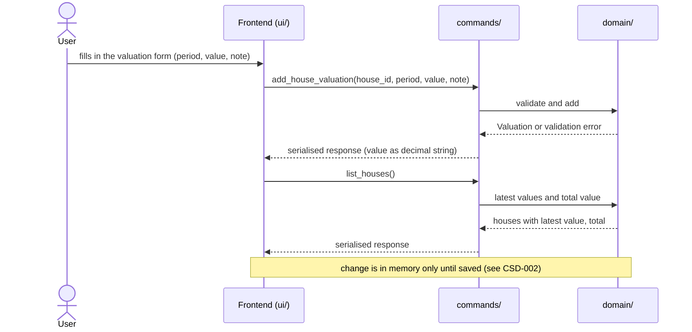
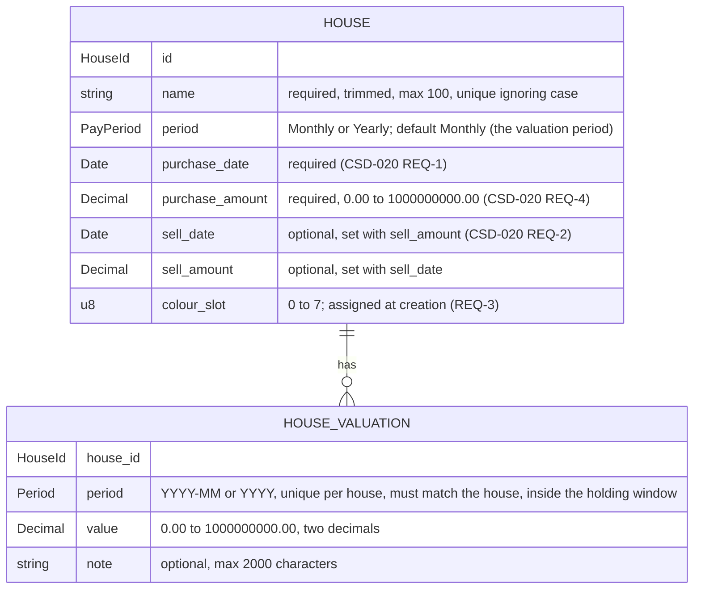

# CSD-015: Houses

## 1. Intent
The app tracks bank accounts, investments and debts, but has no view of the houses the user owns. This capability, which replaces the former Assets capability (the app tracks houses only), lets the user record houses, each with its purchase, and, per house, one value per month or per year, with an optional note. From these the app derives, per valuation, how much the value changed since the previous one and, per calendar year, the yearly values with the closing value and the change. It is for a single person keeping a private, local history of what their houses are worth. It records values as the user estimates or reads them, such as a valuation report. It does not model the house: no depreciation, no address. The purchase and the sale of a house are specified in CSD-020. The result is a value history per house, which the Insights chart of CSD-016 and the Net worth page of CSD-017 build on. It follows the structure of Debts (CSD-011), with a value that cannot be negative and with the change counted as growth.

## 2. Scope
### 2.1 In scope
- Create, edit and delete houses, each with a name, a valuation period (Monthly or Yearly), a purchase date and a purchase amount (CSD-020).
- Create, edit and delete one valuation per house per period: the value (0.00 or more) and an optional note.
- Change the period of an existing valuation (REQ-12).
- Copy the previous valuation into the add form.
- The change per valuation: its value minus the value of the previous valuation (REQ-19).
- Yearly values per calendar year over all houses: closing value and change.
- One Houses view (tab Overview) with the houses, their latest values, the total value, the yearly values and the valuations of all houses. The Insights tab is CSD-016.
- House data is part of the project file (CSD-002). Valuations count for the currency confirmation of CSD-003 (REQ-25).

### 2.2 Non-goals
- NG-1: Depreciation, appreciation rates and any forecast of a value. (The purchase price is part of the purchase of CSD-020.)
- NG-2: Any kind of property other than a house (a car, land, a business), a house type, an address and other details of the house: a name is the only identifier. Every record of this capability is a house.
- NG-3: (removed in v0.5) A debt linked to a house is now CSD-020.
- NG-4: Netting the houses against debts, bank accounts and investments on the Houses page, and integration with the dashboard (CSD-004). The integration with net worth is specified in CSD-017.
- NG-5: Data fetched from a valuation service, and import of valuations (CSV, PDF).
- NG-6: Archiving a house. A house at 0.00 stays a normal row, and a sold house stays listed (CSD-020).
- NG-7: A currency per house. All amounts are in the project currency (CSD-003).
- NG-8: Individual transactions other than the one purchase and one sale of CSD-020 (renovation costs, partial sales), and negative values.
- NG-9: Aligning the latest values of different houses to one date, or estimating a value for a period without a valuation.
- NG-10: Moving a valuation to another house. Only the period of a valuation can change (REQ-12).
- NG-11: Changing the periods of several valuations at once.
- NG-12: Rich text or attachments in notes.
- NG-13: Letting the user choose the colour of a house (CSD-016 NG-6).

## 3. Definitions
| Term | Meaning |
|---|---|
| **House** | One thing the user owns that has a value, identified by a name such as "Example House". |
| **Valuation period** | How a house is recorded: **Monthly** (one valuation per calendar month, `YYYY-MM`) or **Yearly** (one valuation per calendar year, `YYYY`). A house is Monthly unless Yearly is chosen. |
| **Valuation** | The record of one house for one period: its value and an optional note. |
| **Value** | What the house is worth at the end of the period, as one amount of 0.00 or more in the project currency. |
| **Previous valuation** | The valuation of the same house with the latest period before that of the valuation at hand, also when periods in between have none. |
| **Change** | For a valuation: its value minus the value of its previous valuation. Positive when the value grew, negative when it fell. It is derived and never stored. A first valuation has no change. |
| **Latest value** | The value of the valuation with the most recent period of a house. |
| **Total value** | The sum of the latest values of all held houses (CSD-020 REQ-9) that have at least one valuation. |
| **Yearly value** | One row per calendar year: the closing value and the change of that year, over all houses. See REQ-20. |
| **Closing value (of a year)** | The sum, over the houses that have a valuation in that year, of the value of each house's latest valuation in that year. |
| **Opening value (of a house in a year)** | The value of the latest valuation of the house before that year. A house without an earlier valuation has none. |
| **Change (in a year)** | The sum, over the houses that have a valuation in that year and an opening value in it, of the closing value minus the opening value of that house. It is negative when those houses lost value. It is none when no house has an opening value in that year. |
| **Colour slot** | A number from 0 to 7 stored with a house. CSD-016 draws the house in the colour of its slot. |
| **Note** | Optional plain text, up to 2,000 characters, that goes with one valuation. |
| **Project file** | The single user-chosen file holding all app data (CSD-002). Houses are one of its sections. |

## 4. Requirements

> CSD-020 extends REQ-1 and REQ-4 (the purchase, which every house has, and the sale: CSD-020 REQ-1 to REQ-5 and REQ-12), REQ-4 and REQ-6 (linked debts: link in the debt form, no delete while linked: CSD-020 REQ-15, REQ-24), REQ-7 and REQ-13 (valuations lie in the holding window: CSD-020 REQ-6 and REQ-7), REQ-17 (the total counts held houses only: CSD-020 REQ-9), REQ-20 (yearly figures count houses held at year end: CSD-020 REQ-10) and REQ-21 (held or sold, linked debts in the view: CSD-020 REQ-8, REQ-29), and REQ-24 (purchase and sale in the project file: CSD-020 REQ-13). Where they differ, CSD-020 applies. In the scenarios below, a house was bought before its first valuation unless stated.

### 4.0 Overview flow


### 4.1 Houses

**REQ-1: Add a house** *(event-driven)*
When the user submits a new house with a name, a valuation period, a purchase date and a purchase amount, the app shall create the house with valuation period Monthly unless Yearly is chosen, with the purchase as given (CSD-020 REQ-1 to REQ-4) and with a colour slot under REQ-3.

```gherkin
@AC-1.1
Scenario: House created with the default period
  Given no houses exist
  When the user adds a house named "Example House" with purchase date 15/03/2024 and purchase amount 250000.00 without choosing a period
  Then the house "Example House" exists with valuation period "Monthly", purchase date 15/03/2024 and purchase amount 250000.00
  And it has no valuations

@AC-1.2
Scenario: Yearly house
  Given no houses exist
  When the user adds a house named "Example Lodge" with valuation period "Yearly", purchase date 01/06/2020 and purchase amount 60000.00
  Then the house "Example Lodge" exists with valuation period "Yearly"

@AC-1.3
Scenario: Unknown period rejected
  When the user adds a house named "Example House" with valuation period "Weekly", purchase date 15/03/2024 and purchase amount 250000.00
  Then it is rejected with error code "HOUSE_PERIOD_UNSUPPORTED"
  And no house exists

@AC-1.4
Scenario: A house always has a purchase
  When the user adds a house named "Example House" without a purchase date
  Then it is rejected with error code "HOUSE_PURCHASE_DATE_REQUIRED"
  And no house exists
```

**REQ-2: House name rules** *(unwanted behaviour)*
If the name of a house is empty after trimming, is longer than 100 characters, or equals the name of another house when case is ignored, then the app shall reject the house or edit without storing or changing it, and shall store an accepted name trimmed.

```gherkin
@AC-2.1
Scenario Outline: Invalid names rejected
  Given a house named "Example House"
  When the user adds a house named "<name>"
  Then it is rejected with error code "<code>"
  And only the house "Example House" exists

  Examples:
    | name           | code                  |
    | (empty)        | HOUSE_NAME_REQUIRED   |
    | (three spaces) | HOUSE_NAME_REQUIRED   |
    | EXAMPLE HOUSE  | HOUSE_NAME_DUPLICATE  |
    | example house  | HOUSE_NAME_DUPLICATE  |

@AC-2.2
Scenario: Name length boundary
  When the user adds a house with a name of 100 characters
  Then the house exists
  When the user adds a house with a name of 101 characters
  Then it is rejected with error code "HOUSE_NAME_TOO_LONG"

@AC-2.3
Scenario: The name is stored trimmed
  When the user adds a house named "  Example House  "
  Then the house is named "Example House"

@AC-2.4
Scenario: Renaming to an existing name is rejected
  Given houses "Example House" and "Example Lodge"
  When the user renames "Example Lodge" to "example house"
  Then the edit is rejected with error code "HOUSE_NAME_DUPLICATE"

@AC-2.5
Scenario: Changing only the case of its own name is allowed
  Given a house "Example Lodge"
  When the user renames it to "EXAMPLE LAND"
  Then the house is named "EXAMPLE LAND"
```

**REQ-3: Colour slot** *(event-driven)*
When a house is created, the app shall give it the lowest colour slot (0 to 7) that is used by the fewest existing houses, and shall keep that slot for the life of the house, also when other houses are deleted.

```gherkin
@AC-3.1
Scenario: Slots follow creation order
  Given no houses exist
  When the user adds three houses
  Then they have colour slots 0, 1 and 2 in the order they were added

@AC-3.2
Scenario: Slots cycle after eight houses
  Given eight houses with colour slots 0 to 7
  When the user adds a ninth house
  Then it has colour slot 0

@AC-3.3
Scenario: Deleting a house does not recolour the others
  Given houses with colour slots 0, 1 and 2
  When the user deletes the house with colour slot 0 and confirms
  Then the other houses still have colour slots 1 and 2

@AC-3.4
Scenario: A freed slot is used first
  Given houses with colour slots 0, 1 and 2
  When the user deletes the house with colour slot 1 and confirms
  And adds a house
  Then the new house has colour slot 1

@AC-3.5
Scenario: Renaming keeps the slot
  Given a house with colour slot 2
  When the user renames it
  Then it still has colour slot 2
```

**REQ-4: Edit a house** *(event-driven)*
When the user edits a house, the app shall apply a changed name under REQ-2, a changed valuation period under REQ-5 and a changed purchase under CSD-020 REQ-1 to REQ-4, and shall keep the house's valuations.

```gherkin
@AC-4.1
Scenario: Rename keeps valuations
  Given a house "Example House" with 2 valuations
  When the user renames it to "Example Home"
  Then the house is named "Example Home"
  And it still has 2 valuations

@AC-4.2
Scenario: Period of a house without valuations can change
  Given a "Monthly" house "Example House" with no valuations
  When the user changes its valuation period to "Yearly"
  Then the house has valuation period "Yearly"

@AC-4.3
Scenario: An invalid edit changes nothing
  Given houses "Example House" and "Example Lodge"
  When the user renames "Example Lodge" to "  "
  Then the edit is rejected with error code "HOUSE_NAME_REQUIRED"
  And "Example Lodge" keeps its name
```

**REQ-5: Valuation period is locked once valuations exist** *(unwanted behaviour)*
If the user changes the valuation period of a house that has at least one valuation, then the app shall reject the change with the error code `HOUSE_PERIOD_LOCKED`.

```gherkin
@AC-5.1
Scenario: Period change rejected
  Given a "Monthly" house "Example House" with a valuation for 2026-09
  When the user changes its valuation period to "Yearly"
  Then the change is rejected with error code "HOUSE_PERIOD_LOCKED"
  And the house still has valuation period "Monthly"

@AC-5.2
Scenario: Period change allowed again after deleting the last valuation
  Given a "Monthly" house "Example House" with one valuation
  When the user deletes the valuation and confirms
  And changes the valuation period to "Yearly"
  Then the house has valuation period "Yearly"
```

**REQ-6: Delete a house** *(event-driven)*
When the user confirms deletion of a house, the app shall remove the house and all of its valuations. The confirmation reads "This house and all its valuations will be deleted.", the same whether or not the house has valuations, and states no number of valuations.

```gherkin
@AC-6.1
Scenario: Deletion cascades
  Given a house "Example House" with 3 valuations
  When the user deletes the house and confirms
  Then the house no longer exists
  And none of its 3 valuations exist

@AC-6.2
Scenario: Cancelled deletion changes nothing
  Given a house "Example House" with 3 valuations
  When the user starts deleting the house and cancels
  Then the house and its 3 valuations still exist

@AC-6.3
Scenario: A house at 0.00 is deleted like any other
  Given a house "Example Cabin" whose latest value is 0.00
  When the user deletes the house and confirms
  Then the house and its valuations no longer exist

@AC-6.4
Scenario Outline: The confirmation states no count
  Given a house "Example House" with <valuations>
  When the user starts deleting the house
  Then the confirmation reads "This house and all its valuations will be deleted."
  And it states no number of valuations

  Examples:
    | valuations     |
    | 3 valuations   |
    | no valuations  |
```

### 4.2 Valuations

**REQ-7: Add a valuation** *(event-driven)*
When the user submits a valuation for the house chosen in the add form, a period and a value, the app shall store it with the given note, or with an empty note if none is given. Any period of the kind of the house is accepted, in the past or in the future, within the holding window of CSD-020 REQ-6.

```gherkin
@AC-7.1
Scenario: Monthly valuation with a note
  Given a monthly house "Example House"
  When the user adds a valuation for 2026-09 with value 300000.00 and note "Valuation report"
  Then the valuation for 2026-09 has value 300000.00 and note "Valuation report"

@AC-7.2
Scenario: Yearly valuation without a note
  Given a yearly house "Example Lodge"
  When the user adds a valuation for 2025 with value 80000.00 and no note
  Then the valuation for 2025 has value 80000.00 and an empty note

@AC-7.3
Scenario: Old periods are accepted
  Given a monthly house "Example House" bought on 15/03/2010
  When the user adds a valuation for 2019-01 with value 200000.00
  Then the valuation for 2019-01 exists

@AC-7.4
Scenario Outline: A period in the future is accepted
  Given a <period_type> house "Example House"
  When the user adds a valuation for "<period>" with value 1000.00
  Then the valuation for "<period>" exists

  Examples:
    | period_type | period  |
    | monthly     | 2040-11 |
    | yearly      | 2040    |

@AC-7.5
Scenario Outline: Invalid period rejected
  Given a <period_type> house "Example House"
  When the user adds a valuation for "<period>" with value 1000.00
  Then it is rejected with error code "HOUSE_VALUATION_PERIOD_INVALID"

  Examples:
    | period_type | period  |
    | monthly     | 2026-13 |
    | monthly     | 2026-9  |
    | monthly     | abcd    |
    | yearly      | 26      |
    | yearly      | abcd    |
```

**REQ-8: One valuation per house per period** *(unwanted behaviour)*
If the user adds a valuation for a house and period that already has one, then the app shall reject it with the error code `HOUSE_VALUATION_DUPLICATE` and leave the existing valuation unchanged.

```gherkin
@AC-8.1
Scenario: Duplicate period rejected
  Given a monthly house with a valuation for 2026-09 with value 300000.00 and note "First"
  When the user adds another valuation for 2026-09 with value 310000.00
  Then it is rejected with error code "HOUSE_VALUATION_DUPLICATE"
  And the valuation for 2026-09 still has value 300000.00 and note "First"

@AC-8.2
Scenario: Same period on a different house is allowed
  Given two monthly houses, and the first has a valuation for 2026-09
  When the user adds a valuation for 2026-09 to the second house
  Then both houses have a valuation for 2026-09
```

**REQ-9: Valuations match the valuation period** *(unwanted behaviour)*
If the user adds a monthly valuation to a yearly house or a yearly valuation to a monthly house, then the app shall reject it with the error code `HOUSE_PERIOD_MISMATCH`.

```gherkin
@AC-9.1
Scenario: Monthly valuation for a yearly house rejected
  Given a "Yearly" house
  When a valuation for 2026-09 with value 1000.00 is added to it
  Then it is rejected with error code "HOUSE_PERIOD_MISMATCH"

@AC-9.2
Scenario: Yearly valuation for a monthly house rejected
  Given a "Monthly" house
  When a valuation for 2025 with value 1000.00 is added to it
  Then it is rejected with error code "HOUSE_PERIOD_MISMATCH"
```

**REQ-10: Value validation** *(unwanted behaviour)*
If the value of a valuation is not a plain number such as 300000.00, is negative, has more than two decimal places or exceeds 1,000,000,000.00, then the app shall reject the valuation or edit without rounding or storing it. A value of 0.00 is valid.

```gherkin
@AC-10.1
Scenario Outline: Invalid values rejected
  Given a monthly house "Example House"
  When the user adds a valuation for 2026-09 with value "<value>"
  Then it is rejected with error code "<code>"
  And no valuation for 2026-09 exists

  Examples:
    | value          | code                          |
    | (empty)        | HOUSE_VALUATION_VALUE_INVALID   |
    | abc            | HOUSE_VALUATION_VALUE_INVALID   |
    | 1e3            | HOUSE_VALUATION_VALUE_INVALID   |
    | 2500,50        | HOUSE_VALUATION_VALUE_INVALID   |
    | -0.01          | HOUSE_VALUATION_VALUE_NEGATIVE  |
    | 1000.999       | HOUSE_VALUATION_VALUE_PRECISION |
    | 1000000000.01  | HOUSE_VALUATION_VALUE_TOO_LARGE |

@AC-10.2
Scenario Outline: Boundary values accepted
  Given a monthly house "Example House"
  When the user adds a valuation for 2026-09 with value "<value>"
  Then the valuation for 2026-09 has value <value>

  Examples:
    | value         |
    | 0.00          |
    | 1000000000.00 |

@AC-10.3
Scenario: Invalid value in an edit rejected
  Given a valuation for 2026-09 with value 300000.00
  When the user sets the value to -1.00
  Then the edit is rejected with error code "HOUSE_VALUATION_VALUE_NEGATIVE"
  And the valuation still has value 300000.00
```

**REQ-11: Note validation** *(unwanted behaviour)*
If the note of a valuation is longer than 2,000 characters, then the app shall reject the valuation or edit with the error code `HOUSE_VALUATION_NOTE_TOO_LONG`, without shortening or storing it. Line breaks in a note are kept as typed.

```gherkin
@AC-11.1
Scenario: Note length boundary
  Given a monthly house "Example House"
  When the user adds a valuation for 2026-08 with value 1000.00 and a note of 2000 characters
  Then the valuation for 2026-08 exists with that note
  When the user adds a valuation for 2026-09 with value 1000.00 and a note of 2001 characters
  Then it is rejected with error code "HOUSE_VALUATION_NOTE_TOO_LONG"
  And no valuation for 2026-09 exists

@AC-11.2
Scenario: Line breaks are kept
  Given a monthly house "Example House"
  When the user adds a valuation for 2026-09 with value 1000.00 and the note "line one" and "line two" on two lines
  Then the note of the valuation has two lines
```

**REQ-12: Edit a valuation and change its period** *(event-driven)*
When the user edits an existing valuation in the edit form and saves, the app shall give the valuation the edited value and note under REQ-10 and REQ-11 and, when the period was changed, the new period, as one change, without asking for confirmation. The valuation stays with its house, and the latest values, the changes, the yearly values and the insights show it under its new period.

```gherkin
@AC-12.1
Scenario: Edit value and note
  Given a valuation for 2026-09 with value 300000.00 and note "First"
  When the user sets the value to 310000.00 and the note to "Corrected"
  Then the valuation has value 310000.00 and note "Corrected"

@AC-12.2
Scenario: Clear a note
  Given a valuation for 2026-09 with value 300000.00 and note "First"
  When the user empties the note
  Then the valuation has an empty note

@AC-12.3
Scenario: Move a valuation to another month
  Given a monthly house with a valuation for 2026-09 with value 300000.00 and note "First"
  When the user changes its period to 2026-08
  Then the house has a valuation for 2026-08 with value 300000.00 and note "First"
  And the house has no valuation for 2026-09
  And no confirmation was asked

@AC-12.4
Scenario: Change the period and the value together
  Given a monthly house with a valuation for 2026-09 with value 300000.00
  When the user changes its period to 2026-08 and sets the value to 310000.00
  Then the valuation for 2026-08 has value 310000.00
  And there is no valuation for 2026-09

@AC-12.5
Scenario: Move a yearly valuation
  Given a yearly house with a valuation for 2025 with value 80000.00
  When the user changes its period to 2024
  Then the house has a valuation for 2024 with value 80000.00
  And the house has no valuation for 2025

@AC-12.6
Scenario: The yearly values follow the move
  Given a monthly house with valuations 2025-11 (value 10000.00), 2025-12 (value 10200.00) and 2026-05 (value 11000.00)
  When the user changes the period of the valuation for 2025-12 to 2026-01
  Then 2025 shows closing value 10000.00
  And 2026 shows closing value 11000.00

@AC-12.7
Scenario Outline: The edit form offers the period
  Given <valuation>
  When the user opens it for editing
  Then the form shows the <field> "<value>" and the house, which cannot be changed

  Examples:
    | valuation                        | field | value   |
    | a monthly valuation for 2026-09  | month | 2026-09 |
    | a yearly valuation for 2025      | year  | 2025    |

@AC-12.8
Scenario: Keeping the period changes only the values
  Given a monthly house with a valuation for 2026-09 with value 300000.00
  When the user saves it with the period 2026-09 and value 310000.00
  Then the valuation for 2026-09 has value 310000.00
  And no error about a duplicate period is shown

@AC-12.9
Scenario: An edit is an unsaved change
  Given a saved project with a monthly valuation for 2026-09
  When the user changes its period to 2026-08
  Then the unsaved indicator is shown
```

**REQ-13: Invalid new period** *(unwanted behaviour)*
If the new period of an edited valuation is not a valid period, or lies outside the holding window of CSD-020 REQ-6, or the house already has another valuation for it, or it does not match the valuation period of the house, or the edit also has an invalid value, then the app shall reject the whole edit with the error code of the violated rule and leave the valuation, with its period and its values, as it was. Another house may have a valuation for the same period.

AC-13.1 (removed in v1.0): a period in the future is accepted (REQ-7, AC-7.4), so there is no rejection to specify.

```gherkin
@AC-13.2
Scenario: A period that already has a valuation is rejected
  Given a monthly house with a valuation for 2026-08 with value 299000.00 and one for 2026-09 with value 300000.00
  When the user changes the period of the valuation for 2026-09 to 2026-08 and sets the value to 310000.00
  Then the edit is rejected with error code "HOUSE_VALUATION_DUPLICATE"
  And the valuation for 2026-08 still has value 299000.00
  And the valuation for 2026-09 still has value 300000.00

@AC-13.3
Scenario Outline: A period of the wrong kind is rejected
  Given <house> with a valuation for <old>
  When the user changes its period to "<new>"
  Then the edit is rejected with error code "HOUSE_PERIOD_MISMATCH"
  And the valuation is still for <old>

  Examples:
    | house           | old     | new     |
    | a monthly house | 2026-09 | 2026    |
    | a yearly house  | 2025    | 2024-12 |

@AC-13.4
Scenario: An invalid value rejects the whole edit
  Given a monthly house with a valuation for 2026-09 with value 300000.00
  When the user changes its period to 2026-08 and sets the value to -1.00
  Then the edit is rejected with error code "HOUSE_VALUATION_VALUE_NEGATIVE"
  And the valuation is still for 2026-09 with value 300000.00
  And the unsaved indicator is not shown

@AC-13.5
Scenario: Another house may have the same period
  Given two monthly houses, the first with a valuation for 2026-08 and the second with one for 2026-09
  When the user changes the period of the second house's valuation to 2026-08
  Then both houses have a valuation for 2026-08

@AC-13.6
Scenario: An invalid period is rejected
  Given a monthly house with a valuation for 2026-09 with value 300000.00
  When the user changes its period to "2026-13"
  Then the edit is rejected with error code "HOUSE_VALUATION_PERIOD_INVALID"
  And the valuation is still for 2026-09
```

**REQ-14: Delete a valuation** *(event-driven)*
When the user confirms deletion of a valuation, the app shall remove that valuation and no other data.

```gherkin
@AC-14.1
Scenario: Confirmed deletion
  Given a monthly house with valuations for 2026-08 and 2026-09
  When the user deletes the valuation for 2026-09 and confirms
  Then only the valuation for 2026-08 remains

@AC-14.2
Scenario: Cancelled deletion changes nothing
  Given a monthly house with valuations for 2026-08 and 2026-09
  When the user starts deleting the valuation for 2026-09 and cancels
  Then both valuations still exist
```

**REQ-15: Copy the previous period** *(event-driven)*
When the user chooses "copy previous month" (monthly house) or "copy previous year" (yearly house) in the add form, the app shall pre-fill the value with that of the house's most recent valuation and leave the note empty, and shall not store anything until the user confirms.

```gherkin
@AC-15.1
Scenario: Form pre-filled from the latest valuation
  Given a monthly house with valuations for 2026-07 (value 299000.00) and 2026-08 (value 300000.00, note "Valuation report")
  When the user chooses "copy previous month" in the add form for that house
  Then the form shows value 300000.00 and an empty note
  And no new valuation exists

@AC-15.2
Scenario: House without valuations
  Given a monthly house with no valuations
  When the user chooses "copy previous month" in the add form for that house
  Then the form is left empty
  And no error is shown

@AC-15.3
Scenario: A value of 0.00 is copied as it is
  Given a monthly house with a valuation for 2026-08 with value 0.00
  When the user chooses "copy previous month" in the add form for that house
  Then the form shows value 0.00
```

**REQ-16: The add form follows the valuation period** *(event-driven)*
When the user chooses a house in the add form, the app shall ask for a month if the house is monthly and for a year if it is yearly, and shall label the copy button "Copy previous month" or "Copy previous year" accordingly.

```gherkin
@AC-16.1
Scenario: Monthly house
  Given a "Monthly" house
  When the user chooses it in the add form
  Then the form asks for "Month (YYYY-MM)"
  And the copy button reads "Copy previous month"

@AC-16.2
Scenario: Yearly house
  Given a "Yearly" house
  When the user chooses it in the add form
  Then the form asks for "Year (YYYY)"
  And the copy button reads "Copy previous year"

@AC-16.3
Scenario: Switching house switches the form
  Given a "Monthly" house and a "Yearly" house
  When the user chooses the yearly house and then the monthly house in the add form
  Then the form asks for a year and then for a month again
```

### 4.3 Views

**REQ-17: Latest value and total value** *(ubiquitous)*
The app shall show for each house the value of its most recent valuation together with that valuation's period, and shall show the total of the latest values of all houses that have a valuation, as computed in Rust, without converting or aligning the periods.

```gherkin
@AC-17.1
Scenario: Latest value per house
  Given a monthly house with valuations for 2026-07 (value 299000.00) and 2026-09 (value 300000.00)
  Then the house shows latest value 300000.00 for 2026-09

@AC-17.2
Scenario: Total over houses with different periods
  Given a monthly house with latest valuation 2026-09 (value 300000.50)
  And a yearly house with latest valuation 2025 (value 80000.00)
  Then the total value is 380000.50
  And the houses show the periods 2026-09 and 2025

@AC-17.3
Scenario: Houses without valuations do not count
  Given a monthly house with latest valuation 2026-09 (value 300000.00)
  And a monthly house with no valuations
  Then the total value is 300000.00

@AC-17.4
Scenario: A house at 0.00 counts as 0.00
  Given a monthly house with latest valuation 2026-09 (value 300000.00)
  And a monthly house "Example Cabin" with latest valuation 2026-09 (value 0.00)
  Then the total value is 300000.00
  And "Example Cabin" shows latest value 0.00

@AC-17.5
Scenario: A new latest valuation updates the total
  Given a monthly house with a valuation for 2026-09 (value 300000.00)
  When the user adds a valuation for 2026-10 with value 305000.00
  Then the house shows latest value 305000.00 for 2026-10
  And the total value is 305000.00

@AC-17.6
Scenario: An older valuation does not change the latest value
  Given a monthly house with a valuation for 2026-09 (value 300000.00)
  When the user adds a valuation for 2026-01 with value 280000.00
  Then the house still shows latest value 300000.00 for 2026-09
```

**REQ-18: Ordering** *(ubiquitous)*
The app shall list houses alphabetically by name ignoring case, and the valuations of all houses by period, newest first, with a yearly valuation counting as December of its year and, within a period, by house in the alphabetical order of the houses.

```gherkin
@AC-18.1
Scenario: Houses alphabetical
  Given houses "example land", "Example House" and "Example Cabin"
  Then the houses are listed "Example Cabin", "Example House", "example land"

@AC-18.2
Scenario: Newest valuation first
  Given a monthly house with valuations for 2026-07 and 2026-09
  Then the valuation for 2026-09 is listed before the valuation for 2026-07

@AC-18.3
Scenario: Yearly valuation counts as December
  Given a monthly house with valuations for 2025-11 and 2025-12 and a yearly house with a valuation for 2025
  Then the valuation for 2025-12 and the valuation for 2025 are listed before the valuation for 2025-11

@AC-18.4
Scenario: Same period is ordered by house
  Given monthly houses "Example House" and "Example Cabin", both with a valuation for 2026-09
  Then the valuation of "Example Cabin" is listed before that of "Example House"
```

**REQ-19: Change per valuation** *(ubiquitous)*
The app shall show for each valuation its change, its value minus the value of the previous valuation of the same house, computed in Rust each time it is needed, and a dash for a valuation that has no previous valuation.

```gherkin
@AC-19.1
Scenario: Change follows the previous valuation
  Given a monthly house with valuations 2026-07 (value 10000.00), 2026-08 (value 10500.00) and 2026-09 (value 10400.00)
  Then the change of 2026-07 is none
  And the change of 2026-08 is 500.00
  And the change of 2026-09 is -100.00

@AC-19.2
Scenario: A gap does not matter
  Given a monthly house with valuations 2026-03 (value 10000.00) and 2026-09 (value 12000.00)
  Then the change of 2026-09 is 2000.00

@AC-19.3
Scenario: Yearly valuations
  Given a yearly house with valuations 2024 (value 80000.00) and 2025 (value 85000.00)
  Then the change of 2025 is 5000.00
  And the change of 2024 is none

@AC-19.4
Scenario: Another house does not count
  Given a monthly house "Example House" with a valuation 2026-09 (value 300000.00)
  And a monthly house "Example Cabin" with valuations 2026-08 (value 15000.00) and 2026-09 (value 14500.00)
  Then the change of "Example House" 2026-09 is none
  And the change of "Example Cabin" 2026-09 is -500.00

@AC-19.5
Scenario: Changes follow edits
  Given a monthly house with valuations 2026-07 (value 10000.00), 2026-08 (value 10500.00) and 2026-09 (value 11000.00)
  When the user changes the period of the valuation for 2026-08 to 2026-10
  Then the change of 2026-09 is 1000.00
  And the change of 2026-10 is -500.00

@AC-19.6
Scenario: Editing an earlier valuation changes the later change
  Given a monthly house with valuations 2026-08 (value 10500.00) and 2026-09 (value 11000.00)
  When the user sets the value of 2026-08 to 10200.00
  Then the change of 2026-09 is 800.00
```

**REQ-20: Yearly values** *(event-driven)*
When the user views the Houses overview, the app shall show, for each calendar year with at least one valuation of any house and newest year first, in Rust: the closing value and the change of that year, without extrapolating partial years and without carrying values forward. A valuation counts in the year of its own period only.

```gherkin
@AC-20.1
Scenario: Values per calendar year
  Given a monthly house with valuations 2025-11 (value 10000.00), 2025-12 (value 10200.00) and 2026-05 (value 11000.00)
  When the user views the yearly values
  Then 2026 shows closing value 11000.00, change 800.00
  And 2025 shows closing value 10200.00, change none

@AC-20.2
Scenario: No valuations
  Given a house with no valuations
  When the user views the yearly values
  Then the yearly values list is empty

@AC-20.3
Scenario: Values add up all houses
  Given house "Example House" with valuations 2026-08 (value 300000.00) and 2026-09 (value 301000.00)
  And house "Example Lodge" with a valuation 2026-09 (value 50000.00)
  When the user views the yearly values
  Then there is one row for 2026 with closing value 351000.00, change none

@AC-20.4
Scenario: Closing value is the latest value of the year, not a sum over months
  Given a monthly house with valuations 2026-03 (value 10000.00) and 2026-09 (value 12000.00)
  When the user views the yearly values
  Then 2026 shows closing value 12000.00

@AC-20.5
Scenario: Monthly and yearly houses add up together
  Given a monthly house "Example House" with a valuation 2025-12 (value 300000.00)
  And a yearly house "Example Lodge" with valuations 2024 (value 50000.00) and 2025 (value 55000.00)
  When the user views the yearly values
  Then 2025 shows closing value 355000.00, change 5000.00
  And 2024 shows closing value 50000.00, change none

@AC-20.6
Scenario: A house without a valuation in a year does not count in it
  Given a monthly house "Example House" with valuations 2025-12 (value 300000.00) and 2026-03 (value 310000.00)
  And a yearly house "Example Lodge" with a valuation 2025 (value 55000.00)
  When the user views the yearly values
  Then 2026 shows closing value 310000.00, change 10000.00
  And 2025 shows closing value 355000.00, change none

@AC-20.7
Scenario: A house that lost value shows a negative change
  Given a monthly house with valuations 2025-12 (value 15000.00) and 2026-03 (value 14000.00)
  When the user views the yearly values
  Then 2026 shows change -1000.00

@AC-20.8
Scenario: A house without an opening value adds no change
  Given a monthly house "Example House" with valuations 2025-12 (value 300000.00) and 2026-03 (value 310000.00)
  And a monthly house "Example Cabin" with a first valuation 2026-03 (value 15000.00)
  When the user views the yearly values
  Then 2026 shows closing value 325000.00, change 10000.00

@AC-20.9
Scenario: Change after a gap counts in the later year
  Given a monthly house with valuations 2024-12 (value 10000.00) and 2026-06 (value 12000.00)
  When the user views the yearly values
  Then 2026 shows change 2000.00
  And 2025 is not listed

@AC-20.10
Scenario: A new valuation updates the yearly values
  Given a monthly house with valuations 2025-12 (value 10000.00) and 2026-09 (value 11000.00)
  When the user adds a valuation for 2026-10 with value 11500.00
  Then 2026 shows closing value 11500.00, change 1500.00

@AC-20.11
Scenario: Newest year first
  Given a yearly house with valuations 2024, 2025 and 2026
  When the user views the yearly values
  Then the rows are listed 2026, 2025, 2024
```

**REQ-21: Houses view layout** *(ubiquitous)*
The app shall offer Houses as its own item in the left pane with a house icon (position: CSD-024 REQ-1), and shall show the Overview tab as the sections Houses, Yearly values and Valuations in that order, with the valuation period, the latest value with its period in smaller muted text beside it (as on the Debts rows) and the icon buttons Edit (pencil) and Delete (trash) (flush right) on each house row, the button "Add house" in the header of the Houses section, the button "Add valuation" in the header of the Valuations section, the icon buttons Edit (pencil) and Delete (trash) flush right on each valuation row, the total value in a footer row of the Houses section labelled "Total value", the columns Year, Closing value and Change and no actions in the Yearly values section, no count of valuations anywhere in the view, the columns Period, House, Value, Change and Note in the Valuations section, and no house selection that changes what the sections show. A note longer than one line is cut to one line in the table and shown in full when the valuation is edited. A change of none is shown as a dash. The page shall use the same layout, components and styles as the Debts page.

```gherkin
@AC-21.1
Scenario: Sections in order
  Given a house with a valuation
  Then the sections appear in the order Houses, Yearly values, Valuations
  And Houses is an item with a house icon in the left pane (CSD-024 REQ-1)

@AC-21.2
Scenario: House rows carry their period, latest value and actions
  Given monthly house "Example House" with 2 valuations, the latest for 2026-09 with value 300000.00
  And yearly house "Example Lodge" with 1 valuation for 2025 with value 80000.00
  Then the row of "Example House" shows "Monthly" and "300000.00" for 2026-09
  And the row of "Example Lodge" shows "Yearly" and "80000.00" for 2025
  And in each row the value is followed by its period in smaller muted text
  And no row shows a number of valuations
  And each row has the icon buttons Edit (pencil) and Delete (trash) at its right edge, each named for screen readers and in a tooltip, such as "Edit Example Lodge"
  And the footer row reads "Total value" with "380000.00"

@AC-21.3
Scenario: Valuations of all houses with their period, house and change
  Given monthly house "Example House" with valuations for 2026-08 (value 299500.00) and 2026-09 (value 300000.00)
  Then the Valuations section shows the columns Period, House, Value, Change and Note in that order
  And the row for 2026-09 shows change "500.00"
  And the row for 2026-08 shows a dash as change

@AC-21.4
Scenario: Long note cut to one line
  Given a valuation with a note of three lines
  Then the Note column shows one line of it
  And editing the valuation shows the whole note

@AC-21.5
Scenario: Clicking a house changes nothing
  Given two houses with valuations
  When the user clicks a house row
  Then the totals and the valuations are unchanged

@AC-21.6
Scenario: Notes are shown as plain text
  Given a valuation with the note "<b>bold</b>"
  Then the Note column shows the characters "<b>bold</b>" and no formatting

@AC-21.7
Scenario: Add buttons sit in the section headers
  Given a house
  Then the header of the Houses section holds the button "Add house" at its right edge
  And the header of the Valuations section holds the button "Add valuation" at its right edge
  And the page title row holds no button

@AC-21.8
Scenario: Yearly values section
  Given a monthly house "Example House" with valuations for 2025-12 and 2026-09
  Then the Yearly values section shows the columns Year, Closing value and Change in that order
  And the section has no column with a number of valuations
  And a year with change none shows a dash
  And its header holds no button and its rows hold no Edit or Delete button
  And the section is not shown while no houses exist
```

**REQ-22: Empty states** *(state-driven)*
While no houses exist, the app shall show an "Add your first house" prompt and no valuation form, while a house has no valuations, the app shall show a dash as its latest value and no count or "No valuations yet" on its row, while no house has a valuation, the app shall show "No valuations yet." in the Valuations section, and while no house has a valuation, the app shall show "No yearly values yet. They appear once there is a valuation." in the Yearly values section, with no error.

```gherkin
@AC-22.1
Scenario: No houses
  Given no houses exist
  Then the Houses view shows an "Add your first house" prompt
  And there is no valuation form

@AC-22.2
Scenario: House without valuations
  Given a house with no valuations
  Then its row shows a dash as latest value
  And its row shows its valuation period and no "No valuations yet"
  And the Valuations section shows "No valuations yet."
  And no error is shown

@AC-22.3
Scenario: No valuations in any house
  Given a house with no valuations
  Then the Yearly values section shows "No yearly values yet. They appear once there is a valuation."
  And it shows no table and no error
```

**REQ-23: No currency outside Settings** *(ubiquitous)*
The app shall show no currency in the Houses, Yearly values and Valuations sections: not in their titles, on the house rows, in the yearly values table or in the valuations table.

```gherkin
@AC-23.1
Scenario: No currency in the sections
  Given a project in "EUR" with a house and a valuation
  Then the sections are titled "Houses", "Yearly values" and "Valuations"
  And the house rows, the yearly values table and the valuations table show no currency
```

### 4.4 Saving, loading and currency

**REQ-24: Houses are part of the project file** *(event-driven)*
When the user saves and later opens a project, the app shall restore all houses and valuations exactly, including colour slots, purchases and sales (CSD-020 REQ-13), values and notes.

```gherkin
@AC-24.1
Scenario: Round trip
  Given a project with a yearly house "Example Lodge" (colour slot 1, bought on 01/06/2020 for 60000.00) with a valuation for 2025 (value 80000.00, note "Line one" and "Line two" on two lines)
  When the user saves the project and opens it again
  Then the house, its colour slot, its purchase and the valuation exist unchanged, including the two-line note

AC-24.2 (removed in v1.0): a file without the section is now invalid, see AC-27.1.

@AC-24.3
Scenario: A value of 0.00 round trip
  Given a valuation for 2026-09 with value 0.00
  When the user saves the project and opens it again
  Then the valuation has value 0.00

@AC-24.4
Scenario: Other sections are untouched
  Given a project with an employment job, an investment account, a bank account, a debt, an expense and a house
  When the user saves the project and opens it again
  Then all six exist unchanged
```

AC-24.5 (removed in v1.0): moved to AC-27.3. AC-24.6 (removed in v1.0): the former `assets` section is not read any more (first release, no legacy).

**REQ-25: Valuations count for the currency confirmation** *(event-driven)*
When the project has house valuations and the user chooses another currency, the app shall ask for the confirmation of CSD-003 REQ-5, explaining that amounts are not converted, and a house without valuations shall need no confirmation.

```gherkin
@AC-25.1
Scenario: Confirmation with only a house valuation
  Given a project in "EUR" with no jobs, no investments, no bank accounts, no debts, no expenses and a house with 1 valuation for 2026-09 with value 300000.00
  When the user chooses the currency "USD"
  Then the app asks for confirmation before changing it
  And cancelling leaves the currency "EUR"

@AC-25.2
Scenario: A house without valuations needs no confirmation
  Given a project in "EUR" with a house and no valuations
  When the user chooses the currency "USD"
  Then the currency changes to "USD" without a confirmation
```

**REQ-26: Position in the left pane** *(ubiquitous)*
The app shall show the Houses item in the left pane as CSD-024 REQ-1 orders it: in the group Wealth, after Bank accounts and Investments, and apart from Debts, which sits in the group Liabilities.

```gherkin
@AC-26.1
Scenario: Order of the left pane
  Then Houses is the last item of the group "Wealth", after "Bank accounts" and "Investments"
```

**REQ-27: Invalid house data in the project file** *(unwanted behaviour)*
If the project file has no `houses` section, has an unknown field in it, or holds a house without a purchase date or purchase amount or a valuation for a house that does not exist, then the app shall reject the file with the error code `PROJECT_INVALID_FILE` (all sections are required and unknown fields are rejected, CSD-002).

```gherkin
@AC-27.1
Scenario: File without the section
  Given a project file without a "houses" section
  When the user opens it
  Then it is rejected with the error code "PROJECT_INVALID_FILE"

@AC-27.2
Scenario: An unknown field
  Given a project file whose "houses" section has a house with the unknown field "colour"
  When the user opens it
  Then it is rejected with the error code "PROJECT_INVALID_FILE"

@AC-27.3
Scenario: A damaged section is an invalid file
  Given a project file whose "houses" section has a valuation for a house that does not exist
  When the user opens it
  Then it is rejected with the error code "PROJECT_INVALID_FILE"

@AC-27.4
Scenario: A house without a purchase is an invalid file
  Given a project file whose "houses" section has a house without a purchase date
  When the user opens it
  Then it is rejected with the error code "PROJECT_INVALID_FILE"
```

## 5. Interfaces and contracts

Periods: a monthly valuation has period `YYYY-MM` and a yearly one `YYYY`, everywhere (UI, commands, project file). There is no lower or upper bound on a period. Months are shown to the user as `YYYY-MM` (CSD-000 CON-7).



The change per valuation, the opening value and the change in a year are not part of the model: they are derived (REQ-19, REQ-20).

The project file section is `houses` with the lists `houses` and `valuations`, houses in the order they were created. The section is required and unknown fields are rejected (CSD-002, REQ-27). The house field for the valuation period is named `period` in the project file and in IPC, as the period of a valuation is (CSD-002), and the sale fields are named `sell_date` and `sell_amount` there too. Dates are ISO 8601 and values are decimal strings.

Commands (all inputs validated in Rust; amounts cross IPC as decimal strings): `list_houses()` (each house with its valuation count, latest value and period and colour slot, plus the total value; the count is used to lock the period (REQ-5) and is not displayed), `create_house`, `update_house`, `delete_house`, `list_house_valuations()` (valuations of all houses, each with its house name and its change, or null), `add_house_valuation`, `update_house_valuation` (keeps the period that identifies the valuation as an argument and takes the new period as an extra one, equal to it when the period does not change, and applies the edit as a whole or not at all, REQ-13), `delete_house_valuation`, `copy_previous_house_valuation(house_id)` and `yearly_house_values()` (over all houses; each row has the year, closing value, change or null and valuation count, newest year first; the count is not displayed). The insights command is in CSD-016. Project commands (save, open, new) are in CSD-002.

Error codes (returned as code plus safe message): `HOUSE_NAME_REQUIRED`, `HOUSE_NAME_TOO_LONG`, `HOUSE_NAME_DUPLICATE`, `HOUSE_NOT_FOUND`, `HOUSE_PERIOD_UNSUPPORTED`, `HOUSE_PERIOD_LOCKED`, `HOUSE_PERIOD_MISMATCH`, `HOUSE_VALUATION_PERIOD_INVALID`, `HOUSE_VALUATION_DUPLICATE`, `HOUSE_VALUATION_NOT_FOUND`, `HOUSE_VALUATION_VALUE_INVALID`, `HOUSE_VALUATION_VALUE_NEGATIVE`, `HOUSE_VALUATION_VALUE_PRECISION`, `HOUSE_VALUATION_VALUE_TOO_LARGE`, `HOUSE_VALUATION_NOTE_TOO_LONG`. `HOUSE_NOT_FOUND` and `HOUSE_VALUATION_NOT_FOUND` are returned for a house or a valuation that does not exist (a stale screen). `HOUSE_VALUATION_IN_FUTURE` is removed in v1.0: future periods are allowed. The codes for the purchase, the sale and the holding window are in CSD-020. Project error codes are in CSD-002.

## 6. Constraints
- CON-1: Amounts use `rust_decimal::Decimal` and are in the project currency (CSD-003), so adding values across houses never mixes currencies. Rationale: `CLAUDE.md` money rules.
- CON-2: The frontend displays figures computed in Rust, including the latest values, the total value, the changes and the yearly values, and computes none itself. Rationale: `CLAUDE.md` layout rule.
- CON-3: No network access. Rationale: `CLAUDE.md` Tauri security rules, and NG-5.
- CON-4: Errors shown to the user never contain file paths or OS details. Rationale: `CLAUDE.md` error rules.
- CON-5: Values, house names and notes are not logged at `info` or above. Rationale: `CLAUDE.md` privacy rules.
- CON-6: Tests and fixtures use synthetic data only ("Example House", round amounts). Rationale: the repo is public.
- CON-7: Notes are stored as typed and displayed as plain text, never as HTML. Rationale: the frontend must not run markup typed into a note.
- CON-8: The length of a name or a note is counted in characters (Unicode scalar values), not bytes. Rationale: names and notes in any language must fit the stated limits.
- CON-9: The change, the yearly values and the total value are computed in Rust each time they are needed and are never stored in the project file. Rationale: CON-2, and stored figures would go stale when a valuation changes.
- CON-10: Houses get their own module, commands and page. Shared helpers may be reused or extracted when that is small, and Debts, Bank accounts and Investments are not refactored. Rationale: `CLAUDE.md` asks before large refactors across modules.
- CON-11: Money amounts, totals and changes follow the rounding rule of CSD-000 CON-8 (two decimals, half-up). Rationale: one rounding rule project-wide.

## 7. Verification
The data and the domain logic are proven by `cargo test`, with domain logic tested in `domain/`. Tests are named `test_csd015_ac_<n>_<m>_<description>` (CSD-000 REQ-6).

| What | How |
|---|---|
| Rust tests | `cargo test test_csd015_`. One requirement, e.g. REQ-7: `cargo test test_csd015_ac_7_` |
| REQ-9, REQ-11 and REQ-15 (the test names carry the requirement but no AC number) | `cargo test test_csd015_ac_9_`, `test_csd015_ac_11_` and `test_csd015_ac_15_` |
| Yearly values (AC-20.1 to AC-20.11) | `cargo test test_csd015_ac_20_` |
| Display ACs (REQ-21 to REQ-23, REQ-26, the rows of the tables, the dialogs) | No DOM test carries an AC id of this CSD yet, so its display ACs are checked by hand. There are no `test_csd015_ac_21_` tests |
| AC-25.1, AC-25.2 (currency confirmation) | Governed by CSD-003 REQ-5 and verified there. There are no `test_csd015_ac_25_` tests |

Not covered by a named test yet (39 of 108 ACs; no test carries the AC id): AC-1.4, AC-6.2, AC-6.4, AC-9.1, AC-9.2, AC-11.1, AC-11.2, AC-12.2, AC-12.7, AC-12.9, AC-13.4, AC-14.2, AC-15.1 to AC-15.3, AC-16.1 to AC-16.3, AC-17.6, AC-18.3, AC-21.1 to AC-21.8, AC-22.1 to AC-22.3, AC-23.1, AC-25.1, AC-25.2, AC-26.1, AC-27.1 to AC-27.4.

Done means fmt, clippy (`-D warnings`), `cargo test --all-features` and `npm test` pass.

## 8. Open questions
None open. (OQ-1, the position in the left pane, is settled by REQ-26 and CSD-024 REQ-1.)
- OQ-2: (resolved 03/11/2026) The sale fields keep the names `sell_date` and `sell_amount` in the data model, IPC and the project file (section 5, CSD-002, CSD-020).

## 9. Changelog
- 1.2 (03/11/2026): Verification (section 7) lists the real test filters and the ACs that no named test covers yet; claims of tests that do not exist are removed. The claimed `ac_21_` and `ac_25_` coverage is removed; the intro and NG-4 point to CSD-017 for net worth. Back to `draft` until re-approved.
- 1.1 (03/11/2026): Owner decision: the sale fields keep the names `sell_date` and `sell_amount` (OQ-2 resolved, section 5 names them for IPC and the project file, matching CSD-002 and CSD-020). The house field `period` is confirmed as the valuation period name in the data model, replacing any `pay_period` or `valuation_period`. No behaviour change. Back to `draft` until re-approved.
- 1.0 (03/11/2026): A house always has a purchase: `purchase_date` and `purchase_amount` are mandatory (REQ-1, new AC-1.4, REQ-4, section 5 data model, the section 4 note); house purchase and sale are specified in CSD-020. No date bounds: the future-period rejection and the year-1900 bound are removed (REQ-7, AC-7.4, AC-7.5, REQ-13, AC-13.1 removed, error code `HOUSE_VALUATION_IN_FUTURE` removed). First release, no legacy: the former `assets` section is not read (REQ-24, AC-24.6 removed), a file without the section, with an unknown field or with a house without purchase is invalid (new REQ-27, AC-24.2 and AC-24.5 moved to AC-27.1 and AC-27.3). The valuation period of a house is the field `period` in the file and IPC (section 5). Money rounding references CSD-000 CON-8 (new CON-11). Verification table rewritten to what is covered (the claimed ac_21_ coverage and the CSD-003 currency tests are corrected; display ACs are covered by DOM tests). Back to `draft` for re-approval.
- 0.5 (30/10/2026): Assets are renamed to houses everywhere (labels, error codes `HOUSE_*`, commands, the `houses` section of the project file, which also reads the old `assets` key; CSD-002). The app tracks houses only: every existing asset becomes a house, and NG-2 excludes any other kind of property. NG-3 is removed: CSD-020 links existing debts to a house. Back to `draft` until re-approved (GitHub issue 31).
- 0.4 (29/10/2026): CSD-020 adds a purchase and a sale to every house (GitHub issue 27). NG-1, NG-6 and NG-8 no longer exclude them, the Intent says so, and a note in section 4 lists the requirements CSD-020 extends.
- 0.3 (29/10/2026): The position in the left pane follows CSD-004 REQ-1: Houses is in the group Wealth, after Bank accounts and Investments (REQ-26, AC-26.1; GitHub issue 21).
- 0.1 (29/10/2026): initial draft, from GitHub issue 17 and the grill-me interview. It follows CSD-011 (houses, colour slot, period lock, valuations, changing the period, copy previous, yearly values, layout), with a value of 0.00 or more, a change per valuation (REQ-19) counted as growth, and a yearly change in the yearly values. The Insights tab is CSD-016.
- 0.2 (29/10/2026): No counts are displayed any more: the yearly values have the columns Year, Closing value and Change (REQ-20, REQ-21, AC-12.6, AC-20.x, AC-21.2, AC-21.8), house rows show only the period and the latest value with its period in smaller muted text (REQ-21, AC-21.2), the "No valuations yet." note stays in the Valuations section only (REQ-22, AC-22.2), and the delete confirmation states no count (REQ-6, new AC-6.4, manual checklist). The count fields stay in IPC but are not displayed (section 5).
