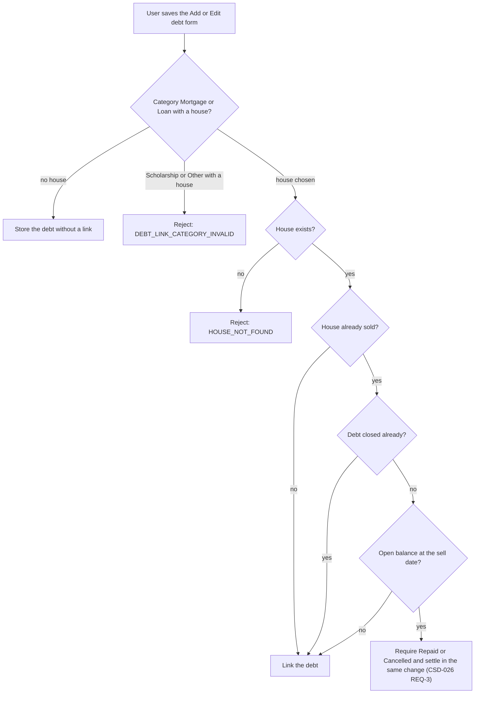
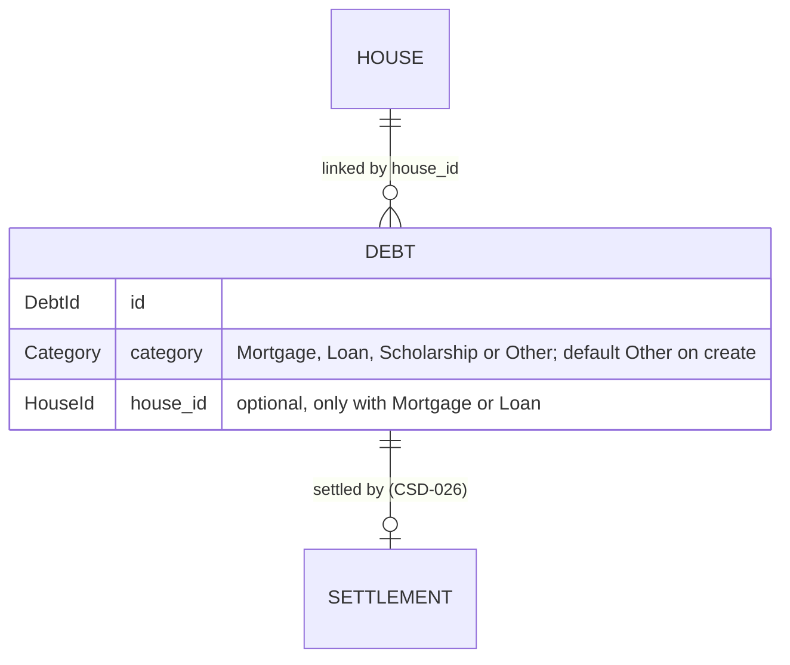

# CSD-020: Debt linked to a house

## 1. Intent
Houses (CSD-015) and debts (CSD-011) are kept apart, yet a mortgage or a loan often belongs to one house. This capability lets the user give each debt a category (Mortgage, Loan, Scholarship or Other) and link a Mortgage or Loan to a house, in the Add and Edit debt form, also to a house that is already sold. The link changes no figure by itself. What a sale of the house does to its linked debts (Repaid or Cancelled, the settlement) is CSD-026, and the purchase and sale of a house are CSD-019. It is for a single person keeping a private, local history. It follows GitHub issues 27 and 31 and the grill-me interviews. The former CSD-020 (v1.1, house purchase, sale and linked debts) is split into CSD-019, this CSD and CSD-026, and the moved items are listed in section 4.3.

## 2. Scope
### 2.1 In scope
- A category on every debt, and an optional link from a Mortgage or Loan to one house, set and removed in the Add and Edit debt form, also to an already sold house.
- The rules for the category and the link, and the debt form and the Debts view that show them.
- The project file (CSD-002) for the category, the link and the settlement of debts.

### 2.2 Non-goals
- NG-1: (moved to CSD-019 NG-1)
- NG-2: (moved to CSD-019 NG-2)
- NG-3: (moved to CSD-019 NG-3)
- NG-4: (moved to CSD-019 NG-4)
- NG-5: (moved to CSD-019 NG-5)
- NG-6: (moved to CSD-019 NG-6)
- NG-7: Categories other than Mortgage, Loan, Scholarship and Other, and any effect of the category apart from the link: it changes no figure.
- NG-8: A debt linked to more than one house, and a house-independent link such as a collateral or a lien.
- NG-9: Linking a debt in the Add and Edit house forms: they show no debt selection.
- NG-10: (moved to CSD-026 NG-1)
- NG-11: (moved to CSD-026 NG-2)
- NG-12: (moved to CSD-026 NG-3)
- NG-13: (moved to CSD-026 NG-4)

## 3. Definitions
| Term | Meaning |
|---|---|
| **Category** | The kind of a debt: **Mortgage**, **Loan**, **Scholarship** or **Other** (the default). Only a Mortgage or a Loan can be linked to a house. |
| **Linked debt** | A debt with a house link. It has at most one, and a house may have many. |
| **Held**, **Sold** | As in CSD-019 section 3. |
| **Sale period**, **Open balance**, **Settlement**, **Settlement statement**, **Settled debt** | As in CSD-026 section 3. |

## 4. Requirements

### 4.0 Overview flow


### 4.1 Category and link
**REQ-15: Link a debt in the debt form** *(event-driven)*
When the user saves the Add or Edit debt form with the category Mortgage or Loan and a house, the app shall link the debt to that house, and with no house or the category Other, the app shall store the debt without a link.

```gherkin
@AC-15.1
Scenario: Link a mortgage
  Given a held house "Example House" and a debt "Example Mortgage"
  When the user edits the debt, selects the category Mortgage and the house "Example House" and saves
  Then "Example Mortgage" has the category Mortgage and is linked to "Example House"

@AC-15.2
Scenario: Unlink a debt
  Given "Example Loan" has the category Loan and is linked to the held house "Example House"
  When the user edits the debt, selects no house and saves
  Then "Example Loan" has the category Loan and no house link
  And its statements are unchanged

@AC-15.3
Scenario: Changing the category to Other removes the link
  Given "Example Loan" has the category Loan and is linked to the held house "Example House"
  When the user edits the debt, selects the category Other and saves
  Then "Example Loan" has the category Other and no house link

@AC-15.4
Scenario: Link while adding a debt
  Given a held house "Example House"
  When the user adds a debt "Example Mortgage" with the category Mortgage and the house "Example House"
  Then "Example Mortgage" is linked to "Example House"

@AC-15.5
Scenario: The category defaults to Other
  When the user adds a debt "Example Card" and leaves the category as it is
  Then "Example Card" has the category Other and no house link

@AC-15.6
Scenario: A scholarship cannot be linked
  Given a debt "Example Study Debt"
  When the user selects the category Scholarship
  Then there is no House dropdown and "Example Study Debt" has the category Scholarship and no house link

@AC-15.7
Scenario: The Houses overview follows the debt form
  Given the Edit house form of "Example House" lists no linked debts
  When the user links "Example Mortgage" to "Example House" in the debt form
  Then the Edit house form of "Example House" lists "Example Mortgage", without reopening the page
```

**REQ-16: Category and link rules** *(unwanted behaviour)*
If a debt is saved with a category other than Mortgage, Loan, Scholarship or Other, a house with the category Scholarship or Other, or a house that does not exist, then the app shall reject the save with the error code of the violated rule and change nothing. The house a debt is linked to may be sold: it does not lock the debt, its link or its category (CSD-026 REQ-6, REQ-18).

```gherkin
@AC-16.1
Scenario Outline: A forbidden category or link is rejected
  Given a held house "Example House" and a house "Example Guesthouse" sold on 10/06/2026
  And "Example Loan" with the category Loan linked to "Example House"
  And "Example Cabin Loan" with the category Loan linked to "Example Guesthouse"
  When the user saves "<debt>" with the category "<category>" and the house "<house>"
  Then it is rejected with error code "<code>"
  And nothing changed

  Examples:
    | debt               | category    | house              | code                       |
    | Example Loan       | Savings     | (none)             | DEBT_CATEGORY_INVALID      |
    | Example Loan       | Other       | Example House      | DEBT_LINK_CATEGORY_INVALID |
    | Example Loan       | Scholarship | Example House      | DEBT_LINK_CATEGORY_INVALID |
    | Example Loan       | Loan        | (a deleted house)  | HOUSE_NOT_FOUND            |

@AC-16.2
Scenario: The link of a debt to a sold house can be changed
  Given "Example Cabin Loan" with the category Loan linked to "Example Guesthouse", sold on 10/06/2026
  When the user saves it with no house
  Then it is saved and has no house link
  And the former error code "HOUSE_LINKS_LOCKED_SOLD" no longer exists
```

**REQ-17: Link a debt to a house that is already sold** *(event-driven)*
When the user saves a debt with a sold house, the app shall link the debt and, if the debt is not closed yet and has an open balance at the sell date of that house, require the outcome Repaid or Cancelled and settle the debt as the sale would have (CSD-026 REQ-3, origin Sale), all in one change. A debt that is closed already is linked without a prompt and keeps its closing (CSD-026 REQ-18).

```gherkin
@AC-17.1
Scenario: Link a mortgage to a sold house
  Given "Example House" sold on 10/06/2026 and "Example Mortgage" (monthly) with a statement for 2026-03 with balance 190000.00
  When the user links "Example Mortgage" to "Example House" with the outcome Repaid
  Then "Example Mortgage" is linked and settled as Repaid with settled amount 190000.00
  And it has a statement for 2026-06 with balance 0.00 and note "Repaid on sale of Example House"

@AC-17.2
Scenario: The outcome is required
  Given the same house and debt
  When the user links "Example Mortgage" to "Example House" without an outcome
  Then it is rejected with error code "HOUSE_SETTLEMENT_REQUIRED"
  And nothing changes

@AC-17.3
Scenario: A debt without an open balance links directly
  Given "Example House" sold on 10/06/2026 and "Example Loan" with no statements
  When the user links "Example Loan" to "Example House"
  Then "Example Loan" is linked and not settled
  And an outcome for it is rejected with error code "HOUSE_SETTLEMENT_INVALID"

@AC-17.4
Scenario: A statement after the sale blocks the link
  Given "Example House" sold on 10/06/2026 and "Example Mortgage" with statements for 2026-03 (190000.00) and 2026-08 (180000.00)
  When the user links "Example Mortgage" to "Example House" with the outcome Repaid
  Then it is rejected with error code "DEBT_STATEMENT_AFTER_SALE"
  And nothing changes

@AC-17.6
Scenario: A closed debt links to a sold house without a prompt
  Given "Example House" sold on 10/06/2026 and "Example Mortgage" closed by hand on 15/05/2026
  When the user links "Example Mortgage" to "Example House" without an outcome
  Then "Example Mortgage" is linked and its closing is unchanged
  And an outcome for it is rejected with error code "HOUSE_SETTLEMENT_INVALID"

@AC-17.5
Scenario: Undoing the sale later undoes the settlement
  Given "Example Mortgage" linked and settled on the sale of "Example House" as in AC-17.1
  When the user empties the sell date and sell amount of the house, confirms and saves
  Then "Example Mortgage" has no settlement, is still linked, and has no statement for 2026-06
```

### 4.2 Display and file

**REQ-30: The debt form and the Debts view** *(ubiquitous)*
The app shall show on each debt row of the Debts overview (CSD-011 REQ-20) the category, the name of the linked house and, for a settled debt, the badge Repaid or Cancelled, and shall show in the debt form a Category dropdown (Mortgage, Loan, Scholarship, Other) and, only while Mortgage or Loan is selected, an optional House dropdown with a choice for no house and all houses, a sold one marked "(sold)", besides the opening and closing fields of CSD-011 REQ-34 (the closing fields stay editable while a house is chosen).

```gherkin
@AC-30.1
Scenario: Rows show category and house
  Given "Example Loan" with the category Loan linked to "Example House" and settled as Repaid
  When the user opens the Debts overview
  Then the row shows "Loan", "Example House" and "Repaid"

@AC-30.2
Scenario: The house dropdown follows the category
  Given a held house "Example House" and a sold house "Example Guesthouse"
  When the user opens the Add debt form
  Then the Category is Other and there is no House dropdown
  When the user selects the category Mortgage
  Then a House dropdown appears with "No house", "Example House" and "Example Guesthouse (sold)"
  When the user selects the category Scholarship or Other
  Then the House dropdown disappears
```

**REQ-33: The project file for debts** *(event-driven)*
When the user saves and later opens a project, the app shall restore every category, link, settlement and settlement statement exactly, and if a debt has no category, no `opening_date` or no `opening_amount` (CSD-011 REQ-30), a link points to a house that does not exist, a debt with the category Scholarship or Other has a link, a settlement has no `origin` or an origin that is not Sale or Manual (CSD-026), a settlement with the origin Sale sits on a debt without a link to a sold house or is dated other than the sell date, a settlement lacks its settlement statement, a settlement statement belongs to no settlement, or a settled debt has a later statement, then the app shall reject the file with the error code `PROJECT_INVALID_FILE`.

```gherkin
@AC-33.1
Scenario: Round trip
  Given "Example Loan" linked to "Example House" and settled as Cancelled, with a regular and a settlement statement for 2026-06
  When the user saves the project and opens it again
  Then the link, the settlement and both statements are unchanged

@AC-33.2
Scenario: A damaged link
  Given a project file in which a debt links to a house that does not exist
  When the user opens it
  Then it is rejected with the error code "PROJECT_INVALID_FILE"

@AC-33.3
Scenario: A debt without a category
  Given a project file in which the debt "Example Card" has no category
  When the user opens it
  Then it is rejected with the error code "PROJECT_INVALID_FILE"

@AC-33.4
Scenario: A manual closing without a house link is valid
  Given a project file in which the debt "Example Card" has no house link, an opening, a settlement with the origin "Manual" dated 2026-06-10 and its settlement statement for 2026-06
  When the user opens it
  Then the project opens and the debt is closed

@AC-33.7
Scenario: A manual closing on a linked debt is valid on any date
  Given a project file in which the debt "Example Loan" is linked to "Example House" sold on 2026-06-10 and has a settlement with the origin "Manual" dated 2026-05-15 and its settlement statement for 2026-05
  When the user opens it
  Then the project opens and the debt is closed

@AC-33.8
Scenario: A settlement without an origin
  Given a project file in which the debt "Example Card" has a settlement without an "origin"
  When the user opens it
  Then it is rejected with the error code "PROJECT_INVALID_FILE"

@AC-33.5
Scenario: A debt without an opening
  Given a project file in which the debt "Example Card" has no "opening_date"
  When the user opens it
  Then it is rejected with the error code "PROJECT_INVALID_FILE"

@AC-33.6
Scenario: A closing by sale that does not match the sale
  Given a project file in which the debt "Example Loan" is linked to "Example House" sold on 2026-06-10 and has a settlement with the origin "Sale" dated 2026-06-11
  When the user opens it
  Then it is rejected with the error code "PROJECT_INVALID_FILE"
```

### 4.3 Moved items
The items below moved out of this CSD when the former CSD-020 v1.1 was split. Their numbers are not reused here (CSD-000 CON-6); the new numbers are in the right column and the full mapping is in the changelog of CSD-026 and CSD-019. Non-goals and constraints that moved are marked in sections 2.2 and 6.

| Old ID (CSD-020 v1.1) | Now |
|---|---|
| REQ-1, AC-1.1 to AC-1.3 | (moved to CSD-019 REQ-1, AC-1.1 to AC-1.3) |
| REQ-2, AC-2.1 to AC-2.3 | (moved to CSD-019 REQ-2, AC-2.1 to AC-2.3) |
| REQ-3, AC-3.1 to AC-3.3 | (moved to CSD-019 REQ-3, AC-3.1 to AC-3.3) |
| REQ-4, AC-4.1 to AC-4.2 | (moved to CSD-019 REQ-4, AC-4.1 to AC-4.2) |
| REQ-5, AC-5.1 | (moved to CSD-019 REQ-5, AC-5.1) |
| REQ-6, AC-6.1 to AC-6.3 | (moved to CSD-019 REQ-6, AC-6.1 to AC-6.3) |
| REQ-7, AC-7.1 to AC-7.2 | (moved to CSD-019 REQ-7, AC-7.1 to AC-7.2) |
| REQ-8, AC-8.1 to AC-8.3 | (moved to CSD-019 REQ-8, AC-8.1 to AC-8.3) |
| REQ-9, AC-9.1 to AC-9.2 | (moved to CSD-019 REQ-9, AC-9.1 to AC-9.2) |
| REQ-10, AC-10.1 to AC-10.5 | (moved to CSD-019 REQ-10, AC-10.1 to AC-10.5) |
| REQ-11, AC-11.1 to AC-11.2 | (moved to CSD-019 REQ-11, AC-11.1 to AC-11.2) |
| REQ-12, AC-12.1 to AC-12.3 | (moved to CSD-019 REQ-12, AC-12.1 to AC-12.3) |
| REQ-13, AC-13.1 to AC-13.4 | (moved to CSD-019 REQ-13, AC-13.1 to AC-13.4) |
| REQ-14, AC-14.1 | (moved to CSD-019 REQ-14, AC-14.1) |
| REQ-18, AC-18.1 to AC-18.4 | (moved to CSD-026 REQ-1, AC-1.1 to AC-1.4) |
| REQ-19, AC-19.1 to AC-19.2 | (moved to CSD-026 REQ-2, AC-2.1 to AC-2.2) |
| REQ-20, AC-20.1 to AC-20.4 | (moved to CSD-026 REQ-3, AC-3.1 to AC-3.4) |
| REQ-21, AC-21.1 to AC-21.3 | (moved to CSD-026 REQ-4, AC-4.1 to AC-4.3) |
| REQ-22, AC-22.1 to AC-22.2 | (moved to CSD-026 REQ-5, AC-5.1 to AC-5.2) |
| REQ-23, AC-23.1 to AC-23.3 | (moved to CSD-026 REQ-6, AC-6.1 to AC-6.3) |
| REQ-24, AC-24.1 to AC-24.2 | (moved to CSD-026 REQ-7, AC-7.1 to AC-7.2) |
| REQ-25, AC-25.1 | (moved to CSD-026 REQ-8, AC-8.1) |
| REQ-26, AC-26.1 | (moved to CSD-026 REQ-9, AC-9.1) |
| REQ-27, AC-27.1 to AC-27.3 | (moved to CSD-026 REQ-10, AC-10.1 to AC-10.3) |
| REQ-28, AC-28.1 to AC-28.2 | (moved to CSD-026 REQ-11, AC-11.1 to AC-11.2) |
| REQ-29, AC-29.1 to AC-29.3 | (moved to CSD-026 REQ-12, AC-12.1 to AC-12.3) |
| REQ-31, AC-31.1 | (moved to CSD-026 REQ-13, AC-13.1) |
| REQ-32, AC-32.1 to AC-32.2 | (moved to CSD-026 REQ-14, AC-14.1 to AC-14.2) |

## 5. Interfaces and contracts



The link is stored on the debt (`house_id`) and the settlement on the debt (`settlement`, CSD-026). In the project file the category is required and the link is optional, and unknown fields are rejected (CSD-002). Dates in the file and over IPC are ISO 8601 (`YYYY-MM-DD`) and amounts decimal strings (CSD-000 CON-7).

Commands: `create_debt` and `update_debt` take, besides the fields of CSD-011, `category` (`Mortgage`, `Loan`, `Scholarship` or `Other`; unchanged when omitted on an edit, `Other` on create) and `house_id` (optional; sent empty to unlink) and `settlement` (`Repaid` or `Cancelled`; for a link to a sold house, REQ-17), the opening fields and `closing` of CSD-011 and CSD-026 REQ-15. A closing can be entered, edited or cleared on any debt, linked or not (CSD-026 REQ-15 to REQ-18). `debt_open_balance(debt_id, house_id)` returns the open balance of a debt at the sell date of a sold house, or none (also none for a debt that is closed already), for the prompt of CSD-026 REQ-13. `list_debts()` returns the category, house name and settlement of each debt. Project load validates REQ-33. All validation is in Rust.

Error codes (code plus safe message): `DEBT_CATEGORY_INVALID`, `DEBT_LINK_CATEGORY_INVALID`, `HOUSE_NOT_FOUND`, `HOUSE_LINKS_LOCKED_SOLD` (removed in v3.1), `HOUSE_SETTLEMENT_REQUIRED`, `HOUSE_SETTLEMENT_INVALID`, `DEBT_STATEMENT_AFTER_SALE`, `PROJECT_INVALID_FILE`. The codes of the sale and its settlement are in CSD-019 and CSD-026.

## 6. Constraints
- CON-1: Amounts use `rust_decimal::Decimal`, and every figure is computed in Rust. Rationale: `CLAUDE.md` money rules; the frontend only displays.
- CON-2: The frontend computes no dates, link validity or settlement figures. Rationale: `CLAUDE.md` layout rule.
- CON-3: (moved to CSD-019 CON-3)
- CON-4: Amounts and dates are not logged at `info` or above, and tests use synthetic data. Rationale: `CLAUDE.md` privacy rules, public repo.
- CON-5: No network access and no new dependency. Rationale: `CLAUDE.md` Tauri security rules.
- CON-6: (moved to CSD-026 CON-5)
- CON-7: (moved to CSD-026 CON-6)

## 7. Verification
Domain logic is in `domain/houses` (`linking`) and `domain/debts`, and the file in `storage/`. Tests are named `test_csd020_ac_<n>_<m>_<description>` (CSD-000 REQ-6).

| What | How |
|---|---|
| Rust tests | `cargo test test_csd020_`. One requirement, e.g. REQ-17: `cargo test test_csd020_ac_17_` |
| Display ACs (the debt form, the House dropdown, the badges) | `npm test`: `ui/tests/ac-c1-houses.test.js` (AC-15.7, AC-30.2) and `ui/tests/ac-c1-debts.test.js` (the settlement badge, CSD-011 AC-26.4) |

Not covered by a named test yet (0 of 21 ACs; every AC carries a test name).

Done means fmt, clippy (`-D warnings`), `cargo test --all-features` and `npm test` pass.

## 8. Open questions
None. The former OQ-1 (Cancelled-adjusted repaid amount in the Debts overview) moved to CSD-026 and is answered by CSD-026 REQ-11.

## 9. Changelog
- 3.1 (04/11/2026): The debts of a sold house can be edited: the link of a debt to a sold house is no longer locked, `HOUSE_LINKS_LOCKED_SOLD` is removed (REQ-16, AC-16.1 row removed, new AC-16.2), a closed debt links to a sold house without a prompt (REQ-17, new AC-17.6), and the closing fields of the debt form stay editable with a house chosen (REQ-30). The file check knows the `origin` of a settlement: a closing by sale must match the sale, a manual closing may sit on any debt on any date (REQ-33, AC-33.6 reworded, new AC-33.7, AC-33.8). Follows CSD-026 v3.0 and CSD-011 v3.2. Owner decisions from the grill-me interview of 04/11/2026. Back to `draft` until re-approved.
- 3.0 (04/11/2026): The debt form shows the opening and closing fields of CSD-011 v3.0 (REQ-30); the file check requires the opening and accepts a settlement on a debt without a house link, as a manual closing (CSD-026 v2.0), while a settlement on a linked debt must match the sale (REQ-33, new AC-33.4 to AC-33.6; section 5). Owner decisions from the grill-me interview of 04/11/2026 (GitHub issue 51). Back to `draft` until re-approved (it was approved).
- 2.0 (04/11/2026): Split into three CSDs, as decided by the owner. The house part (former REQ-1 to REQ-14) is now CSD-019 with the same numbers, and the settlement part (former REQ-18 to REQ-29, REQ-31, REQ-32) is now CSD-026 with fresh numbers (mapping in its changelog). This CSD keeps the debt link: REQ-15, REQ-16, REQ-17, REQ-30 and REQ-33 with their numbers; every moved item leaves a stub (section 4.3, the NG and CON lists). Title restored to "Debt linked to a house". REQ-17 points to CSD-026 REQ-3. Behaviour is unchanged. Back to `draft` until re-approved.
- 1.1 (03/11/2026): Verification (section 7) lists the real test filters and the ACs that no named test covers yet; claims of tests that do not exist are removed. The claimed REQ-1 to REQ-33 coverage is replaced by the list of ACs that have no named test.
- 1.0 (03/11/2026): House purchase and sale merged into this CSD, which is renumbered once and renamed. Behaviour changes: a house always has a purchase, so the legacy handling of houses without a purchase is gone; there are no date bounds, so a future date is accepted and `HOUSE_DATE_IN_FUTURE` is removed (REQ-3); the net-worth dip in the sale year is stated as intended (new REQ-11); the Debts overview shows the Cancelled-adjusted repaid amount, which closes the former OQ-1 (new REQ-28); a period may hold two statements, the settlement one not editable (definition, REQ-20, AC-20.4); a Cancelled debt nets to zero and a Repaid debt counts in full in the wealth accumulation from cash (REQ-26, REQ-27, REQ-31 wording); the legacy rules for files made before the capability are removed and the file is strict (REQ-13, REQ-33, AC-13.4, AC-33.3; former AC-16.2 and AC-16.6 removed); the data model uses the field name `period`. Back to `draft` until re-approved.
- 0.10 (02/11/2026): Only the settlement statement is locked in the settlement period; the regular statement of that period stays editable (former REQ-8, REQ-18, AC-8.1, AC-8.3, AC-18.1). Statements after the settlement period stay locked.
- 0.9 (30/10/2026): The Debts overview follows a sale or its undo, and the Houses overview follows the debt form, without reopening the page (former AC-6.3, AC-1.7). No requirement changes.
- 0.8 (30/10/2026): Files with a debt settled by an earlier version open in the current form (former REQ-16, AC-16.6). Amended without a draft phase at the owner's request. Removed in 1.0.
- 0.7 (30/10/2026): The settlement adds a final statement and keeps the regular statement of the sale period, so a debt can have two statements in one month or year (definition, former REQ-5, REQ-6, REQ-8, REQ-16, new REQ-18). The replaced statement is dropped. Amended without a draft phase at the owner's request.
- 0.6 (30/10/2026): New debt category Scholarship, which cannot be linked to a house (definition, former REQ-1, REQ-2, REQ-14, REQ-16, AC-1.6). Back to `draft` until re-approved.
- 0.5 (30/10/2026): The linked debts are no longer shown on the Houses overview rows; the Edit house form shows them as a table with the columns Debt, Category, Balance and Outcome (former REQ-13, AC-13.1, AC-13.2). Back to `draft` until re-approved.
- 0.4 (30/10/2026): The Edit house form shows a read-only list of the linked debts (former REQ-13, AC-13.2, AC-13.3). Back to `draft` until re-approved.
- 0.3 (30/10/2026): A debt can be linked to a house that is already sold, with the Repaid or Cancelled choice in the debt form (new REQ-17; former REQ-2, REQ-14, REQ-15 changed), because debts that predate a sale could not be linked. Back to `draft` until re-approved.
- 0.2 (30/10/2026): The link is made in the debt form, not in the house forms: every debt gets a category and only a Mortgage or Loan can be linked to a house (former REQ-1, REQ-2, REQ-13, REQ-14, REQ-16, NG-1, NG-3). Back to `draft` until re-approved.
- 0.1 (30/10/2026): initial draft, from GitHub issue 31 and the grill-me interview. It replaces the earlier CSD-020 draft that was removed.
