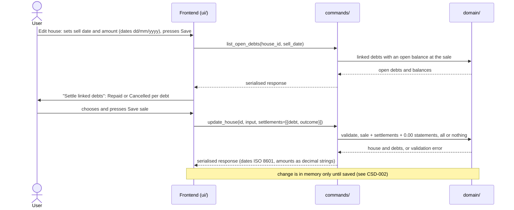
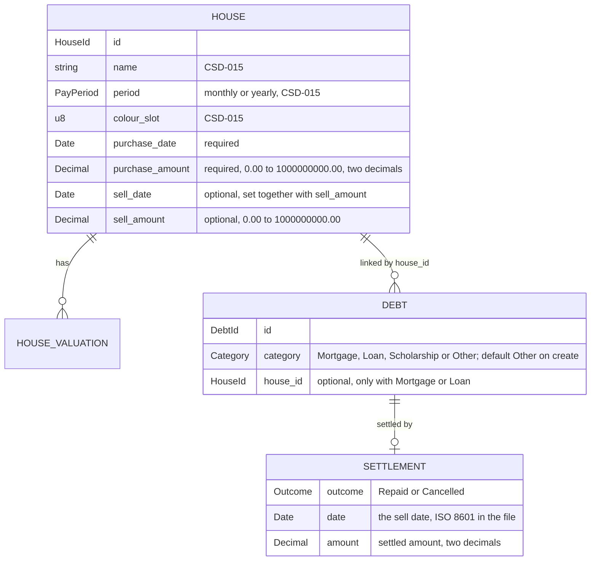

# CSD-020: House purchase, sale and linked debts

## 1. Intent
Houses (CSD-015) are a value history, and debts (CSD-011) are kept apart from them. A house needs to say when it was bought, for how much and whether it was sold, because a sold house must stop counting in the yearly values, the net worth and the ratios. A mortgage or a loan often belongs to one house, and when that house is sold its debts are normally paid off or written off, which the app must record. This capability gives every house one purchase (date and amount) and at most one sale (date and amount), lets the user give each debt a category (Mortgage, Loan, Scholarship or Other) and link a Mortgage or Loan to a house, and, when a house with linked debts is sold, asks per debt whether it was **Repaid** or **Cancelled**. Either way the debt drops to 0.00. A Repaid debt counts in full in the wealth accumulation from cash (CSD-018), while a Cancelled debt nets to zero in it, because no cash paid it. The purchase and sale amounts are a record: they change neither net worth nor cash. It is for a single person keeping a private, local history. It follows GitHub issues 27 and 31 and the grill-me interviews, and it merges the former CSD-019 (house purchase and sale) into the former CSD-020 (debt linked to a house).

## 2. Scope
### 2.1 In scope
- A purchase date and purchase amount on every house, and an optional sale (sell date and sell amount, set together and removable by clearing both).
- Date and amount rules, and the holding window that limits a house's valuations.
- The held or sold state shown in the Houses view.
- The effect of a sale on the total value (held houses only), on the yearly values (houses held at the end of the year) and so on the net worth, the house insights and the ratios.
- A category on every debt, and an optional link from a Mortgage or Loan to one house, set and removed in the Add and Edit debt form, also to an already sold house.
- The Repaid or Cancelled choice per linked debt when a house is sold, and its effect on the debt (a settlement and its settlement statement).
- Undoing a sale, the locks that keep a settlement consistent, and the delete rules.
- The effect on total debt, net worth, the wealth accumulation from cash and the Debts overview.
- Showing the links and settlements in the Houses and Debts overviews.
- The project file (CSD-002) for the purchase, the sale, the link and the settlement.

### 2.2 Non-goals
- NG-1: More than one purchase or sale per house: top-ups, partial sales, quantities and lots. A top-up is a new house.
- NG-2: Fees, tax and cost-basis methods.
- NG-3: Percentage and annualised returns. Only the amount difference is shown.
- NG-4: Any cash or net-worth effect of the sale amount: it is not added to a bank account or to net worth, which stays valuation-based (CSD-017), and it is not netted against the debts. Settling the debts linked to a sold house follows the debts, not the amount.
- NG-5: Creating a valuation automatically at the purchase or the sale date.
- NG-6: Archiving, filtering or hiding sold houses. They stay listed.
- NG-7: Categories other than Mortgage, Loan, Scholarship and Other, and any effect of the category apart from the link: it changes no figure.
- NG-8: A debt linked to more than one house, and a house-independent link such as a collateral or a lien.
- NG-9: Linking a debt in the Add and Edit house forms: they show no debt selection.
- NG-10: Partial repayment or partial cancellation: a settlement settles the whole open balance.
- NG-11: Settling a debt without selling its house, and settling debts that are not linked.
- NG-12: Changing the Repaid or Cancelled outcome after the sale is saved. The user undoes the sale (REQ-21) and enters it again.
- NG-13: Interest, fees and tax on the settlement.

## 3. Definitions
| Term | Meaning |
|---|---|
| **Purchase** | The purchase date and the purchase amount of a house. Required on every house. |
| **Sale** | The sell date and the sell amount of a house. Both or neither. |
| **Held** | A house without a sale. **Sold** is a house with one. |
| **Holding window** | From the period of the purchase date to the period of the sell date, both included, where *period* is the month (`YYYY-MM`) of a monthly house and the year (`YYYY`) of a yearly house. It has no end while the house is held. |
| **Held at the end of a year** | Purchased on or before 31/12 of that year, and not sold on or before 31/12 of that year. |
| **Result** | The sell amount minus the purchase amount of a sold house. Derived and never stored; it is not shown. |
| **Category** | The kind of a debt: **Mortgage**, **Loan**, **Scholarship** or **Other** (the default). Only a Mortgage or a Loan can be linked to a house. |
| **Linked debt** | A debt with a house link. It has at most one, and a house may have many. |
| **Sale period** | The period that holds the sell date: the month (`YYYY-MM`) for a debt with monthly statements and the year (`YYYY`) for a debt with yearly statements. |
| **Open balance** | The balance of the latest statement of the debt in a period up to and including the sale period. A debt without such a statement, or with 0.00, has no open balance. |
| **Settlement** | What the sale does to a linked debt with an open balance: the outcome (**Repaid** or **Cancelled**), the settlement date (the sell date), and the settled amount (the open balance). |
| **Settlement statement** | The final statement of balance 0.00 that the settlement adds in the sale period, flagged as a settlement statement, with the note "Repaid on sale of <house>" or "Cancelled on sale of <house>". A period may therefore hold two statements of a debt: a regular one, which stays as it is, and the settlement statement, which comes after it and which the user cannot edit or delete (only undoing the sale removes it, REQ-21). CSD-011 REQ-8 (one statement per period) is amended for this case. |
| **Settled debt** | A debt with a settlement. |

## 4. Requirements

### 4.0 Overview flow


### 4.1 Purchase and sale

**REQ-1: Purchase on every house** *(event-driven)*
When the user adds or edits a house, the app shall require a purchase date and a purchase amount and store them with the house.

```gherkin
@AC-1.1
Scenario: House with a purchase
  When the user adds a house "Example House" with purchase date 15/03/2024 and purchase amount 250000.00
  Then the house has purchase date 15/03/2024 and purchase amount 250000.00
  And it has no sale and is held

@AC-1.2
Scenario Outline: A missing purchase field is rejected
  When the user adds a house "Example House" with purchase date "<date>" and purchase amount "<amount>"
  Then it is rejected with error code "<code>"
  And no house exists

  Examples:
    | date       | amount    | code                           |
    | (empty)    | 250000.00 | HOUSE_PURCHASE_DATE_REQUIRED   |
    | 15/03/2024 | (empty)   | HOUSE_PURCHASE_AMOUNT_REQUIRED |

@AC-1.3
Scenario: An edit keeps the purchase required
  Given a house "Example House" bought on 15/03/2024 for 250000.00
  When the user renames it to "Example Home" and empties the purchase date
  Then the edit is rejected with error code "HOUSE_PURCHASE_DATE_REQUIRED"
  And the house is still named "Example House"
```

**REQ-2: Record and undo a sale** *(event-driven)*
When the user saves a house with a sell date and a sell amount, the app shall store the sale, and when the user saves it with both emptied, the app shall remove the sale and the house is held again. For a house with linked debts REQ-18 and REQ-21 apply as well.

```gherkin
@AC-2.1
Scenario: Sell a house
  Given a held house "Example House" bought on 15/03/2024 for 250000.00
  When the user sets sell date 10/06/2026 and sell amount 300000.00
  Then the house is sold on 10/06/2026 for 300000.00

@AC-2.2
Scenario: Undo a sale
  Given a house "Example House" sold on 10/06/2026 for 300000.00
  When the user empties the sell date and the sell amount and saves
  Then the house has no sale and is held

@AC-2.3
Scenario: A sale on the day of purchase is allowed
  Given a held house "Example Cabin" bought on 01/09/2026 for 10000.00
  When the user sets sell date 01/09/2026 and sell amount 9500.00
  Then the house is sold on 01/09/2026
```

**REQ-3: Date rules** *(unwanted behaviour)*
If a purchase or sell date is not a valid date, or the sell date is earlier than the purchase date, then the app shall reject the house or edit with the error code of the violated rule, without storing or changing anything. Any valid date is accepted, in the past or in the future.

```gherkin
@AC-3.1
Scenario Outline: Invalid dates rejected
  When the user adds a house "Example House" with purchase date "<purchase>" and purchase amount 250000.00 and sell date "<sell>" and sell amount 1000.00
  Then it is rejected with error code "<code>"
  And no house exists

  Examples:
    | purchase   | sell       | code                         |
    | 31/02/2024 | (empty)    | HOUSE_DATE_INVALID           |
    | 2024-03-15 | (empty)    | HOUSE_DATE_INVALID           |
    | 15/03/2024 | 14/03/2024 | HOUSE_SELL_BEFORE_PURCHASE   |

@AC-3.2
Scenario: A future date is accepted
  When the user adds a house "Example House" with purchase date 15/03/2040 and purchase amount 250000.00
  Then the house exists with purchase date 15/03/2040

@AC-3.3
Scenario: A date has no lower bound
  When the user adds a house "Example House" with purchase date 01/01/1850 and purchase amount 250000.00
  Then the house exists with purchase date 01/01/1850
```

**REQ-4: Amount rules** *(unwanted behaviour)*
If a purchase or sell amount is not a plain number, is negative, has more than two decimal places or exceeds 1,000,000,000.00, then the app shall reject the house or edit with the error code of the violated rule, without rounding or storing it. An amount of 0.00 is valid.

```gherkin
@AC-4.1
Scenario Outline: Invalid amounts rejected
  Given a held house "Example House" bought on 15/03/2024 for 250000.00
  When the user sets sell date 10/06/2026 and sell amount "<amount>"
  Then it is rejected with error code "<code>"
  And the house is still held

  Examples:
    | amount         | code                    |
    | abc            | HOUSE_AMOUNT_INVALID    |
    | 1e3            | HOUSE_AMOUNT_INVALID    |
    | -0.01          | HOUSE_AMOUNT_NEGATIVE   |
    | 1000.999       | HOUSE_AMOUNT_PRECISION  |
    | 1000000000.01  | HOUSE_AMOUNT_TOO_LARGE  |

@AC-4.2
Scenario: A worthless sale and a free purchase are valid
  When the user adds a house "Example Guesthouse" with purchase date 15/03/2024 and purchase amount 0.00 and sell date 10/06/2026 and sell amount 0.00
  Then the house is sold and its result is 0.00
```

**REQ-5: A sale is complete** *(unwanted behaviour)*
If the user saves a house with a sell date but no sell amount, or a sell amount but no sell date, then the app shall reject it with the error code `HOUSE_SALE_INCOMPLETE`.

```gherkin
@AC-5.1
Scenario Outline: Half a sale rejected
  Given a held house "Example House" bought on 15/03/2024 for 250000.00
  When the user saves it with sell date "<date>" and sell amount "<amount>"
  Then it is rejected with error code "HOUSE_SALE_INCOMPLETE"
  And the house is still held

  Examples:
    | date       | amount    |
    | 10/06/2026 | (empty)   |
    | (empty)    | 300000.00 |
```

### 4.2 Holding window

**REQ-6: Valuations lie in the holding window** *(unwanted behaviour)*
If the period of an added or edited valuation is earlier than the period of the purchase date or later than the period of the sell date, then the app shall reject it with the error code `HOUSE_VALUATION_OUTSIDE_HOLDING`, leaving the valuations unchanged.

```gherkin
@AC-6.1
Scenario Outline: Period outside the window rejected
  Given a monthly house "Example House" bought on 15/03/2024 and sold on 10/06/2026
  When the user adds a valuation for "<period>" with value 1000.00
  Then <outcome>

  Examples:
    | period  | outcome                                                          |
    | 2024-02 | it is rejected with error code "HOUSE_VALUATION_OUTSIDE_HOLDING" |
    | 2024-03 | the valuation for 2024-03 exists                                 |
    | 2026-06 | the valuation for 2026-06 exists                                 |
    | 2026-07 | it is rejected with error code "HOUSE_VALUATION_OUTSIDE_HOLDING" |

@AC-6.2
Scenario: A yearly house is compared by year
  Given a yearly house "Example Lodge" bought on 15/03/2024
  When the user adds a valuation for 2023 with value 1000.00
  Then it is rejected with error code "HOUSE_VALUATION_OUTSIDE_HOLDING"
  When the user adds a valuation for 2024 with value 1000.00
  Then the valuation for 2024 exists

@AC-6.3
Scenario: Moving a valuation out of the window is rejected
  Given a monthly house bought on 15/03/2024 with a valuation for 2024-05 with value 1000.00
  When the user changes its period to 2024-01
  Then the edit is rejected with error code "HOUSE_VALUATION_OUTSIDE_HOLDING"
  And the valuation is still for 2024-05
```

**REQ-7: Dates may not orphan valuations** *(unwanted behaviour)*
If the user saves a purchase date or sell date so that an existing valuation of the house falls outside the holding window, then the app shall reject the whole edit with the error code `HOUSE_DATES_EXCLUDE_VALUATIONS`.

```gherkin
@AC-7.1
Scenario Outline: Narrowing the window is rejected
  Given a monthly house "Example House" bought on 15/03/2024 with a valuation for 2024-05 and one for 2026-09
  When the user saves it with <change>
  Then the edit is rejected with error code "HOUSE_DATES_EXCLUDE_VALUATIONS"
  And the dates of the house are unchanged

  Examples:
    | change                                    |
    | purchase date 01/06/2024                  |
    | sell date 10/06/2026 and sell amount 1.00 |

@AC-7.2
Scenario: Widening the window is accepted
  Given a monthly house bought on 15/03/2024 with a valuation for 2024-05
  When the user saves it with purchase date 01/01/2024
  Then the house has purchase date 01/01/2024
```

### 4.3 Views and figures of a house

**REQ-8: Held or sold** *(ubiquitous)*
The app shall show on each house row of the Houses overview its valuation period and either "Held" or "Sold", and nothing else of the purchase and the sale: the purchase date and amount, the sell date and amount are shown in the Edit house form (REQ-12). Sold houses shall stay in the list in the order of CSD-015 REQ-18.

```gherkin
@AC-8.1
Scenario: Held house
  Given a monthly house "Example House" bought on 15/03/2024 for 250000.00 and not sold
  Then its row shows "Monthly" and "Held" and no purchase date or amount

@AC-8.2
Scenario: Sold house
  Given a yearly house "Example House" bought on 15/03/2024 for 250000.00 and sold on 10/06/2026 for 300000.00
  Then its row shows "Yearly" and "Sold" and no sell date, sell amount or result

@AC-8.3
Scenario: A sold house stays in the list
  Given a sold house "Example House" and a held house "Example Lodge"
  Then both are listed alphabetically
```

**REQ-9: Total value counts held houses** *(ubiquitous)*
The app shall compute the total value of CSD-015 REQ-17 over held houses only. A sold house keeps showing its latest value on its row and is not part of the total.

```gherkin
@AC-9.1
Scenario: Sold house not in the total
  Given a held house "Example Lodge" with latest valuation 2026-09 (value 50000.00)
  And a sold house "Example House" with latest valuation 2026-05 (value 300000.00)
  Then the total value is 50000.00
  And "Example House" shows latest value 300000.00 for 2026-05

@AC-9.2
Scenario: Selling a house lowers the total
  Given held houses "Example House" (latest value 300000.00) and "Example Lodge" (latest value 50000.00)
  When the user sells "Example House" on 10/06/2026 for 310000.00
  Then the total value is 50000.00
```

**REQ-10: Yearly figures count houses held at year end** *(ubiquitous)*
The app shall include a house in the closing value and the change of a calendar year only if it was held at the end of that year, in the yearly values (CSD-015 REQ-20) and in the figures built on them: the house insights (CSD-016), the net worth (CSD-017) and the ratios (CSD-018). A year is listed in the yearly values only if at least one house held at its end has a valuation in it. Values are still not carried forward.

```gherkin
@AC-10.1
Scenario: A sold house stops counting in its sale year
  Given a monthly house "Example House" bought on 15/03/2024 and sold on 10/06/2026
  And valuations 2024-12 (value 200000.00), 2025-12 (value 210000.00) and 2026-03 (value 215000.00)
  When the user views the yearly values
  Then 2025 shows closing value 210000.00, change 10000.00
  And 2024 shows closing value 200000.00, change none
  And 2026 is not listed

@AC-10.2
Scenario: The insights show zero from the sale year
  Given the same house and the current date 29/10/2026
  When the user views the house insights
  Then 2026 shows closing value 0.00

@AC-10.3
Scenario Outline: Year-end boundary
  Given a monthly house with a valuation 2026-12 (value 1000.00)
  And the house is sold on <sell>
  Then 2026 <outcome>

  Examples:
    | sell       | outcome                            |
    | 31/12/2026 | is not listed in the yearly values |
    | (none)     | shows closing value 1000.00        |

@AC-10.4
Scenario: Other houses are unaffected
  Given a sold house "Example House" and a held house "Example Lodge" with a valuation 2026-03 (value 50000.00)
  When the user views the yearly values
  Then 2026 shows closing value 50000.00

@AC-10.5
Scenario: A purchase after year end is not counted in that year
  Given a monthly house bought on 15/01/2026 with a valuation 2026-03 (value 1000.00)
  Then 2025 is not listed in the yearly values
```

**REQ-11: Net worth dips in the sale year** *(ubiquitous)*
The app shall let the net worth of the year of a sale drop by the value the sold house had before, because the house leaves the yearly values of that year (REQ-10) and the sale amount touches no cash (NG-4). This dip is intended.

```gherkin
@AC-11.1
Scenario: Net worth drops the sold house
  Given a monthly house sold on 10/06/2026 with valuation 2025-12 (value 210000.00), and no other records
  When the user views the net worth
  Then the houses figure of 2025 is 210000.00 and the net worth of 2025 is 210000.00
  And the houses figure of 2026 is 0.00 and the net worth of 2026 is 0.00

@AC-11.2
Scenario: The sale amount does not replace the house
  Given the same house sold on 10/06/2026 for 300000.00
  When the user views the net worth
  Then the net worth of 2026 is 0.00 and not 300000.00
```

**REQ-12: The house form** *(event-driven)*
When the user opens the add or edit house form, the app shall offer the purchase date, purchase amount, sell date and sell amount next to the name and the valuation period, with dates typed as dd/mm/yyyy, and shall do all date and amount validation in Rust.

```gherkin
@AC-12.1
Scenario: Fields in the form
  When the user opens the add house form
  Then it asks for Name, Valuation period, "Purchase date (dd/mm/yyyy)", "Purchase amount", "Sell date (dd/mm/yyyy)" and "Sell amount"
  And the sell fields are marked optional

@AC-12.2
Scenario: Editing shows the stored values
  Given a house sold on 10/06/2026 for 300000.00
  When the user opens it for editing
  Then the form shows sell date "10/06/2026" and sell amount "300000.00"

@AC-12.3
Scenario: An edit is an unsaved change
  Given a saved project with a held house
  When the user sells it
  Then the unsaved indicator is shown
```

**REQ-13: Purchase and sale are part of the project file** *(event-driven)*
When the user saves and later opens a project, the app shall restore the purchase and the sale of every house exactly, and if a house lacks its purchase, has half a sale, or has a valuation outside its holding window, then the app shall reject the file with the error code `PROJECT_INVALID_FILE`.

```gherkin
@AC-13.1
Scenario: Round trip
  Given a house "Example House" bought on 15/03/2024 for 250000.00 and sold on 10/06/2026 for 300000.00
  When the user saves the project and opens it again
  Then the house has the same purchase and sale

@AC-13.2
Scenario: A damaged sale is an invalid file
  Given a project file with a house that has a sell date but no sell amount
  When the user opens it
  Then it is rejected with the error code "PROJECT_INVALID_FILE"

@AC-13.3
Scenario: A valuation outside the window is an invalid file
  Given a project file with a house bought on 15/03/2024 and a valuation for 2023-12
  When the user opens it
  Then it is rejected with the error code "PROJECT_INVALID_FILE"

@AC-13.4
Scenario: A house without a purchase is an invalid file
  Given a project file with a house "Example House" that has no purchase date and no purchase amount
  When the user opens it
  Then it is rejected with the error code "PROJECT_INVALID_FILE"
```

**REQ-14: Purchase and sale do not count for the currency confirmation** *(ubiquitous)*
The app shall leave the purchase and sale amounts out of the entry count that triggers the currency confirmation of CSD-003 REQ-5.

```gherkin
@AC-14.1
Scenario: Amounts alone need no confirmation
  Given a project in "EUR" with a sold house and no valuations
  When the user chooses the currency "USD"
  Then the currency changes to "USD" without a confirmation
```

### 4.4 Category and link

**REQ-15: Link a debt in the debt form** *(event-driven)*
When the user saves the Add or Edit debt form with the category Mortgage or Loan and a house, the app shall link the debt to that house, and with no house or the category Other, the app shall store the debt without a link.

```gherkin
@AC-15.1
Scenario: Link a mortgage
  Given a held house "Example House" and a debt "Example Mortgage"
  When the user edits the debt, selects the category Mortgage and the house "Example House" and saves
  Then "Example Mortgage" has the category Mortgage and is linked to "Example House"

@AC-15.2
Scenario: Unlink a debt
  Given "Example Loan" has the category Loan and is linked to the held house "Example House"
  When the user edits the debt, selects no house and saves
  Then "Example Loan" has the category Loan and no house link
  And its statements are unchanged

@AC-15.3
Scenario: Changing the category to Other removes the link
  Given "Example Loan" has the category Loan and is linked to the held house "Example House"
  When the user edits the debt, selects the category Other and saves
  Then "Example Loan" has the category Other and no house link

@AC-15.4
Scenario: Link while adding a debt
  Given a held house "Example House"
  When the user adds a debt "Example Mortgage" with the category Mortgage and the house "Example House"
  Then "Example Mortgage" is linked to "Example House"

@AC-15.5
Scenario: The category defaults to Other
  When the user adds a debt "Example Card" and leaves the category as it is
  Then "Example Card" has the category Other and no house link

@AC-15.6
Scenario: A scholarship cannot be linked
  Given a debt "Example Study Debt"
  When the user selects the category Scholarship
  Then there is no House dropdown and "Example Study Debt" has the category Scholarship and no house link

@AC-15.7
Scenario: The Houses overview follows the debt form
  Given the Edit house form of "Example House" lists no linked debts
  When the user links "Example Mortgage" to "Example House" in the debt form
  Then the Edit house form of "Example House" lists "Example Mortgage", without reopening the page
```

**REQ-16: Category and link rules** *(unwanted behaviour)*
If a debt is saved with a category other than Mortgage, Loan, Scholarship or Other, a house with the category Scholarship or Other, a house that does not exist, or while its current house is sold, then the app shall reject the save with the error code of the violated rule and change nothing.

```gherkin
@AC-16.1
Scenario Outline: A forbidden category or link is rejected
  Given a held house "Example House" and a house "Example Guesthouse" sold on 10/06/2026
  And "Example Loan" with the category Loan linked to "Example House"
  And "Example Cabin Loan" with the category Loan linked to "Example Guesthouse"
  When the user saves "<debt>" with the category "<category>" and the house "<house>"
  Then it is rejected with error code "<code>"
  And nothing changed

  Examples:
    | debt               | category    | house              | code                       |
    | Example Loan       | Savings     | (none)             | DEBT_CATEGORY_INVALID      |
    | Example Loan       | Other       | Example House      | DEBT_LINK_CATEGORY_INVALID |
    | Example Loan       | Scholarship | Example House      | DEBT_LINK_CATEGORY_INVALID |
    | Example Loan       | Loan        | (a deleted house)  | HOUSE_NOT_FOUND            |
    | Example Cabin Loan | Loan        | (none)             | HOUSE_LINKS_LOCKED_SOLD    |
```

**REQ-17: Link a debt to a house that is already sold** *(event-driven)*
When the user saves a debt with a sold house, the app shall link the debt and, if the debt has an open balance at the sell date of that house, require the outcome Repaid or Cancelled and settle the debt as the sale would have (REQ-20), all in one change.

```gherkin
@AC-17.1
Scenario: Link a mortgage to a sold house
  Given "Example House" sold on 10/06/2026 and "Example Mortgage" (monthly) with a statement for 2026-03 with balance 190000.00
  When the user links "Example Mortgage" to "Example House" with the outcome Repaid
  Then "Example Mortgage" is linked and settled as Repaid with settled amount 190000.00
  And it has a statement for 2026-06 with balance 0.00 and note "Repaid on sale of Example House"

@AC-17.2
Scenario: The outcome is required
  Given the same house and debt
  When the user links "Example Mortgage" to "Example House" without an outcome
  Then it is rejected with error code "HOUSE_SETTLEMENT_REQUIRED"
  And nothing changes

@AC-17.3
Scenario: A debt without an open balance links directly
  Given "Example House" sold on 10/06/2026 and "Example Loan" with no statements
  When the user links "Example Loan" to "Example House"
  Then "Example Loan" is linked and not settled
  And an outcome for it is rejected with error code "HOUSE_SETTLEMENT_INVALID"

@AC-17.4
Scenario: A statement after the sale blocks the link
  Given "Example House" sold on 10/06/2026 and "Example Mortgage" with statements for 2026-03 (190000.00) and 2026-08 (180000.00)
  When the user links "Example Mortgage" to "Example House" with the outcome Repaid
  Then it is rejected with error code "DEBT_STATEMENT_AFTER_SALE"
  And nothing changes

@AC-17.5
Scenario: Undoing the sale later undoes the settlement
  Given "Example Mortgage" linked and settled on the sale of "Example House" as in AC-17.1
  When the user empties the sell date and sell amount of the house, confirms and saves
  Then "Example Mortgage" has no settlement, is still linked, and has no statement for 2026-06
```

### 4.5 Sale and settlement

**REQ-18: A sale asks Repaid or Cancelled per open debt** *(event-driven)*
When the user saves a house that gains a sale and has linked debts with an open balance, the app shall require an outcome, Repaid or Cancelled, for each of those debts, and shall save the sale and all settlements together or not at all.

```gherkin
@AC-18.1
Scenario: Sell with two outcomes
  Given the held house "Example House" bought on 15/03/2024 with linked debts "Example Mortgage" (latest statement 2026-03, balance 190000.00) and "Example Loan" (latest statement 2026-03, balance 10000.00)
  When the user sets sell date 10/06/2026 and sell amount 300000.00, chooses Repaid for "Example Mortgage" and Cancelled for "Example Loan", and saves
  Then the house is sold on 10/06/2026 for 300000.00
  And "Example Mortgage" is settled as Repaid with settled amount 190000.00
  And "Example Loan" is settled as Cancelled with settled amount 10000.00

@AC-18.2
Scenario: A missing choice saves nothing
  Given the same house and debts
  When the user saves the sale with a choice for "Example Mortgage" only
  Then it is rejected with error code "HOUSE_SETTLEMENT_REQUIRED"
  And the house has no sale and both debts are unchanged

@AC-18.3
Scenario: A choice for a debt that needs none is rejected
  Given a held house with a linked debt "Example Loan" that has no statements
  When the user saves a sale with the choice Repaid for "Example Loan"
  Then it is rejected with error code "HOUSE_SETTLEMENT_INVALID"
  And the house has no sale

@AC-18.4
Scenario: A house with no open debt is sold directly
  Given a held house with no linked debts
  When the user sets sell date 10/06/2026 and sell amount 300000.00 and saves
  Then the house is sold and no choice is asked
```

**REQ-19: The open balance is the settled amount** *(ubiquitous)*
The app shall take the settled amount of a debt from its latest statement in a period up to and including the sale period, shall give no choice for a debt without an open balance, and shall leave such a debt linked.

```gherkin
@AC-19.1
Scenario Outline: Which debts need a choice
  Given a linked debt "Example Loan" with statements <statements>
  And a house sold on 10/06/2026
  When the user saves the sale
  Then the choice is <asked> and the settled amount is <amount>

  Examples:
    | statements                         | asked     | amount  |
    | 2026-02: 5000.00, 2026-05: 4000.00 | asked     | 4000.00 |
    | 2026-06: 3500.00                   | asked     | 3500.00 |
    | (none)                             | not asked | none    |
    | 2026-04: 0.00                      | not asked | none    |

@AC-19.2
Scenario: A statement after the sale period blocks the sale
  Given a linked debt "Example Loan" with a statement for 2026-08 with balance 3000.00
  When the user saves a sale with sell date 10/06/2026 with an outcome for "Example Loan"
  Then it is rejected with error code "DEBT_STATEMENT_AFTER_SALE"
  And nothing changes
```

**REQ-20: A settlement drops the debt to 0.00** *(event-driven)*
When a sale is saved with an outcome for a debt, the app shall store the settlement on the debt and add its settlement statement of 0.00 in the sale period after any regular statement of that period, which stays unchanged, so a debt can have two statements in the same month or year.

```gherkin
@AC-20.1
Scenario: The settlement statement
  Given "Example Mortgage" (monthly) with a statement for 2026-03 with balance 190000.00
  When the house is sold on 10/06/2026 with the outcome Repaid for it
  Then it has a settlement statement for 2026-06 with balance 0.00 and note "Repaid on sale of Example House"
  And its settlement is Repaid, dated 10/06/2026, with settled amount 190000.00
  And its latest balance is 0.00

@AC-20.2
Scenario: A statement in the sale period stays
  Given "Example Loan" (monthly) with a statement for 2026-06 with balance 3500.00 and note "Mid-June"
  When the house is sold on 10/06/2026 with the outcome Cancelled for it
  Then it has two statements for 2026-06: the regular one with balance 3500.00 and note "Mid-June", and after it the settlement statement with balance 0.00 and note "Cancelled on sale of Example House"
  And the settled amount is 3500.00
  And its latest balance is 0.00

@AC-20.3
Scenario: A yearly debt gets a second statement in the sale year
  Given "Example Mortgage" (yearly) with statements for 2025 (balance 200000.00) and 2026 (balance 150000.00)
  When the house is sold on 10/06/2026 with the outcome Repaid for it
  Then it has two statements for 2026: the regular one with balance 150000.00, and after it the settlement statement with balance 0.00
  And the settled amount is 150000.00

@AC-20.4
Scenario: The settlement statement cannot be edited
  Given "Example Loan" settled on 10/06/2026 with a regular statement for 2026-06 and its settlement statement
  When the user tries to edit or delete the settlement statement
  Then it is rejected with error code "DEBT_SETTLED_LOCKED"
  And the debt still has both statements for 2026-06
```

**REQ-21: Undo a sale** *(event-driven)*
When the user saves a sold house with the sell date and the sell amount emptied and has confirmed it, the app shall remove the sale and every settlement of the house, shall remove each settlement statement and leave every regular statement as it is, and shall leave the debts linked.

```gherkin
@AC-21.1
Scenario: Undo removes only the settlement statement
  Given "Example Loan" was settled as Cancelled on the sale of "Example House" and has a regular statement for 2026-06 with balance 3500.00 and note "Mid-June"
  When the user empties the sell date and sell amount, confirms and saves
  Then the house is held again
  And "Example Loan" has no settlement, is still linked, and has exactly one statement for 2026-06, with balance 3500.00 and note "Mid-June"

@AC-21.2
Scenario: Undo without confirmation
  Given a house sold with a settled debt
  When the user empties the sell date and sell amount and saves without confirming
  Then it is rejected with error code "HOUSE_SALE_UNDO_UNCONFIRMED"
  And nothing changes

@AC-21.3
Scenario: The Debts overview follows the undo
  Given the Debts overview shows "Example Loan" with the badge Cancelled and its settlement statement
  When the user undoes the sale of "Example House" in the Edit house form
  Then the Debts overview shows "Example Loan" without a badge and without the settlement statement, without reopening the page
```

### 4.6 Locks and deletes

**REQ-22: The sell date is locked while debts are settled** *(unwanted behaviour)*
If a house has a settled debt, then the app shall reject a change of its sell date with the error code `HOUSE_SELL_DATE_LOCKED`, and shall accept a change of its sell amount.

```gherkin
@AC-22.1
Scenario: Change the sell date
  Given a house sold on 10/06/2026 for 300000.00 with a settled debt
  When the user sets sell date 11/06/2026
  Then it is rejected with error code "HOUSE_SELL_DATE_LOCKED"

@AC-22.2
Scenario: Change the sell amount
  Given the same house
  When the user sets sell amount 310000.00 and saves
  Then the house is sold on 10/06/2026 for 310000.00 and the settlement is unchanged
```

**REQ-23: Settled debts are locked** *(unwanted behaviour)*
If a debt has a settlement, then the app shall reject, with the error code `DEBT_SETTLED_LOCKED`, adding a statement after the settlement period, changing or deleting a statement after it or the settlement statement, changing the statement period of the debt, removing its house link and changing its category; statements before the settlement period and the regular statement of the settlement period itself stay editable.

```gherkin
@AC-23.1
Scenario Outline: Locked operations
  Given "Example Mortgage" settled on 10/06/2026 (settlement period 2026-06) with a regular statement for 2026-03 and the settlement statement for 2026-06
  When the user <operation>
  Then it is rejected with error code "DEBT_SETTLED_LOCKED"

  Examples:
    | operation                                                |
    | adds a statement for 2026-07                             |
    | edits the settlement statement for 2026-06               |
    | deletes the settlement statement for 2026-06             |
    | unlinks it or changes its category in the Edit debt form |

@AC-23.2
Scenario: Earlier statements stay editable
  Given the same debt
  When the user edits the statement for 2026-03 to balance 189000.00
  Then the statement is saved and the settled amount stays 190000.00

@AC-23.3
Scenario: The regular statement of the settlement period stays editable
  Given "Example Loan" settled on 10/06/2026 with a regular statement for 2026-06 with balance 3500.00 and its settlement statement
  When the user edits the regular statement for 2026-06 to balance 3400.00
  Then the statement is saved with balance 3400.00
  And the settlement statement, the settlement and the settled amount 3500.00 are unchanged
```

**REQ-24: Deleting a house or a debt** *(unwanted behaviour)*
If a house has linked debts, then the app shall reject its deletion with the error code `HOUSE_HAS_LINKED_DEBTS`, and when the user deletes a debt that is settled or linked, the app shall remove the debt with its statements, its link and its settlement.

```gherkin
@AC-24.1
Scenario: A house with linked debts cannot be deleted
  Given "Example Loan" is linked to "Example House"
  When the user deletes "Example House"
  Then it is rejected with error code "HOUSE_HAS_LINKED_DEBTS"
  And the house and the debt exist

@AC-24.2
Scenario: Deleting a settled debt
  Given "Example Loan" is settled as Cancelled on the sale of "Example House"
  When the user deletes "Example Loan"
  Then the debt and its settlement are gone and the house is still sold
```

### 4.7 Figures of a settlement

**REQ-25: Net worth and total debt** *(ubiquitous)*
The app shall count a settled debt like any debt: its settlement statement of 0.00 is its latest balance, so a Repaid and a Cancelled debt both leave the total debt and the Debts of the net worth, and the sale amount shall not change cash or net worth (NG-4).

```gherkin
@AC-25.1
Scenario Outline: Both outcomes drop to 0.00
  Given a house "Example House" with latest valuation 300000.00 and the linked debt "Example Mortgage" with balance 190000.00, and no other records
  When the house is sold on 10/06/2026 with the outcome <outcome>
  Then the total debt is 0.00
  And the Debts of the net worth of 2026 are 0.00 and the Houses of 2026 are 0.00
  And the net worth of 2026 is 0.00

  Examples:
    | outcome   |
    | Repaid    |
    | Cancelled |
```

**REQ-26: A Repaid debt counts in full** *(ubiquitous)*
The app shall let the drop of a Repaid debt to 0.00 count in full in the repaid amount, and so in the wealth accumulation from cash (CSD-018 REQ-5), as any drop in balance does.

```gherkin
@AC-26.1
Scenario: Repaid
  Given "Example Mortgage" with a statement for 2025-12 with balance 200000.00 and Repaid on 10/06/2026 (settled amount 190000.00)
  When the ratios are computed
  Then the repaid amount of 2026 is 200000.00
```

**REQ-27: A Cancelled debt nets to zero** *(ubiquitous)*
The app shall subtract the settled amount of a Cancelled debt from the repaid amount of the year of its settlement in the wealth accumulation from cash, so that the cancelled part nets to zero, only when the debt has an opening balance in that year (CSD-011 section 3), and the result may be negative.

```gherkin
@AC-27.1
Scenario: Cancelled
  Given "Example Mortgage" with a statement for 2025-12 with balance 200000.00 and Cancelled on 10/06/2026 (settled amount 190000.00)
  When the ratios are computed
  Then the repaid amount of 2026 is 10000.00

@AC-27.2
Scenario: No opening balance
  Given "Example Loan" with its first statement 2026-02 (5000.00) and Cancelled on 10/06/2026 (settled amount 5000.00)
  When the ratios are computed
  Then the repaid amount of 2026 is none

@AC-27.3
Scenario: More cancelled than repaid
  Given "Example Mortgage" with a statement for 2025-12 with balance 200000.00, a statement for 2026-02 with balance 200000.00 and Cancelled on 10/06/2026 (settled amount 200000.00), and no other debt
  When the ratios are computed
  Then the repaid amount of 2026 is 0.00
```

**REQ-28: The Debts overview shows the Cancelled-adjusted repaid amount** *(ubiquitous)*
The app shall show in the yearly totals of the Debts overview (CSD-011 REQ-19) the same repaid amount as the wealth accumulation from cash, with the settled amount of a Cancelled debt taken out under the rules of REQ-27.

```gherkin
@AC-28.1
Scenario: Cancelled debt in the yearly totals
  Given "Example Mortgage" with a statement for 2025-12 with balance 200000.00 and Cancelled on 10/06/2026 (settled amount 190000.00)
  When the user opens the Debts overview
  Then the yearly total of 2026 shows repaid 10000.00

@AC-28.2
Scenario: No opening balance in the yearly totals
  Given "Example Loan" with its first statement 2026-02 (5000.00) and Cancelled on 10/06/2026 (settled amount 5000.00)
  When the user opens the Debts overview
  Then the yearly total of 2026 shows no repaid amount
```

### 4.8 Display and file

**REQ-29: The Edit house form shows the linked debts** *(ubiquitous)*
The app shall show in the Edit house form a read-only table of the linked debts of the house with the columns Debt, Category, Balance (the latest balance) and Outcome (Repaid or Cancelled with the settled amount, or a dash), without any way to add or remove a debt there, and shall show no debts on the rows of the Houses overview.

```gherkin
@AC-29.1
Scenario: The overview rows carry no debts
  Given "Example House" with linked "Example Mortgage" and "Example Loan"
  When the user opens the Houses overview
  Then the row of "Example House" shows no debt

@AC-29.2
Scenario: The Edit house form lists the linked debts read-only
  Given "Example House" with linked "Example Mortgage" (category Mortgage, latest balance 190000.00) and "Example Loan" (category Loan, settled as Cancelled), and an unlinked debt "Example Card"
  When the user opens the Edit house form of "Example House"
  Then it shows a table with the columns Debt, Category, Balance and Outcome
  And the rows "Example Mortgage", "Mortgage", 190000.00, a dash and "Example Loan", "Loan", 0.00, "Cancelled 10000.00"
  And no row for "Example Card"
  And the table has no checkbox, button or field to add or remove a debt

@AC-29.3
Scenario: The Add house form has no list
  When the user opens the Add house form
  Then it shows no table of debts
```

**REQ-30: The debt form and the Debts view** *(ubiquitous)*
The app shall show on each debt row of the Debts overview (CSD-011 REQ-20) the category, the name of the linked house and, for a settled debt, the badge Repaid or Cancelled, and shall show in the debt form a Category dropdown (Mortgage, Loan, Scholarship, Other) and, only while Mortgage or Loan is selected, an optional House dropdown with a choice for no house and all houses, a sold one marked "(sold)".

```gherkin
@AC-30.1
Scenario: Rows show category and house
  Given "Example Loan" with the category Loan linked to "Example House" and settled as Repaid
  When the user opens the Debts overview
  Then the row shows "Loan", "Example House" and "Repaid"

@AC-30.2
Scenario: The house dropdown follows the category
  Given a held house "Example House" and a sold house "Example Guesthouse"
  When the user opens the Add debt form
  Then the Category is Other and there is no House dropdown
  When the user selects the category Mortgage
  Then a House dropdown appears with "No house", "Example House" and "Example Guesthouse (sold)"
  When the user selects the category Scholarship or Other
  Then the House dropdown disappears
```

**REQ-31: The settlement prompt** *(event-driven)*
When a sale with open linked debts, or a link of a debt with an open balance to a sold house (REQ-17), is saved without outcomes, the app shall show the dialog "Settle linked debts" with one row per open debt (name, settled amount, and the choices Repaid and Cancelled, none selected), the line "Repaid counts in full in the wealth accumulation from cash, Cancelled nets to zero.", the button "Save sale" disabled until every row has a choice, and the button "Back", which saves nothing.

```gherkin
@AC-31.1
Scenario: Prompt behaviour
  Given a sale with the open debts "Example Mortgage" (190000.00) and "Example Loan" (10000.00)
  When the user presses Save in the Edit house form
  Then the dialog "Settle linked debts" lists both rows with no choice selected
  And "Save sale" is disabled until both have a choice
  And "Back" returns to the form with nothing saved
```

**REQ-32: The Statements table shows the settlement statement** *(ubiquitous)*
The app shall show both statements of a period in the Statements table of the Debts overview, the settlement statement above the regular one, with the badge of the settlement on the settlement row, and shall show no Edit and Delete buttons on the settlement statement and on the statements after the settlement period of a settled debt, and the Edit and Delete buttons on the regular statement of the settlement period.

```gherkin
@AC-32.1
Scenario: Two rows in one period
  Given "Example Loan" settled as Cancelled with a regular statement for 2026-06 (balance 3500.00) and its settlement statement
  When the user opens the Debts overview
  Then the Statements table lists the settlement statement "Cancelled on sale of Example House" with balance 0.00 and the badge Cancelled directly above the regular statement for 2026-06 with balance 3500.00
  And the settlement row has no Edit or Delete buttons and the regular row has both

@AC-32.2
Scenario: The change of the settlement statement
  Given the same debt with a regular statement for 2026-05 (balance 4000.00)
  Then the change of the regular statement for 2026-06 is 500.00 and the change of the settlement statement is 3500.00
```

**REQ-33: The project file for debts** *(event-driven)*
When the user saves and later opens a project, the app shall restore every category, link, settlement and settlement statement exactly, and if a debt has no category, a link points to a house that does not exist, a debt with the category Scholarship or Other has a link, a settlement lacks its settlement statement, a settlement statement belongs to no settlement, or a settled debt has a later statement, then the app shall reject the file with the error code `PROJECT_INVALID_FILE`.

```gherkin
@AC-33.1
Scenario: Round trip
  Given "Example Loan" linked to "Example House" and settled as Cancelled, with a regular and a settlement statement for 2026-06
  When the user saves the project and opens it again
  Then the link, the settlement and both statements are unchanged

@AC-33.2
Scenario: A damaged link
  Given a project file in which a debt links to a house that does not exist
  When the user opens it
  Then it is rejected with the error code "PROJECT_INVALID_FILE"

@AC-33.3
Scenario: A debt without a category
  Given a project file in which the debt "Example Card" has no category
  When the user opens it
  Then it is rejected with the error code "PROJECT_INVALID_FILE"
```

## 5. Interfaces and contracts



The result, the held or sold state and the held-at-year-end rule are derived (REQ-8, REQ-10) and not stored. In the project file the purchase and the category are required, the sale, the link and the settlement are optional, and unknown fields are rejected (CSD-002). Dates in the file and over IPC are ISO 8601 (`YYYY-MM-DD`) and amounts decimal strings (CSD-000 CON-7).

The link is stored on the debt (`house_id`) and the settlement on the debt (`settlement`). The settlement statement is a statement of the debt (CSD-011) with the flag `settlement`; it counts in the figures and sorts after the regular statement of its period.

Commands: `create_house` and `update_house` take the purchase and sale fields, `links` with `settlements` (a list of `{ debt_id, outcome }`) and `confirm_undo` (boolean) only. `create_debt` and `update_debt` take, besides the fields of CSD-011, `category` (`Mortgage`, `Loan`, `Scholarship` or `Other`; unchanged when omitted on an edit, `Other` on create) and `house_id` (optional; sent empty to unlink) and `settlement` (`Repaid` or `Cancelled`; only for a link to a sold house, REQ-17). `debt_open_balance(debt_id, house_id)` returns the open balance of a debt at the sell date of a sold house, or none, for the prompt of REQ-31. `list_open_debts(house_id, sell_date)` returns the linked debts of that house with an open balance at a sale, for the same prompt, and the commands still validate the choices (REQ-18). `list_houses()` adds, per house, the purchase, the sale, held or sold, and the linked debts with latest balance and settlement, and its total covers held houses only. `list_debts()` returns the category, house name and settlement of each debt. `yearly_house_values()`, `get_house_insights()` and the net-worth and ratios commands apply REQ-10. Project load validates REQ-13 and REQ-33. All validation is in Rust.

Error codes (code plus safe message): `HOUSE_PURCHASE_DATE_REQUIRED`, `HOUSE_PURCHASE_AMOUNT_REQUIRED`, `HOUSE_DATE_INVALID`, `HOUSE_SELL_BEFORE_PURCHASE`, `HOUSE_SALE_INCOMPLETE`, `HOUSE_AMOUNT_INVALID`, `HOUSE_AMOUNT_NEGATIVE`, `HOUSE_AMOUNT_PRECISION`, `HOUSE_AMOUNT_TOO_LARGE`, `HOUSE_VALUATION_OUTSIDE_HOLDING`, `HOUSE_DATES_EXCLUDE_VALUATIONS`, `DEBT_CATEGORY_INVALID`, `DEBT_LINK_CATEGORY_INVALID`, `HOUSE_NOT_FOUND`, `HOUSE_LINKS_LOCKED_SOLD`, `HOUSE_SETTLEMENT_REQUIRED`, `HOUSE_SETTLEMENT_INVALID`, `HOUSE_SALE_UNDO_UNCONFIRMED`, `HOUSE_SELL_DATE_LOCKED`, `HOUSE_HAS_LINKED_DEBTS`, `DEBT_STATEMENT_AFTER_SALE`, `DEBT_SETTLED_LOCKED`, `PROJECT_INVALID_FILE`. `HOUSE_DATE_IN_FUTURE` no longer exists (REQ-3).

## 6. Constraints
- CON-1: Amounts use `rust_decimal::Decimal` and reuse the value rules of CSD-015 REQ-10, and every figure, including the Cancelled subtraction, is computed in Rust. Rationale: `CLAUDE.md` money rules; the frontend only displays.
- CON-2: The frontend computes no dates, held state, result, totals or settlement figures. Rationale: `CLAUDE.md` layout rule.
- CON-3: The result and the held-at-year-end rule are computed in `domain/houses` so net worth and ratios inherit them, and are never stored. Rationale: CSD-015 CON-9.
- CON-4: Amounts and dates are not logged at `info` or above, and tests use synthetic data. Rationale: `CLAUDE.md` privacy rules, public repo.
- CON-5: No network access and no new dependency. Rationale: `CLAUDE.md` Tauri security rules.
- CON-6: A sale and its settlements are one atomic change of the project data. Rationale: a sold house with unsettled debts must never exist.
- CON-7: The settled amount comes from statements, not from the sale amount. Rationale: the sale amount is a record only (NG-4).

## 7. Verification
All ACs are proven by `cargo test`, with domain logic in `domain/` (`domain/houses`, `domain/debts`, `domain/ratios`) and the file in `storage/`. Tests are named `test_csd020_ac_<n>_<m>_<description>` (CSD-000 REQ-6).

| What | How |
|---|---|
| REQ-1 to REQ-7, REQ-9 to REQ-11, REQ-13 to REQ-28, REQ-33 (data) | `cargo test test_csd020_` |
| One requirement, e.g. REQ-10 | `cargo test test_csd020_ac_10_` |
| REQ-18, REQ-21, REQ-22 through the commands | `cargo test test_csd020_ac_18_`, `test_csd020_ac_21_`, `test_csd020_ac_22_` |
| REQ-8, REQ-12, REQ-29 to REQ-32 and the display part of REQ-28 (forms, labels, dd/mm/yyyy input, the dialog, the badges, the Statements table) | DOM tests |

Done means fmt, clippy (`-D warnings`), `cargo test --all-features` and `cargo deny check` pass. CSD-015 REQ-17 and REQ-20 tests are updated where REQ-9 and REQ-10 change their figures.

## 8. Open questions
None. The former OQ-1 (Cancelled-adjusted repaid amount in the Debts overview) is answered by REQ-28.

## 9. Changelog
- 1.0 (03/11/2026): CSD-019 (house purchase and sale) merged into this CSD, which is renumbered once and renamed; CSD-019 is deprecated. Behaviour changes: a house always has a purchase, so the legacy handling of houses without a purchase is gone (former CSD-019 REQ-6, AC-6.1 to AC-6.4, NG-6); there are no date bounds, so a future date is accepted and `HOUSE_DATE_IN_FUTURE` is removed (REQ-3); the net-worth dip in the sale year is stated as intended (new REQ-11); the Debts overview shows the Cancelled-adjusted repaid amount, which closes the former OQ-1 (new REQ-28); a period may hold two statements, the settlement one not editable (definition, REQ-20, AC-20.4); a Cancelled debt nets to zero and a Repaid debt counts in full in the wealth accumulation from cash (REQ-26, REQ-27, REQ-31 wording); the legacy rules for files made before the capability are removed and the file is strict (REQ-13, REQ-33, AC-13.4, AC-33.3; former AC-16.2 and AC-16.6 removed); the data model uses the field name `period`. Back to `draft` until re-approved. Old-to-new mapping (CSD-019 first, then the former CSD-020; a mapping range such as AC-7.1 to AC-7.3 to AC-6.1 to AC-6.3 maps in order):
  - CSD-019 to CSD-020: REQ-1 to REQ-5 stay REQ-1 to REQ-5 (AC numbers stay); REQ-6 removed (AC-6.1 to AC-6.4 removed); REQ-7 to REQ-6 (AC-7.x to AC-6.x); REQ-8 to REQ-7 (AC-8.x to AC-7.x); REQ-9 to REQ-8 (AC-9.x to AC-8.x); REQ-10 to REQ-9 (AC-10.x to AC-9.x); REQ-11 to REQ-10 (AC-11.1 to AC-11.5 to AC-10.1 to AC-10.5; AC-11.6 to AC-11.1); REQ-12 to REQ-14 stay REQ-12 to REQ-14 (AC numbers stay). NG-1 to NG-5 stay; NG-6 removed; NG-7 to NG-6. CON-1 to CON-5 stay CON-1 to CON-5 (CON-1 merged with the former CSD-020 CON-1, CON-5 with its CON-3).
  - Former CSD-020 to CSD-020: REQ-1 to REQ-15, REQ-2 to REQ-16, REQ-3 to REQ-18, REQ-4 to REQ-19, REQ-5 to REQ-20, REQ-6 to REQ-21, REQ-7 to REQ-22, REQ-8 to REQ-23, REQ-9 to REQ-24, REQ-10 to REQ-25, REQ-11 to REQ-26, REQ-12 to REQ-27, REQ-13 to REQ-29, REQ-14 to REQ-30, REQ-15 to REQ-31, REQ-16 to REQ-33, REQ-17 stays REQ-17, REQ-18 to REQ-32. AC numbers follow the requirement (for example AC-3.2 to AC-18.2), except AC-1.1 to AC-1.7 to AC-15.1 to AC-15.7 in the same order, AC-6.2 to AC-21.2 and AC-6.3 to AC-21.3 (undo without confirmation, Debts overview follows the undo), AC-16.1 to AC-33.1, AC-16.3 to AC-33.2, AC-16.2 and AC-16.6 removed. NG-1 to NG-4 to NG-7 to NG-10, NG-5 merged into NG-4, NG-6 to NG-11, NG-7 to NG-12, NG-8 to NG-13. CON-2 to CON-6, CON-3 merged into CON-5, CON-4 to CON-7. OQ-1 removed (answered by REQ-28).
- 0.10 (02/11/2026): Only the settlement statement is locked in the settlement period; the regular statement of that period stays editable (former REQ-8, REQ-18, AC-8.1, AC-8.3, AC-18.1). Statements after the settlement period stay locked.
- 0.9 (30/10/2026): The Debts overview follows a sale or its undo, and the Houses overview follows the debt form, without reopening the page (former AC-6.3, AC-1.7). No requirement changes.
- 0.8 (30/10/2026): Files with a debt settled by an earlier version open in the current form (former REQ-16, AC-16.6). Amended without a draft phase at the owner's request. Removed in 1.0.
- 0.7 (30/10/2026): The settlement adds a final statement and keeps the regular statement of the sale period, so a debt can have two statements in one month or year (definition, former REQ-5, REQ-6, REQ-8, REQ-16, new REQ-18). The replaced statement is dropped. Amended without a draft phase at the owner's request.
- 0.6 (30/10/2026): New debt category Scholarship, which cannot be linked to a house (definition, former REQ-1, REQ-2, REQ-14, REQ-16, AC-1.6). Back to `draft` until re-approved.
- 0.5 (30/10/2026): The linked debts are no longer shown on the Houses overview rows; the Edit house form shows them as a table with the columns Debt, Category, Balance and Outcome (former REQ-13, AC-13.1, AC-13.2). Back to `draft` until re-approved.
- 0.4 (30/10/2026): The Edit house form shows a read-only list of the linked debts (former REQ-13, AC-13.2, AC-13.3). Back to `draft` until re-approved.
- 0.3 (30/10/2026): A debt can be linked to a house that is already sold, with the Repaid or Cancelled choice in the debt form (new REQ-17; former REQ-2, REQ-14, REQ-15 changed), because debts that predate a sale could not be linked. Back to `draft` until re-approved.
- 0.2 (30/10/2026): The link is made in the debt form, not in the house forms: every debt gets a category and only a Mortgage or Loan can be linked to a house (former REQ-1, REQ-2, REQ-13, REQ-14, REQ-16, NG-1, NG-3). Back to `draft` until re-approved.
- 0.1 (30/10/2026): initial draft, from GitHub issue 31 and the grill-me interview. It replaces the earlier CSD-020 draft that was removed.
- History of the merged CSD-019 (house purchase and sale): 0.3 (30/10/2026) the house row shows only the valuation period and Held or Sold; 0.2 (30/10/2026) assets renamed to houses; 0.1 (29/10/2026) initial draft from GitHub issue 27, superseding CSD-015 NG-1, NG-6 and NG-8.
