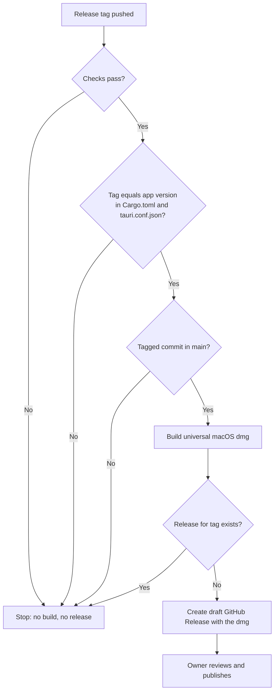

# CSD-021: CI and release pipeline

## 1. Intent
The repository has no automated checks and no way to produce an installable app. Format, lint and test failures are only caught if the owner runs them by hand, and a release means building a `.dmg` on one Mac. This capability adds a GitHub Actions pipeline in two parts: checks that run on every change, and a release build that runs when a version tag is pushed and leaves a draft GitHub Release for the owner to publish. It is for the owner, who is the only publisher. GitHub issue 29 asked for it.

## 2. Scope
### 2.1 In scope
- Checks on pull requests and on pushes to `development` and `main`: format, lint, tests and the `cargo deny` licence and advisory check.
- A release build triggered by a stable version tag, with guards on the tag.
- A universal macOS `.dmg` (Apple Silicon and Intel) attached to a draft GitHub Release.
- The bundle settings in `tauri.conf.json` that the `.dmg` needs.

### 2.2 Non-goals
- NG-1: Publishing a release automatically. The owner publishes the draft.
- NG-2: Code signing and notarization. Builds are unsigned, so macOS asks the user to open the app with right-click > Open.
- NG-3: Windows and Linux builds (`CLAUDE.md`: macOS only).
- NG-4: Automatic updates inside the app.
- NG-5: Releases from pre-release tags such as `v0.1.0-rc1`.
- NG-6: Enforcing the strict CSP. `CLAUDE.md` requires it before a release build; OQ-1 tracks it.

## 3. Definitions
| Term | Meaning |
|---|---|
| **Checks** | Four steps: `cargo fmt --all --check`, `cargo clippy --all-targets --all-features -- -D warnings`, `cargo test --all-features` and `cargo deny check`. |
| **Release tag** | A tag of the form `vMAJOR.MINOR.PATCH`, for example `v0.1.0`. |
| **App version** | The `version` in `src-tauri/Cargo.toml` and in `src-tauri/tauri.conf.json`. |

## 4. Requirements

### 4.0 Overview flow


**REQ-1: Checks on every change** *(event-driven)*
When a pull request is opened or updated, or a commit is pushed to `development` or `main`, the pipeline shall run the checks.

```gherkin
@AC-1.1
Scenario: A clean pull request passes
  Given a pull request whose code is formatted, lint-free, tested and licence-compliant
  When the pull request is opened
  Then the pipeline runs fmt, clippy, tests and cargo deny
  And the pull request shows a passing status

@AC-1.2
Scenario: A push to development runs the checks
  Given a commit pushed to "development"
  When the push arrives
  Then the pipeline runs the same four checks
```

**REQ-2: A failing check fails the run** *(unwanted behaviour)*
If any check fails, then the pipeline shall mark the run as failed.

```gherkin
@AC-2.1
Scenario: A clippy warning fails the run
  Given a pull request that introduces one clippy warning
  When the pipeline runs
  Then the clippy step fails
  And the pull request shows a failing status

@AC-2.2
Scenario: A disallowed licence fails the run
  Given a dependency licensed "GPL-3.0-only"
  When the pipeline runs
  Then the cargo deny step fails
```

**REQ-3: Release tags start a release** *(event-driven)*
When a release tag is pushed, the pipeline shall start the release run.

```gherkin
@AC-3.1
Scenario: A stable tag starts a release run
  When the tag "v0.1.0" is pushed
  Then the release run starts

@AC-3.2
Scenario Outline: Other tags do not start a release run
  When the tag "<tag>" is pushed
  Then no release run starts

  Examples:
    | tag        |
    | v0.1.0-rc1 |
    | 0.1.0      |
    | release-1  |
```

**REQ-4: Checks gate the release** *(unwanted behaviour)*
If a check fails on the tagged commit, then the pipeline shall not build or publish anything.

```gherkin
@AC-4.1
Scenario: Failing tests block the release
  Given the tag "v0.1.0" on a commit where one test fails
  When the release run starts
  Then no dmg is built
  And no GitHub Release is created
```

**REQ-5: The tag must equal the app version** *(unwanted behaviour)*
If the release tag differs from the app version in `Cargo.toml` or in `tauri.conf.json`, then the pipeline shall fail without building.

```gherkin
@AC-5.1
Scenario: Tag and versions agree
  Given "Cargo.toml" and "tauri.conf.json" both say version "0.1.0"
  When the tag "v0.1.0" is pushed
  Then the version check passes

@AC-5.2
Scenario Outline: Tag and versions disagree
  Given "Cargo.toml" says "<cargo>" and "tauri.conf.json" says "<tauri>"
  When the tag "v0.1.0" is pushed
  Then the run fails with a message naming both versions
  And no dmg is built

  Examples:
    | cargo | tauri |
    | 0.1.1 | 0.1.0 |
    | 0.1.0 | 0.1.1 |
```

**REQ-6: Releases come from main** *(unwanted behaviour)*
If the tagged commit is not part of `main`, then the pipeline shall fail without building.

```gherkin
@AC-6.1
Scenario: Tag on a commit that is in main
  Given the tag "v0.1.0" points at a commit reachable from "main"
  When the release run starts
  Then the main check passes

@AC-6.2
Scenario: Tag on a development-only commit
  Given the tag "v0.1.0" points at a commit that exists only on "development"
  When the release run starts
  Then the run fails and no dmg is built
```

**REQ-7: Build a universal macOS dmg** *(event-driven)*
When the checks, the version check and the main check have passed, the pipeline shall build one `.dmg` that runs on Apple Silicon and Intel Macs.

```gherkin
@AC-7.1
Scenario: The dmg is universal
  Given a release run that passed all guards
  When the build finishes
  Then one file "Varde_0.1.0_universal.dmg" exists
  And its app binary contains both "arm64" and "x86_64"
```

**REQ-8: Draft release with the dmg** *(event-driven)*
When the dmg is built, the pipeline shall create a draft GitHub Release for the tag with the dmg attached.

```gherkin
@AC-8.1
Scenario: A draft release is created
  Given a built "Varde_0.1.0_universal.dmg" for the tag "v0.1.0"
  When the release step runs
  Then a draft GitHub Release "Varde v0.1.0" exists
  And it has the dmg attached
  And it is not published
```

**REQ-9: An existing release is left alone** *(unwanted behaviour)*
If a GitHub Release for the tag already exists, then the pipeline shall fail and leave that release unchanged.

```gherkin
@AC-9.1
Scenario: The tag is pushed again after a release exists
  Given a GitHub Release for "v0.1.0" already exists
  When a release run for "v0.1.0" reaches the release step
  Then the step fails
  And the existing release and its files are unchanged
```

**REQ-10: No secrets beyond the workflow token** *(ubiquitous)*
The pipeline shall use no secret other than the token GitHub provides to the workflow run.

```gherkin
@AC-10.1
Scenario: A run needs no configured secrets
  Given a repository with no Actions secrets configured
  When a release run starts
  Then it completes without a missing-secret error
```

## 5. Interfaces and contracts
- `.github/workflows/ci.yml`: the checks, run on `pull_request`, on pushes to `development` and `main`, and as a reusable workflow.
- `.github/workflows/release.yml`: the release run, on tags matching `v[0-9]+.[0-9]+.[0-9]+`.
- `deny.toml`: the allowed licences for `cargo deny`, checked for the two macOS targets only.
- `src-tauri/tauri.conf.json`: `bundle.active` is `true` and the target is `dmg`.

## 6. Constraints
- CON-1: Runs use `macos-latest`. Rationale: macOS is the only supported platform and the `.dmg` can only be built there.
- CON-2: Workflows request read-only repository permission, and only the release job gets write access. Rationale: least privilege; the repository is public.
- CON-3: Workflow files and bundle settings change only with the owner's approval. Rationale: `CLAUDE.md` asks first for `.github/workflows/` and `tauri.conf.json`.
- CON-4: Dependency licences stay MIT, Apache-2.0, BSD or compatible. Rationale: `CLAUDE.md` Dependencies rule.

## 7. Verification
Workflow behaviour cannot be proven with `cargo test`, so ACs are checked in GitHub Actions. The Rust code is unchanged, so no `test_csd021_` tests exist.

| ACs | How |
|---|---|
| AC-1.1, AC-1.2, AC-2.1, AC-2.2 | Open a pull request, then one with a deliberate clippy warning, and read the check status. Push to `development` and read the run. |
| AC-3.1, AC-3.2, AC-5.1, AC-5.2, AC-6.1, AC-6.2 | Push throwaway tags on a scratch branch or fork and read the run. |
| AC-4.1, AC-7.1, AC-8.1, AC-9.1 | Push the first real tag. Open the draft release, check the file name, run `lipo -archs` on the app binary, push the tag again. |
| AC-10.1 | Confirm the repository has no Actions secrets and the run completes. |

## 8. Open questions
- OQ-1: Set a strict CSP in `tauri.conf.json` before the first release tag (`CLAUDE.md`)? Owner: Thijs. Blocks: the first tag, not a requirement.
- OQ-2: Which follow-up CSD covers signing and notarization (NG-2)? Owner: Thijs.
- OQ-3: Who bumps the app version, and in which commit, so the tag matches (REQ-5)? Owner: Thijs.
- OQ-4: A new `cargo deny` advisory can turn unrelated pull requests red. Add a scheduled run, or accept it? Owner: Thijs. Blocks: REQ-2.

## 9. Changelog
- 0.1 (02/11/2026): initial draft.
