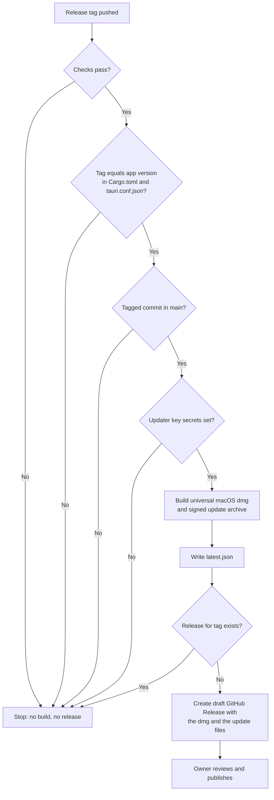

# CSD-021: CI and release pipeline

## 1. Intent
The repository has no automated checks and no way to produce an installable app. Format, lint and test failures (Rust and frontend) are only caught if the owner runs them by hand, and a release means building a `.dmg` on one Mac. This capability adds one GitHub Actions pipeline that runs only when a version tag is pushed: it runs the checks, builds the app and leaves a draft GitHub Release for the owner to publish. Nothing runs on pull requests or merges. It is for the owner, who is the only publisher. GitHub issue 29 asked for it.

## 2. Scope
### 2.1 In scope
- A release run triggered by a stable version tag, with guards on the tag. It starts with the checks: format, lint, the Rust tests, the frontend DOM tests and the `cargo deny` licence and advisory check.
- A universal macOS `.dmg` (Apple Silicon and Intel) attached to a draft GitHub Release.
- The update files that the in-app update (CSD-023) needs: a signed universal `.app.tar.gz` with its `.sig`, and a `latest.json`, attached to the same draft release.
- The bundle settings in `tauri.conf.json` that the `.dmg` and the update files need.

### 2.2 Non-goals
- NG-1: Publishing a release automatically. The owner publishes the draft.
- NG-2: Code signing and notarization. Builds are unsigned, so macOS blocks the first launch. The user allows it with Open Anyway in System Settings > Privacy & Security (macOS 15 and later) or right-click > Open (older versions), as the README explains.
- NG-3: Windows and Linux builds (`CLAUDE.md`: macOS only).
- NG-4: (removed in v0.7) Updating from inside the app is now CSD-023. Key rotation for the update signature, release channels and `tauri-action` stay out.
- NG-5: Releases from pre-release tags such as `v0.1.0-rc1`.
- NG-6: (removed in v0.5) The strict CSP is set in `src-tauri/tauri.conf.json` (OQ-1 resolved). It is not a requirement of this pipeline.
- NG-7: Checks on pull requests or on pushes to any branch. The owner runs them locally before tagging, and the release run repeats them.

## 3. Definitions
| Term | Meaning |
|---|---|
| **Checks** | Five steps: `cargo fmt --all --check`, `cargo clippy --all-targets --all-features -- -D warnings`, `cargo test --all-features`, the frontend DOM tests (`npm test`, CSD-000 REQ-6) and `cargo deny check`. |
| **Release tag** | A tag of the form `vMAJOR.MINOR.PATCH`, for example `v0.1.0`. |
| **App version** | The `version` in `src-tauri/Cargo.toml` and in `src-tauri/tauri.conf.json`. |
| **Update files** | `Varde_<version>_universal.app.tar.gz`, its signature `Varde_<version>_universal.app.tar.gz.sig` and `latest.json`. |
| **Updater key** | The minisign key pair that signs the update archive. The public key is in `tauri.conf.json` (CSD-023 CON-3), the private key and its password are the Actions secrets `TAURI_SIGNING_PRIVATE_KEY` and `TAURI_SIGNING_PRIVATE_KEY_PASSWORD`. It is separate from Apple signing. |

## 4. Requirements

### 4.0 Overview flow


**REQ-1: Checks only in the release run** *(event-driven)*
When a release tag is pushed, the pipeline shall run the checks as the first part of the release run. The pipeline shall not run on pull requests or on pushes to branches.

```gherkin
@AC-1.1
Scenario: A release tag runs the checks
  Given a release tag is pushed
  When the release run starts
  Then it runs fmt, clippy, the Rust tests, the DOM tests and cargo deny

@AC-1.2
Scenario: A push to main starts no run
  Given a pull request merged into "main"
  When the merge commit arrives on "main"
  Then the pipeline starts no run

@AC-1.3
Scenario: A pull request or a push to development starts no run
  Given a pull request, or a commit pushed to "development"
  When it is opened, updated or pushed
  Then the pipeline starts no run
```

**REQ-2: A failing check fails the run** *(unwanted behaviour)*
If any check fails, then the pipeline shall mark the run as failed.

```gherkin
@AC-2.1
Scenario: A clippy warning fails the run
  Given the tag "v0.1.0" on a commit with one clippy warning
  When the release run starts
  Then the clippy step fails
  And the run is marked as failed

@AC-2.2
Scenario: A disallowed licence fails the run
  Given the tag "v0.1.0" on a commit with a dependency licensed "GPL-3.0-only"
  When the release run starts
  Then the cargo deny step fails

@AC-2.3
Scenario: A failing DOM test fails the run
  Given the tag "v0.1.0" on a commit where one DOM test fails
  When the release run starts
  Then the DOM test step fails
  And the run is marked as failed
```

**REQ-3: Release tags start a release** *(event-driven)*
When a release tag is pushed, the pipeline shall start the release run.

```gherkin
@AC-3.1
Scenario: A stable tag starts a release run
  When the tag "v0.1.0" is pushed
  Then the release run starts

@AC-3.2
Scenario Outline: Other tags do not start a release run
  When the tag "<tag>" is pushed
  Then no release run starts

  Examples:
    | tag        |
    | v0.1.0-rc1 |
    | 0.1.0      |
    | release-1  |
```

**REQ-4: Checks gate the release** *(unwanted behaviour)*
If a check fails on the tagged commit, then the pipeline shall not build or publish anything.

```gherkin
@AC-4.1
Scenario: Failing tests block the release
  Given the tag "v0.1.0" on a commit where one test fails
  When the release run starts
  Then no dmg is built
  And no GitHub Release is created
```

**REQ-5: The tag must equal the app version** *(unwanted behaviour)*
If the release tag differs from the app version in `Cargo.toml` or in `tauri.conf.json`, then the pipeline shall fail without building.

```gherkin
@AC-5.1
Scenario: Tag and versions agree
  Given "Cargo.toml" and "tauri.conf.json" both say version "0.1.0"
  When the tag "v0.1.0" is pushed
  Then the version check passes

@AC-5.2
Scenario Outline: Tag and versions disagree
  Given "Cargo.toml" says "<cargo>" and "tauri.conf.json" says "<tauri>"
  When the tag "v0.1.0" is pushed
  Then the run fails with a message naming both versions
  And no dmg is built

  Examples:
    | cargo | tauri |
    | 0.1.1 | 0.1.0 |
    | 0.1.0 | 0.1.1 |
```

**REQ-6: Releases come from main** *(unwanted behaviour)*
If the tagged commit is not part of `main`, then the pipeline shall fail without building.

```gherkin
@AC-6.1
Scenario: Tag on a commit that is in main
  Given the tag "v0.1.0" points at a commit reachable from "main"
  When the release run starts
  Then the main check passes

@AC-6.2
Scenario: Tag on a development-only commit
  Given the tag "v0.1.0" points at a commit that exists only on "development"
  When the release run starts
  Then the run fails and no dmg is built
```

**REQ-7: Build a universal macOS dmg** *(event-driven)*
When the checks, the version check and the main check have passed, the pipeline shall build one `.dmg` that runs on Apple Silicon and Intel Macs.

```gherkin
@AC-7.1
Scenario: The dmg is universal
  Given a release run that passed all guards
  When the build finishes
  Then one file "Varde_0.1.0_universal.dmg" exists
  And its app binary contains both "arm64" and "x86_64"
```

**REQ-8: Draft release with the dmg and the update files** *(event-driven)*
When the dmg and the update files are built, the pipeline shall create a draft GitHub Release for the tag with the dmg and the update files attached.

```gherkin
@AC-8.1
Scenario: A draft release is created
  Given a built "Varde_0.1.0_universal.dmg" and the update files for the tag "v0.1.0"
  When the release step runs
  Then a draft GitHub Release "Varde v0.1.0" exists
  And it has the dmg, "Varde_0.1.0_universal.app.tar.gz", its ".sig" and "latest.json" attached
  And it is not published

@AC-8.2
Scenario: Publishing the draft is the rollout
  Given the draft release "Varde v0.1.0"
  When the owner publishes it
  Then the URL "https://github.com/BardoelT/varde/releases/latest/download/latest.json" serves its "latest.json"
  And while the release is a draft that URL does not serve it
```

**REQ-9: An existing release is left alone** *(unwanted behaviour)*
If a GitHub Release for the tag already exists, then the pipeline shall fail and leave that release unchanged.

```gherkin
@AC-9.1
Scenario: The tag is pushed again after a release exists
  Given a GitHub Release for "v0.1.0" already exists
  When a release run for "v0.1.0" reaches the release step
  Then the step fails
  And the existing release and its files are unchanged
```

**REQ-10: Secrets: the workflow token and the updater key only** *(ubiquitous)*
The pipeline shall use no secret other than the token GitHub provides to the workflow run and the two updater key secrets, and shall never print any of them.

```gherkin
@AC-10.1
Scenario: A run with the updater key secrets completes
  Given a repository whose only Actions secrets are "TAURI_SIGNING_PRIVATE_KEY" and "TAURI_SIGNING_PRIVATE_KEY_PASSWORD"
  When a release run starts
  Then it completes without a missing-secret error

@AC-10.2
Scenario: The logs hold no secret
  Given a finished release run
  When its log is read
  Then it contains neither the private key nor its password
```

**REQ-11: A signed update archive** *(event-driven)*
When the build runs, the pipeline shall produce one universal `Varde_<version>_universal.app.tar.gz` and its `.sig`, signed with the updater key.

```gherkin
@AC-11.1
Scenario: The archive and its signature exist
  Given a release run that passed all guards
  When the build finishes
  Then "Varde_0.1.0_universal.app.tar.gz" and "Varde_0.1.0_universal.app.tar.gz.sig" exist
  And the signature verifies with the public key in "tauri.conf.json"
```

**REQ-12: latest.json for both Macs** *(event-driven)*
When the update archive is built, the pipeline shall write a `latest.json` with the version, the publication date, and the same archive URL and signature under `darwin-aarch64` and under `darwin-x86_64`.

```gherkin
@AC-12.1
Scenario: Both platform keys point at the universal archive
  Given the archive "Varde_0.1.0_universal.app.tar.gz" for the tag "v0.1.0"
  When "latest.json" is written
  Then its "version" is "0.1.0"
  And "platforms.darwin-aarch64" and "platforms.darwin-x86_64" both have the url "https://github.com/BardoelT/varde/releases/download/v0.1.0/Varde_0.1.0_universal.app.tar.gz"
  And both have the signature held in the ".sig" file
```

**REQ-13: A missing updater key stops the run before the build** *(unwanted behaviour)*
If either updater key secret is missing or empty, then the pipeline shall fail without building and without creating a release.

```gherkin
@AC-13.1
Scenario Outline: A secret is missing
  Given the secret "<missing>" is not set
  When the release run reaches the build job
  Then the run fails with a message naming the secret
  And no dmg is built and no release is created

  Examples:
    | missing                              |
    | TAURI_SIGNING_PRIVATE_KEY            |
    | TAURI_SIGNING_PRIVATE_KEY_PASSWORD   |
```

## 5. Interfaces and contracts
- `.github/workflows/release.yml`: the only workflow. It runs on tags matching `v[0-9]+.[0-9]+.[0-9]+` and holds the check jobs and the release job. There is no workflow for pull requests or pushes.
- `package.json` and `package-lock.json` at the repository root: they hold the dev-only dependencies of the DOM tests and the `npm test` script. The workflow installs them from the lock file (`npm ci`) in the check job.
- `rust-toolchain.toml` at the repository root: the exact Rust version (with rustfmt, clippy and both macOS targets) used locally and in the release run. The workflow installs the same version explicitly, because the install action cannot read the file.
- `deny.toml`: the allowed licences for `cargo deny`, checked for the two macOS targets only.
- `src-tauri/tauri.conf.json`: `bundle.active` is `true`, the targets are `dmg` and `app`, `bundle.createUpdaterArtifacts` is `true`, and `plugins.updater` holds the public key and the endpoint (CSD-023 section 5).
- The build runs `cargo tauri build --target universal-apple-darwin --bundles dmg,app -- --locked` with the two updater key secrets in its environment. A `jq` step writes `latest.json`: `{ "version", "notes": "", "pub_date", "platforms": { "darwin-aarch64": { "signature", "url" }, "darwin-x86_64": { "signature", "url" } } }`. `tauri-action` is not used.
- GitHub serves `releases/latest/download/` only for a published release, so a draft is invisible to installed apps until the owner publishes it.

## 6. Constraints
- CON-1: Runs use `macos-latest`. Rationale: macOS is the only supported platform and the `.dmg` can only be built there.
- CON-2: Workflows request read-only repository permission, and only the release job gets write access. Rationale: least privilege; the repository is public.
- CON-3: Workflow files and bundle settings change only with the owner's approval. Rationale: `CLAUDE.md` asks first for `.github/workflows/` and `tauri.conf.json`.
- CON-4: Dependency licences stay MIT, Apache-2.0, BSD or compatible. Rationale: `CLAUDE.md` Dependencies rule.
- CON-5: JavaScript dependencies exist only for the frontend tests, are dev-only, are installed from the lock file and never enter the app bundle; the app itself needs no Node and no build step. Rationale: `CLAUDE.md` says no npm build step, and the owner approved this tests-only exception.
- CON-6: Every third-party action in a workflow is pinned to a full 40-character commit SHA, with the readable version as a trailing comment. Rationale: a moved tag cannot change what a release run executes; the repository is public and builds the app people install.
- CON-7: Cargo commands that resolve dependencies in the release run (`clippy`, `test`, `tauri build`, `install`) use `--locked`, so the run builds what `Cargo.lock` says. Rationale: a release must not pick up newer dependencies than the ones that were tested.
- CON-8: The Rust version in `rust-toolchain.toml` and the `toolchain` of the install action in `release.yml` are the same, and change in one commit. Rationale: the checks and the release build use the compiler the owner tested with.

## 7. Verification
Workflow behaviour cannot be proven with `cargo test`, so ACs are checked in GitHub Actions. The Rust code is unchanged, so no `test_csd021_` tests exist.

| ACs | How |
|---|---|
| AC-1.1, AC-2.1, AC-2.2, AC-2.3 | Push a throwaway tag on a scratch branch or fork, then one on a commit with a deliberate clippy warning and one with a deliberately failing DOM test, and read the run. |
| AC-1.2, AC-1.3 | Merge a pull request, open one, and push to `development`. Confirm in the Actions tab that no run starts. |
| AC-3.1, AC-3.2, AC-5.1, AC-5.2, AC-6.1, AC-6.2 | Push throwaway tags on a scratch branch or fork and read the run. |
| AC-4.1, AC-7.1, AC-8.1, AC-9.1 | Push the first real tag. Open the draft release, check the file names (dmg, archive, `.sig`, `latest.json`), run `lipo -archs` on the app binary, push the tag again. |
| AC-8.2, AC-11.1, AC-12.1 | On the first real tag: read `latest.json` in the draft, verify the `.sig` with the public key (`minisign -V`), and after publishing fetch the endpoint URL. The CSD-023 checklist covers the install itself. |
| AC-10.1, AC-10.2 | Confirm the repository has only the two updater key secrets, the run completes, and read the log for the key and the password. |
| AC-13.1 | Push a throwaway tag on a scratch fork without one of the secrets and read the run. |

## 8. Open questions
- OQ-1: (resolved 03/11/2026) A strict CSP is set in `src-tauri/tauri.conf.json` (default-src 'self', no remote scripts, no `unsafe-eval`).
- OQ-2: Which follow-up CSD covers signing and notarization (NG-2)? Owner: Thijs.
- OQ-3: Who bumps the app version, and in which commit, so the tag matches (REQ-5)? Owner: Thijs.

## 9. Changelog
- 0.7 (18/11/2026): The release also produces the update files for the in-app update (CSD-023, GitHub issue 39): a signed universal `.app.tar.gz` with its `.sig`, and a `latest.json` listing it under both `darwin-aarch64` and `darwin-x86_64`, all on the draft release (REQ-8 widened, new AC-8.2, new REQ-11 to REQ-13, definitions, flow, sections 2.1 and 5). REQ-10 now allows the two updater key secrets and no others (AC-10.1 reworded, new AC-10.2); the release is no longer free of secrets. NG-4 removed. Apple signing stays out (NG-2). Back to `draft` until re-approved.
- 0.6 (04/11/2026): Release hardening, approved by the owner: actions pinned to commit SHAs (CON-6), `--locked` on the cargo commands (CON-7), a pinned toolchain in `rust-toolchain.toml` that the workflow matches (CON-8, section 5). Requirements and ACs are unchanged. Stays `draft` until re-approved.
- 0.5 (03/11/2026): NG-6 removed and OQ-1 resolved: `tauri.conf.json` now holds a strict CSP. The verification table is unchanged: the ACs are checked in GitHub Actions and no `test_csd021_` tests exist by design. Back to `draft` until re-approved.
- 0.4 (03/11/2026): The frontend DOM tests are a fifth check (definition Checks, section 1, section 2.1, AC-1.1, new AC-2.3, section 5 with `package.json` and the lock file, new CON-5 for the tests-only JavaScript dependencies, section 7). Back to `draft` until re-approved.
- 0.3 (02/11/2026): The pipeline runs only on a release tag, nothing on pull requests or merges: REQ-1 and its ACs rewritten, new NG-7, ACs 2.1, 2.2 reworded, no separate `ci.yml`, sections 1, 2.1, 5 and 7, OQ-4 removed. NG-2 now names the current macOS way to open an unsigned app.
- 0.2 (02/11/2026): Checks no longer run on pushes to `development`, only on pull requests and pushes to `main` (REQ-1, AC-1.2, new AC-1.3, sections 2.1, 5, 7).
- 0.1 (02/11/2026): initial draft.
