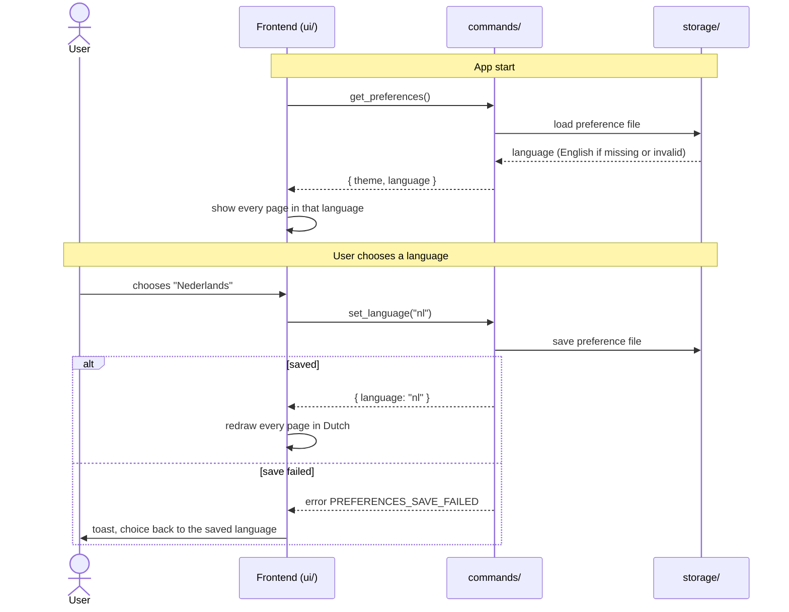

# CSD-022: Language (English and Dutch)

## 1. Intent
Every text in the app is in English. The owner works in Dutch as well, and a Dutch speaker who opens the project, such as a partner or family member, cannot read the app in their own language. This capability lets the user choose English or Dutch on the Settings page. English is the default. Like the theme (CSD-008), the language is a preference of the person using the app on this Mac, not of the project, so it is kept outside the project file and stays the same whichever project is open. It is for a single user. It is GitHub issue 22.

## 2. Scope
### 2.1 In scope
- A "Language" choice on the Settings page with English and Dutch: choosing, applying, saving and showing it.
- All fixed texts of the screens in both languages: labels, buttons, headings, notes, explanations, dialogs and toasts.
- Error messages from Rust, shown through their error code in the chosen language.
- Keeping the preference with the theme (CSD-008) and restoring it at start.

### 2.2 Non-goals
- NG-1: Languages other than English and Dutch, and a translation tool or a way for the user to add a language.
- NG-2: Translating what the user typed: account, bank, debt, house and job names, notes and any other project data. These show as they were entered.
- NG-3: Changing how amounts, percentages and dates are written with the language. They keep one format in both languages (REQ-10).
- NG-4: Following the macOS language. The user chooses, and the default is English.
- NG-5: A language per project. The project file holds no language (CSD-003 CON-2 stays as it is).
- NG-6: The native macOS menu bar stays in English, which is accepted, and native file dialogs keep the language the system gives them.
- NG-7: Translating the project file, the specs in `docs/` or the app name.

## 3. Definitions
| Term | Meaning |
|---|---|
| **Language** | The language of the app's own texts: `en` (English) or `nl` (Dutch). |
| **Fixed text** | A text written in the app itself, as opposed to project data the user typed. |
| **Error code** | The stable code that Rust sends with an error (`error.rs`), next to its English message. |

## 4. Requirements

### 4.0 Overview flow


**REQ-1: Language choice on the Settings page** *(ubiquitous)*
The Settings page shall show a "Language" choice in the "Appearance" panel, below "Theme", that offers English and Nederlands in that order, each written in its own language, and shows the current language.

```gherkin
@AC-1.1
Scenario: The choice and its options
  Given the app has started
  When the user opens Settings
  Then the "Appearance" panel shows a "Language" choice below "Theme"
  And the choice offers "English" and "Nederlands" in that order

@AC-1.2
Scenario Outline: The choice shows the current language
  Given the saved language is "<language>"
  When the user opens Settings
  Then the "Language" choice shows "<label>"

  Examples:
    | language | label      |
    | en       | English    |
    | nl       | Nederlands |
```

**REQ-2: Default language** *(state-driven)*
While no language has been saved, the app shall use English.

```gherkin
@AC-2.1
Scenario: First start
  Given no preference file exists
  When the app starts
  Then every text is in English
  And the "Language" choice shows "English"

@AC-2.2
Scenario: The macOS language is not followed
  Given macOS is set to Dutch and no language has been saved
  When the app starts
  Then every text is in English
```

**REQ-3: Apply the choice at once** *(event-driven)*
When the user chooses a language, the app shall show every page, dialog and open form in it immediately, without a confirmation, a restart or a reload of the project, and without marking the project as having unsaved changes.

```gherkin
@AC-3.1
Scenario: Choosing Dutch
  Given the app shows English and the user is on Settings
  When the user chooses "Nederlands"
  Then the Settings page, the navigation and every other page show Dutch texts at once
  And no confirmation is asked

@AC-3.2
Scenario: The choice is not an unsaved project change
  Given a saved project
  When the user chooses "Nederlands"
  Then the unsaved indicator is not shown

@AC-3.3
Scenario: Data the user typed is unchanged
  Given the project has a bank account named "Example Bank"
  When the user chooses "Nederlands"
  Then the account is still shown as "Example Bank"

@AC-3.4
Scenario: Choosing the current language changes nothing
  Given the saved language is "nl"
  When the user chooses "Nederlands"
  Then the saved language is "nl"
```

**REQ-4: The language is remembered** *(ubiquitous)*
The app shall keep the chosen language in the preference file of CSD-008, outside the project file, restore it when the app starts and before the first page is shown, and use it for every project.

```gherkin
@AC-4.1
Scenario: Restored at start
  Given the user chose "Nederlands" and quit the app
  When the app starts
  Then the first page that is shown is already in Dutch

@AC-4.2
Scenario: Same language for another project
  Given the language is "nl"
  When the user opens a different project file
  Then the app is still in Dutch

@AC-4.3
Scenario: Not in the project file
  Given the language is "nl" and the user saves the project
  Then the project file contains no language

@AC-4.4
Scenario: Theme and language are kept together
  Given the theme is "dark" and the user chooses "Nederlands"
  When the app starts again
  Then the theme is "dark" and the language is "nl"
```

**REQ-5: All fixed texts are translated** *(ubiquitous)*
The app shall show every fixed text in the chosen language, including its titles, column headings, buttons, form labels, placeholders, notes, empty states, confirmation dialogs, toasts, chart legends and tooltips, and the explanations of the ratios.

```gherkin
@AC-5.1
Scenario: A page in Dutch
  Given the language is "nl"
  When the user opens "Ratios"
  Then the page title, the row labels, the sub-headings and the explanations are in Dutch

@AC-5.2
Scenario: A dialog in Dutch
  Given the language is "nl"
  When the user starts deleting a job
  Then the confirmation dialog, its message and its buttons are in Dutch
```

**REQ-6: A missing translation falls back to English** *(unwanted behaviour)*
If a fixed text has no translation in the chosen language, then the app shall show its English text and shall not show a text key or an empty string.

```gherkin
@AC-6.1
Scenario: Dutch text missing
  Given the language is "nl" and a text has no Dutch version
  When the page with that text is shown
  Then the text is shown in English
```

**REQ-7: Errors in the chosen language** *(event-driven)*
When Rust returns an error, the app shall show the text of its error code in the chosen language, and shall show the English message from Rust when the code has no translation.

```gherkin
@AC-7.1
Scenario: A known error in Dutch
  Given the language is "nl"
  When a command fails with code "JOB_NOT_FOUND"
  Then the toast shows the Dutch text for that code

@AC-7.2
Scenario: An unknown code
  Given the language is "nl" and a command fails with a code that has no Dutch text
  When the error is shown
  Then the toast shows the English message that Rust sent

@AC-7.3
Scenario: No path in the message
  Given a command fails with a code for a file problem
  When the error is shown in either language
  Then the toast contains no file path
```

**REQ-8: Missing or unsupported language** *(unwanted behaviour)*
If the preference file has no language, an empty one or one that is not `en` or `nl`, or `set_language` is called with such a value, then the app shall use English and shall not change the saved language.

```gherkin
@AC-8.1
Scenario Outline: A language that cannot be used
  Given the preference file holds language "<stored>"
  When the app starts
  Then the language is English

  Examples:
    | stored |
    |        |
    | fr     |
    | NL     |

@AC-8.2
Scenario: Unsupported value on save
  When the frontend calls set_language("fr")
  Then the command fails with code PREFERENCES_LANGUAGE_UNSUPPORTED
  And the saved language is unchanged

@AC-8.3
Scenario: An older preference file
  Given the preference file holds only { "theme": "dark" }
  When the app starts
  Then the language is English and the theme is "dark"
```

**REQ-9: Saving fails** *(unwanted behaviour)*
If the language cannot be saved, then the app shall keep the saved language, show the previous language and choice, and show a message that the language could not be saved without a file path.

```gherkin
@AC-9.1
Scenario: Read-only config folder
  Given the saved language is "en" and the config folder cannot be written
  When the user chooses "Nederlands"
  Then the app is still in English
  And the "Language" choice shows "English"
  And a message appears that the language could not be saved
  And the message contains no file path
```

**REQ-10: Formats do not follow the language** *(ubiquitous)*
The app shall write dates as dd/mm/yyyy and amounts with a comma as thousands separator, a point as decimal separator and two decimals (for example 1,234.50, CSD-000 CON-8) in every language.

```gherkin
@AC-10.1
Scenario Outline: Dates and amounts are the same in both languages
  Given the language is "<language>"
  And a job starting 01/03/2024 and a paycheck with gross salary 1234.50
  Then the job start date is shown as "01/03/2024"
  And the gross salary is shown as "1,234.50"

  Examples:
    | language |
    | en       |
    | nl       |

@AC-10.2
Scenario: Switching the language does not change the formats
  Given the language is "en" and an amount is shown as "1,234.50"
  When the user chooses "Nederlands"
  Then the amount is still shown as "1,234.50"
  And dates are still shown as dd/mm/yyyy
```

## 5. Interfaces and contracts
Commands: `get_preferences()` returns `{ theme, language }` (CSD-008 returned `{ theme }`), and `set_language(language)` takes `"en"` or `"nl"` and returns `{ language }`. It saves first and returns only when the save succeeded, so a failed save changes nothing (REQ-9), as `set_theme` does.

Preference file: `preferences.json`, for example `{ "theme": "system", "language": "en" }`. Unknown fields are ignored, and a missing `language` means English (AC-8.3). The preference file is lenient on purpose, unlike the strict project file (CSD-002 REQ-17).

Error codes: `PREFERENCES_LANGUAGE_UNSUPPORTED` (new), `PREFERENCES_SAVE_FAILED` (CSD-008). Rust keeps sending its English message with every code.

## 6. Constraints
- CON-1: The language is stored only in the preference file of CSD-008, with the same rules (outside the project file, atomic, owner-only, never committed). Rationale: it belongs to the person and the Mac, and it is needed before any project is open.
- CON-2: Rust is the only place the preference is kept. The frontend holds no copy (no `localStorage`). Rationale: one source of truth, CSD-008 CON-2.
- CON-3: The English text is written where it is used and is the key of its Dutch version, which lives in the Dutch dictionary in `ui/locales/` (split by area, merged in one file). Texts are read through one helper, with no new dependency and no build step. The frontend contains no text that bypasses the helper. Rationale: `CLAUDE.md` (vanilla frontend), English can never be missing, and one place to find and review the Dutch texts.
- CON-4: Rust sends error codes and English messages, never translated text, and `domain/` holds no texts for the screens. Rationale: `CLAUDE.md` layout rule and the safe error rule.
- CON-5: The language is a closed set (`en`, `nl`), not free text beyond the command edge. Rationale: invalid states are unrepresentable per `CLAUDE.md`.
- CON-6: No new plugin, capability or permission, and no network access. Rationale: least privilege per `CLAUDE.md`.
- CON-7: Tests use a temporary directory and never the real app config folder. Rationale: `CLAUDE.md` testing rules.

## 7. Verification
The preference is proven by `cargo test`. Tests are named `test_csd022_ac_<n>_<m>_<description>` (CSD-000 REQ-6).

| Requirement | Command |
|---|---|
| REQ-2 (AC-2.1), REQ-4 (AC-4.3, AC-4.4), REQ-8, REQ-9, and the data of REQ-1 and REQ-3 | `cargo test test_csd022_`. Storage tests (save, load, missing, empty, invalid, older file, read-only folder) run in a temporary directory |
| REQ-1 (display), AC-2.2, REQ-3, AC-4.1, AC-4.2, REQ-5, REQ-6, REQ-7, REQ-10 | DOM tests (dev-only test harness): the "Language" choice, switching with every page open in turn, a dialog, a toast, an error in each language, a deleted Dutch text, and the date and amount formats in both languages. Manual checklist for what needs a real restart or macOS: AC-2.2 and AC-4.1 |

Done means fmt, clippy (`-D warnings`) and `cargo test --all-features` pass.

## 8. Open questions
- OQ-1: Should a Rust test check that the Dutch dictionary has every key of the English one? It is a cheap guard, but it makes `cargo test` read files in `ui/`. Owner: Thijs. Blocks: Section 7.
- OQ-2: Who writes and reviews the Dutch texts? Claude can draft them, and the owner reviews the wording before approval. Owner: Thijs. Blocks: REQ-5.

## 9. Changelog
- 0.3 (03/11/2026): Formatting does not follow the language: new REQ-10 (AC-10.1, AC-10.2), dates stay dd/mm/yyyy and amounts stay 1,234.50 in Dutch too, NG-3 and CSD-000 CON-8 referenced. The native menu stays in English, which is accepted (NG-6). Display ACs are covered by DOM tests. Back to `draft` until re-approved.
- 0.1 (02/11/2026): initial draft, from GitHub issue 22 and the interview. Beyond the interview: the macOS language is not followed (NG-4), the native menu and file dialogs stay as they are (NG-6), and a text without a translation falls back to English (REQ-6).
- 0.2 (02/11/2026): CON-3 clarified for the implementation: English texts are the keys, so there is a Dutch dictionary only (no clarification of behaviour).
