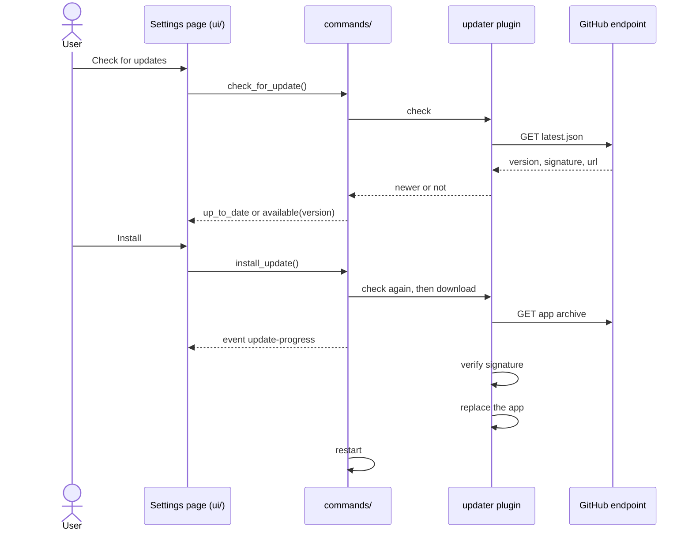

# CSD-023: In-app updates

## 1. Intent
A new version of Varde reaches people only if they notice it and download the `.dmg` again by hand. This capability lets the user check for a newer version from the Settings page and install it from there: the app downloads the update, verifies it, replaces itself and restarts. It is for the owner and the few people who use the app. The check is manual only, because the app is local-first and makes no network call the user did not ask for. It is GitHub issue 39, refined in a grill-me interview of 18/11/2026.

## 2. Scope
### 2.1 In scope
- An Updates section on the Settings page: the current version, a "Check for updates" button, and the result of the check.
- Installing a newer version from that section: download, signature check, replace, restart, with progress.
- The confirmation before installing when the project has unsaved changes.
- The Rust commands, the one endpoint and the update signature check.
- English and Dutch texts (CSD-022).
- The README sentence about network access, which says the one call this feature makes.

The release side (the signed update files and `latest.json`) is in CSD-021.

### 2.2 Non-goals
- NG-1: Automatic checks: at startup, in the background or on a timer.
- NG-2: A menu item for updates. The native menu stays as it is (CSD-024 REQ-5).
- NG-3: Release notes in the app.
- NG-4: Cancelling a download in progress.
- NG-5: Rotating the update signing key.
- NG-6: Downgrades, release channels and pre-releases.
- NG-7: Apple code signing and notarization (CSD-021 NG-2).
- NG-8: Any other network call, and any data sent to the endpoint beyond the request itself.

## 3. Definitions
| Term | Meaning |
|---|---|
| **Current version** | The version of the running app (CSD-031 REQ-2 gives the single source). |
| **Newer version** | A version in `latest.json` that is higher than the current version by semantic versioning order. |
| **Endpoint** | `https://github.com/BardoelT/varde/releases/latest/download/latest.json`. |
| **Update run** | One check, or one install, from its start until it ends in a result or an error. |
| **Update code** | One of the four safe error codes of REQ-8. |

## 4. Requirements

### 4.0 Overview flow


**REQ-1: Updates section** *(ubiquitous)*
The Settings page shall show an Updates section with the current version and a "Check for updates" button.

```gherkin
@AC-1.1
Scenario: The section shows the version and the button
  Given the app version is "0.1.0"
  When the user opens Settings
  Then the Updates section shows "0.1.0" and a "Check for updates" button
  And no result or message is shown yet

@AC-1.2
Scenario: Dutch
  Given the language setting is Dutch
  When the user opens Settings
  Then the Updates section shows its texts in Dutch
```

**REQ-2: Checks are manual only** *(ubiquitous)*
The app shall contact the endpoint only while a check or an install that the user started is running.

```gherkin
@AC-2.1
Scenario: Starting the app makes no call
  Given the app starts
  When the main window is shown
  Then the app has made no request to the endpoint

@AC-2.2
Scenario: Opening Settings makes no call
  When the user opens the Settings page
  Then the app has made no request to the endpoint

@AC-2.3
Scenario: The native menu has no update item
  When the user looks through the native menu bar
  Then no item checks for or installs updates
```

**REQ-3: Check result** *(event-driven)*
When the user chooses "Check for updates", the app shall fetch the endpoint and show exactly one of three results: up to date, a newer version available, or an error.

```gherkin
@AC-3.1
Scenario: Already the latest
  Given the app version is "0.1.0" and the endpoint says "0.1.0"
  When the user chooses "Check for updates"
  Then the section shows "Up to date (0.1.0)"
  And no Install button is shown

@AC-3.2
Scenario: A newer version exists
  Given the app version is "0.1.0" and the endpoint says "0.2.0"
  When the user chooses "Check for updates"
  Then the section shows "Version 0.2.0 is available" and an "Install" button

@AC-3.3
Scenario: The endpoint cannot be reached
  Given the Mac is offline
  When the user chooses "Check for updates"
  Then the section shows a generic message and the code "UPDATE_CHECK_FAILED"
  And the "Check for updates" button is enabled again

@AC-3.4
Scenario: The endpoint answers with something that is not a valid update file
  Given the endpoint answers with text that is not valid JSON
  When the user chooses "Check for updates"
  Then the section shows a generic message and the code "UPDATE_CHECK_FAILED"
```

**REQ-4: Always fresh, only newer** *(ubiquitous)*
Every check shall fetch the endpoint again, and the app shall treat only a higher version than the current one as an update.

```gherkin
@AC-4.1
Scenario: A second check fetches again
  Given a check found "0.2.0"
  And the endpoint now says "0.3.0"
  When the user chooses "Check for updates" again
  Then the section shows "Version 0.3.0 is available"

@AC-4.2
Scenario Outline: A version that is not higher is not an update
  Given the app version is "0.2.0" and the endpoint says "<endpoint>"
  When the user chooses "Check for updates"
  Then the section shows "Up to date (0.2.0)"

  Examples:
    | endpoint |
    | 0.2.0    |
    | 0.1.9    |
```

**REQ-5: Install** *(event-driven)*
When the user chooses "Install" for an available version, the app shall check the endpoint again, download the update, verify its signature, replace the installed app and restart it.

```gherkin
@AC-5.1
Scenario: A successful install
  Given the app version is "0.1.0" and "0.2.0" is available
  When the user chooses "Install"
  Then the update is downloaded and its signature is verified
  And the app is replaced and restarts
  And the Updates section then shows "0.2.0"

@AC-5.2
Scenario: The version changed between check and install
  Given a check found "0.2.0"
  And the endpoint now says "0.3.0"
  When the user chooses "Install"
  Then "0.3.0" is installed, the version the endpoint says at that moment

@AC-5.3
Scenario: The newer version disappeared between check and install
  Given a check found "0.2.0"
  And the endpoint now says "0.1.0"
  When the user chooses "Install"
  Then nothing is downloaded
  And the section shows "Up to date (0.1.0)"
```

**REQ-6: Progress** *(state-driven)*
While an update is downloading, the Updates section shall show the progress as a percentage bar, or as a bar without a percentage when the download size is unknown.

```gherkin
@AC-6.1
Scenario: Known size
  Given an update of 40 MB is downloading
  When 20 MB has arrived
  Then the section shows a bar at 50%

@AC-6.2
Scenario: Unknown size
  Given the server sends no content length
  When the update is downloading
  Then the section shows a bar without a percentage
```

**REQ-7: Confirm before installing with unsaved changes** *(event-driven)*
When the user chooses "Install" while the unsaved-changes indicator is shown, the app shall ask for confirmation before it downloads anything, and shall do nothing further if the user cancels.

```gherkin
@AC-7.1
Scenario: Unsaved changes ask first
  Given unsaved changes
  When the user chooses "Install"
  Then a confirmation is asked
  And choosing "cancel" downloads nothing and leaves the section as it was
  And the project and its unsaved changes are unchanged

@AC-7.2
Scenario: Confirming goes on
  Given unsaved changes
  When the user chooses "Install" and confirms
  Then the install runs as in REQ-5

@AC-7.3
Scenario: No unsaved changes, no question
  Given no unsaved changes
  When the user chooses "Install"
  Then no confirmation is asked

@AC-7.4
Scenario: Autosave on with a saved project
  Given autosave is on and the project file "example-a.varde" is open
  When the user adds a job and chooses "Install"
  Then no confirmation is asked
  And "example-a.varde" holds the job
```

**REQ-8: A failure changes nothing and can be retried** *(unwanted behaviour)*
If a check or an install fails, then the app shall leave the installed app and the project file as they were, show a generic message with one update code, and allow the user to try again.

The update codes are `UPDATE_CHECK_FAILED` (the endpoint cannot be reached or its answer is not valid), `UPDATE_DOWNLOAD_FAILED` (the download fails or stops), `UPDATE_SIGNATURE_INVALID` (the signature does not match) and `UPDATE_INSTALL_FAILED` (the replace or the restart fails). The message holds no URL, path or raw error text.

```gherkin
@AC-8.1
Scenario Outline: Each stage has its code
  Given a run that fails at the stage "<stage>"
  Then the section shows a generic message in the current language and the code "<code>"
  And the message contains no URL and no file path
  And the installed app and the project file are unchanged

  Examples:
    | stage     | code                     |
    | check     | UPDATE_CHECK_FAILED      |
    | download  | UPDATE_DOWNLOAD_FAILED   |
    | signature | UPDATE_SIGNATURE_INVALID |
    | install   | UPDATE_INSTALL_FAILED    |

@AC-8.2
Scenario: A bad signature installs nothing
  Given the downloaded archive has a signature that does not match the public key in the app
  When the user chooses "Install"
  Then nothing is replaced
  And the section shows the code "UPDATE_SIGNATURE_INVALID"

@AC-8.3
Scenario: Try again after a failure
  Given an install failed with "UPDATE_DOWNLOAD_FAILED"
  When the user chooses "Install" again
  Then a new install run starts

@AC-8.4
Scenario: The connection drops mid-download
  Given an update is downloading
  When the connection drops
  Then the section shows "UPDATE_DOWNLOAD_FAILED"
  And the installed app and the project file are unchanged
```

**REQ-9: One run at a time** *(state-driven)*
While an update run is active, the app shall disable the "Check for updates" and "Install" buttons and shall offer no way to cancel the run.

```gherkin
@AC-9.1
Scenario: Buttons are disabled during a check
  When a check is running
  Then "Check for updates" and "Install" are disabled

@AC-9.2
Scenario: Buttons are disabled during an install
  When an install is running
  Then "Check for updates" and "Install" are disabled
  And the section has no cancel button

@AC-9.3
Scenario: Buttons come back after the run
  Given a run ended with an error
  Then "Check for updates" is enabled again
```

**REQ-10: A result is not remembered** *(ubiquitous)*
The app shall keep the result of a check in memory only and show it no longer than until the user leaves the Settings page or the app quits.

```gherkin
@AC-10.1
Scenario: Leaving Settings clears the result
  Given a check found "0.2.0"
  When the user opens another page and returns to Settings
  Then the section shows no result and no Install button

@AC-10.2
Scenario: A restart forgets it
  Given a check found "0.2.0"
  When the app quits and starts again
  Then the section shows no result
  And no file or preference holds the result
```

**REQ-11: One endpoint, nothing sent** *(ubiquitous)*
The app shall make network requests only to the endpoint and to the download URL that the endpoint names, and shall send no data about the user, the project or the Mac beyond what the HTTP request itself carries.

```gherkin
@AC-11.1
Scenario: The endpoint is fixed
  Given the configured endpoint list
  Then it holds exactly "https://github.com/BardoelT/varde/releases/latest/download/latest.json"

@AC-11.2
Scenario: The request carries no project data
  When a check runs
  Then the request holds no project data, file name or identifier of the user
```

**REQ-12: Only signed updates install** *(unwanted behaviour)*
If an update is not signed with the key that belongs to the public key built into the app, then the app shall not install it.

```gherkin
@AC-12.1
Scenario: Signed with another key
  Given an archive signed with a key other than the app's
  When the user chooses "Install"
  Then nothing is replaced
  And the section shows "UPDATE_SIGNATURE_INVALID"

@AC-12.2
Scenario: No signature
  Given the endpoint names an archive without a signature
  When a check runs
  Then the section shows "UPDATE_CHECK_FAILED"
```

**REQ-13: Update texts in both languages** *(ubiquitous)*
The app shall show every text of the Updates section, including the four messages, the confirmation and the progress, in English and in Dutch (CSD-022).

```gherkin
@AC-13.1
Scenario: Every text has a Dutch translation
  Given the Dutch dictionary
  Then it holds a translation for every English text of the Updates section
```

## 5. Interfaces and contracts
Commands (Rust, `src-tauri/src/commands/`), both async:

- `check_for_update()` returns `{ status: "up_to_date", current }` or `{ status: "available", current, version }`. An error returns `{ code }` with one update code.
- `install_update()` checks again, downloads, verifies, installs and restarts. It returns only on an error (`{ code }`) or when the endpoint says there is nothing newer (`{ status: "up_to_date", current }`).

Event `update-progress` with `{ downloaded, total }` (bytes; `total` is `null` when unknown), sent by Rust while downloading. The frontend only listens (`core:event:allow-listen` is already granted) and computes no figures except the display percentage of a number it was given.

The frontend asks Rust whether the project has unsaved changes with `project_status()` (CSD-002 section 5) and asks the confirmation itself, as it does for close (CSD-002 REQ-4); `install_update()` does not ask.

Dependency: the `tauri-plugin-updater` crate, used from Rust only. No updater permission is added to `src-tauri/capabilities/`, so the webview cannot call the plugin. `tauri.conf.json` holds the plugin's `pubkey` and the endpoint under `plugins.updater`. The files at the endpoint are described in CSD-021 section 5.

Rust requests are not subject to the webview CSP, so the CSP stays as it is.

## 6. Constraints
- CON-1: Rust drives the update; the webview gets no updater permission. Rationale: least privilege per `CLAUDE.md`, and the page cannot start a download by itself.
- CON-2: The only endpoint is the one in section 3, over HTTPS. Rationale: `CLAUDE.md` allows no network calls beyond what is documented; the endpoint is a static URL, so nothing about the user is sent.
- CON-3: The update signing key is separate from any Apple signing. The public key lives in `tauri.conf.json`; the private key and its password only in GitHub Actions secrets (CSD-021). Rationale: builds stay unsigned for Apple (CSD-021 NG-2), while the app still refuses an update that this repository did not produce.
- CON-4: The one new crate (`tauri-plugin-updater`) and the changes to `tauri.conf.json` and `release.yml` are approved by the owner for this issue. Anything beyond them needs a new approval. Rationale: `CLAUDE.md` Ask first.
- CON-5: No amount, file name or project data appears in a message, a log line or an update code. Rationale: `CLAUDE.md` Privacy.

## 7. Verification
Tests are named `test_csd023_ac_<n>_<m>_<description>` (CSD-000 REQ-6).

| ACs | How |
|---|---|
| AC-3.1 to AC-3.4, AC-4.1, AC-4.2, AC-5.2, AC-5.3, AC-8.1, AC-8.2, AC-12.2 | `cargo test test_csd023_`: the decision (newer or not, error to code) is a pure function; the plugin is behind a small trait so tests feed canned answers. No test calls the network. |
| AC-1.1, AC-1.2, AC-3.x display, AC-6.1, AC-6.2, AC-7.1 to AC-7.4, AC-9.1 to AC-9.3, AC-10.1, AC-13.1 | `npm test`, DOM tests in `ui/tests/` with a fake Tauri bridge. |
| AC-2.1 to AC-2.3, AC-10.2, AC-11.1 | `cargo test test_csd023_` on the configuration and on the startup path (no call without a command), plus a read of `tauri.conf.json` and the capabilities. |
| AC-5.1, AC-8.3, AC-8.4, AC-11.2, AC-12.1 | The manual end-to-end checklist below. |

**Manual end-to-end checklist (a hard gate).** It must pass once on Apple Silicon before the first release tag is pushed. It uses a scratch GitHub repository and a throwaway key pair; the `tauri.conf.json` pubkey and endpoint are changed locally for the test builds and never committed.

1. Build version 0.1.0 and install it from its `.dmg` into `/Applications`.
2. Publish a release 0.1.1 in the scratch repository with the files CSD-021 describes.
3. Open the app, then Settings, and check: the section shows "Version 0.1.1 is available".
4. Open a project, make an unsaved change, choose Install: the confirmation appears. Cancel: nothing changes.
5. Choose Install and confirm: the progress shows, the app restarts and the section shows "0.1.1".
6. Check that macOS shows no Gatekeeper prompt for the replaced app (OQ-1).
7. Repeat once with a wrong signature (AC-12.1) and once with the Mac offline (AC-8.4).

After the first real update (from the first release to the second), repeat steps 3 to 6 once with the real key and endpoint.

Done means fmt, clippy (`-D warnings`), `cargo test --all-features` and `npm test` pass, and the checklist has passed.

## 8. Open questions
- OQ-1: Does the updater replace an unsigned `.app` without a Gatekeeper prompt? Only checklist step 6 can show it. Owner: Thijs. Blocks: the first release tag.
- OQ-2: The checklist runs on Apple Silicon. The Intel Mac gap stays an accepted risk, since one universal build serves both. Is an Intel Mac available for one run? Owner: Thijs. Blocks: nothing.

## 9. Changelog
- 0.1 (18/11/2026): initial draft from the grill-me interview of 18/11/2026 on GitHub issue 39. Owner decisions: manual check only, Rust-driven with no webview permission, one universal artifact, the unsaved-changes confirmation follows the close rule (autosave aware), four safe codes, a percentage progress bar, results kept in memory only, and the end-to-end checklist is a hard gate before the first release.
