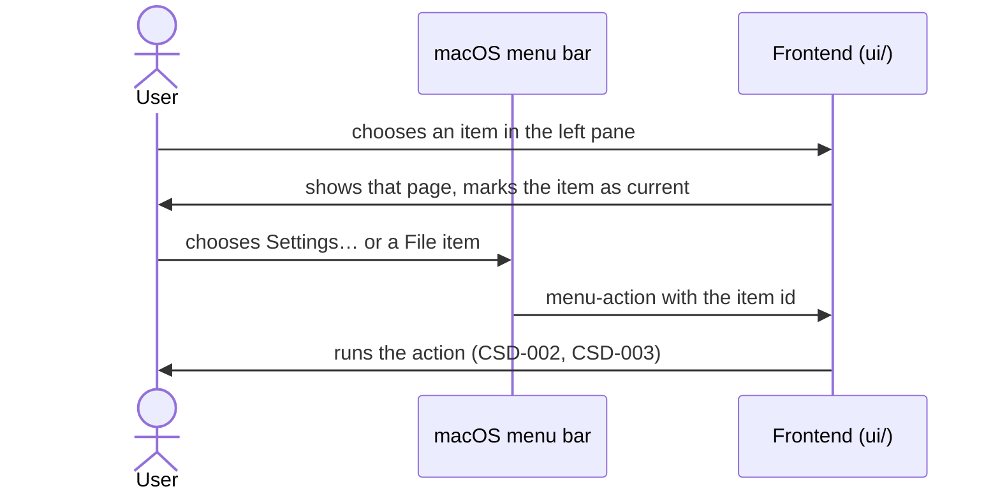

# CSD-024: Navigation and app shell

## 1. Intent
The app has one window with a left pane that opens the pages, and a native macOS menu bar. The name of the open project file is shown in the window title (GitHub issue 20). Until now the left pane was specified inside the income dashboard CSD (CSD-004), although it belongs to the whole app, and the menu was described only in pieces in CSD-002 and CSD-003. This capability is the one place for the structure of the left pane, which page opens first, how a page is chosen, and what the native menu holds. On every page the title and the tabs stay in view while the page scrolls, and the title shrinks to give the content more room (GitHub issue 74). The pages themselves and the actions behind the menu items stay with their own CSDs.

## 2. Scope
### 2.1 In scope
- The left pane: its groups, the order of its items, and Settings pinned at the bottom.
- The window title: the name of the open project file, and a dot while the project has unsaved changes.
- Which page the app opens on, and choosing a page with the mouse or the keyboard.
- The native menu bar: which items it holds, and that its texts stay English.
- The page header: the title of a page and its tabs stay at the top of the content area while the page scrolls, and the title compresses (REQ-10 to REQ-16).

### 2.2 Non-goals
- NG-1: Any page in the Insights group other than the Net worth page of CSD-017 and the Ratios page of CSD-018 (moved from CSD-004 NG-5).
- NG-2: Pages that have no function yet: Accounts and Budget. (Transactions has a function from CSD-032 and is no longer in this list. Changed in v0.7. Budgeting is a tab "Budgets" on the Transactions page, CSD-037, so there is still no page "Budget" in the left pane. Changed in v0.11.)
- NG-3: Collapsible groups, and a user-defined order of the items.
- NG-4: Keyboard shortcuts that open a page, other than ⌘, for Settings (CSD-003 REQ-2). Decided for the first release (OQ-1).
- NG-5: The content of a page, its tabs (such as Overview and Insights) and the actions behind the menu items (the owning CSDs). Keeping the title and the tabs in view is shell behaviour and is specified here (REQ-10).
- NG-6: Remembering the last shown page between sessions (OQ-2).
- NG-7: A status text in the left pane for the project ("New project", "All changes saved"); the window title replaces it (GitHub issue 20).
- NG-8: The macOS "document edited" dot in the close button (it needs `NSWindow` through FFI, which `CLAUDE.md` forbids) and an "— Edited" suffix: the dot is a character in the title (REQ-9).
- NG-9: A translated window title: "Untitled" stays English, like the menu (REQ-6).
- NG-10: Pinning anything else than the title and the tabs: panel headers, table headers (the ratios row labels of CSD-018 stay as they are), the filter bars of CSD-028 and the left pane (GitHub issue 74).
- NG-11: A setting to turn the pinned header or the compression off (GitHub issue 74).

## 3. Definitions
| Term | Meaning |
|---|---|
| **Left pane** | The column at the left of the window with the groups of pages and Settings. |
| **Group** | A plain, non-collapsible heading in the left pane with the pages below it. |
| **Page** | One view the left pane can open. Exactly one page is shown at a time. |
| **Window title** | The text the native macOS title bar of the window shows, centred at the top. |
| **Page header** | The title of a page (its `h1`) and, on a page that has them, its tabs (such as Overview and Insights). |
| **Compressed** | The state of the page header while the page is scrolled: a smaller title with less space above and below it. **Expanded** is the state at the top of the page. |
| **Unsaved dot** | The character `●`, placed after the file name in the window title while the project has unsaved changes (CSD-002 REQ-3). |

## 4. Requirements

### 4.0 Overview flow


**REQ-1: Structure of the left pane** *(ubiquitous)*
The app shall group the pages in the left pane under plain, non-collapsible headings, in this order: Overview (Dashboard), Finance (Income, Expenses, Transactions), Wealth (Bank accounts, Investments, Houses), Liabilities (Debts) and Insights (Net worth, Ratios). This requirement is the one place that states the order; the capabilities that add a page do not repeat it.

```gherkin
@AC-1.1
Scenario: Groups and pages in order
  Given the app has started
  Then the left pane shows the headings "Overview", "Finance", "Wealth", "Liabilities" and "Insights" in that order
  And "Overview" holds "Dashboard", "Finance" holds "Income", "Expenses" and "Transactions", "Wealth" holds "Bank accounts", "Investments" and "Houses", "Liabilities" holds "Debts" and "Insights" holds "Net worth" and "Ratios", each in that order

@AC-1.2
Scenario: Pages without a function are not offered
  Given the app has started
  Then there is no "Accounts" or "Budget" in the left pane

@AC-1.3
Scenario: No example data
  Given the app has started
  Then no page shows example accounts or budgets
```

**REQ-2: The app opens on the Dashboard** *(event-driven)*
When the app has started, the app shall show the Dashboard page and mark its item in the left pane as the current page.

```gherkin
@AC-2.1
Scenario: First page
  Given the app has started with a new project
  Then the Dashboard page is shown
  And "Dashboard" is the only item marked as the current page

@AC-2.2
Scenario: A remembered project does not change the first page
  Given a project was remembered from the last session (CSD-002 REQ-8)
  When the app has started and opened it
  Then the Dashboard page is shown
```

**REQ-3: Choosing a page** *(event-driven)*
When the user chooses an item in the left pane, with the mouse or by pressing Enter or Space on it after reaching it with Tab, the app shall show that page only and mark that item, and no other, as the current page.

```gherkin
@AC-3.1
Scenario: Mouse
  Given the Dashboard is shown
  When the user chooses "Debts"
  Then the Debts page is shown and the Dashboard page is hidden
  And "Debts" is the only item marked as the current page

@AC-3.2
Scenario: Keyboard
  Given the Dashboard is shown
  When the user reaches "Income" with Tab and presses Enter
  Then the Income page is shown
  And "Income" is the only item marked as the current page

@AC-3.3
Scenario: Choosing the current page again
  Given the Income page is shown
  When the user chooses "Income"
  Then the Income page stays shown and "Income" stays marked as the current page
```

**REQ-4: Settings at the bottom** *(ubiquitous)*
The app shall pin "Settings" at the bottom of the left pane, outside the groups, and shall not show a project status text in the left pane.

```gherkin
@AC-4.1
Scenario: Pinned item
  Given the app has started
  Then "Settings" is shown below the group "Insights", outside every group
  And it is the last item of the left pane

@AC-4.2
Scenario: Pinned item stays in place
  Given the user has opened "Net worth"
  Then "Settings" is still shown at the bottom of the left pane

@AC-4.3
Scenario: No project status in the left pane
  Given the app has started
  Then the left pane shows no "New project", "Unsaved changes" or "All changes saved" text
```

**REQ-5: Native menu** *(ubiquitous)*
The app shall show the native macOS menu bar with the standard menus (app, File, Edit, View and Window), where the app menu holds "Settings…" (⌘,) below "About" and the File menu holds "New" (⌘N), "Open…" (⌘O), "Save" (⌘S) and "Save As…" (⇧⌘S) above its standard items, and the Edit menu holds "Undo" (⌘Z) and "Redo" (⇧⌘Z) as specified in CSD-027 REQ-10, and the app menu's "About" shows the panel specified in CSD-031, and no other menu item is specified. On Windows the menu differs as specified in CSD-038 REQ-7 and REQ-8 (no app menu; Settings… in File, About in a Help menu, Ctrl instead of ⌘).

```gherkin
@AC-5.1
Scenario: Items and shortcuts
  Given the app has started
  Then the app menu holds "Settings…" with ⌘, directly below "About"
  And the File menu starts with "New" ⌘N, "Open…" ⌘O, "Save" ⌘S and "Save As…" ⇧⌘S
  And the menu bar has the menus app, File, Edit, View and Window

@AC-5.2
Scenario: Copy and paste keep working
  Given a text field has the focus
  When the user presses ⌘C and ⌘V
  Then the text is copied and pasted
```

**REQ-6: The menu stays English** *(ubiquitous)*
The app shall show the texts of the native menu bar in English, whatever the language setting is (CSD-022 NG-6).

```gherkin
@AC-6.1
Scenario: Dutch language, English menu
  Given the language setting is Dutch
  Then the left pane shows Dutch texts
  And the menu bar shows "Settings…" and "Save As…"
```

**REQ-7: Menu items run in the window** *(event-driven)*
When the user chooses "Settings…" or a File menu item, the app shall run that item's action in the window as specified in CSD-003 REQ-2 and CSD-002 REQ-9, from whichever page is shown.

```gherkin
@AC-7.1
Scenario: Settings from another page
  Given the Income page is shown
  When the user presses ⌘,
  Then the Settings page is shown
  And "Settings" is the only item marked as the current page

@AC-7.2
Scenario: A menu item for an action that needs confirmation
  Given the project has unsaved changes
  When the user chooses File > New
  Then a confirmation is asked before the project is replaced (CSD-002 REQ-7)
```

**REQ-8: Window title shows the open file** *(ubiquitous)*
The app shall show the name of the open project file, with its extension and without its folder, as the window title, and the text `Untitled` while the project has no path. The title holds nothing else: no app name and no path.

```gherkin
@AC-8.1
Scenario: New project
  Given the app has started with a new project
  Then the window title is "Untitled"

@AC-8.2
Scenario: Opened file
  Given the user opens the project file "/Users/example/Documents/something.varde"
  Then the window title is "something.varde"

@AC-8.3
Scenario: Save As changes the name
  Given a project saved to "example-a.varde"
  When the user chooses Save As and picks "example-b.varde"
  Then the window title is "example-b.varde"

@AC-8.4
Scenario: New project after a file
  Given the project file "something.varde" is open
  When the user starts a new project
  Then the window title is "Untitled"

@AC-8.5
Scenario: A remembered project is reopened at startup
  Given a project was remembered from the last session (CSD-002 REQ-8)
  When the app has started and opened it
  Then the window title is the name of that file
  And when it could not be opened (CSD-002 REQ-11 to REQ-13) the window title is "Untitled"

@AC-8.6
Scenario: No folder, same in every language
  Given the project file "/Users/example/Documents/something.varde" is open
  And the language setting is Dutch
  Then the window title is "something.varde"
  And the window title does not contain "/Users" or "Documents"
```

**REQ-9: Unsaved dot in the window title** *(state-driven)*
While the project has unsaved changes (CSD-002 REQ-3), the app shall show one space and the unsaved dot `●` after the name in the window title, and shall show neither while it has none.

```gherkin
@AC-9.1
Scenario: New project with an edit
  Given the app has started with a new project
  When the user adds a job
  Then the window title is "Untitled ●"

@AC-9.2
Scenario: Opened file with an edit
  Given the project file "something.varde" is open
  When the user adds a job
  Then the window title is "something.varde ●"

@AC-9.3
Scenario: Saving clears the dot
  Given the window title is "something.varde ●"
  When the user saves
  Then the window title is "something.varde"

@AC-9.4
Scenario: Undo and redo move the dot (CSD-027)
  Given the project file "something.varde" is open
  When the user adds a job and chooses Edit > Undo
  Then the window title is "something.varde"
  When the user chooses Edit > Redo
  Then the window title is "something.varde ●"

@AC-9.5
Scenario: A failed save keeps the dot
  Given the window title is "something.varde ●"
  And the chosen path is not writable
  When the user saves
  Then the window title is still "something.varde ●"

@AC-9.6
Scenario: With autosave on the dot follows the write (CSD-002 REQ-23)
  Given autosave is on and the project file "something.varde" is open
  When the user adds a job
  Then the window title is "something.varde"

@AC-9.7
Scenario: With autosave on a project without a path keeps the dot
  Given autosave is on and the app has started with a new project
  When the user adds a job
  Then the window title is "Untitled ●"

@AC-9.8
Scenario: A failed autosave keeps the dot (CSD-002 REQ-26)
  Given autosave is on and the project file "something.varde" is open
  And its folder is not writable
  When the user adds a job
  Then the window title is "something.varde ●"
```

The scenarios AC-9.1 to AC-9.5 describe autosave off (CSD-002 section 3).

**REQ-10: The page header stays in view** *(ubiquitous)*
The app shall keep the page header of the shown page at the top of the content area while the page content scrolls, on every page: the title alone on Dashboard, Settings, Net worth and Ratios, and the title with the tabs on Income, Investments, Bank accounts, Houses, Debts, Transactions and Expenses. The header has the page background, so scrolling content does not show through it.

```gherkin
@AC-10.1
Scenario: Title alone
  Given the Dashboard is shown and its content is taller than the window
  When the user scrolls down 400 px
  Then the title "Dashboard" is still at the top of the content area

@AC-10.2
Scenario: Title and tabs
  Given the Income page is shown with one job and its content is taller than the window
  When the user scrolls down 400 px
  Then the title "Income" and the tabs "Overview" and "Insights" are still at the top of the content area
  And the tabs are directly below the title

@AC-10.3
Scenario: A page whose tabs are hidden
  Given the Income page is shown and no job exists, so its tabs are hidden
  When the user scrolls down
  Then only the title "Income" is kept at the top

@AC-10.4
Scenario Outline: Every page
  Given the page "<page>" is shown
  Then its title is part of the pinned page header
  And its tabs are too: "<tabs>"

  Examples:
    | page          | tabs                                          |
    | Dashboard     | none                                          |
    | Income        | Overview, Insights                            |
    | Expenses      | Overview, Insights                            |
    | Transactions  | Accounts, Categories, Rules, Overview, Insights |
    | Bank accounts | Overview, Insights                            |
    | Investments   | Overview, Insights                            |
    | Houses        | Overview, Insights                            |
    | Debts         | Overview, Insights                            |
    | Net worth     | none                                          |
    | Ratios        | none                                          |
    | Settings      | none                                          |

@AC-10.5
Scenario: The content does not show above the header
  Given the Income page is scrolled down 400 px
  Then no part of the content is visible above the title
```

**REQ-11: The header collapses with the scroll movement** *(state-driven)*
While the page is scrolled down, the app shall make the page header smaller in step with the scroll distance: at the top the header is expanded, and over the first 80 px of scrolling it shrinks in proportion, so that at 40 px it is halfway, and from 80 px on it is compressed. Expanded: the title at 20 px, 30 px of space above and 22 px below. Compressed: the title at 16 px, 10 px of space above and below. In between, each size is the proportional value between the two.

```gherkin
@AC-11.1
Scenario: Intermediate sizes
  Given the Income page is shown at the top and its content is taller than the window by 800 px
  When the user scrolls down 40 px
  Then the page header is halfway between expanded and compressed
  And the title is 18 px with 20 px of space above and 16 px below

@AC-11.2
Scenario: Fully compressed from 80 px
  Given the Income page is shown at the top and its content is taller than the window by 800 px
  When the user scrolls down 80 px or more
  Then the page header is compressed

@AC-11.3
Scenario: The sizes
  Given the page header is expanded
  Then the title is 20 px with 30 px of space above and 22 px below
  When the page header is compressed
  Then the title is 16 px with 10 px of space above and 10 px below
  And the tabs keep their look and sit directly below the title
```

**REQ-12: The collapse is a function of the scroll position, and short pages do not collapse** *(state-driven)*
The app shall derive the size of the page header from the scroll position alone, so that scrolling back up expands it by the same amount and the very top always shows it expanded. If the page overflows the content area by less than the full shrink of the header plus 32 px, then the app shall not collapse the header, so that a short page never switches back and forth.

```gherkin
@AC-12.1
Scenario: Scrolling back expands it again
  Given the page header is compressed at 100 px
  When the user scrolls up to 60 px
  Then the page header is three quarters of the way to compressed
  When the user scrolls back to the top
  Then the page header is expanded

@AC-12.3
Scenario: A short page never collapses
  Given a page whose content is taller than the content area by 40 px
  When the user scrolls down to the bottom of the page
  Then the page header is still expanded

@AC-12.4
Scenario: Another page starts expanded
  Given the page header of Income is compressed
  When the user chooses "Debts"
  Then the Debts page is shown at the top with its page header expanded
```

**REQ-13: Charts do not change when the header compresses** *(ubiquitous)*
The app shall size a yearly chart as if the page header were expanded, so that compressing or expanding the header neither changes the plot height nor redraws the chart, and the rule of CSD-025 holds: with the page scrolled to the top the chart ends at the bottom of the window. A change of the window size still redraws it.

```gherkin
@AC-13.1
Scenario: No redraw while scrolling
  Given the Insights tab of Income is shown with a chart
  When the user scrolls down 400 px so that the page header compresses
  Then the chart is not drawn again
  And its plot height is unchanged

@AC-13.2
Scenario: At the top the chart still ends at the bottom of the window
  Given the Insights tab of Income is shown at the top
  Then the chart ends at the bottom of the window as in CSD-025

@AC-13.3
Scenario: A resize still redraws
  Given the Insights tab of Income is shown with a chart
  When the window is made 200 px lower
  Then the chart is drawn again with a plot about 200 px lower
```

**REQ-14: Focus and jumps stay clear of the header** *(ubiquitous)*
The app shall keep an element that receives the focus, or that is scrolled into view, below the compressed page header and not under it.

```gherkin
@AC-14.1
Scenario: Tab to a field further down
  Given the Debts page is shown and a field is below the window
  When the user reaches the field with Tab
  Then the field is scrolled into view below the page header, not behind it
```

**REQ-15: The header lies below popovers, tooltips and dialogs** *(ubiquitous)*
The app shall show the page header above the page content (including the sticky row labels of the ratios table) and below the filter panel of CSD-028, the tooltips, and the dialogs.

```gherkin
@AC-15.1
Scenario: Filter panel above the header
  Given the filter panel of a table is open near the top of the window
  Then the panel is shown above the page header

@AC-15.2
Scenario: Dialog above the header
  Given the page header is compressed
  When the user opens the dialog "Add job"
  Then the dialog and its backdrop cover the page header

@AC-15.3
Scenario: Table rows pass below the header
  Given the Ratios page is scrolled down 400 px
  Then the row labels of the table pass below the page header, not over it
```

**REQ-16: No transition** *(ubiquitous)*
The app shall tie the size of the page header directly to the scroll movement, without a time-based transition, so the header never lags behind or runs ahead of the scrolling, with or without the system setting "reduce motion".

```gherkin
@AC-16.1
Scenario: Follows the scroll
  Given the page is scrolled slowly
  Then the page header changes size with every scrolled pixel and at no other moment
```

## 5. Interfaces and contracts

Window title: Rust sets the title of the main window after every change of the project state (open, save, Save As, new project, edit, undo, redo) and at startup, with the pure function `window_title(file_name: Option<&str>, unsaved_changes: bool) -> String` in `domain/`. The command layer passes the last part of the path only, so the folder never reaches the title. The title is never set from the frontend.

Page header: the sizes of REQ-11 are CSS custom properties in `ui/styles/`, in one place for the expanded and one for the compressed state, and the `top` of the tabs is the height of the title in the current state, so nothing is measured with JavaScript for the position. The frontend only sets one custom property on the content area, the collapse from 0 to 1, as a function of its scroll position (80 px for the full range, REQ-11, REQ-12); the sizes in between are interpolated in the style sheet. The chart code measures the position of a chart against the expanded header (REQ-13). No figure is computed.

Menu: Rust builds the menu. The items `open-settings`, `project-new`, `project-open`, `project-save` and `project-save-as` emit the event `menu-action` with the item id to the frontend, which runs the action. The page elements and their ids are frontend-internal.

## 6. Constraints
- CON-1: The menu uses Tauri's built-in menu API: no plugin and no extra permission. Rationale: least privilege per `CLAUDE.md` (as CSD-002 CON-6 and CSD-003 CON-3).
- CON-2: The standard macOS Edit menu stays, except that its predefined Undo and Redo are replaced by the project Undo and Redo of CSD-027, which leave ⌘Z and ⇧⌘Z to a focused text field (CSD-027 REQ-11, CON-3). Rationale: it makes copy and paste work in text fields, and typing can still be undone there (CSD-002 CON-6).
- CON-4: The window title is set with Tauri's built-in window API from Rust: no plugin and no new capability (`core:window:allow-set-title` is not added). Rationale: least privilege per `CLAUDE.md`, and the file name stays in Rust (CSD-002 error rule: no paths to the UI).
- CON-5: The page header uses a CSS sticky position and one custom property set through the CSSOM: no `style=` attribute, no `<style>` block, no `setAttribute('style', ...)` and no new dependency (`CLAUDE.md` CSP rule, CSD-021 CON-5). The scroll listener is passive. Rationale: the strict CSP, and a scroll listener must not slow scrolling.
- CON-6: The page header is only layout and has no data: it adds no command, no capability and no permission. Rationale: least privilege per `CLAUDE.md`.
- CON-3: The left pane is part of the page, not of one capability: a capability that adds a page adds its item through this CSD. Rationale: one place for the order.

## 7. Verification
The left pane and the page switching are checked by DOM tests (`npm test`, dev-only test harness in `ui/tests/`, `navigation.test.js`, titles carry the AC id). Tests are named `test_csd024_ac_<n>_<m>_<description>` (CSD-000 REQ-6).

| What | How |
|---|---|
| Display ACs with a DOM test | `npm test`: `navigation.test.js` (AC-1.1 to AC-1.3, AC-2.1, AC-2.2, AC-3.1 to AC-3.3, AC-4.1 to AC-4.3, AC-6.1, AC-7.1, AC-7.2) |
| Page header (REQ-10 to REQ-16) | `npm test`: `page-header.test.js` (collapse set from the scroll position with the range of REQ-11 and REQ-12, the short-page guard with stubbed `scrollHeight` and `clientHeight`, every page and its tabs, the chart not redrawn on compress with the real chart code and a stubbed layout, and the rules of the stylesheets: sticky, the two sets of sizes, `scroll-padding-top`, the z-index order and the reduced-motion rule). jsdom has no layout, so the real sticky behaviour, the look, the transition, the focus jump and the layers are on the manual checklist (AC-10.1 to AC-10.3, AC-10.5, AC-11.3, AC-14.1, AC-15.1 to AC-15.3, AC-16.1, AC-16.2) |
| Window title (REQ-8, REQ-9) | `cargo test test_csd024_`: `window_title` as a pure function (all four strings, `Untitled` and the dot), and the command layer with the Tauri mock runtime (the title after open, save, Save As, new, edit, undo, redo and the failed save, AC-8.1 to AC-8.6, AC-9.1 to AC-9.5). jsdom cannot see a native title |
| Menu tables (REQ-5, REQ-7) | `cargo test test_csd002_ac_9_` and `cargo test test_csd003_ac_2_1` check the tables the menu is built from. Native menus can only be created on the main thread, so the built menu (AC-5.1, AC-5.2, AC-6.1 menu texts) is on the manual checklist |

Not covered by a named test yet (2 of 27 ACs; no test carries the AC id): AC-5.1, AC-5.2. The page header ACs (AC-10.1 to AC-16.2) get their tests, or their place on the manual checklist, when this version is approved and implemented. Both need the native menu bar and a real text field, which no automatic test can build (muda creates menus on the main thread only, and a native paste is an OS action). The parts of AC-5.1 that are tables are proven by `test_csd002_ac_9_1_...` and `test_csd003_ac_2_1_...`; the rest is on the manual checklist.

Done means fmt, clippy (`-D warnings`), `cargo test --all-features` and `npm test` pass.

## 8. Open questions
- OQ-1: (resolved 03/11/2026) No keyboard shortcuts for pages in the first release; only ⌘, for Settings exists and NG-4 stays.
- OQ-2: (resolved 03/11/2026) The app always opens on the Dashboard and does not remember the last page (REQ-2, AC-2.2, NG-6).
- OQ-3: (resolved 03/11/2026) The native menu is specified only as the standard menus (app, File, Edit, View, Window) plus the items already named; it is not listed item by item (REQ-5).

## 9. Changelog
- 0.12 (26/11/2026): REQ-5 points to CSD-038 for the Windows menu and shortcuts (GitHub issue 86); related adds CSD-038. The macOS menu is unchanged. Back to `draft` until re-approved.
- 0.11 (22/11/2026): NG-2 notes that budgeting is a tab of the Transactions page (CSD-037), not a page of the left pane (GitHub issue 82). No behaviour change. Back to `draft` until re-approved.
- 0.10 (18/11/2026): The header collapse follows the scroll movement continuously over 80 px (REQ-11, REQ-12) instead of switching at 32 px, with intermediate sizes; no transition (REQ-16). Owner request after trying 0.9.
- 0.9 (18/11/2026): The page header stays in view (GitHub issue 74): new REQ-10 to REQ-16 (AC-10.1 to AC-16.2), the definitions Page header and Compressed, NG-10, NG-11, CON-5, CON-6, and the interface and verification notes. The title and the tabs of every page stay at the top while the page scrolls; the title compresses (20 px to 16 px, 30/22 px to 10/10 px of space) after 32 px of scrolling and expands again at the top, not on pages that overflow too little; charts keep their size (CSD-025 rule unchanged); focus, layers and reduced motion follow. NG-5 now excludes the pinned header. Owner decisions from the grill-me interview of 18/11/2026. Back to `draft` until re-approved.
- 0.8 (18/11/2026): Autosave (CSD-002 v3.2, GitHub issue 71): new AC-9.6 to AC-9.8 (the dot with autosave on: gone after the write, kept without a path, kept after a failed write); AC-9.1 to AC-9.5 describe autosave off. REQ-9 itself is unchanged. Back to `draft` until re-approved.
- 0.7 (12/11/2026): The Transactions page of CSD-032 (GitHub issue 70) joins the left pane as the last item of Finance; REQ-1 and AC-1.1 to AC-1.3 change with it and NG-2 no longer lists it. Back to `draft` until re-approved.
- 0.6 (09/11/2026): REQ-5 says the content of the "About" item is specified in CSD-031 (GitHub issue 54); related adds CSD-031. No other change. Back to `draft` until re-approved.
- 0.5 (09/11/2026): The name of the open file in the window title (GitHub issue 20). New REQ-8 (AC-8.1 to AC-8.6: the file name with extension, `Untitled` for a new project, no folder, no app name, English only) and REQ-9 (AC-9.1 to AC-9.5: the dot `●` after the name while there are unsaved changes). REQ-4 now pins only Settings and the project status text leaves the left pane (new AC-4.3, NG-7); the unsaved indicator of CSD-002 REQ-3 becomes the dot. New NG-8, NG-9, CON-4, and the window title in section 5 and 7. Owner decisions from the grill-me interview of 09/11/2026. Back to `draft` until re-approved.
- 0.4 (07/11/2026): Undo and redo of project data (CSD-027, GitHub issue 43): REQ-5 names the Edit items Undo (⌘Z) and Redo (⇧⌘Z), CON-2 says they replace the predefined ones. Back to `draft` until re-approved.
- 0.3 (03/11/2026): Verification (section 7) lists the real test filters and the ACs that no named test covers yet; claims of tests that do not exist are removed.
- 0.2 (03/11/2026): Owner decisions, OQ-1 to OQ-3 resolved. No page shortcuts in the first release (NG-4 stays), the app always opens on the Dashboard (new NG-6 for remembering the last page), and REQ-5 now says the menu is the standard menus (app, File, Edit, View, Window) without a full item list (AC-5.1 names the five menus). Back to `draft` until re-approved.
- 0.1 (03/11/2026): initial draft. The left pane requirements move here from CSD-004 REQ-1, AC-1.1, AC-1.2 and NG-5 (decision D9); the native menu, which CSD-002 REQ-9 and CSD-003 REQ-2 specify item by item, gets one overview (REQ-5 to REQ-7). Describes the behaviour of the app today.
