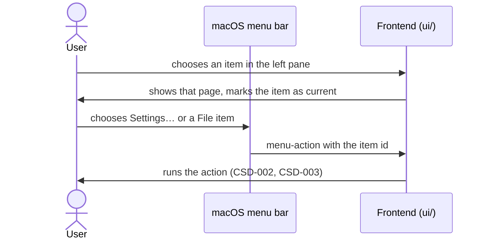

# CSD-024: Navigation and app shell

## 1. Intent
The app has one window with a left pane that opens the pages, and a native macOS menu bar. Until now the left pane was specified inside the income dashboard CSD (CSD-004), although it belongs to the whole app, and the menu was described only in pieces in CSD-002 and CSD-003. This capability is the one place for the structure of the left pane, which page opens first, how a page is chosen, and what the native menu holds. The pages themselves and the actions behind the menu items stay with their own CSDs.

## 2. Scope
### 2.1 In scope
- The left pane: its groups, the order of its items, Settings and the project status pinned at the bottom.
- Which page the app opens on, and choosing a page with the mouse or the keyboard.
- The native menu bar: which items it holds, and that its texts stay English.

### 2.2 Non-goals
- NG-1: Any page in the Insights group other than the Net worth page of CSD-017 and the Ratios page of CSD-018 (moved from CSD-004 NG-5).
- NG-2: Pages that have no function yet: Accounts, Transactions and Budget.
- NG-3: Collapsible groups, and a user-defined order of the items.
- NG-4: Keyboard shortcuts that open a page, other than ⌘, for Settings (CSD-003 REQ-2). Decided for the first release (OQ-1).
- NG-5: The content of a page, its tabs (such as Overview and Insights) and the actions behind the menu items (the owning CSDs).
- NG-6: Remembering the last shown page between sessions (OQ-2).

## 3. Definitions
| Term | Meaning |
|---|---|
| **Left pane** | The column at the left of the window with the groups of pages, Settings and the project status. |
| **Group** | A plain, non-collapsible heading in the left pane with the pages below it. |
| **Page** | One view the left pane can open. Exactly one page is shown at a time. |
| **Project status** | The indicator at the bottom of the left pane that shows the state of the project (CSD-002 REQ-3). |

## 4. Requirements

### 4.0 Overview flow


**REQ-1: Structure of the left pane** *(ubiquitous)*
The app shall group the pages in the left pane under plain, non-collapsible headings, in this order: Overview (Dashboard), Finance (Income, Expenses), Wealth (Bank accounts, Investments, Houses), Liabilities (Debts) and Insights (Net worth, Ratios). This requirement is the one place that states the order; the capabilities that add a page do not repeat it.

```gherkin
@AC-1.1
Scenario: Groups and pages in order
  Given the app has started
  Then the left pane shows the headings "Overview", "Finance", "Wealth", "Liabilities" and "Insights" in that order
  And "Overview" holds "Dashboard", "Finance" holds "Income" and "Expenses", "Wealth" holds "Bank accounts", "Investments" and "Houses", "Liabilities" holds "Debts" and "Insights" holds "Net worth" and "Ratios", each in that order

@AC-1.2
Scenario: Pages without a function are not offered
  Given the app has started
  Then there is no "Accounts", "Transactions" or "Budget" in the left pane

@AC-1.3
Scenario: No example data
  Given the app has started
  Then no page shows example transactions, accounts or budgets
```

**REQ-2: The app opens on the Dashboard** *(event-driven)*
When the app has started, the app shall show the Dashboard page and mark its item in the left pane as the current page.

```gherkin
@AC-2.1
Scenario: First page
  Given the app has started with a new project
  Then the Dashboard page is shown
  And "Dashboard" is the only item marked as the current page

@AC-2.2
Scenario: A remembered project does not change the first page
  Given a project was remembered from the last session (CSD-002 REQ-8)
  When the app has started and opened it
  Then the Dashboard page is shown
```

**REQ-3: Choosing a page** *(event-driven)*
When the user chooses an item in the left pane, with the mouse or by pressing Enter or Space on it after reaching it with Tab, the app shall show that page only and mark that item, and no other, as the current page.

```gherkin
@AC-3.1
Scenario: Mouse
  Given the Dashboard is shown
  When the user chooses "Debts"
  Then the Debts page is shown and the Dashboard page is hidden
  And "Debts" is the only item marked as the current page

@AC-3.2
Scenario: Keyboard
  Given the Dashboard is shown
  When the user reaches "Income" with Tab and presses Enter
  Then the Income page is shown
  And "Income" is the only item marked as the current page

@AC-3.3
Scenario: Choosing the current page again
  Given the Income page is shown
  When the user chooses "Income"
  Then the Income page stays shown and "Income" stays marked as the current page
```

**REQ-4: Settings and project status at the bottom** *(ubiquitous)*
The app shall pin "Settings" and the project status at the bottom of the left pane, outside the groups, with "Settings" above the project status.

```gherkin
@AC-4.1
Scenario: Pinned items
  Given the app has started
  Then "Settings" is shown below the group "Insights", outside every group
  And the project status is shown below "Settings"

@AC-4.2
Scenario: Pinned items stay in place
  Given the user has opened "Net worth"
  Then "Settings" and the project status are still shown at the bottom of the left pane
```

**REQ-5: Native menu** *(ubiquitous)*
The app shall show the native macOS menu bar with the standard menus (app, File, Edit, View and Window), where the app menu holds "Settings…" (⌘,) below "About" and the File menu holds "New" (⌘N), "Open…" (⌘O), "Save" (⌘S) and "Save As…" (⇧⌘S) above its standard items, and no other menu item is specified.

```gherkin
@AC-5.1
Scenario: Items and shortcuts
  Given the app has started
  Then the app menu holds "Settings…" with ⌘, directly below "About"
  And the File menu starts with "New" ⌘N, "Open…" ⌘O, "Save" ⌘S and "Save As…" ⇧⌘S
  And the menu bar has the menus app, File, Edit, View and Window

@AC-5.2
Scenario: Copy and paste keep working
  Given a text field has the focus
  When the user presses ⌘C and ⌘V
  Then the text is copied and pasted
```

**REQ-6: The menu stays English** *(ubiquitous)*
The app shall show the texts of the native menu bar in English, whatever the language setting is (CSD-022 NG-6).

```gherkin
@AC-6.1
Scenario: Dutch language, English menu
  Given the language setting is Dutch
  Then the left pane shows Dutch texts
  And the menu bar shows "Settings…" and "Save As…"
```

**REQ-7: Menu items run in the window** *(event-driven)*
When the user chooses "Settings…" or a File menu item, the app shall run that item's action in the window as specified in CSD-003 REQ-2 and CSD-002 REQ-9, from whichever page is shown.

```gherkin
@AC-7.1
Scenario: Settings from another page
  Given the Income page is shown
  When the user presses ⌘,
  Then the Settings page is shown
  And "Settings" is the only item marked as the current page

@AC-7.2
Scenario: A menu item for an action that needs confirmation
  Given the project has unsaved changes
  When the user chooses File > New
  Then a confirmation is asked before the project is replaced (CSD-002 REQ-7)
```

## 5. Interfaces and contracts

Menu: Rust builds the menu. The items `open-settings`, `project-new`, `project-open`, `project-save` and `project-save-as` emit the event `menu-action` with the item id to the frontend, which runs the action. The page elements and their ids are frontend-internal.

## 6. Constraints
- CON-1: The menu uses Tauri's built-in menu API: no plugin and no extra permission. Rationale: least privilege per `CLAUDE.md` (as CSD-002 CON-6 and CSD-003 CON-3).
- CON-2: The standard macOS Edit menu stays. Rationale: it makes copy, paste and undo work in text fields (CSD-002 CON-6).
- CON-3: The left pane is part of the page, not of one capability: a capability that adds a page adds its item through this CSD. Rationale: one place for the order.

## 7. Verification
The left pane and the page switching are checked by DOM tests (`npm test`, dev-only test harness in `ui/tests/`, `navigation.test.js`, titles carry the AC id). Tests are named `test_csd024_ac_<n>_<m>_<description>` (CSD-000 REQ-6).

| What | How |
|---|---|
| Display ACs with a DOM test | `npm test`: `navigation.test.js` (AC-1.1 to AC-1.3, AC-2.1, AC-2.2, AC-3.1 to AC-3.3, AC-4.1, AC-4.2, AC-6.1, AC-7.1, AC-7.2) |
| Menu tables (REQ-5, REQ-7) | `cargo test test_csd002_ac_9_` and `cargo test test_csd003_ac_2_1` check the tables the menu is built from. Native menus can only be created on the main thread, so the built menu (AC-5.1, AC-5.2, AC-6.1 menu texts) is on the manual checklist |

Not covered by a named test yet (2 of 15 ACs; no test carries the AC id): AC-5.1, AC-5.2. Both need the native menu bar and a real text field, which no automatic test can build (muda creates menus on the main thread only, and a native paste is an OS action). The parts of AC-5.1 that are tables are proven by `test_csd002_ac_9_1_...` and `test_csd003_ac_2_1_...`; the rest is on the manual checklist.

Done means fmt, clippy (`-D warnings`), `cargo test --all-features` and `npm test` pass.

## 8. Open questions
- OQ-1: (resolved 03/11/2026) No keyboard shortcuts for pages in the first release; only ⌘, for Settings exists and NG-4 stays.
- OQ-2: (resolved 03/11/2026) The app always opens on the Dashboard and does not remember the last page (REQ-2, AC-2.2, NG-6).
- OQ-3: (resolved 03/11/2026) The native menu is specified only as the standard menus (app, File, Edit, View, Window) plus the items already named; it is not listed item by item (REQ-5).

## 9. Changelog
- 0.3 (03/11/2026): Verification (section 7) lists the real test filters and the ACs that no named test covers yet; claims of tests that do not exist are removed.
- 0.2 (03/11/2026): Owner decisions, OQ-1 to OQ-3 resolved. No page shortcuts in the first release (NG-4 stays), the app always opens on the Dashboard (new NG-6 for remembering the last page), and REQ-5 now says the menu is the standard menus (app, File, Edit, View, Window) without a full item list (AC-5.1 names the five menus). Back to `draft` until re-approved.
- 0.1 (03/11/2026): initial draft. The left pane requirements move here from CSD-004 REQ-1, AC-1.1, AC-1.2 and NG-5 (decision D9); the native menu, which CSD-002 REQ-9 and CSD-003 REQ-2 specify item by item, gets one overview (REQ-5 to REQ-7). Describes the behaviour of the app today.
