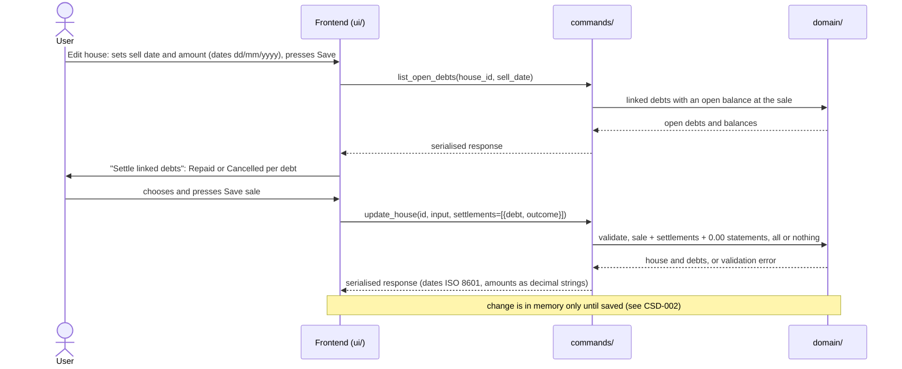
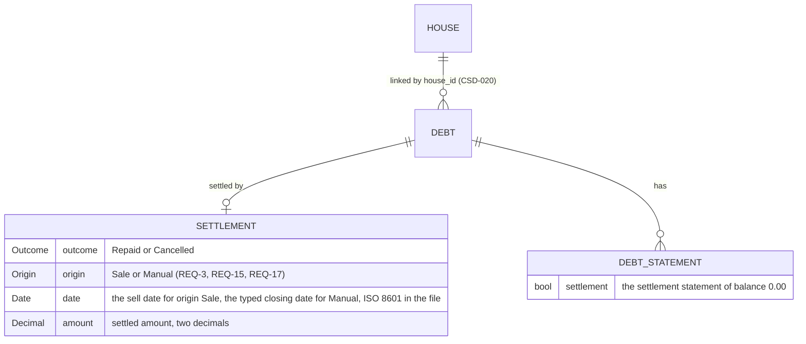

# CSD-026: Sale settlement of linked debts

## 1. Intent
A mortgage or a loan linked to a house (CSD-020) is normally paid off or written off when that house is sold (CSD-019), and the app must record which. When a house with linked debts is sold, this capability asks per debt whether it was **Repaid** or **Cancelled**. Either way the debt drops to 0.00, through a settlement statement of balance 0.00. A Repaid debt counts in full in the wealth accumulation from cash (CSD-018), while a Cancelled debt nets to zero in it, because no cash paid it. The sale amount stays a record: it changes neither net worth nor cash (CSD-019 NG-4). The capability also covers undoing a sale, the locks that keep a settlement consistent, the delete rules, and what the Houses and Debts views show. It is for a single person keeping a private, local history. It follows GitHub issues 27 and 31 and the grill-me interviews, and was split off from the former CSD-020 (v1.1). Since v2.0 the same settlement can also be entered by hand, as a **manual closing** (GitHub issue 51): the closing date, the closing amount and the outcome of CSD-011 REQ-34. Since v3.0 that holds for every debt, also one linked to a house, because a mortgage or a loan can be repaid or cancelled without the house being sold, and the user can edit or clear any closing, also one that a sale made. Each settlement carries its **origin**, Sale or Manual, so the sale only touches the closings it made itself.

## 2. Scope
### 2.1 In scope
- The Repaid or Cancelled choice per linked debt when a house is sold (or when a debt is linked to a house that is already sold, CSD-020 REQ-17), and its effect on the debt (a settlement and its settlement statement).
- Undoing a sale, the locks that keep a settlement consistent, and the delete rules.
- A manual closing of any debt, linked or not, editing it in place and clearing it (REQ-15, REQ-16, REQ-17), and changing the house link of a closed debt (REQ-18).
- The origin of a settlement, Sale or Manual, and what each origin means for a sale, its undo and the sell-date lock (REQ-1, REQ-4, REQ-5).
- The effect on total debt, net worth, the wealth accumulation from cash and the Debts overview.
- Showing the linked debts and settlements in the Edit house form and the Statements table, and the settlement prompt.

### 2.2 Non-goals
- NG-1: Partial repayment or partial cancellation: a settlement settles the whole open balance.
- NG-2: (removed in v3.0) A debt linked to a house can be closed by hand without selling the house (REQ-15).
- NG-3: (removed in v3.0) The outcome, the date and the amount of a closing can be edited in place (REQ-17), also after a sale made it.
- NG-4: Interest, fees and tax on the settlement.

## 3. Definitions
| Term | Meaning |
|---|---|
| **Sale period** | The period that holds the sell date: the month (`YYYY-MM`) for a debt with monthly statements and the year (`YYYY`) for a debt with yearly statements. |
| **Open balance** | The balance of the latest statement of the debt in a period up to and including the sale period. A debt without such a statement, or with 0.00, has no open balance. |
| **Settlement** | What the sale does to a linked debt with an open balance: the outcome (**Repaid** or **Cancelled**), the settlement date (the sell date), and the settled amount (the open balance). |
| **Settlement statement** | The final statement of balance 0.00 that the settlement adds in the sale period, flagged as a settlement statement, with the note "Repaid on sale of <house>" or "Cancelled on sale of <house>". A period may therefore hold two statements of a debt: a regular one, which stays as it is, and the settlement statement, which comes after it and which the user cannot edit or delete (only undoing the sale removes it, REQ-4). CSD-011 REQ-8 (one statement per period) is amended for this case. |
| **Settled debt** | A debt with a settlement. |
| **Origin** | Who made a settlement: **Sale** (the sale of the house the debt is linked to, REQ-3) or **Manual** (the user, in the debt form). Stored with the settlement. |
| **Manual closing** | A settlement with the origin Manual, entered in the debt form on any debt, linked or not: the outcome (Repaid or Cancelled), the closing date as the settlement date, and the closing amount as the settled amount, all typed. Its settlement statement has the note "Repaid on closing" or "Cancelled on closing". |
| **Closing by sale** | A settlement with the origin Sale: made by selling a house, with the sell date as its date and the open balance as its amount, until the user edits it (REQ-17), which makes it a manual closing. |
| **Open debt (at a sale)** | A debt linked to the house with an open balance at the sale and no settlement. A debt that is closed already, by hand or otherwise, is never an open debt. |

## 4. Requirements

### 4.0 Overview flow


### 4.1 Sale and settlement

**REQ-1: A sale asks Repaid or Cancelled per open debt** *(event-driven)*
When the user saves a house that gains a sale and has linked debts with an open balance, the app shall require an outcome, Repaid or Cancelled, for each of those debts that is not closed yet, and shall save the sale and all settlements together or not at all. A linked debt that is closed already keeps its closing as it is and is not asked about.

```gherkin
@AC-1.1
Scenario: Sell with two outcomes
  Given the held house "Example House" bought on 15/03/2024 with linked debts "Example Mortgage" (latest statement 2026-03, balance 190000.00) and "Example Loan" (latest statement 2026-03, balance 10000.00)
  When the user sets sell date 10/06/2026 and sell amount 300000.00, chooses Repaid for "Example Mortgage" and Cancelled for "Example Loan", and saves
  Then the house is sold on 10/06/2026 for 300000.00
  And "Example Mortgage" is settled as Repaid with settled amount 190000.00
  And "Example Loan" is settled as Cancelled with settled amount 10000.00

@AC-1.2
Scenario: A missing choice saves nothing
  Given the same house and debts
  When the user saves the sale with a choice for "Example Mortgage" only
  Then it is rejected with error code "HOUSE_SETTLEMENT_REQUIRED"
  And the house has no sale and both debts are unchanged

@AC-1.3
Scenario: A choice for a debt that needs none is rejected
  Given a held house with a linked debt "Example Loan" that has no statements
  When the user saves a sale with the choice Repaid for "Example Loan"
  Then it is rejected with error code "HOUSE_SETTLEMENT_INVALID"
  And the house has no sale

@AC-1.5
Scenario: A debt that is closed already is skipped
  Given the held house "Example House" with the linked debts "Example Mortgage" (latest statement 2026-03, balance 190000.00) and "Example Loan" (statement 2026-03, balance 10000.00), and "Example Loan" closed by hand as Repaid on 15/05/2026 with closing amount 10000.00
  When the user sets sell date 10/06/2026 and sell amount 300000.00
  Then the settle dialog asks about "Example Mortgage" only
  When the user chooses Repaid for "Example Mortgage" and saves
  Then "Example Mortgage" is settled with the origin Sale
  And "Example Loan" is still closed on 15/05/2026 with the origin Manual and settled amount 10000.00

@AC-1.6
Scenario: A choice for a debt that is closed already is rejected
  Given the same house and "Example Loan" closed by hand
  When the user saves the sale with the choice Cancelled for "Example Loan"
  Then it is rejected with error code "HOUSE_SETTLEMENT_INVALID"
  And the house has no sale

@AC-1.4
Scenario: A house with no open debt is sold directly
  Given a held house with no linked debts
  When the user sets sell date 10/06/2026 and sell amount 300000.00 and saves
  Then the house is sold and no choice is asked
```

**REQ-2: The open balance is the settled amount** *(ubiquitous)*
The app shall take the settled amount of a debt from its latest statement in a period up to and including the sale period, shall give no choice for a debt without an open balance, and shall leave such a debt linked.

```gherkin
@AC-2.1
Scenario Outline: Which debts need a choice
  Given a linked debt "Example Loan" with statements <statements>
  And a house sold on 10/06/2026
  When the user saves the sale
  Then the choice is <asked> and the settled amount is <amount>

  Examples:
    | statements                         | asked     | amount  |
    | 2026-02: 5000.00, 2026-05: 4000.00 | asked     | 4000.00 |
    | 2026-06: 3500.00                   | asked     | 3500.00 |
    | (none)                             | not asked | none    |
    | 2026-04: 0.00                      | not asked | none    |

@AC-2.2
Scenario: A statement after the sale period blocks the sale
  Given a linked debt "Example Loan" with a statement for 2026-08 with balance 3000.00
  When the user saves a sale with sell date 10/06/2026 with an outcome for "Example Loan"
  Then it is rejected with error code "DEBT_STATEMENT_AFTER_SALE"
  And nothing changes
```

**REQ-3: A settlement drops the debt to 0.00** *(event-driven)*
When a sale is saved with an outcome for a debt, the app shall store the settlement on the debt with the origin Sale and add its settlement statement of 0.00 in the sale period after any regular statement of that period, which stays unchanged, so a debt can have two statements in the same month or year.

```gherkin
@AC-3.1
Scenario: The settlement statement
  Given "Example Mortgage" (monthly) with a statement for 2026-03 with balance 190000.00
  When the house is sold on 10/06/2026 with the outcome Repaid for it
  Then it has a settlement statement for 2026-06 with balance 0.00 and note "Repaid on sale of Example House"
  And its settlement is Repaid, dated 10/06/2026, with settled amount 190000.00
  And its latest balance is 0.00

@AC-3.2
Scenario: A statement in the sale period stays
  Given "Example Loan" (monthly) with a statement for 2026-06 with balance 3500.00 and note "Mid-June"
  When the house is sold on 10/06/2026 with the outcome Cancelled for it
  Then it has two statements for 2026-06: the regular one with balance 3500.00 and note "Mid-June", and after it the settlement statement with balance 0.00 and note "Cancelled on sale of Example House"
  And the settled amount is 3500.00
  And its latest balance is 0.00

@AC-3.3
Scenario: A yearly debt gets a second statement in the sale year
  Given "Example Mortgage" (yearly) with statements for 2025 (balance 200000.00) and 2026 (balance 150000.00)
  When the house is sold on 10/06/2026 with the outcome Repaid for it
  Then it has two statements for 2026: the regular one with balance 150000.00, and after it the settlement statement with balance 0.00
  And the settled amount is 150000.00

@AC-3.4
Scenario: The settlement statement cannot be edited
  Given "Example Loan" settled on 10/06/2026 with a regular statement for 2026-06 and its settlement statement
  When the user tries to edit or delete the settlement statement
  Then it is rejected with error code "DEBT_SETTLED_LOCKED"
  And the debt still has both statements for 2026-06
```

**REQ-4: Undo a sale** *(event-driven)*
When the user saves a sold house with the sell date and the sell amount emptied and has confirmed it, the app shall remove the sale and every closing by sale of the house (a settlement with the origin Sale), shall remove each of their settlement statements and leave every regular statement as it is, shall leave every manual closing and its settlement statement as it is, and shall leave the debts linked.

```gherkin
@AC-4.1
Scenario: Undo removes only the settlement statement
  Given "Example Loan" was settled as Cancelled on the sale of "Example House" and has a regular statement for 2026-06 with balance 3500.00 and note "Mid-June"
  When the user empties the sell date and sell amount, confirms and saves
  Then the house is held again
  And "Example Loan" has no settlement, is still linked, and has exactly one statement for 2026-06, with balance 3500.00 and note "Mid-June"

@AC-4.2
Scenario: Undo without confirmation
  Given a house sold with a settled debt
  When the user empties the sell date and sell amount and saves without confirming
  Then it is rejected with error code "HOUSE_SALE_UNDO_UNCONFIRMED"
  And nothing changes

@AC-4.4
Scenario: Undo leaves a manual closing alone
  Given "Example Mortgage" linked to "Example House" and settled by the sale on 10/06/2026 (origin Sale)
  And "Example Loan" linked to "Example House" and closed by hand as Repaid on 15/05/2026 (origin Manual)
  When the user empties the sell date and sell amount, confirms and saves
  Then "Example Mortgage" has no settlement
  And "Example Loan" is still closed on 15/05/2026 as Repaid, with its settlement statement

@AC-4.5
Scenario: Undo leaves an edited closing alone
  Given "Example Loan" settled by the sale on 10/06/2026 and then edited by the user to closing date 20/05/2026 (REQ-17)
  When the user undoes the sale of "Example House"
  Then "Example Loan" is still closed on 20/05/2026 with the origin Manual

@AC-4.3
Scenario: The Debts overview follows the undo
  Given the Debts overview shows "Example Loan" with the badge Cancelled and its settlement statement
  When the user undoes the sale of "Example House" in the Edit house form
  Then the Debts overview shows "Example Loan" without a badge and without the settlement statement, without reopening the page
```

### 4.2 Locks and deletes

**REQ-5: The sell date is locked while debts are settled** *(unwanted behaviour)*
If a house has a debt with a closing by sale (a settlement with the origin Sale), then the app shall reject a change of its sell date with the error code `HOUSE_SELL_DATE_LOCKED`, and shall accept a change of its sell amount. A manual closing never locks the sell date, and a closing by sale that the user edited is a manual closing (REQ-17).

```gherkin
@AC-5.1
Scenario: Change the sell date
  Given a house sold on 10/06/2026 for 300000.00 with a settled debt
  When the user sets sell date 11/06/2026
  Then it is rejected with error code "HOUSE_SELL_DATE_LOCKED"

@AC-5.2
Scenario: Change the sell amount
  Given the same house
  When the user sets sell amount 310000.00 and saves
  Then the house is sold on 10/06/2026 for 310000.00 and the settlement is unchanged

@AC-5.3
Scenario: A manual closing does not lock the sell date
  Given a house sold on 10/06/2026 for 300000.00 whose only settled debt "Example Loan" is closed by hand (origin Manual)
  When the user sets sell date 11/06/2026 and saves
  Then the house is sold on 11/06/2026

@AC-5.4
Scenario: Editing the closing by sale releases the lock
  Given a house sold on 10/06/2026 with "Example Loan" settled by the sale
  When the user edits the closing of "Example Loan" to date 10/06/2026, amount 3500.00 and outcome Repaid
  And sets the sell date of the house to 11/06/2026 and saves
  Then the house is sold on 11/06/2026
  And "Example Loan" is still closed on 10/06/2026
```

**REQ-6: Settled debts are locked** *(unwanted behaviour)*
If a debt has a settlement, then the app shall reject, with the error code `DEBT_SETTLED_LOCKED`, adding a statement after the settlement period, changing or deleting a statement after it or the settlement statement, and changing the statement period of the debt; statements before the settlement period, the regular statement of the settlement period itself, the name and the opening of the debt (CSD-011 REQ-30, REQ-32), its category, its house link (REQ-18) and its closing (REQ-16, REQ-17) stay editable, also while the house it is linked to is sold.

```gherkin
@AC-6.1
Scenario Outline: Locked operations
  Given "Example Mortgage" settled on 10/06/2026 (settlement period 2026-06) with a regular statement for 2026-03 and the settlement statement for 2026-06
  When the user <operation>
  Then it is rejected with error code "DEBT_SETTLED_LOCKED"

  Examples:
    | operation                                                |
    | adds a statement for 2026-07                             |
    | edits the settlement statement for 2026-06               |
    | deletes the settlement statement for 2026-06             |
    | changes its statement period in the Edit debt form       |

@AC-6.4
Scenario: Name, opening, category and link stay editable on a debt settled by a sale
  Given "Example Mortgage" settled by the sale of the sold house "Example House"
  When the user changes its name to "Example Home Loan", its opening to 01/03/2020 and 210000.00 and its category to Loan, and saves
  Then the changes are saved and the settlement is unchanged

@AC-6.2
Scenario: Earlier statements stay editable
  Given the same debt
  When the user edits the statement for 2026-03 to balance 189000.00
  Then the statement is saved and the settled amount stays 190000.00

@AC-6.3
Scenario: The regular statement of the settlement period stays editable
  Given "Example Loan" settled on 10/06/2026 with a regular statement for 2026-06 with balance 3500.00 and its settlement statement
  When the user edits the regular statement for 2026-06 to balance 3400.00
  Then the statement is saved with balance 3400.00
  And the settlement statement, the settlement and the settled amount 3500.00 are unchanged
```

**REQ-7: Deleting a house or a debt** *(unwanted behaviour)*
If a house has linked debts, then the app shall reject its deletion with the error code `HOUSE_HAS_LINKED_DEBTS`, and when the user deletes a debt that is settled or linked, the app shall remove the debt with its statements, its link and its settlement.

```gherkin
@AC-7.1
Scenario: A house with linked debts cannot be deleted
  Given "Example Loan" is linked to "Example House"
  When the user deletes "Example House"
  Then it is rejected with error code "HOUSE_HAS_LINKED_DEBTS"
  And the house and the debt exist

@AC-7.2
Scenario: Deleting a settled debt
  Given "Example Loan" is settled as Cancelled on the sale of "Example House"
  When the user deletes "Example Loan"
  Then the debt and its settlement are gone and the house is still sold
```

### 4.3 Figures of a settlement

**REQ-8: Net worth and total debt** *(ubiquitous)*
The app shall count a settled debt like any debt: its settlement statement of 0.00 is its latest balance, so a Repaid and a Cancelled debt both leave the total debt and the Debts of the net worth, and the sale amount shall not change cash or net worth (CSD-019 NG-4).

```gherkin
@AC-8.1
Scenario Outline: Both outcomes drop to 0.00
  Given a house "Example House" with latest valuation 300000.00 and the linked debt "Example Mortgage" with balance 190000.00, and no other records
  When the house is sold on 10/06/2026 with the outcome <outcome>
  Then the total debt is 0.00
  And the Debts of the net worth of 2026 are 0.00 and the Houses of 2026 are 0.00
  And the net worth of 2026 is 0.00

  Examples:
    | outcome   |
    | Repaid    |
    | Cancelled |
```

**REQ-9: A Repaid debt counts in full** *(ubiquitous)*
The app shall let the drop of a Repaid debt to 0.00 count in full in the repaid amount, and so in the wealth accumulation from cash (CSD-018 REQ-5), as any drop in balance does.

```gherkin
@AC-9.1
Scenario: Repaid
  Given "Example Mortgage" with a statement for 2025-12 with balance 200000.00 and Repaid on 10/06/2026 (settled amount 190000.00)
  When the ratios are computed
  Then the repaid amount of 2026 is 200000.00
```

**REQ-10: A Cancelled debt nets to zero** *(ubiquitous)*
The app shall subtract the settled amount of a Cancelled debt from the repaid amount of the year of its settlement in the wealth accumulation from cash, so that the cancelled part nets to zero, only when the debt has an opening balance in that year (CSD-011 section 3), and the result may be negative.

```gherkin
@AC-10.1
Scenario: Cancelled
  Given "Example Mortgage" with a statement for 2025-12 with balance 200000.00 and Cancelled on 10/06/2026 (settled amount 190000.00)
  When the ratios are computed
  Then the repaid amount of 2026 is 10000.00

@AC-10.2
Scenario: No opening balance
  Given "Example Loan" with its first statement 2026-02 (5000.00) and Cancelled on 10/06/2026 (settled amount 5000.00)
  When the ratios are computed
  Then the repaid amount of 2026 is none

@AC-10.3
Scenario: More cancelled than repaid
  Given "Example Mortgage" with a statement for 2025-12 with balance 200000.00, a statement for 2026-02 with balance 200000.00 and Cancelled on 10/06/2026 (settled amount 200000.00), and no other debt
  When the ratios are computed
  Then the repaid amount of 2026 is 0.00
```

**REQ-11: The Debts overview shows the Cancelled-adjusted repaid amount** *(ubiquitous)*
The app shall show in the yearly totals of the Debts overview (CSD-011 REQ-19) the same repaid amount as the wealth accumulation from cash, with the settled amount of a Cancelled debt taken out under the rules of REQ-10.

```gherkin
@AC-11.1
Scenario: Cancelled debt in the yearly totals
  Given "Example Mortgage" with a statement for 2025-12 with balance 200000.00 and Cancelled on 10/06/2026 (settled amount 190000.00)
  When the user opens the Debts overview
  Then the yearly total of 2026 shows repaid 10000.00

@AC-11.2
Scenario: No opening balance in the yearly totals
  Given "Example Loan" with its first statement 2026-02 (5000.00) and Cancelled on 10/06/2026 (settled amount 5000.00)
  When the user opens the Debts overview
  Then the yearly total of 2026 shows no repaid amount
```

### 4.4 Display

**REQ-12: The Edit house form shows the linked debts** *(ubiquitous)*
The app shall show in the Edit house form a read-only table of the linked debts of the house with the columns Debt, Category, Balance (the latest balance) and Outcome (Repaid or Cancelled with the settled amount, or a dash), without any way to add or remove a debt there, and shall show no debts on the rows of the Houses overview.

```gherkin
@AC-12.1
Scenario: The overview rows carry no debts
  Given "Example House" with linked "Example Mortgage" and "Example Loan"
  When the user opens the Houses overview
  Then the row of "Example House" shows no debt

@AC-12.2
Scenario: The Edit house form lists the linked debts read-only
  Given "Example House" with linked "Example Mortgage" (category Mortgage, latest balance 190000.00) and "Example Loan" (category Loan, settled as Cancelled), and an unlinked debt "Example Card"
  When the user opens the Edit house form of "Example House"
  Then it shows a table with the columns Debt, Category, Balance and Outcome
  And the rows "Example Mortgage", "Mortgage", "190,000.00", a dash ("—") and "Example Loan", "Loan", "0.00", "Cancelled 10,000.00"
  And no row for "Example Card"
  And the table has no checkbox, button or field to add or remove a debt

@AC-12.3
Scenario: The Add house form has no list
  When the user opens the Add house form
  Then it shows no table of debts
```

**REQ-13: The settlement prompt** *(event-driven)*
When a sale with open linked debts, or a link of a debt with an open balance to a sold house (CSD-020 REQ-17), is saved without outcomes, the app shall show the dialog "Settle linked debts" with one row per open debt (name, settled amount, and the choices Repaid and Cancelled, none selected), the line "Repaid counts in full in the wealth accumulation from cash, Cancelled nets to zero.", the button "Save sale" disabled until every row has a choice, and the button "Back", which saves nothing.

```gherkin
@AC-13.1
Scenario: Prompt behaviour
  Given a sale with the open debts "Example Mortgage" (190000.00) and "Example Loan" (10000.00)
  When the user presses Save in the Edit house form
  Then the dialog "Settle linked debts" lists both rows with no choice selected
  And "Save sale" is disabled until both have a choice
  And "Back" returns to the form with nothing saved
```

**REQ-14: The Statements table shows the settlement statement** *(ubiquitous)*
The app shall show both statements of a period in the Statements table of the Debts overview, the settlement statement above the regular one, with the badge of the settlement on the settlement row, and shall show no Edit and Delete buttons on the settlement statement and on the statements after the settlement period of a settled debt, and the Edit and Delete buttons on the regular statement of the settlement period.

```gherkin
@AC-14.1
Scenario: Two rows in one period
  Given "Example Loan" settled as Cancelled with a regular statement for 2026-06 (balance 3500.00) and its settlement statement
  When the user opens the Debts overview
  Then the Statements table lists the settlement statement "Cancelled on sale of Example House" with balance 0.00 and the badge Cancelled directly above the regular statement for 2026-06 with balance 3500.00
  And the settlement row has no Edit or Delete buttons and the regular row has both

@AC-14.2
Scenario: The change of the settlement statement
  Given the same debt with a regular statement for 2026-05 (balance 4000.00)
  Then the change of the regular statement for 2026-06 is 500.00 and the change of the settlement statement is 3500.00
```

### 4.5 Manual closing

**REQ-15: Close a debt by hand** *(event-driven)*
When the user saves a debt that is not closed yet, with or without a house link, whether the house is held or sold, with a closing date, a closing amount and an outcome (CSD-011 REQ-34), the app shall store the settlement of the debt with the origin Manual, that outcome, that date and that amount as the settled amount, and add its settlement statement of 0.00 in the period of the closing date after any regular statement of that period, with the note "Repaid on closing" or "Cancelled on closing", under the rules of CSD-011 REQ-31 and REQ-32, and the debt is then locked under REQ-6. The debt keeps its house link, and no rule ties the closing date to the sell date of the house.

```gherkin
@AC-15.1
Scenario: A manual closing
  Given "Example Card" (monthly, no house link) with opening 01/01/2025 and 5000.00 and a statement for 2026-03 with balance 800.00
  When the user saves it with closing date 10/06/2026, closing amount 800.00 and outcome Repaid
  Then its settlement is Repaid, dated 10/06/2026, with settled amount 800.00
  And it has a settlement statement for 2026-06 with balance 0.00 and note "Repaid on closing"
  And its latest balance is 0.00 and its row shows the badge Repaid

@AC-15.2
Scenario: A debt linked to a held house can be closed by hand
  Given "Example Loan" (monthly) linked to the held house "Example House", with opening 01/01/2025 and 10000.00 and a statement for 2026-03 with balance 4000.00
  When the user saves it with closing date 10/06/2026, closing amount 4000.00 and outcome Repaid
  Then its settlement is Repaid with the origin Manual, dated 10/06/2026, with settled amount 4000.00
  And it has a settlement statement for 2026-06 with balance 0.00 and note "Repaid on closing"
  And it is still linked to "Example House", which is still held

@AC-15.6
Scenario: A debt linked to a sold house can be closed by hand on any date
  Given "Example Loan" linked to "Example House" sold on 10/06/2026, with no settlement (it had no open balance at the sale) and a statement for 2026-09 with balance 3000.00
  When the user saves it with closing date 15/09/2026, closing amount 3000.00 and outcome Cancelled
  Then its settlement is Cancelled with the origin Manual, dated 15/09/2026, with settled amount 3000.00

@AC-15.7
Scenario: A closed debt has one settlement
  Given "Example Card" closed by hand on 10/06/2026
  When the user saves it with the closing date 11/06/2026
  Then the closing is edited under REQ-17
  And the debt has exactly one settlement and exactly one settlement statement

@AC-15.3
Scenario: The closing rules apply
  Given "Example Card" with opening 01/01/2025
  When the user saves it with closing date 31/12/2024, closing amount 0.00 and outcome Repaid
  Then it is rejected with error code "DEBT_CLOSING_BEFORE_OPENING"

@AC-15.4
Scenario: A Cancelled manual closing nets to zero
  Given "Example Card" with opening 01/01/2025 and a statement for 2025-12 with balance 800.00 and a later closing, Cancelled, with closing amount 800.00 in 2026
  Then the wealth accumulation from cash takes out the settled amount 800.00 as for any Cancelled debt (REQ-10)

@AC-15.5
Scenario: The settled debt is locked
  Given "Example Card" closed by hand on 10/06/2026
  When the user adds a statement for 2026-07
  Then it is rejected with error code "DEBT_SETTLED_LOCKED"
```

**REQ-16: Clear a manual closing** *(event-driven)*
When the user empties the closing date, the closing amount and the outcome of a closed debt, whatever the origin of its closing, saves, and has confirmed with "Undo the closing?", the app shall remove the settlement and its settlement statement and leave every regular statement as it is. A debt linked to a sold house stays linked and sold, without a settlement.

```gherkin
@AC-16.1
Scenario: Clearing removes only the settlement statement
  Given "Example Card" closed by hand on 10/06/2026 with a regular statement for 2026-03 (balance 800.00)
  When the user empties the closing fields, confirms and saves
  Then "Example Card" has no settlement and exactly one statement, for 2026-03 with balance 800.00

@AC-16.2
Scenario: Clearing without confirmation
  Given "Example Card" closed by hand
  When the user empties the closing fields and saves without confirming
  Then it is rejected with error code "DEBT_CLOSING_UNDO_UNCONFIRMED"
  And the closing is unchanged

@AC-16.3
Scenario: A closing by sale can be cleared in the debt form
  Given "Example Loan" settled by the sale of "Example House" on 10/06/2026, with a regular statement for 2026-03 (balance 4000.00)
  When the user empties its closing fields, confirms and saves
  Then "Example Loan" has no settlement and exactly one statement, for 2026-03 with balance 4000.00
  And it is still linked to "Example House", which is still sold
  And the sell date of the house is no longer locked by it (REQ-5)

@AC-16.4
Scenario: Clearing a closing by sale without confirmation
  Given "Example Loan" settled by the sale of "Example House"
  When the user empties its closing fields and saves without confirming
  Then it is rejected with error code "DEBT_CLOSING_UNDO_UNCONFIRMED"
  And the settlement is unchanged
```

**REQ-17: Edit a closing in place** *(event-driven)*
When the user saves a closed debt with a changed closing date, closing amount or outcome, the app shall replace the settlement with the new values and the origin Manual, move its settlement statement to the period of the new closing date and give it the note of the new outcome ("Repaid on closing" or "Cancelled on closing"), without asking for the "Undo the closing?" confirmation and under the rules of CSD-011 REQ-31 and REQ-32. A closing by sale that the user edits is a manual closing from then on. Saving the debt with the closing fields unchanged leaves the settlement, its origin and its settlement statement as they are.

```gherkin
@AC-17.1
Scenario: Edit a manual closing
  Given "Example Card" closed by hand on 10/06/2026 as Repaid with closing amount 800.00 and a regular statement for 2026-03 (balance 800.00)
  When the user changes the closing to date 15/07/2026, amount 790.00 and outcome Cancelled and saves
  Then its settlement is Cancelled with the origin Manual, dated 15/07/2026, with settled amount 790.00
  And its settlement statement is for 2026-07 with balance 0.00 and note "Cancelled on closing", and there is none for 2026-06

@AC-17.2
Scenario: Editing a closing by sale makes it manual
  Given "Example Loan" settled by the sale of "Example House" on 10/06/2026 as Cancelled with settled amount 4000.00
  When the user changes the closing to date 20/05/2026, amount 4000.00 and outcome Repaid and saves
  Then its settlement is Repaid with the origin Manual, dated 20/05/2026
  And its settlement statement is for 2026-05 with note "Repaid on closing"
  And the house is still sold on 10/06/2026

@AC-17.3
Scenario: An unchanged closing keeps its origin
  Given "Example Loan" settled by the sale of "Example House"
  When the user changes only its name and saves
  Then its settlement keeps the origin Sale and is unchanged

@AC-17.4
Scenario: A closing before a statement is rejected
  Given "Example Card" closed by hand on 10/06/2026 with a statement for 2026-03
  When the user changes the closing date to 01/02/2026 and saves
  Then it is rejected with error code "DEBT_DATES_EXCLUDE_STATEMENTS"
  And the closing is unchanged

@AC-17.5
Scenario: The edit keeps the debt consistent in the figures
  Given "Example Card" with a statement for 2025-12 with balance 800.00 closed Cancelled on 10/06/2026 with closing amount 800.00
  When the user changes the outcome to Repaid and saves
  Then the repaid amount of 2026 in the Debts overview and in the wealth accumulation from cash counts the debt in full (REQ-9)
```

**REQ-18: Change the house link of a closed debt** *(event-driven)*
When the user saves a closed debt with another house or with no house, or links a closed debt without a house to a house, held or sold, the app shall keep the closing and its settlement statement as they are, shall not show the settle prompt (REQ-13), and shall make the closing manual when the debt was linked and the link changes or goes. A change of the link never adds or removes a closing by itself. A category other than Mortgage or Loan with a house link is still rejected with `DEBT_LINK_CATEGORY_INVALID` (CSD-020 REQ-16).

```gherkin
@AC-18.1
Scenario: Unlink a debt settled by a sale
  Given "Example Loan" settled by the sale of "Example House" on 10/06/2026 as Cancelled with settled amount 4000.00
  When the user saves it with no house
  Then it has no house link
  And its settlement is still Cancelled, dated 10/06/2026, with settled amount 4000.00 and the origin Manual
  And the sell date of "Example House" is no longer locked by it (REQ-5)

@AC-18.2
Scenario: Link a closed debt to a house
  Given "Example Card" closed by hand on 10/06/2026 and the held house "Example House"
  When the user links "Example Card" to "Example House" and saves
  Then it is linked to "Example House"
  And its closing is unchanged and no dialog is shown

@AC-18.3
Scenario: Link a closed debt to a sold house
  Given "Example Card" closed by hand on 10/06/2026 and "Example Guesthouse" sold on 10/09/2026
  When the user links "Example Card" to "Example Guesthouse" and saves
  Then it is linked and its closing is unchanged with the origin Manual
  And no dialog is shown and no second settlement is made

@AC-18.4
Scenario: Move a debt settled by a sale to another house
  Given "Example Loan" settled by the sale of "Example House" on 10/06/2026
  When the user links it to "Example Lodge" and saves
  Then it is linked to "Example Lodge"
  And its settlement is unchanged and has the origin Manual, so undoing the sale of "Example House" leaves it
```

## 5. Interfaces and contracts



The settlement is stored on the debt (`settlement`). The settlement statement is a statement of the debt (CSD-011) with the flag `settlement`; it counts in the figures and sorts after the regular statement of its period. The link itself, the category and their file rules are CSD-020; the sale is CSD-019. A settlement does not need a house link. Its `origin` (`Sale` or `Manual`) says who made it: a settlement with the origin Sale must sit on a debt linked to a house sold on the date of the settlement, and one with the origin Manual may sit on any debt, linked or not, with any valid date (REQ-15, REQ-17, REQ-18). In the project file the settlement is optional and carries its `origin`, and a settlement without its settlement statement, or a settlement statement without a settlement, or a settlement with the origin Sale that does not match the sale of the house of its debt, is an invalid file (CSD-020 REQ-33, CSD-002).

Commands: `create_house` and `update_house` take, besides the fields of CSD-019, `links` with `settlements` (a list of `{ debt_id, outcome }`) and `confirm_undo` (boolean) only. `create_debt` and `update_debt` take `settlement` (`Repaid` or `Cancelled`; for a link to a sold house, CSD-020 REQ-17) or `closing` (`{ date, amount, outcome }`: a manual closing of any debt, linked or not, or an in-place edit of an existing closing, or empty to clear it with `confirm_undo`, REQ-15, REQ-16, REQ-17). `list_open_debts` skips debts that are closed already (REQ-1). `list_open_debts(house_id, sell_date)` returns the linked debts of that house with an open balance at a sale, for the prompt of REQ-13, and the commands still validate the choices (REQ-1). `list_houses()` adds, per house, the linked debts with latest balance and settlement. `list_debts()` returns the settlement of each debt. The ratios and Debts overview commands apply REQ-10 and REQ-11. All validation is in Rust.

Error codes (code plus safe message): `HOUSE_SETTLEMENT_REQUIRED`, `HOUSE_SETTLEMENT_INVALID`, `HOUSE_SALE_UNDO_UNCONFIRMED`, `HOUSE_SELL_DATE_LOCKED`, `HOUSE_HAS_LINKED_DEBTS`, `DEBT_STATEMENT_AFTER_SALE`, `DEBT_SETTLED_LOCKED`, `DEBT_CLOSING_LINKED` (removed in v3.0), `DEBT_CLOSING_UNDO_UNCONFIRMED`. The codes of the closing values are in CSD-011.

## 6. Constraints
- CON-1: Amounts use `rust_decimal::Decimal` and reuse the value rules of CSD-015 REQ-10, and every figure, including the Cancelled subtraction, is computed in Rust. Rationale: `CLAUDE.md` money rules; the frontend only displays.
- CON-2: The frontend computes no dates, held state, totals or settlement figures. Rationale: `CLAUDE.md` layout rule.
- CON-3: Amounts and dates are not logged at `info` or above, and tests use synthetic data. Rationale: `CLAUDE.md` privacy rules, public repo.
- CON-4: No network access and no new dependency. Rationale: `CLAUDE.md` Tauri security rules.
- CON-5: A sale and its settlements are one atomic change of the project data. Rationale: a sold house with unsettled debts must never exist.
- CON-6: The settled amount of a closing by sale comes from statements, not from the sale amount. Rationale: the sale amount is a record only (CSD-019 NG-4). The settled amount of a manual closing is the closing amount the user typed (CSD-011 OQ-1, resolved).

## 7. Verification
Domain logic is in `domain/houses` (`linking`), `domain/debts` (`settlement`) and `domain/ratios`, and the file in `storage/`. Tests are named `test_csd026_ac_<n>_<m>_<description>` (CSD-000 REQ-6).

| What | How |
|---|---|
| Rust tests | `cargo test test_csd026_`. One requirement, e.g. REQ-3: `cargo test test_csd026_ac_3_` |
| REQ-1, REQ-4, REQ-5 through the commands | `cargo test test_csd026_ac_1_`, `test_csd026_ac_4_`, `test_csd026_ac_5_` |
| REQ-15 to REQ-18 (manual closing, editing and clearing it, the house link of a closed debt) | `cargo test test_csd026_ac_15_`, `test_csd026_ac_16_`, `test_csd026_ac_17_`, `test_csd026_ac_18_` |
| Display ACs with a DOM test | `npm test`: `ui-bugs.test.js` (AC-13.1, the settle hint in English and in Dutch), `ac-c1-houses.test.js` (AC-4.3, AC-12.1, AC-12.3) and `ac-c1-debts.test.js` (the settle dialog, CSD-011 AC-27 and AC-28) |
| Display ACs without a DOM test (look and layout of the dialog and the tables) | Checked by hand |

Every AC is covered by a named test.

Done means fmt, clippy (`-D warnings`), `cargo test --all-features` and `npm test` pass.

## 8. Open questions
None of its own. CSD-011 OQ-1 (the typed closing amount) is resolved and shapes REQ-15, and CSD-011 OQ-2 (closing a linked debt by hand) is resolved the other way in v3.0 (REQ-15). The former OQ-1 of CSD-020 (Cancelled-adjusted repaid amount in the Debts overview) is answered by REQ-11.

## 9. Changelog
- 3.0 (04/11/2026): A loan or a mortgage can be repaid or cancelled without selling its house, and the debts of a sold house can be edited. Every settlement carries an `origin` (Sale or Manual; new definitions Origin, Closing by sale, Open debt). A debt with a house link, held or sold, can be closed by hand (REQ-15, AC-15.2 reversed, new AC-15.6, AC-15.7; `DEBT_CLOSING_LINKED` removed; NG-2 removed). A closing is edited in place without the clear-and-re-enter step, and a closing by sale that the user edits becomes manual (new REQ-17; NG-3 removed). Any closing can be cleared with the confirmation, a closing by sale too (REQ-16, AC-16.3 reversed, new AC-16.4). The house link of a closed debt can change without losing the closing (new REQ-18); REQ-6 no longer locks the link and the category of a settled debt. A sale skips debts that are closed already (REQ-1, new AC-1.5, AC-1.6), undoing a sale removes only closings by sale (REQ-4, new AC-4.4, AC-4.5), and only a closing by sale locks the sell date (REQ-5, new AC-5.3, AC-5.4). Section 5, the error codes and section 7 updated. The file schema change is in CSD-002 v2.0 (`format_version` 2). Owner decisions from the grill-me interview of 04/11/2026. Back to `draft` until re-approved.
- 2.0 (04/11/2026): A debt without a house link can be closed by hand: new REQ-15 (manual closing, settlement statement note "Repaid on closing" or "Cancelled on closing") and REQ-16 (clearing it after confirmation); NG-2 and NG-3 narrowed, REQ-6 amended (adding a link to a closed debt is locked, the name and the opening stay editable), new definition Manual closing, CON-6 amended, section 5 and the error codes extended (GitHub issue 51, with CSD-011 v3.0). Owner decisions from the grill-me interview of 04/11/2026. Back to `draft` until re-approved.
- 1.1 (04/11/2026): Wording follows the UI; no behaviour change: the linked-debts table in the Edit house form shows grouped amounts and "—" for no outcome (AC-12.2). Back to `draft` until re-approved.
- 1.0 (04/11/2026): New CSD, split off from CSD-020 v1.1 (house purchase, sale and linked debts), which keeps the debt link (REQ-15, REQ-16, REQ-17, REQ-30, REQ-33) and whose house part is now CSD-019. The numbering is fresh. Mapping from CSD-020 v1.1: REQ-18 to REQ-24 are REQ-1 to REQ-7, REQ-25 to REQ-28 are REQ-8 to REQ-11, REQ-29 is REQ-12, REQ-31 is REQ-13 and REQ-32 is REQ-14; their ACs follow (AC-18.x to AC-1.x, AC-19.x to AC-2.x, AC-20.x to AC-3.x, AC-21.x to AC-4.x, AC-22.x to AC-5.x, AC-23.x to AC-6.x, AC-24.x to AC-7.x, AC-25.x to AC-8.x, AC-26.x to AC-9.x, AC-27.x to AC-10.x, AC-28.x to AC-11.x, AC-29.x to AC-12.x, AC-31.x to AC-13.x, AC-32.x to AC-14.x, the second number unchanged). NG-10 to NG-13 are NG-1 to NG-4. CON-1 and CON-2 stay CON-1 and CON-2 (shortened), CON-4 and CON-5 are CON-3 and CON-4, CON-6 is CON-5 and CON-7 is CON-6. The former OQ-1 is answered by REQ-11. Cross-references inside the text now name the CSD (CSD-019 NG-4, CSD-020 REQ-17). Behaviour is unchanged. Draft until approved.
