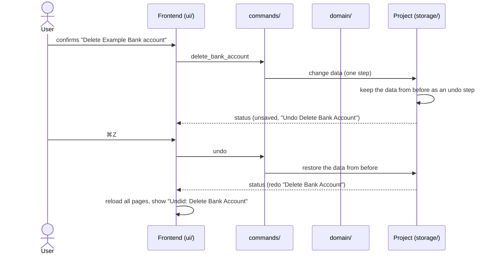

# CSD-027: Undo and redo

## 1. Intent
A wrong click should not cost the user an entry. Today an accidental delete of a statement, a valuation or a whole account can only be repaired by retyping it, or by closing the app without saving. This capability lets the user undo and redo changes to the project data during the session, with the same shortcuts as in any other Mac app. It comes from GitHub issue 43, which was parked as out of scope for the first release. The history lives in memory only, so the project file and the save model do not change.

## 2. Scope
### 2.1 In scope
- Undo and redo of every confirmed change to project data: create, update, delete and "copy previous" in income, investments, bank accounts, debts, houses and expenses.
- The Edit menu items Undo and Redo, their shortcuts, their labels and when they are available.
- What the app shows after an undo or redo.
- How the history relates to saving, New and Open.

### 2.2 Non-goals
- NG-1: A history that survives quitting the app or opening another project.
- NG-2: Autosave and backup or recovery copies made by the app (CSD-002 NG-2 stays). Undo never writes the project file.
- NG-3: On-screen undo buttons, and toasts with an undo button.
- NG-4: Undoing settings (the currency, CSD-003), application preferences (theme and language, CSD-008) and file actions (New, Open, Save, Save As).
- NG-5: A list of past steps, and jumping back several steps at once ("undo to here").
- NG-6: Undoing what the user typed in a form before confirming it. The native text-field undo keeps doing that.

## 3. Definitions
| Term | Meaning |
|---|---|
| **Step** | One confirmed user action that changed project data, for example one saved form or one confirmed delete. It is undone and redone as a whole, even when it changed several records. |
| **History** | The undo steps and the redo steps of the open project, held in memory. |
| **Undo the sale** | The existing house-sale action of CSD-026. It is a named action on the house page and is not the Edit > Undo item of this CSD. |

## 4. Requirements

### 4.0 Overview flow


**REQ-1: Undo** *(event-driven)*
When the user chooses Edit > Undo, the app shall restore the project data to the state before the most recent step.

```gherkin
@AC-1.1
Scenario: Undo a delete
  Given a project with a bank account "Example Bank" holding one entry of EUR 1,000.00 on 31/01/2026
  When the user deletes the account "Example Bank"
  And the user chooses Edit > Undo
  Then the account "Example Bank" is back with its entry of EUR 1,000.00 on 31/01/2026

@AC-1.2
Scenario: Undo an edit
  Given a bank account entry of EUR 1,000.00 on 31/01/2026
  When the user changes the amount to EUR 1,250.00
  And the user chooses Edit > Undo
  Then the entry shows EUR 1,000.00 again

@AC-1.3
Scenario: Undo steps back one step at a time
  Given the user added an expense of EUR 20.00 and then an expense of EUR 30.00
  When the user chooses Edit > Undo once
  Then only the expense of EUR 30.00 is gone

@AC-1.4
Scenario: Nothing to undo
  Given a freshly opened project
  Then the menu item Undo is disabled
```

**REQ-2: Redo** *(event-driven)*
When the user chooses Edit > Redo, the app shall apply again the step that was last undone.

```gherkin
@AC-2.1
Scenario: Redo an undone delete
  Given the user deleted the account "Example Bank" and then chose Edit > Undo
  When the user chooses Edit > Redo
  Then the account "Example Bank" is gone again

@AC-2.2
Scenario: Nothing to redo
  Given a freshly opened project
  Then the menu item Redo is disabled
```

**REQ-3: One step per action** *(ubiquitous)*
The app shall treat each confirmed create, update, delete and "copy previous" of project data as exactly one step, however many records it changes.

```gherkin
@AC-3.1
Scenario: A cascading delete is one step
  Given a job "Example Employer" with 2 paychecks and 1 statement
  When the user deletes the job
  And the user chooses Edit > Undo once
  Then the job, both paychecks and the statement are back

@AC-3.2
Scenario: Undoing a settlement step restores the whole state
  Given a debt linked to a house, and the user closed the debt by selling the house, which added a settlement statement
  When the user chooses Edit > Undo
  Then the house is open again and the settlement statement is gone
  And no extra confirmation is asked

@AC-3.3
Scenario: "Undo the sale" is not an edit undo
  Given a sold house with a settled debt
  When the user chooses the action "Undo sale" on the house page and confirms
  Then this counts as one step, and Edit > Undo takes that action back
```

**REQ-4: What is not a step** *(ubiquitous)*
The app shall not record the project currency, the theme, the language, nor New, Open, Save and Save As as steps.

```gherkin
@AC-4.1
Scenario: Changing the currency is not undoable
  Given a freshly opened project and the currency "EUR"
  When the user changes the currency to "USD" in Settings
  Then the menu item Undo is disabled

@AC-4.2
Scenario: Saving is not a step
  Given the user added a job and then saved the project
  When the user chooses Edit > Undo
  Then the job is removed, and not a save
```

**REQ-5: A new step clears redo** *(event-driven)*
When the user makes a new change while there are undone steps, the app shall remove all steps that could be redone.

```gherkin
@AC-5.1
Scenario: Redo is gone after a new edit
  Given the user added an expense of EUR 20.00 and chose Edit > Undo
  When the user adds an expense of EUR 45.00
  Then the menu item Redo is disabled
```

**REQ-6: Limit** *(ubiquitous)*
The app shall keep at most 100 undo steps per open project and shall drop the oldest step when a 101st is made.

```gherkin
@AC-6.1
Scenario: The 101st step drops the oldest
  Given a project where the user made 101 changes, each adding one expense
  When the user chooses Edit > Undo 100 times
  Then the first expense is still there
  And the menu item Undo is disabled
```

**REQ-7: A failed change records nothing** *(unwanted behaviour)*
If a change is rejected, then the app shall not add a step and shall not clear the redo steps.

```gherkin
@AC-7.1
Scenario: A rejected change leaves the history alone
  Given the user added an expense of EUR 20.00 and chose Edit > Undo
  When the user submits an expense with an invalid date and it is rejected
  Then the menu item Redo is still enabled
  And the menu item Undo is still disabled
```

**REQ-8: History belongs to the open project** *(event-driven)*
When the user starts a new project or opens a project file, the app shall clear the history.

```gherkin
@AC-8.1
Scenario: Opening a project clears the history
  Given the user added a job and may undo it
  When the user chooses File > Open… and opens another project file
  Then the menu items Undo and Redo are disabled

@AC-8.2
Scenario: A failed Open keeps the history
  Given the user added a job and may undo it
  When the user chooses File > Open… and the file is invalid, so the open fails
  Then the current project and its history are unchanged
```

**REQ-9: Undo and the saved state** *(state-driven)*
While the project data differs from the last saved or opened state, the app shall show the unsaved-changes indicator (CSD-002 REQ-3), after an undo or redo as after any other change, and saving shall not clear the history.

```gherkin
@AC-9.1
Scenario: Undo back to the saved state
  Given a freshly opened project
  When the user adds a job and chooses Edit > Undo
  Then no unsaved indicator is shown
  And the project file on disk is unchanged

@AC-9.2
Scenario: Undo past a save
  Given the user added a job and saved the project
  When the user chooses Edit > Undo
  Then the job is removed and the unsaved indicator is shown
  And the project file on disk still holds the job until the user saves again
```

**REQ-10: Menu items** *(ubiquitous)*
The app shall offer Undo (⌘Z) and Redo (⇧⌘Z) as items of the native Edit menu, labelled with the action they apply to (for example "Undo Delete Bank Account"), in English whatever the language setting is (CSD-024 REQ-6), and disabled when there is no step to apply.

```gherkin
@AC-10.1
Scenario: Items, shortcuts and labels
  Given the user deleted a bank account
  Then the Edit menu holds "Undo Delete Bank Account" with ⌘Z and a disabled "Redo" with ⇧⌘Z

@AC-10.2
Scenario: The label follows the history
  Given the user deleted a bank account and chose Edit > Undo
  Then the Edit menu holds a disabled "Undo" and "Redo Delete Bank Account"

@AC-10.3
Scenario: The menu stays English in Dutch
  Given the language setting is Dutch
  And the user added an expense
  Then the Edit menu holds "Undo Add Expense"
```

**REQ-11: Not while editing** *(state-driven)*
While a form or dialog is open, or a text field has the focus, the app shall not undo or redo project data, and ⌘Z and ⇧⌘Z shall act on the text in the focused field.

```gherkin
@AC-11.1
Scenario: ⌘Z in a text field undoes typing
  Given the user is typing an amount in the add-expense form
  When the user presses ⌘Z
  Then the typed text is undone and no project step is undone

@AC-11.2
Scenario: A dialog blocks project undo
  Given the user can undo a step and opens the form "Add expense"
  When the user chooses Edit > Undo
  Then nothing is undone and the form stays open
```

**REQ-12: The screen follows** *(event-driven)*
When a step is undone or redone, the app shall stay on the current page, reload the data of every page, and return to the list of the page when the selected record no longer exists.

```gherkin
@AC-12.1
Scenario: Pages show the restored data
  Given the user is on the Bank accounts page and deleted the account "Example Bank"
  When the user chooses Edit > Undo
  Then the Bank accounts page lists "Example Bank" again
  And the Dashboard and net worth figures include it again

@AC-12.2
Scenario: A vanished selection returns to the list
  Given the user added the account "Example Bank" and is viewing its detail
  When the user chooses Edit > Undo
  Then the page shows the list of accounts without "Example Bank"
```

**REQ-13: Say what happened** *(event-driven)*
When a step is undone or redone, the app shall show a short message that names the step, in the language of the app, with no button.

```gherkin
@AC-13.1
Scenario: Message after undo
  Given the user deleted a bank account
  When the user chooses Edit > Undo
  Then the message "Undid: Delete Bank Account" is shown

@AC-13.2
Scenario: Message in Dutch
  Given the language setting is Dutch
  And the user deleted a bank account
  When the user chooses Edit > Undo
  Then the message is shown in Dutch and names the step
```

## 5. Interfaces and contracts
- The status the frontend already reads (CSD-002) gains the label of the next undo step and of the next redo step, each empty when there is none.
- Two commands, `undo` and `redo`, that return the new status and the label of the step they applied. They fail with a safe error when there is no step.
- The step label is "Add", "Edit", "Delete" or "Copy Previous" followed by the name of the record:

| Area | Record names |
|---|---|
| Income | Job, Paycheck, Statement |
| Investments | Investment Account, Investment Statement |
| Bank accounts | Bank Account, Bank Entry |
| Debts | Debt, Debt Statement |
| Houses | House, House Valuation |
| Expenses | Expense |

- The labels are English text and are the keys of the Dutch texts in the status message (CSD-022).
- Errors follow `CLAUDE.md`: a safe code and message, no data in the text.

## 6. Constraints
- CON-1: The history holds copies of the whole project data, kept in the Rust project, and every command that changes project data goes through one place that records the step. Rationale: a cascade (a deleted job, a settled debt) is then undone atomically, and no command needs its own inverse. The project data is small (about 40 KB for the example project), so 100 copies cost a few MB.
- CON-2: Rust owns the history, the labels and the unsaved flag. The frontend only asks for undo or redo and reloads. Rationale: `CLAUDE.md` keeps business logic out of `ui/`.
- CON-3: The Edit menu keeps the standard items (cut, copy, paste, select all) and replaces only the predefined Undo and Redo with the items of REQ-10. Rationale: text fields keep working (REQ-11). This changes CSD-024 CON-2 and CSD-002 CON-6.
- CON-4: The history is never written to disk and never logged. Rationale: it holds amounts and names (`CLAUDE.md` privacy rules), and NG-1, NG-2.
- CON-5: No new crate, plugin or permission. Rationale: `CLAUDE.md` asks first for these, and the built-in menu API is enough (CSD-002 CON-6).

## 7. Verification
Tests are named `test_csd027_ac_<n>_<m>_<description>` (CSD-000 REQ-6).

| What | How |
|---|---|
| History rules (REQ-1 to REQ-9): undo, redo, one step per action, cascades, the limit, failed changes, New and Open, unsaved flag | `cargo test test_csd027_` (Rust, `storage/` and `domain/` tests on a project in a temporary directory, synthetic data only) |
| The extended status (labels) and the undo and redo commands | `GOLDEN_UPDATE=1 cargo test golden` once for the deliberate change, then `cargo test golden`, with the diff reviewed |
| Display ACs (REQ-11 to REQ-13, AC-12.1, AC-12.2) | `npm test`: a DOM test file for this CSD, a fake Tauri bridge fed with canned answers |
| Menu texts and shortcuts (REQ-10) | The menu table is checked by `cargo test test_csd027_ac_10_`. The built native menu can only be created on the main thread, so AC-10.1 to AC-10.3 stay on the manual checklist, as CSD-024 does for its menu |

Done means fmt, clippy (`-D warnings`), `cargo test --all-features` and `npm test` pass.

## 8. Open questions
- OQ-1: How does the Edit menu know a form is open or a text field has the focus (REQ-11)? The draft only fixes what the user sees: project undo does nothing in those states. Whether the item is also greyed out is left to the implementation. Owner: Thijs. Blocks: AC-11.2 only if greying out is required.

## 9. Changelog
- 0.1 (07/11/2026): initial draft, from GitHub issue 43 and the grill-me interview of 07/11/2026. Amends CSD-002 (NG-2, CON-6, REQ-3) and CSD-024 (REQ-5, CON-2).
