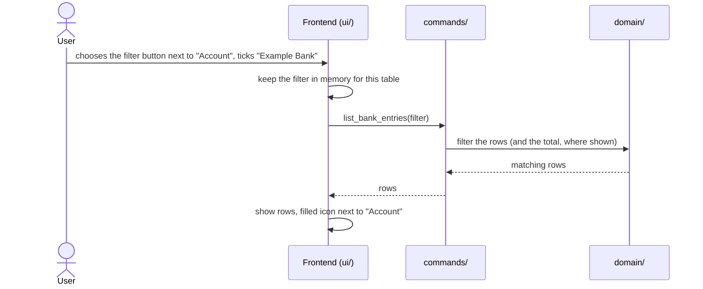

# CSD-028: Filters in the statement tables

## 1. Intent
Every area keeps a growing table of records: paychecks, investment statements, bank entries, debt statements, house valuations and expenses. After a few years these tables are long, and finding the entries of one account, one category or one period means scrolling. This capability lets the user narrow each of these tables by period and by the entity the rows belong to (job, account, debt, house or category). It comes from GitHub issue 55. Filtering only changes what a table shows. It never changes project data, the yearly totals, the charts or the insights.

## 2. Scope
### 2.1 In scope
- A filter on each of the six statement tables (see §3): a period range and a multi-select on the entity of the table, each opened from an icon-only button in its own column header.
- The filled filter icon while a column is filtered, and the button "Reset filter" in each panel.
- The "no matches" state, and the filtered total of the expenses table.
- How the filter relates to editing, deleting, closing the project and undo.

### 2.2 Non-goals
- NG-1: Filtering or searching the yearly totals tables, the ratios table, the charts and the insights tabs.
- NG-2: Filtering on amount, note or free text, and sorting by column.
- NG-3: Saving filters in the project file or in the application preferences, or remembering them after the app closes.
- NG-4: Named or saved filters.
- NG-5: Putting filter changes in the undo history (CSD-027): a filter is view state, not project data.

## 3. Definitions
| Term | Meaning |
|---|---|
| **Statement table** | One of the six record tables below. |
| **Entity** | The thing a row belongs to, listed in the table below. |
| **Filter** | A period range plus a set of selected entities, applied to one statement table. The two parts are set and cleared separately, each from its own column header. |
| **Active** | A part of the filter that is set: a period bound, or at least one selected entity. |

| Page | Statement table | Entity filter |
|---|---|---|
| Income | Paychecks | Job |
| Investments | Investment statements | Account |
| Bank accounts | Bank entries | Account |
| Debts | Debt statements | Debt |
| Houses | House valuations | House |
| Expenses | Expenses | Category |

## 4. Requirements

### 4.0 Overview flow


**REQ-1: Filter buttons in the column headers** *(ubiquitous)*
The app shall show, in the header row of each statement table that holds data, one icon-only filter button right next to the title of the period column and one right next to the title of the entity column, each with an accessible label and a tooltip, and no visible text.

```gherkin
@AC-1.1
Scenario: Two filter buttons in the header row
  Given the Bank accounts page with 3 entries
  Then a button labelled "Filter by period" is shown next to the column title "Period"
  And a button labelled "Filter by account" is shown next to the column title "Account"
  And both buttons hold an icon and no text

@AC-1.2
Scenario: A table without data has no filter buttons
  Given the Bank accounts page without entries
  Then no filter button is shown
  And the note "No entries yet" is shown
```

**REQ-2: Filter panels, one per column** *(event-driven)*
When the user chooses the filter button of the period column, the app shall open a panel with a from month and a to month. When the user chooses the filter button of the entity column, the app shall open a panel with one checkbox per entity of that table that has rows in it, open or closed. The app shall apply every change to the table at once, without an Apply button, keep the panel inside the window, and let the two filters work independently.

```gherkin
@AC-2.1
Scenario: The entity panel lists every entity
  Given the bank accounts "Example Bank" and "Savings Example"
  When the user chooses the filter button next to "Account"
  Then the panel shows the checkboxes "Example Bank" and "Savings Example"
  And no from month or to month

@AC-2.4
Scenario: The period panel holds the range only
  When the user chooses the filter button next to "Period"
  Then the panel shows a from month and a to month, both empty
  And no checkboxes

@AC-2.2
Scenario: Changes apply live and the panel closes with the filter kept
  Given the entity panel of the bank entries is open
  When the user ticks "Example Bank"
  Then the table shows only the entries of "Example Bank" while the panel is still open
  When the user presses Escape or clicks outside the panel
  Then the panel closes and the filter is still "Example Bank"

@AC-2.3
Scenario: Closed debts and sold houses are listed
  Given a closed debt "Example Loan" with 2 statements and a sold house "Example House" with 1 valuation
  When the user opens the entity panel of the debt statements
  Then "Example Loan" is listed
  When the user opens the entity panel of the house valuations
  Then "Example House" is listed

@AC-2.5
Scenario: The two filters combine
  Given the entity filter ticks "Example Bank"
  When the user sets from 2026-02 in the period panel
  Then the table shows the entries of "Example Bank" from 2026-02 on
```

```gherkin
@AC-2.6
Scenario: A filter in use can be adjusted
  Given the entity filter ticks "Example Bank" and the panel is closed
  When the user chooses the filter button next to "Account"
  Then the panel opens with "Example Bank" ticked
  And the user can tick or untick other accounts

@AC-2.8
Scenario: The text of an item works like its checkbox
  Given the entity panel is open
  When the user clicks the text "Example Bank" instead of its checkbox
  Then "Example Bank" is ticked and the panel stays open

@AC-2.9
Scenario: The panel uses the case of the items
  Given the column headers are shown in capitals
  When a filter panel is open
  Then its texts read "From month", "To month" and "Example Bank", not in capitals
```

```gherkin
@AC-2.10
Scenario Outline: The panel stays inside the window
  Given a window of <window> pixels high and the filter button at <icon>
  When the user opens a panel that is <height> pixels high
  Then the panel is shown <where>

  Examples:
    | window | icon       | height | where                                       |
    | 600    | 100 to 120 | 200    | below the button                            |
    | 400    | 300 to 320 | 200    | above the button                            |
    | 300    | 100 to 120 | 500    | below the button, scrolling inside it       |
```

**REQ-3: Period range** *(event-driven)*
When the user sets a from month, a to month or both, the app shall show only the rows whose month lies in that range, both ends included, and shall always show a row whose period is a year (`YYYY`). For expenses the month is the month of the date.

```gherkin
@AC-3.1
Scenario Outline: Period range on bank entries
  Given bank entries for 2025-12, 2026-01, 2026-02 and 2026-03
  When the user sets from "<from>" and to "<to>"
  Then the table shows the periods "<shown>"

  Examples:
    | from    | to      | shown                      |
    | 2026-01 | 2026-02 | 2026-01, 2026-02           |
    | 2026-02 |         | 2026-02, 2026-03           |
    |         | 2026-01 | 2025-12, 2026-01           |

@AC-3.2
Scenario: Expenses use the month of their date
  Given expenses on 31/01/2026 and 01/02/2026
  When the user sets from 2026-02
  Then only the expense of 01/02/2026 is shown

@AC-3.4
Scenario: A yearly row ignores the period range
  Given a yearly bank account "Yearly Example" with an entry for 2025 and a monthly account "Example Bank" with entries for 2026-01 and 2026-03
  When the user sets from "2026-02" and to "2026-02"
  Then the entry for 2025 is shown
  And the entries of 2026-01 and 2026-03 are not shown

@AC-3.5
Scenario: A yearly row still follows the entity filter
  Given the same entries
  When the user ticks "Example Bank"
  Then the entry for 2025 is not shown

@AC-3.3
Scenario: A range that ends before it starts
  Given bank entries for 2026-01 and 2026-02
  When the user sets from "2026-03" and to "2026-01"
  Then the table shows no rows
  And the "no matches" note is shown
```

**REQ-4: Entity selection** *(event-driven)*
When the user ticks one or more entities, the app shall show only the rows of those entities. While no entity is ticked, the app shall not filter on the entity.

```gherkin
@AC-4.1
Scenario: One account
  Given entries of "Example Bank" and "Savings Example"
  When the user ticks "Example Bank"
  Then only the entries of "Example Bank" are shown

@AC-4.2
Scenario: Two accounts
  Given entries of "Example Bank", "Savings Example" and "Cash Example"
  When the user ticks "Example Bank" and "Cash Example"
  Then the entries of those two accounts are shown and those of "Savings Example" are not

@AC-4.3
Scenario: Nothing ticked means all
  Given entries of "Example Bank" and "Savings Example"
  When the user unticks every account
  Then the entries of both accounts are shown

@AC-4.4
Scenario: Period and entity combine
  Given an entry of "Example Bank" for 2026-01 and one of "Savings Example" for 2026-01
  When the user ticks "Example Bank" and sets from 2026-02
  Then no rows are shown
```

**REQ-5: Entity per table** *(ubiquitous)*
The app shall offer on each statement table the entity of §3 and no other: job on paychecks, account on investment statements and on bank entries, debt on debt statements, house on house valuations and category on expenses, and the filter button of the entity column shall sit next to the title of that column.

```gherkin
@AC-5.1
Scenario Outline: Each table filters on its own entity
  Given the page "<page>"
  When the user opens the entity panel of its statement table
  Then the checkboxes are titled "<entity>"
  And the button sits next to the column title "<entity>"

  Examples:
    | page         | entity   |
    | Income       | Job      |
    | Investments  | Account  |
    | Bank accounts| Account  |
    | Debts        | Debt     |
    | Houses       | House    |
    | Expenses     | Category |
```

**REQ-6: Active filter shows a filled icon** *(state-driven)*
While the period filter or the entity filter of a table is active, the app shall show the filter icon of that column filled, and name in its label and tooltip that the filter is active. The other column keeps its own state.

```gherkin
@AC-6.1
Scenario: An active entity filter shows the filled icon
  Given the entity filter ticks "Example Bank"
  Then the button next to "Account" shows a filled icon and is labelled "Filter by account (active)"
  And the button next to "Period" still shows the outline icon

@AC-6.2
Scenario: An active period filter shows the filled icon
  Given the period filter has from 2026-01
  Then the button next to "Period" shows a filled icon and is labelled "Filter by period (active)"

@AC-6.3
Scenario: No active filter
  Given no filter is active
  Then both buttons show the outline icon
```

**REQ-7: Reset one column** *(event-driven)*
When the user chooses the button "Reset filter" in the panel of a column, the app shall clear the filter of that column only, close the panel, show the outline icon again and show the rows that remain. While that column has no active filter, the button shall be disabled.

```gherkin
@AC-7.1
Scenario: Resetting the entity filter keeps the period filter
  Given the entity filter ticks "Example Bank" and the period filter has from 2026-01
  When the user opens the panel next to "Account" and chooses "Reset filter"
  Then the entries of every account from 2026-01 on are shown
  And the button next to "Account" shows the outline icon again
  And the button next to "Period" still shows the filled icon

@AC-7.2
Scenario: Resetting the last filter shows every row
  Given the bank entries are filtered to "Example Bank"
  When the user opens the panel next to "Account" and chooses "Reset filter"
  Then all entries are shown

@AC-2.7
Scenario: Nothing to reset
  Given no filter is active
  When the user opens the panel next to "Account"
  Then the button "Reset filter" is disabled
```

**REQ-8: No matches** *(state-driven)*
While an active filter leaves a statement table without rows and the table holds data without the filter, the app shall keep the header row with its filter buttons and show the note "No entries match the filters" below it instead of rows.

```gherkin
@AC-8.1
Scenario: A filter matching nothing
  Given entries of "Example Bank" for 2026-01
  When the user ticks "Example Bank" and sets from 2027-01
  Then the header row is still shown, with the filled icons
  And the note "No entries match the filters" is shown
  And the note "No entries yet" is not shown
```

**REQ-9: Filtered total** *(state-driven)*
While a filter is active on a table that shows a total (expenses), the app shall show the total of the matching rows and label it "Filtered total".

```gherkin
@AC-9.1
Scenario: Total follows the filter
  Given expenses of EUR 20.00 and EUR 30.00 in category "Groceries" and EUR 100.00 in category "Travel"
  When the user ticks the category "Groceries"
  Then the total reads EUR 50.00
  And its label is "Filtered total"

@AC-9.2
Scenario: Total without filter
  Given the same expenses and no active filter
  Then the total reads EUR 150.00
  And its label is "Total"
```

**REQ-10: Rust filters** *(ubiquitous)*
The app shall let the Rust list commands of the six tables take an optional filter, and shall return the matching rows and any total computed by Rust, without the frontend filtering rows or adding amounts.

```gherkin
@AC-10.1
Scenario: No filter gives today's answer
  Given the golden example project
  When a list command is called without a filter
  Then its answer equals the golden file

@AC-10.2
Scenario: A filter with an unknown id
  Given a filter that ticks the id of an account that does not exist
  When list_bank_entries is called
  Then no rows are returned and no error is raised
```

**REQ-11: Editing keeps the filter** *(event-driven)*
When the user adds, edits or deletes a record, the app shall reload the table through the active filter and keep the filter as it was.

```gherkin
@AC-11.1
Scenario: A new row outside the filter is not shown
  Given the bank entries are filtered to "Example Bank"
  When the user adds an entry for "Savings Example"
  Then the filter is unchanged
  And the new entry is not shown

@AC-11.2
Scenario: A deleted row leaves the filter in place
  Given the bank entries are filtered to "Example Bank" with 2 matching rows
  When the user deletes one of them
  Then 1 row is shown and the filter is unchanged
```

**REQ-12: Stale entities** *(event-driven)*
When an entity that is ticked in a filter no longer exists, the app shall remove it from the selection without a message. If no entity is left ticked, the entity filter shall be inactive.

```gherkin
@AC-12.1
Scenario: A ticked account is deleted
  Given the bank entries are filtered to "Example Bank" and from 2026-01
  When the user deletes the account "Example Bank"
  Then no account is ticked and the from month is still 2026-01
  And entries of the other accounts from 2026-01 are shown
```

**REQ-13: Filters live in memory** *(event-driven)*
When the user starts a new project or opens a project file, the app shall reset the filters of every table. The app shall keep the filters while the user switches pages or tabs, and shall not write them to disk.

```gherkin
@AC-13.1
Scenario: Filter survives a page switch
  Given the bank entries are filtered to "Example Bank"
  When the user opens the Debts page and returns to Bank accounts
  Then the filter still ticks "Example Bank"

@AC-13.2
Scenario: Opening a project resets the filters
  Given the bank entries are filtered to "Example Bank"
  When the user opens another project file
  Then no filter is active on any table

@AC-13.3
Scenario: Quitting forgets the filters
  Given an active filter and a saved project
  When the project file is read
  Then it holds no filter
```

**REQ-14: Undo ignores filters** *(ubiquitous)*
The app shall not record a filter change as an undo step (CSD-027), and shall keep the filter when a step is undone or redone.

```gherkin
@AC-14.1
Scenario: Filtering does not enable Undo
  Given a freshly opened project
  When the user sets a filter on the bank entries
  Then the menu item Undo is disabled

@AC-14.2
Scenario: Undo keeps the filter
  Given the bank entries are filtered to "Example Bank" and the user deleted an entry
  When the user chooses Edit > Undo
  Then the entry is back and the filter is unchanged
```

**REQ-15: Language and labels** *(ubiquitous)*
The app shall show every filter text, label and tooltip in the language of the app (CSD-022), and the filter and reset buttons shall be reachable and operable by keyboard.

```gherkin
@AC-15.1
Scenario: Dutch labels
  Given the language setting is Dutch
  Then the filter button labels, the reset button and the "no matches" note are shown in Dutch

@AC-15.2
Scenario: Keyboard
  Given the focus is on the filter button next to "Period"
  When the user presses Enter
  Then the period panel opens and its first control has the focus
```

## 5. Interfaces and contracts
- The six list commands (`list_entries`, `list_investment_statements`, `list_bank_entries`, `list_debt_statements`, `list_house_valuations`, `list_expenses`) gain one optional argument, `filter`: `{ from: "YYYY-MM" | null, to: "YYYY-MM" | null, ids: [id] }`. Months are ISO inside IPC (CSD-000 CON-7). An absent filter, or `from` and `to` null with empty `ids`, returns the unfiltered answer.
- For expenses, `ids` holds category keys; for the others it holds record ids.
- `list_expenses` returns the total of the returned rows.
- The frontend sends the filter and shows the answer. It computes no amounts and does not filter rows (CON-2).
- Errors follow `CLAUDE.md`: a safe code and message.

## 6. Constraints
- CON-1: The shared filter panel is one component in `ui/shared/`, reused by all six pages, and adds no dependency. Rationale: one behaviour, one place to test.
- CON-2: Rust applies the filter and computes any filtered total. Rationale: `CLAUDE.md` keeps business logic and figures out of `ui/`.
- CON-3: The filter and reset icons are inline SVG paths added to the existing icon helper, with no `style=` attributes and no new asset. Rationale: the strict CSP in `CLAUDE.md`.
- CON-4: Filter state is never written to disk and never logged. Rationale: NG-3, and it holds names.
- CON-5: Yearly totals tables, charts and insights ignore the filters. Rationale: NG-1, so yearly figures never depend on a view setting.

## 7. Verification
Tests are named `test_csd028_ac_<n>_<m>_<description>` (CSD-000 REQ-6).

| What | How |
|---|---|
| Filtering rules (REQ-3, REQ-4, AC-9, REQ-10, REQ-12 range handling): range edges, empty selection, unknown ids, total | `cargo test test_csd028_` (Rust, `domain/` unit tests and IPC tests, synthetic data only) |
| No filter equals today's answer (AC-10.1) | `cargo test golden`, which must pass without `GOLDEN_UPDATE` |
| Display ACs (REQ-1, 2, 5 to 9, 11 to 15) | `npm test`: a DOM test file for this CSD, a fake Tauri bridge with canned answers |
| Filter state not stored (AC-13.3) | `cargo test test_csd028_ac_13_` reads a saved project file |
| Undo ignores filters (REQ-14) | DOM test, plus the menu staying disabled in the CSD-027 tests |

Done means fmt, clippy (`-D warnings`), `cargo test --all-features` and `npm test` pass.

## 8. Open questions
- OQ-1 (resolved in v0.1): Should a range with from after to show no rows or block the panel with a message? Answer: show no rows and the "no matches" note (AC-3.3).
- OQ-2 (resolved in v0.1): Should the Debt and House lists include closed debts and sold houses? Answer: yes, every debt and house that has rows in the table, open or closed (REQ-2).
- OQ-3 (resolved in v0.1): Live or explicit apply? Answer: live, with no Apply button (REQ-2).

## 9. Changelog
- 0.5 (07/11/2026): the panel stays inside the window: below the icon when it fits, else above it, else scrolling inside (REQ-2, AC-2.10). Owner request.
- 0.4 (07/11/2026): a filtered column keeps its filter icon, shown filled, so the filter can be adjusted; the clear icon is replaced by a text button "Reset filter" in each panel (REQ-2, REQ-6, REQ-7, REQ-8). The panel texts use the case of the items, and clicking the text of an item works like its checkbox (AC-2.6 to AC-2.9). Owner request. Back to `draft` until re-approved.
- 0.3 (07/11/2026): the filter is split over the column headers: one icon next to the period title and one next to the entity title, each with its own panel; an active filter replaces its filter icon by the clear icon, and the dot, the count and the single reset button are gone (REQ-1, REQ-2, REQ-5 to REQ-8). The header row stays visible while nothing matches. Owner request. Back to `draft` until re-approved.
- 0.2 (07/11/2026): a row with a yearly period always passes the period range and still follows the entity filter (REQ-3, AC-3.4, AC-3.5). Found while reading the list commands: bank entries, investment statements and income can hold `YYYY` periods. Back to `draft` until re-approved (CSD-000 REQ-2).
- 0.1 (07/11/2026): initial draft, from GitHub issue 55 and the grill-me interview of 07/11/2026. OQ-1 to OQ-3 resolved: an inverted range shows no rows, closed debts and sold houses are listed, filters apply live (REQ-2, AC-2.2, AC-2.3).
