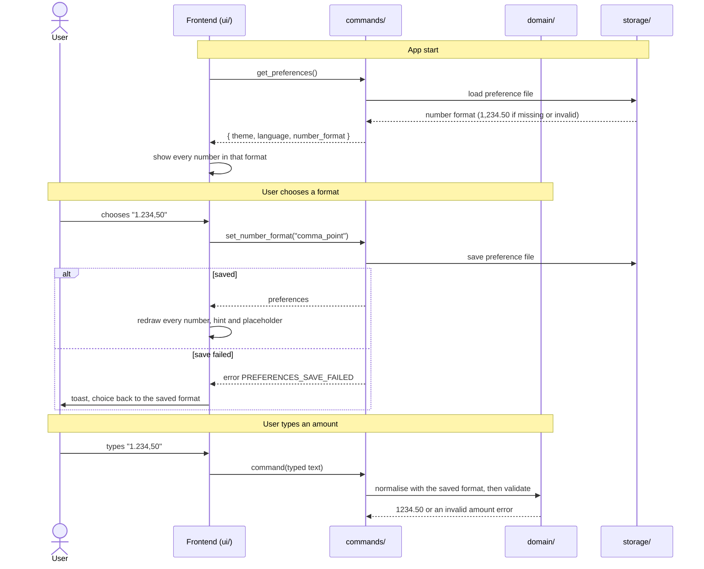

# CSD-029: Number format (thousands and decimal separators)

## 1. Intent
Every amount in the app is written as 1,234.50. People who are used to 1.234,50 (Dutch usage) or 1'234,50 (Swiss usage) have to read and type numbers in a format that is not theirs, and a comma and a point mean the opposite of what they expect. This capability adds a Number format choice to the Settings page, with three options, and writes every number the app shows, and reads every number the user types, in that format. Like the theme (CSD-008) and the language (CSD-022), it is a preference of the person using the app on this Mac, not of the project, so it is kept outside the project file and stays the same whichever project is open. The default is 1,234.50, so nothing changes until the user chooses. It is for a single user. It is GitHub issue 56.

## 2. Scope
### 2.1 In scope
- A "Number format" choice on the Settings page: choosing, applying, saving and showing it.
- Every amount, percentage and ratio the app shows, including chart axes, tooltips and labels.
- Every amount the user types, and the hints and placeholders that explain how to type it.
- Keeping the preference with the theme and the language and restoring it at start.

### 2.2 Non-goals
- NG-1: Formats other than the three below, and free-text separators.
- NG-2: Following the macOS region or the language. The user chooses, and the default is 1,234.50 in every language.
- NG-3: A format per project. The project file holds no number format (CSD-003 CON-2 stays as it is), and the project file and IPC keep point decimals.
- NG-4: Changing the date format (dd/mm/yyyy, CSD-000 CON-7), the currency or where its symbol is written.
- NG-5: Changing the rounding. Two decimals, half-up (CSD-000 CON-8).
- NG-6: Accepting either separator when typing and guessing which is meant. Typing is strict (REQ-7).

## 3. Definitions
| Term | Meaning |
|---|---|
| **Number format** | One of `point_comma` (1,234.50), `comma_point` (1.234,50) and `apostrophe_comma` (1'234,50). |
| **Grouping separator** | The character between groups of three digits: `,` `.` or `'`. |
| **Decimal separator** | The character before the decimals: `.` `,` or `,`. |
| **Canonical form** | How numbers travel between the frontend, Rust and the project file: no grouping, a point as decimal separator ("1234.50"). |

## 4. Requirements

### 4.0 Overview flow


**REQ-1: Number format choice on the Settings page** *(ubiquitous)*
The Settings page shall show a "Number format" choice in the "Appearance" panel, below "Language", that offers 1,234.50, 1.234,50 and 1'234,50 in that order, each written as that example, and shows the current format.

```gherkin
@AC-1.1
Scenario: The choice and its options
  Given the app has started
  When the user opens Settings
  Then the "Appearance" panel shows a "Number format" choice below "Language"
  And the choice offers "1,234.50", "1.234,50" and "1'234,50" in that order

@AC-1.2
Scenario Outline: The choice shows the current format
  Given the saved number format is "<format>"
  When the user opens Settings
  Then the "Number format" choice shows "<label>"

  Examples:
    | format           | label    |
    | point_comma      | 1,234.50 |
    | comma_point      | 1.234,50 |
    | apostrophe_comma | 1'234,50 |
```

**REQ-2: Default format** *(state-driven)*
While no number format has been saved, the app shall use 1,234.50.

```gherkin
@AC-2.1
Scenario: First start
  Given no preference file exists
  When the app starts
  Then every amount is written as in "1,234.50"
  And the "Number format" choice shows "1,234.50"

@AC-2.2
Scenario: The language and the Mac's region are not followed
  Given the language is "nl", macOS is set to a Dutch region and no number format has been saved
  When the app starts
  Then the gross salary 1234.50 is shown as "1,234.50"
```

**REQ-3: Apply the choice at once** *(event-driven)*
When the user chooses a number format, the app shall show every page, dialog and open form in it immediately, without a confirmation, a restart or a reload of the project, without marking the project as having unsaved changes, and shall re-write an amount already typed in an open form or filter field in the new format, or clear that field when it cannot be read in the format that was in use.

```gherkin
@AC-3.1
Scenario: Choosing 1.234,50
  Given the app shows a gross salary as "1,234.50" and the user is on Settings
  When the user chooses "1.234,50"
  Then the gross salary is shown as "1.234,50" at once
  And no confirmation is asked

@AC-3.2
Scenario: The choice is not an unsaved project change
  Given a saved project
  When the user chooses "1'234,50"
  Then the unsaved indicator is not shown

@AC-3.3
Scenario: A typed amount in an open form is re-written
  Given the format is "point_comma" and a form field holds "1,234.50"
  When the user chooses "1.234,50"
  Then the field holds "1.234,50"

@AC-3.4
Scenario: A typed amount that cannot be read is cleared
  Given the format is "point_comma" and a form field holds "12,34.50"
  When the user chooses "1.234,50"
  Then that field is empty
  And the other fields of the form keep their values

@AC-3.5
Scenario: Choosing the current format changes nothing
  Given the saved number format is "comma_point"
  When the user chooses "1.234,50"
  Then the saved number format is "comma_point"
```

**REQ-4: The format is remembered** *(ubiquitous)*
The app shall keep the chosen number format in the preference file of CSD-008, outside the project file, restore it when the app starts and before the first page is shown, and use it for every project.

```gherkin
@AC-4.1
Scenario: Restored at start
  Given the user chose "1.234,50" and quit the app
  When the app starts
  Then the first page that is shown already writes 1234.50 as "1.234,50"

@AC-4.2
Scenario: Same format for another project
  Given the format is "comma_point"
  When the user opens a different project file
  Then amounts are still written as "1.234,50"

@AC-4.3
Scenario: Not in the project file
  Given the format is "comma_point" and the user saves the project
  Then the project file contains no number format
  And every amount in the project file has a point as decimal separator and no grouping

@AC-4.4
Scenario: Theme, language and number format are kept together
  Given the theme is "dark", the language is "nl" and the user chooses "1'234,50"
  When the app starts again
  Then the theme is "dark", the language is "nl" and the number format is "apostrophe_comma"
```

**REQ-5: Every number is written in the format** *(ubiquitous)*
The app shall write every amount, percentage and ratio it shows in the chosen format, with two decimals (CSD-000 CON-8): in tables, totals, forms, messages, chart axes, tooltips, legends and short labels such as "1.50k", where the decimal separator of the format replaces the point and a minus sign stays a minus sign.

```gherkin
@AC-5.1
Scenario Outline: An amount in each format
  Given the number format is "<format>"
  And a bank account statement with balance 1234567.50
  Then the balance is shown as "<balance>"

  Examples:
    | format           | balance      |
    | point_comma      | 1,234,567.50 |
    | comma_point      | 1.234.567,50 |
    | apostrophe_comma | 1'234'567,50 |

@AC-5.2
Scenario: Small and negative amounts
  Given the number format is "comma_point"
  Then 999.00 is shown as "999,00", -1234.50 as "-1.234,50" and 0.00 as "0,00"

@AC-5.3
Scenario: Percentages and ratios
  Given the number format is "comma_point"
  Then a growth of 12.50 percent is shown as "12,50%" and a ratio of 0.75 as "0,75"

@AC-5.4
Scenario: Chart labels
  Given the number format is "comma_point"
  Then the short label of 1500.00 is "1,50k"
  And the tooltip of a point with value 1234.50 shows "1.234,50"
```

**REQ-6: Typed amounts follow the format** *(event-driven)*
When the user types an amount, the app shall read it in the chosen number format: the decimal separator of the format starts the decimals, the grouping separator may be written between groups of three digits and is ignored, the minus sign may start the amount where the field allows a negative amount, and the result is rounded as in CSD-000 CON-8.

```gherkin
@AC-6.1
Scenario Outline: Typed amounts are read in the chosen format
  Given the number format is "<format>"
  When the user types "<typed>" as an amount
  Then the amount is "<amount>"

  Examples:
    | format           | typed     | amount  |
    | point_comma      | 1234.50   | 1234.50 |
    | point_comma      | 1,234.50  | 1234.50 |
    | comma_point      | 1234,50   | 1234.50 |
    | comma_point      | 1.234,50  | 1234.50 |
    | comma_point      | 1.234     | 1234.00 |
    | comma_point      | -1.234,5  | -1234.50 |
    | apostrophe_comma | 1'234,50  | 1234.50 |
    | apostrophe_comma | 1’234,50  | 1234.50 |
    | comma_point      | 3000,505  | 3000.51 |

@AC-6.2
Scenario: The project file and IPC stay canonical
  Given the number format is "comma_point"
  When the user saves a paycheck with gross salary typed as "1.234,50"
  Then the project file holds "1234.50"
```

**REQ-7: Typed amounts that do not fit the format are rejected** *(unwanted behaviour)*
If a typed amount uses a separator other than the grouping and decimal separators of the chosen format, groups its digits in anything other than groups of three after the first group of one to three digits, has more than one decimal separator, or has a grouping separator after the decimal separator, then the app shall reject it with the invalid-amount error of that area, shall not guess what was meant, and shall keep the project unchanged.

```gherkin
@AC-7.1
Scenario Outline: Amounts that are rejected
  Given the number format is "<format>"
  When the user types "<typed>" as an amount
  Then the command fails with the invalid amount error of that area
  And the project is unchanged

  Examples:
    | format           | typed     | why                                   |
    | comma_point      | 1234.50   | the point groups, "50" is not a group |
    | comma_point      | 12.34,50  | wrong grouping                        |
    | comma_point      | 1,234.50  | the other format's separators         |
    | comma_point      | 1,234,50  | two decimal separators                |
    | comma_point      | 1234,5.0  | grouping after the decimals           |
    | point_comma      | 1.234,50  | the other format's separators         |
    | point_comma      | 12,34.50  | wrong grouping                        |
    | apostrophe_comma | 1.234,50  | a point is not a separator here       |
    | apostrophe_comma | 1''234,50 | two grouping characters in a row      |
    | comma_point      | 10,9x     | a letter                              |

@AC-7.2
Scenario: The message names no path and no other format
  Given the number format is "comma_point" and the user types "1234.50"
  When the error is shown
  Then the message says the amount is not valid and shows the example "1.234,50" in the chosen format
```

**REQ-8: Hints and placeholders follow the format** *(ubiquitous)*
The app shall write the placeholder and the explanation of every amount field in the chosen format and in the chosen language, with the decimal separator named and an example in the format.

```gherkin
@AC-8.1
Scenario Outline: Placeholder and hint
  Given the number format is "<format>"
  When the user opens the form of a paycheck
  Then the gross salary placeholder is "<placeholder>"
  And the hint says to use a "<separator>" for decimals, for example "<example>"

  Examples:
    | format           | placeholder | separator | example |
    | point_comma      | 0.00        | dot       | 3000.00 |
    | comma_point      | 0,00        | comma     | 3000,00 |
    | apostrophe_comma | 0,00        | comma     | 3000,00 |

@AC-8.2
Scenario: The hint in Dutch
  Given the number format is "comma_point" and the language is "nl"
  When the user opens the form of a paycheck
  Then the hint is in Dutch and names a comma for decimals
```

**REQ-9: Missing or unsupported format** *(unwanted behaviour)*
If the preference file has no number format, an empty one or one that is not `point_comma`, `comma_point` or `apostrophe_comma`, or `set_number_format` is called with such a value, then the app shall use 1,234.50 and shall not change the saved format.

```gherkin
@AC-9.1
Scenario Outline: A format that cannot be used
  Given the preference file holds number format "<stored>"
  When the app starts
  Then amounts are written as in "1,234.50"

  Examples:
    | stored        |
    |               |
    | comma         |
    | COMMA_POINT   |

@AC-9.2
Scenario: Unsupported value on save
  When the frontend calls set_number_format("comma")
  Then the command fails with code PREFERENCES_NUMBER_FORMAT_UNSUPPORTED
  And the saved number format is unchanged

@AC-9.3
Scenario: An older preference file
  Given the preference file holds only { "theme": "dark", "language": "nl" }
  When the app starts
  Then the number format is "point_comma", the theme is "dark" and the language is "nl"
```

**REQ-10: Saving fails** *(unwanted behaviour)*
If the number format cannot be saved, then the app shall keep the saved format, show the previous format and choice, and show a message that the number format could not be saved without a file path.

```gherkin
@AC-10.1
Scenario: Read-only config folder
  Given the saved number format is "point_comma" and the config folder cannot be written
  When the user chooses "1.234,50"
  Then amounts are still written as "1,234.50"
  And the "Number format" choice shows "1,234.50"
  And a message appears that the number format could not be saved
  And the message contains no file path
```

## 5. Interfaces and contracts
Commands: `get_preferences()` returns `{ theme, language, number_format }`, and `set_number_format(number_format)` takes `"point_comma"`, `"comma_point"` or `"apostrophe_comma"` and returns the preferences. It saves first and returns only when the save succeeded, so a failed save changes nothing (REQ-10), as `set_theme` and `set_language` do.

Preference file: `preferences.json`, for example `{ "theme": "system", "language": "en", "number_format": "point_comma" }`. Unknown fields are ignored, and a missing `number_format` means 1,234.50 (AC-9.3). The preference file is lenient on purpose, unlike the strict project file (CSD-002 REQ-17).

Commands that take an amount receive the typed text and are normalised in Rust with the saved format before their own validation. Values that Rust returns stay in canonical form, and the frontend writes them in the chosen format for display only (as it does today with `formatAmount`). Labels that Rust builds (chart axes and short labels, CSD-025) are written in the chosen format by Rust.

Error codes: `PREFERENCES_NUMBER_FORMAT_UNSUPPORTED` (new), `PREFERENCES_SAVE_FAILED` (CSD-008), and the existing `*_AMOUNT_INVALID` code of each area for REQ-7. Rust keeps sending its English message with every code.

## 6. Constraints
- CON-1: The number format is stored only in the preference file of CSD-008, with the same rules (outside the project file, atomic, owner-only, never committed). Rationale: it belongs to the person and the Mac, and it is needed before any project is open.
- CON-2: Rust is the only place the preference is kept. The frontend holds no copy (no `localStorage`). Rationale: one source of truth, CSD-008 CON-2.
- CON-3: The number format is a closed set of three values, never free text beyond the command edge. Rationale: invalid states are unrepresentable per `CLAUDE.md`.
- CON-4: The project file, IPC and every stored amount stay in canonical form. Rationale: the file format (CSD-002) does not change, no migration is needed, and the file reads the same on every Mac.
- CON-5: Parsing a typed amount is done in Rust, and `domain/` stays pure: the format is a value given to it, not read from the preferences inside it. The frontend never computes a figure and only writes the canonical values it receives. Rationale: `CLAUDE.md` layout rule.
- CON-6: One rounding rule (CSD-000 CON-8) before and after the format: the format changes how a number is written and read, never its value. Rationale: figures must agree in every format.
- CON-7: No new dependency, plugin, permission or network access. Rationale: least privilege per `CLAUDE.md`.
- CON-8: Tests use a temporary directory and never the real app config folder. Rationale: `CLAUDE.md` testing rules.

## 7. Verification
Tests are named `test_csd029_ac_<n>_<m>_<description>` (CSD-000 REQ-6).

| What | How |
|---|---|
| The preference (AC-4.3, AC-4.4, AC-9.1 to AC-9.3, AC-10.1) | `cargo test test_csd029_`. Storage tests (save, load, missing, empty, invalid, older file, read-only folder) run in a temporary directory |
| Reading typed amounts (AC-6.1, AC-6.2, AC-7.1) | `cargo test test_csd029_ac_6_` and `test_csd029_ac_7_`, on the domain function that takes the format, plus a property test that writing a number in a format and reading it back gives the same value |
| Rust-built labels (AC-5.4 short and axis labels) | `cargo test test_csd029_ac_5_`; the golden files are unchanged for the default format (`cargo test golden`) |
| Display ACs (AC-1.1, AC-1.2, AC-2.1, AC-2.2, AC-3.1 to AC-3.5, AC-4.1, AC-4.2, AC-5.1 to AC-5.3, AC-7.2, AC-8.1, AC-8.2, AC-10.1) | `npm test`: `number-format.test.js` |
| Needs a real restart or macOS | Manual checklist: AC-2.2 with a Mac set to a Dutch region, and AC-4.1 across a real restart |

Done means fmt, clippy (`-D warnings`), `cargo test --all-features` and `npm test` pass.

## 8. Open questions
- OQ-1: Do the amount inputs of every area (income, bank accounts, investments, debts, expenses, houses) accept a minus sign today, so REQ-6 follows each field's own rule? Owner: Thijs. Blocks: none (REQ-6 leaves it to the field).
- OQ-2: With the default format, typing a grouping comma ("1,234.50") is accepted from now on, which is new behaviour for the default (REQ-6). Is that acceptable? Owner: Thijs. Blocks: AC-6.1.

## 9. Changelog
- 0.1 (09/11/2026): initial draft, from GitHub issue 56 and the interview. CSD-000 CON-8, CSD-008 NG-6 and CSD-022 REQ-10 are amended to refer to it.
