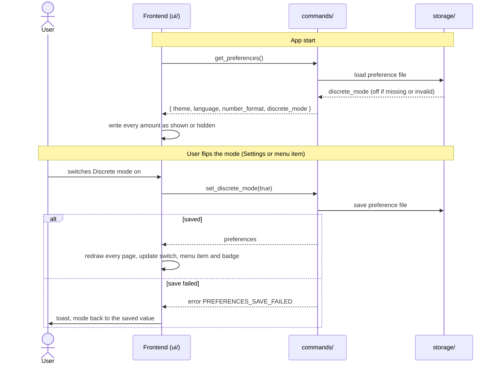

# CSD-030: Discrete mode (hide amounts)

## 1. Intent
Varde shows a person's complete financial position. That makes it awkward to show the app to someone else (a friend, a screen share, a demo) without also disclosing every balance, salary and debt. This capability adds a Discrete mode switch to the Settings page. While it is on, every amount in the app is hidden behind a blurred placeholder, and percentages, ratios, dates, counts, years and names stay readable, so the structure and the trends of the app can still be shown. Like the theme (CSD-008), the language (CSD-022) and the number format (CSD-029), it is a preference of the person using the app on this Mac, not of the project: it is kept outside the project file and applies to every project. It is off by default and is for a single user. It is GitHub issue 26.

## 2. Scope
### 2.1 In scope
- A Discrete mode switch on the Settings page: choosing, applying, saving and showing it.
- Hiding every amount the app shows or reads out, including chart text, messages, screen-reader text and amount input fields.
- A menu item with a shortcut and a badge in the navigation that show and flip the mode.
- Keeping the preference with the other preferences and restoring it at start.

### 2.2 Non-goals
- NG-1: Hiding percentages, ratios, dates, counts, years or names (accounts, houses, debts, categories).
- NG-2: Hiding the shape of a chart (lines, bars, slopes). Only its text is hidden.
- NG-3: Revealing a value while the mode is on (hover, click, hold). A value is revealed by switching the mode off (REQ-10).
- NG-4: A discrete setting per project. The project file holds no discrete mode (CSD-003 CON-2 stays as it is).
- NG-5: A lock or password for switching the mode off.
- NG-6: Hiding data in the project file, in the file dialogs or in the macOS window list. This mode changes what the app draws, not what is stored.
- NG-7: Changing any figure, its rounding (CSD-000 CON-8) or the number format (CSD-029).

## 3. Definitions
| Term | Meaning |
|---|---|
| **Discrete mode** | The preference `discrete_mode`, on or off. Off by default. |
| **Hidden amount** | An amount written as the fixed placeholder `•••••` with a blur over it. The placeholder has the same width for every amount, whatever the amount, its sign or its currency. |
| **Amount** | Any money value the app writes: balances, salaries, totals, changes, limits, chart axis labels and short labels such as "1.50k", with its sign and currency symbol. |

## 4. Requirements

### 4.0 Overview flow


**REQ-1: Discrete mode switch on the Settings page** *(ubiquitous)*
The Settings page shall show a "Discrete mode" toggle switch with a short explanation in the "Appearance" panel, below "Number format", that shows whether the mode is on.

```gherkin
@AC-1.1
Scenario: The switch and its explanation
  Given the app has started
  When the user opens Settings
  Then the "Appearance" panel shows a "Discrete mode" toggle switch below "Number format"
  And the switch has an explanation that all amounts are hidden and percentages stay visible

@AC-1.2
Scenario Outline: The switch shows the current mode
  Given the saved discrete mode is "<mode>"
  When the user opens Settings
  Then the "Discrete mode" switch is "<state>"

  Examples:
    | mode | state |
    | on   | on    |
    | off  | off   |

@AC-1.3
Scenario: The switch is usable with the keyboard and by screen reader
  Given the user is on Settings
  When the user focuses the "Discrete mode" switch and presses Space
  Then the mode flips
  And the switch is announced as a switch with its state
```

**REQ-2: Default mode** *(state-driven)*
While no discrete mode has been saved, the app shall show every amount.

```gherkin
@AC-2.1
Scenario: First start
  Given no preference file exists
  When the app starts
  Then every amount is shown as in "1,234.50"
  And the "Discrete mode" switch is off
  And no badge is shown
```

**REQ-3: Apply the choice at once** *(event-driven)*
When the user switches Discrete mode on or off, the app shall redraw every page, dialog and open form in the new mode immediately, without a confirmation, a restart or a reload of the project, and without marking the project as having unsaved changes.

```gherkin
@AC-3.1
Scenario: Switching on
  Given the app shows a gross salary as "3,000.00" and the user is on Settings
  When the user switches Discrete mode on
  Then the gross salary on every page is hidden at once
  And no confirmation is asked

@AC-3.2
Scenario: Switching off
  Given Discrete mode is on
  When the user switches it off
  Then every amount is shown again, as "3,000.00"

@AC-3.3
Scenario: The choice is not an unsaved project change
  Given a saved project
  When the user switches Discrete mode on
  Then the unsaved indicator is not shown

@AC-3.4
Scenario: Choosing the current mode changes nothing
  Given the saved discrete mode is off
  When set_discrete_mode(false) is called
  Then the saved discrete mode is off
```

**REQ-4: The mode is remembered** *(ubiquitous)*
The app shall keep the discrete mode in the preference file of CSD-008, outside the project file, restore it when the app starts and before the first page is shown, and use it for every project.

```gherkin
@AC-4.1
Scenario: Restored at start
  Given the user switched Discrete mode on and quit the app
  When the app starts
  Then the first page that is shown already hides every amount

@AC-4.2
Scenario: Same mode for another project
  Given Discrete mode is on
  When the user opens a different project file
  Then amounts are still hidden

@AC-4.3
Scenario: Not in the project file
  Given Discrete mode is on and the user saves the project
  Then the project file contains no discrete mode
  And every amount in the project file is unchanged

@AC-4.4
Scenario: The preferences are kept together
  Given the theme is "dark", the language is "nl", the number format is "comma_point" and the user switches Discrete mode on
  When the app starts again
  Then the theme, language and number format are unchanged and Discrete mode is on
```

**REQ-5: Every amount is hidden** *(state-driven)*
While Discrete mode is on, the app shall write every amount it shows as a hidden amount, with its sign and currency symbol hidden too: in tiles, totals, tables and lists, forms, dialogs, the net worth, and chart axis labels, markers, legends and tooltips.

```gherkin
@AC-5.1
Scenario Outline: Amounts are hidden on every page
  Given Discrete mode is on
  When the user opens the "<page>" page with data
  Then no amount on the page shows a digit
  And every amount is written as "•••••" with a blur

  Examples:
    | page          |
    | Dashboard     |
    | Net worth     |
    | Bank accounts |
    | Investments   |
    | Debts         |
    | Houses        |
    | Income        |
    | Expenses      |

@AC-5.2
Scenario: Sign and currency are hidden
  Given Discrete mode is on
  Then 1234.50, -1234.50 and "€ 12.00" are all written as the same "•••••"

@AC-5.3
Scenario: Chart text
  Given Discrete mode is on
  Then the y-axis labels, the marker labels such as "1.50k" and the tooltip amounts of a chart are hidden
```

**REQ-6: What stays visible** *(state-driven)*
While Discrete mode is on, the app shall keep percentages, ratios, dates, months, counts, years and names visible, and in a text that holds both an amount and a percentage shall hide only the amount.

```gherkin
@AC-6.1
Scenario: Percentages, ratios and dates stay
  Given Discrete mode is on
  Then a growth of 12.50 percent is shown as "12.50%", a ratio of 0.75 as "0.75" and a date as "25/10/2026"

@AC-6.2
Scenario: A text with an amount and a percentage
  Given Discrete mode is on
  When a text reads "Balance 1,200.00 (+3.50%)"
  Then it is shown as "Balance ••••• (+3.50%)"

@AC-6.3
Scenario: Names and counts stay
  Given Discrete mode is on and an account is named "Example Bank" with 3 statements
  Then "Example Bank" and the count 3 are shown
```

**REQ-7: Chart shapes stay** *(state-driven)*
While Discrete mode is on, the app shall draw every chart with the same shape as with the mode off and shall hide only the text of the chart.

```gherkin
@AC-7.1
Scenario: Same drawing
  Given a net worth chart with the points 1000.00, 1500.00 and 2000.00
  When Discrete mode is switched on
  Then the line, bars and their positions are unchanged
  And only the axis and tooltip text is hidden
```

**REQ-8: Messages and screen-reader text** *(state-driven)*
While Discrete mode is on, the app shall hide every amount in a message (toast, error, confirmation) and in the text that screen readers and tooltips read out, and shall keep the percentages in them.

```gherkin
@AC-8.1
Scenario: A message with an amount
  Given Discrete mode is on
  When a message says "Debt limit 5,000.00 exceeded"
  Then the message reads "Debt limit ••••• exceeded"

@AC-8.2
Scenario: Screen-reader text
  Given Discrete mode is on and a chart point of 1,234.50 has a text for screen readers
  Then that text holds no digit of the amount
  And the amount is read as hidden

@AC-8.3
Scenario: The real text is not in the page
  Given Discrete mode is on
  Then no amount text of the page, including its attributes, holds a digit of any amount
```

**REQ-9: Amount input fields** *(state-driven)*
While Discrete mode is on, the app shall blur every amount input field, including while it has focus, while the field keeps its real value and stays editable.

```gherkin
@AC-9.1
Scenario: A blurred field with its value
  Given Discrete mode is on and a paycheck form is open with gross salary "3,000.00"
  Then the gross salary field is blurred
  And the field value is "3,000.00"

@AC-9.2
Scenario: Blur stays while typing
  Given Discrete mode is on
  When the user focuses the gross salary field and types "3,500.00"
  Then the field stays blurred and saving stores 3500.00

@AC-9.3
Scenario: Fields that are not amounts
  Given Discrete mode is on
  Then the name and date fields of a form are not blurred
```

**REQ-10: No way to peek** *(unwanted behaviour)*
If a user hovers, clicks, selects or focuses a hidden amount while Discrete mode is on, then the app shall not reveal it, and shall reveal amounts only after the mode is switched off.

```gherkin
@AC-10.1
Scenario: Hover and click do not reveal
  Given Discrete mode is on
  When the user hovers or clicks a hidden amount
  Then it stays hidden

@AC-10.2
Scenario: Copying does not leak
  Given Discrete mode is on
  When the user selects and copies a hidden amount
  Then the copied text is not the amount
```

**REQ-11: Menu item and shortcut** *(event-driven)*
When the user chooses the "Discrete Mode" menu item or presses ⌘⇧D, the app shall flip Discrete mode like the switch on the Settings page, and the menu item shall show a check mark while the mode is on and shall always agree with the switch.

```gherkin
@AC-11.1
Scenario: Shortcut flips the mode
  Given Discrete mode is off
  When the user presses ⌘⇧D
  Then Discrete mode is on
  And the menu item shows a check mark
  And the Settings switch is on

@AC-11.2
Scenario: Switch and menu agree
  Given Discrete mode is on
  When the user switches it off on the Settings page
  Then the menu item shows no check mark
```

**REQ-12: Badge** *(state-driven)*
While Discrete mode is on, the app shall show a "Discrete mode" badge in the navigation, on every page.

```gherkin
@AC-12.1
Scenario: Badge shown and removed
  Given Discrete mode is off and no badge is shown
  When the user switches Discrete mode on
  Then a "Discrete mode" badge is shown in the navigation
  When the user switches it off
  Then the badge is gone
```

**REQ-13: Missing or unsupported value** *(unwanted behaviour)*
If the preference file has no discrete mode or a value that is not a boolean, then the app shall show every amount and shall not change the saved value.

```gherkin
@AC-13.1
Scenario Outline: A value that cannot be used
  Given the preference file holds discrete_mode "<stored>"
  When the app starts
  Then every amount is shown
  And the other preferences are read as before

  Examples:
    | stored |
    | "yes"  |
    | 1      |
    | null   |

@AC-13.2
Scenario: An older preference file
  Given the preference file holds only { "theme": "dark", "language": "nl", "number_format": "comma_point" }
  When the app starts
  Then Discrete mode is off and the other preferences are kept
```

**REQ-14: Saving fails** *(unwanted behaviour)*
If the discrete mode cannot be saved, then the app shall keep the saved mode, show the switch, menu item and badge as before, and show a message that the setting could not be saved without a file path.

```gherkin
@AC-14.1
Scenario: Read-only config folder
  Given the saved discrete mode is off and the config folder cannot be written
  When the user switches Discrete mode on
  Then amounts are still shown
  And the switch is off and the menu item has no check mark
  And a message appears that the setting could not be saved
  And the message contains no file path
```

## 5. Interfaces and contracts
Commands: `get_preferences()` returns `{ theme, language, number_format, discrete_mode }`, and `set_discrete_mode(discrete_mode)` takes a boolean and returns the preferences. It saves first and returns only when the save succeeded, so a failed save changes nothing (REQ-14), as the other setters do.

Preference file: `preferences.json`, for example `{ "theme": "system", "language": "en", "number_format": "point_comma", "discrete_mode": false }`. Unknown fields are ignored, and a missing or non-boolean `discrete_mode` means off (REQ-13). Each field is read on its own, as today.

Menu: a checkable "Discrete Mode" item with shortcut ⌘⇧D that is forwarded to the frontend like the other menu items; the checked state is kept equal to the saved preference.

Error codes: `PREFERENCES_SAVE_FAILED` (CSD-008). Rust keeps sending its English message with every code.

## 6. Constraints
- CON-1: Discrete mode is stored only in the preference file of CSD-008, with the same rules (outside the project file, atomic, owner-only, never committed). Rationale: it belongs to the person and the Mac, and is needed before any project is open.
- CON-2: Rust is the only place the preference is kept. The frontend holds no copy (no `localStorage`). Rationale: one source of truth, CSD-008 CON-2.
- CON-3: Hiding is done only where the frontend writes amounts (the display layer). Rust, IPC, the project file and the golden files are unchanged, and the frontend still computes no figure. Rationale: `CLAUDE.md` layout rule; the mode changes what is shown, never a value.
- CON-4: A hidden amount holds no digit of the real amount anywhere in the page text, attributes or screen-reader text, except in the real value of an input field (REQ-9), where the blur is the only protection. Rationale: a blur alone is only visual and the text can be copied or read out.
- CON-5: The placeholder has one fixed width. Rationale: the number of digits shows the size of an amount, and a sign shows asset versus debt.
- CON-6: Blur and the badge are drawn in CSS in `ui/styles/`, without `style=` attributes (CSP, `CLAUDE.md`). The switch is a native checkbox with the switch role, styled in CSS, in the shared component styles. Rationale: strict CSP, no new dependency.
- CON-7: No new dependency, plugin, permission or network access. Rationale: least privilege per `CLAUDE.md`.
- CON-8: Tests use a temporary directory and never the real app config folder. Rationale: `CLAUDE.md` testing rules.

## 7. Verification
Tests are named `test_csd030_ac_<n>_<m>_<description>` (CSD-000 REQ-6).

| What | How |
|---|---|
| The preference (AC-3.4, AC-4.3, AC-4.4, AC-13.1, AC-13.2, AC-14.1) | `cargo test test_csd030_`. Storage tests (save, load, missing, wrong type, older file, read-only folder) run in a temporary directory |
| Display ACs (AC-1.1 to AC-1.3, AC-2.1, AC-3.1 to AC-3.3, AC-4.1, AC-4.2, AC-5.1 to AC-5.3, AC-6.1 to AC-6.3, AC-7.1, AC-8.1 to AC-8.3, AC-9.1 to AC-9.3, AC-10.1, AC-10.2, AC-12.1, AC-14.1) | `npm test`: `discrete-mode.test.js`, with a fake Tauri bridge fed with the golden files |
| Golden files unchanged | `cargo test golden` |
| Needs the real menu bar | Manual checklist: AC-11.1 and AC-11.2 (shortcut, check mark), and AC-4.1 across a real restart |

Done means fmt, clippy (`-D warnings`), `cargo test --all-features` and `npm test` pass.

## 8. Open questions
None. Decided at implementation (09/11/2026): OQ-1, the "Discrete Mode" item is the first item of the View menu that macOS adds to the standard menu bar, above a separator; OQ-2, screen readers read "hidden amount" (Dutch: "verborgen bedrag").

## 9. Changelog
- 0.2 (09/11/2026): OQ-1 and OQ-2 decided (View menu, "hidden amount"). Implementation note: each hidden amount is wrapped in a marked element (`hidden-amount`) by a small DOM observer, which gives it the blur and the screen-reader text; the blur on SVG chart text depends on the web view and the placeholder alone already hides it.
- 0.1 (09/11/2026): initial draft, from GitHub issue 26 and the interview. CSD-008 NG-5 is amended to refer to it.
