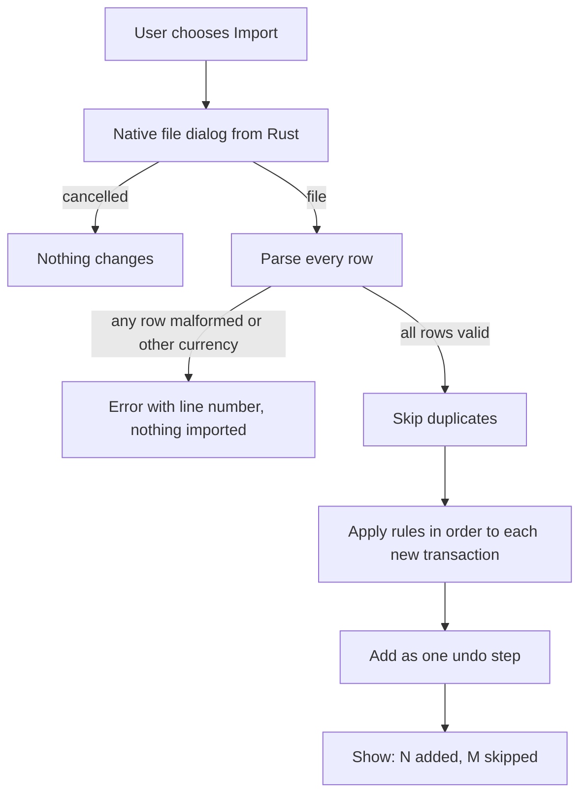
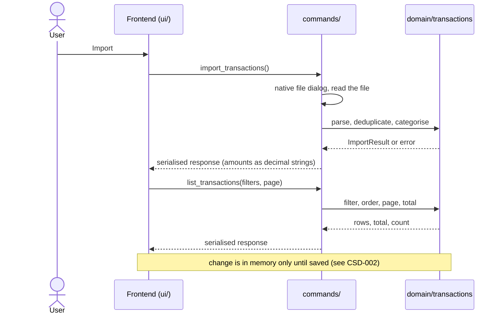
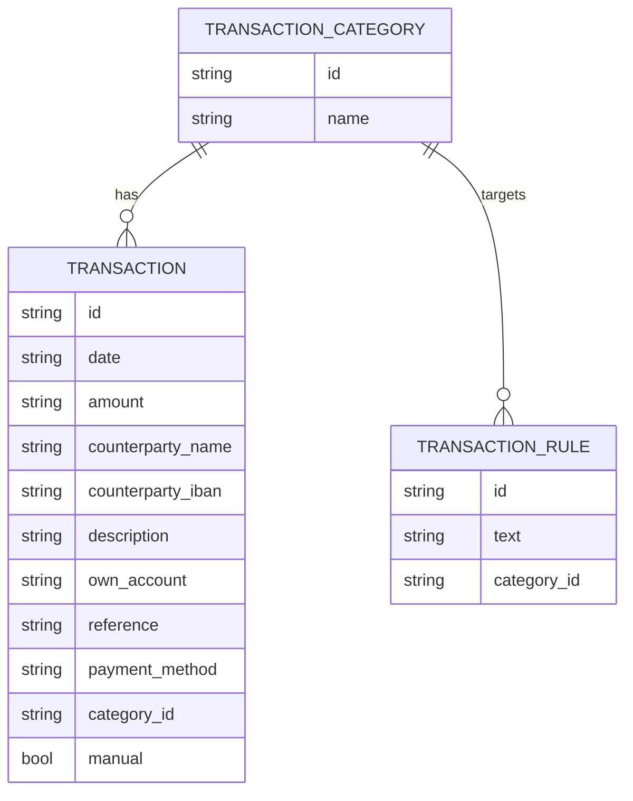

# CSD-032: Transactions

## 1. Intent
The app tracks what the user owns, owes and has spent on notable purchases, but not what the bank account itself shows: the daily stream of payments, incomes and direct debits. Typing those in is not realistic. This capability lets the user import the transactions of a bank export into the project, have each one categorised automatically by simple rules, and browse, filter and correct them on a new Transactions page. It is for a single person keeping a private, local history. It comes from GitHub issue 70, and it deliberately reverses the earlier decision that the app has no transaction model (`CLAUDE.md`, CSD-009 NG-1, CSD-013 NG-9, CSD-024 NG-2). Transactions stand on their own: they feed no balance, no net worth figure and no expense.

## 2. Scope
### 2.1 In scope
- Importing the transactions of a Knab CSV export into the open project, with duplicate skipping and all-or-nothing error handling.
- A list of user-defined categories (seeded with defaults) and an ordered list of text rules that assign a category on import.
- Changing the category of a transaction by hand, re-applying the rules, and deleting a transaction.
- A Transactions page with one Overview tab: the paged list, the table filters of CSD-028, a filtered total, and the management of categories and rules.
- Storage of transactions, categories and rules as sections of the project file (CSD-002), and the consequences for undo (CSD-027), the currency confirmation (CSD-003), Discrete mode (CSD-030) and the example project.

### 2.2 Non-goals
- NG-1: Banks and formats other than the Knab CSV, and PDF statements. A parser per format is a follow-up.
- NG-2: An Insights tab (totals per category or month, charts). A follow-up.
- NG-3: A link to the bank accounts of CSD-009, to expenses (CSD-013), to net worth or to the dashboard. Importing never changes a balance or creates an expense. Detecting or netting transfers between own accounts.
- NG-4: Adding a transaction by hand, and editing its date, amount, counterparty, description or any field other than the category.
- NG-5: Regular expressions, amount or date conditions, and any learning in the rules. A rule is a "contains" text match.
- NG-6: Several categories per transaction, tags, sub-categories, splitting a transaction, and budgets.
- NG-7: A currency per transaction, and conversion. All amounts are in the project currency (CSD-003).
- NG-8: Importing from a folder, importing several files at once, a preview step before the import, and a partial import.
- NG-9: Hiding counterparty names, descriptions and IBANs in Discrete mode (CSD-030 NG-1 stays).
- NG-10: Export of transactions, bulk delete, and sorting by anything but date (newest first).
- NG-11: Remembering the filters or the loaded pages between sessions (CSD-028 REQ-13).

## 3. Definitions
| Term | Meaning |
|---|---|
| **Transaction** | One booked bank line: a date, a signed amount, a counterparty, a description, the own account, a bank reference and a payment method, plus one category. |
| **Amount** | Signed, in the project currency: a debit ("Afschrijvingen") is negative, a credit ("Bijschrijvingen") is positive. |
| **Date** | The `Transactiedatum` of the export, shown as `dd/mm/yyyy` and stored as ISO 8601. |
| **Counterparty** | The name (`Tegenrekeninghouder`) and IBAN (`Tegenrekeningnummer`) of the other side. Either can be empty. |
| **Own account** | The IBAN (`Rekeningnummer`) of the account the export belongs to, kept as text. It is not a link to a bank account of CSD-009. |
| **Bank reference** | The `Referentie` column, the bank's own id of the booking. |
| **Duplicate** | A row of an import that matches a stored transaction under REQ-5. |
| **Category** | A user-defined name (REQ-8). "Uncategorized" is built in. |
| **Rule** | An ordered pair of a text and a category (REQ-9). |
| **Manual** | A transaction whose category the user set by hand (REQ-11). Rules never overwrite it. |
| **Import** | One run of REQ-1 on one file. |

## 4. Requirements

### 4.0 Overview flow




### 4.1 Importing

**REQ-1: Import a Knab CSV** *(event-driven)*
When the user chooses Import on the Transactions page and picks a file, the app shall add every transaction of the file that is not a duplicate to the project, categorise each by REQ-10, and show how many were added and how many were skipped as duplicates.

```gherkin
@AC-1.1
Scenario: A file of three new transactions
  Given a project without transactions
  And a Knab CSV with 3 valid rows
  When the user imports the file
  Then the project holds 3 transactions
  And the app shows "3 added, 0 skipped as duplicates"
  And the unsaved indicator is shown

@AC-1.2
Scenario: Cancelling the file dialog
  Given a project with 2 transactions
  When the user chooses Import and cancels the file dialog
  Then the project still holds 2 transactions
  And the unsaved indicator is unchanged

@AC-1.3
Scenario: The import has no effect outside transactions
  Given a project with a bank account balance of 1,000.00 and an expense "Example Bike"
  When the user imports a file with 3 valid rows
  Then the balance is 1,000.00 and the expense "Example Bike" is unchanged

@AC-1.4
Scenario: An empty file
  Given a Knab CSV with only the header row
  When the user imports the file
  Then the app shows "0 added, 0 skipped as duplicates"
```

**REQ-2: The Knab CSV format** *(ubiquitous)*
The app shall read a file as semicolon-separated text (UTF-8, with CRLF or LF line endings) whose first row is the Knab header, and shall take from each row the date (`dd-mm-yyyy`), the direction (`Afschrijvingen` or `Bijschrijvingen`), the amount (digits and one decimal comma, for example `23,97`), the currency, the own account, the counterparty name and IBAN, the description, the bank reference and the payment method.

```gherkin
@AC-2.1
Scenario: A debit and a credit
  Given a row dated 30-10-2026 with direction "Afschrijvingen" and amount "23,97"
  And a row dated 28-10-2026 with direction "Bijschrijvingen" and amount "1250,00"
  When the user imports the file
  Then the first transaction has date 30/10/2026 and amount -23.97
  And the second transaction has date 28/10/2026 and amount 1,250.00

@AC-2.2
Scenario: A row without counterparty
  Given a row whose counterparty IBAN is one space and whose counterparty name is empty
  When the user imports the file
  Then the transaction has an empty counterparty name and an empty counterparty IBAN

@AC-2.3
Scenario: Windows line endings
  Given a file with CRLF line endings
  When the user imports the file
  Then no stored field ends with a carriage return

@AC-2.4
Scenario: A semicolon inside a quoted field
  Given a row whose description is "Example; Shop" in double quotes
  When the user imports the file
  Then the description is "Example; Shop"
```

**REQ-3: All-or-nothing on malformed input** *(unwanted behaviour)*
If the header is not the Knab header, or a row has a wrong number of columns, a date that is not a real `dd-mm-yyyy` date, a field longer than 1,000 characters, a direction other than `Afschrijvingen` or `Bijschrijvingen`, an empty or unparsable amount, or an amount that is 0,00 or has more than two decimals, or an empty bank reference, then the app shall import nothing and shall show the error code and the line number of the first offending line.

```gherkin
@AC-3.1
Scenario Outline: One bad row imports nothing
  Given a file of 5 rows where line 4 has <fault>
  When the user imports the file
  Then it is rejected with error code "<code>" naming line 4
  And the project holds no new transaction

  Examples:
    | fault                      | code                          |
    | the date 31-04-2026        | TRANSACTION_IMPORT_DATE       |
    | the direction "Anders"     | TRANSACTION_IMPORT_DIRECTION  |
    | the amount "abc"           | TRANSACTION_IMPORT_AMOUNT     |
    | the amount "0,00"          | TRANSACTION_IMPORT_AMOUNT     |
    | the amount "1,234"         | TRANSACTION_IMPORT_AMOUNT     |
    | 14 columns instead of 15   | TRANSACTION_IMPORT_COLUMNS    |
    | a field of 1001 characters | TRANSACTION_IMPORT_FIELD      |
    | an empty bank reference    | TRANSACTION_IMPORT_REFERENCE  |

@AC-3.2
Scenario: A file with another header
  Given a file whose first row is "Datum;Bedrag"
  When the user imports the file
  Then it is rejected with error code "TRANSACTION_IMPORT_FORMAT"
  And the project holds no new transaction

@AC-3.3
Scenario: The error is shown without the file path
  Given a rejected file
  Then the message shows the line number and never the path of the file
```

**REQ-4: The currency must match** *(unwanted behaviour)*
If any row has a currency code other than the project currency (CSD-003), then the app shall import nothing and shall show the error code `TRANSACTION_IMPORT_CURRENCY` with the line number of the first such row.

```gherkin
@AC-4.1
Scenario: A row in another currency
  Given the project currency is EUR
  And a file whose line 3 has currency "USD"
  When the user imports the file
  Then it is rejected with error code "TRANSACTION_IMPORT_CURRENCY" naming line 3
  And the project holds no new transaction

@AC-4.2
Scenario: The project currency is compared, not a fixed EUR
  Given the project currency is USD
  And a file with rows in "EUR"
  When the user imports the file
  Then it is rejected with error code "TRANSACTION_IMPORT_CURRENCY"
```

**REQ-5: Skip duplicates** *(event-driven)*
When a row of an import has the same own account and bank reference as a stored transaction (or earlier row of the same file), the app shall skip it and count it as a duplicate.

```gherkin
@AC-5.1
Scenario: Re-importing an overlapping export
  Given a project with the 3 transactions of the file "October.csv"
  And "October-full.csv" holds those 3 rows and 2 new rows
  When the user imports "October-full.csv"
  Then the project holds 5 transactions
  And the app shows "2 added, 3 skipped as duplicates"

@AC-5.2
Scenario: The same reference on another account
  Given a stored transaction with own account "NL00EXAM0000000001" and reference "REF0001"
  When the user imports a row with own account "NL00EXAM0000000002" and reference "REF0001"
  Then the row is added

@AC-5.3
Scenario: A repeated row inside one file
  Given a file with two identical rows
  When the user imports the file
  Then 1 transaction is added and 1 is skipped as a duplicate

@AC-5.4
Scenario: A deleted transaction can be imported again
  Given the user deleted a transaction that came from "October.csv"
  When the user imports "October.csv" again
  Then that transaction is added again
```

**REQ-6: One import is one undo step** *(ubiquitous)*
The app shall record an import that added at least one transaction as one undo step labelled "Import Transactions", and shall record nothing for an import that added none or was rejected (CSD-027 REQ-1, REQ-7).

```gherkin
@AC-6.1
Scenario: Undo removes the whole import
  Given a project with 2 transactions
  When the user imports a file that adds 3 transactions
  And chooses Edit > Undo
  Then the project holds 2 transactions
  And the menu item Redo reads "Redo Import Transactions"

@AC-6.2
Scenario: A rejected import records no step
  Given a file with a malformed row
  When the user imports the file
  Then the menu item Undo is unchanged
```

**REQ-7: What is stored** *(ubiquitous)*
The app shall store for each transaction only: an id, the date, the signed amount, the counterparty name, the counterparty IBAN, the description, the own account, the bank reference, the payment method, the category and whether the category was set by hand. It shall not store the other columns of the export.

```gherkin
@AC-7.1
Scenario: Dropped columns are not stored
  Given a row with a mandate number "MANDATE-1" and a creditor id "CRED-1"
  When the user imports the file and saves the project
  Then the project file contains neither "MANDATE-1" nor "CRED-1"

@AC-7.2
Scenario: Counterparty and description are stored as imported, trimmed
  Given a row with the counterparty name " Example Shop " and the description "Pas 0000 Example Town"
  When the user imports the file
  Then the counterparty name is "Example Shop" and the description is "Pas 0000 Example Town"
```

### 4.2 Categories and rules

**REQ-8: Categories** *(event-driven)*
When the user adds, renames or deletes a category, the app shall apply the change, and shall reject a name that is empty after trimming, longer than 50 characters or equal (ignoring case) to another category or to "Uncategorized". The category "Uncategorized" is built in and cannot be renamed or deleted. A new project holds the categories Salary, Groceries, Housing, Utilities, Insurance, Transport, Eating out, Shopping, Health, Leisure, Subscriptions, Savings & transfers, Taxes and Other, as stored text the user may change.

```gherkin
@AC-8.1
Scenario: A new project has the default categories
  When the user starts a new project
  Then the categories are Salary, Groceries, Housing, Utilities, Insurance, Transport, Eating out, Shopping, Health, Leisure, Subscriptions, Savings & transfers, Taxes and Other
  And "Uncategorized" is also offered, first, and cannot be edited or deleted

@AC-8.2
Scenario: Add and rename
  When the user adds the category "Example Pets"
  And renames it to "Pets"
  Then the category "Pets" exists
  And the transactions and rules that used it show "Pets"

@AC-8.3
Scenario Outline: Invalid names rejected
  When the user adds a category named "<name>"
  Then it is rejected with error code "<code>"

  Examples:
    | name                 | code                        |
    | (empty)              | TRANSACTION_CATEGORY_NAME_REQUIRED |
    | (51 characters)      | TRANSACTION_CATEGORY_NAME_TOO_LONG |
    | groceries            | TRANSACTION_CATEGORY_NAME_TAKEN    |
    | uncategorized        | TRANSACTION_CATEGORY_NAME_TAKEN    |

@AC-8.4
Scenario: Uncategorized is protected
  When the user tries to rename or delete "Uncategorized"
  Then it is rejected with error code "TRANSACTION_CATEGORY_PROTECTED"
```

**REQ-9: Rules** *(event-driven)*
When the user adds, edits, reorders or deletes a rule, the app shall apply the change. A rule has a text of 1 to 100 characters after trimming and one category (not "Uncategorized"), and the rules are kept in an order the user can change. A new project holds about 15 seed rules for well-known Dutch chains, which the user may change.

```gherkin
@AC-9.1
Scenario: Add a rule
  When the user adds the rule "Example Market" with category "Groceries"
  Then the rule list ends with "Example Market" → Groceries

@AC-9.2
Scenario: Reorder
  Given rules A, B and C in that order
  When the user moves C to the top
  Then the order is C, A, B

@AC-9.3
Scenario Outline: Invalid rules rejected
  When the user adds a rule with text "<text>" and category "<category>"
  Then it is rejected with error code "<code>"

  Examples:
    | text            | category      | code                          |
    | (empty)         | Groceries     | TRANSACTION_RULE_TEXT_REQUIRED |
    | (101 characters)| Groceries     | TRANSACTION_RULE_TEXT_TOO_LONG |
    | Example         | Uncategorized | TRANSACTION_RULE_CATEGORY_INVALID |
    | Example         | Nonexistent   | TRANSACTION_RULE_CATEGORY_INVALID |

@AC-9.4
Scenario: A new project has seed rules
  When the user starts a new project
  Then the rule list holds seed rules that each name an existing category
```

**REQ-10: Categorise on import** *(event-driven)*
When a transaction is added by an import, the app shall give it the category of the first rule, in order, whose text is contained, ignoring case, in the counterparty name followed by a space and the description, and "Uncategorized" if no rule matches.

```gherkin
@AC-10.1
Scenario: First matching rule wins
  Given the rules "Example Market" → Groceries and "Example" → Shopping, in that order
  When the user imports a row with counterparty "EXAMPLE MARKET Town"
  Then the transaction has category "Groceries"

@AC-10.2
Scenario: The description is matched too
  Given the rule "Rent October" → Housing
  When the user imports a row with an empty counterparty and the description "Rent October 2026"
  Then the transaction has category "Housing"

@AC-10.3
Scenario: No rule matches
  Given no rule matches a row
  When the user imports the file
  Then the transaction has category "Uncategorized"

@AC-10.4
Scenario: Matching ignores case but not the text itself
  Given the rule "example market" → Groceries
  When the user imports a row with counterparty "Example Mkt"
  Then the transaction has category "Uncategorized"
```

**REQ-11: Change a category by hand** *(event-driven)*
When the user sets the category of a transaction, the app shall store it and mark the transaction manual, and shall never change a manual transaction's category by a rule, a re-apply or an import.

```gherkin
@AC-11.1
Scenario: A manual choice sticks
  Given a transaction "Example Shop" in "Uncategorized"
  When the user sets its category to "Shopping"
  And adds the rule "Example Shop" → Leisure and re-applies to all non-manual transactions
  Then the transaction has category "Shopping"

@AC-11.2
Scenario: Back to Uncategorized by hand
  Given a manual transaction in "Shopping"
  When the user sets its category to "Uncategorized"
  Then it has category "Uncategorized" and is still manual

@AC-11.3
Scenario: A stale screen
  Given the user opened a transaction and it was deleted in the meantime
  When the user sets its category
  Then it is rejected with error code "TRANSACTION_NOT_FOUND"
```

**REQ-12: Re-apply the rules** *(event-driven)*
When the user chooses to re-apply the rules to the uncategorized transactions, or to all non-manual transactions, the app shall run REQ-10 on those transactions as one change and show how many changed category.

```gherkin
@AC-12.1
Scenario: Uncategorized only
  Given 2 uncategorized transactions and 1 non-manual transaction in "Shopping", none manual
  And a new rule that matches all three with category "Leisure"
  When the user re-applies to uncategorized transactions
  Then the 2 uncategorized transactions are in "Leisure"
  And the third is still in "Shopping"
  And the app shows "2 changed"

@AC-12.2
Scenario: All non-manual
  Given the same state
  When the user re-applies to all non-manual transactions
  Then all three are in "Leisure"
  And the app shows "3 changed"

@AC-12.3
Scenario: Nothing matches
  When the user re-applies and no transaction would change
  Then the app shows "0 changed" and records no undo step
```

**REQ-13: Deleting a category** *(event-driven)*
When the user confirms deleting a category, the app shall move its transactions to "Uncategorized" (keeping their manual flag) and delete the rules that name it, in one change.

```gherkin
@AC-13.1
Scenario: Deleting a used category
  Given the category "Leisure" with 4 transactions and 2 rules
  When the user deletes "Leisure" and confirms
  Then the 4 transactions have category "Uncategorized"
  And the 2 rules are gone

@AC-13.2
Scenario: Cancelling changes nothing
  When the user starts deleting "Leisure" and cancels
  Then the category, its transactions and its rules are unchanged
```

**REQ-14: Delete a transaction** *(event-driven)*
When the user confirms deletion of a transaction, the app shall remove that transaction and no other data.

```gherkin
@AC-14.1
Scenario: Confirmed deletion
  Given transactions "Example Shop" and "Example Cafe"
  When the user deletes "Example Shop" and confirms
  Then only "Example Cafe" remains

@AC-14.2
Scenario: Cancelled deletion
  When the user starts deleting a transaction and cancels
  Then it still exists
```

### 4.3 The Transactions page

**REQ-15: The list** *(ubiquitous)*
The Transactions page shall show an Overview tab with the transactions newest first (equal dates in the order they were added, newest added first), 200 rows at a time with a "Load more" control, the filters of CSD-028 with Rust computing the filtered rows and the total of the amounts over all matching transactions, and the empty state "No transactions yet" with the Import button when there are none.

```gherkin
@AC-15.1
Scenario: Newest first and paged
  Given 450 transactions
  Then the list shows 200 rows, newest first
  When the user chooses "Load more"
  Then 400 rows are shown
  When the user chooses "Load more" again
  Then 450 rows are shown and "Load more" is gone

@AC-15.2
Scenario: The total covers all matches, not the loaded rows
  Given 450 transactions in "Groceries" and the filter category "Groceries"
  Then the filtered total sums all 450 transactions

@AC-15.3
Scenario: Empty state
  Given no transactions
  Then the page shows "No transactions yet" and the Import button

@AC-15.4
Scenario: Editing keeps the filter
  Given the filter category "Groceries" is active
  When the user changes a transaction's category to "Shopping"
  Then the filter is still active and the row is no longer listed
```

**REQ-16: The page in the navigation** *(ubiquitous)*
The left pane shall list Transactions as the last item of the group Finance (CSD-024 REQ-1), and the page shall have two tabs, left to right "Categories and rules" and "Overview". The Overview tab, which is the one shown first, holds the list and the Import button. The Categories and rules tab holds the management of categories, the management of rules and the two re-apply actions of REQ-12. The message of an import or a re-apply is shown above the tabs, so it is visible on both.

```gherkin
@AC-16.1
Scenario: Transactions is in the left pane
  When the user opens the app
  Then the left pane lists "Transactions" after "Income" and "Expenses" in the group "Finance"
  And choosing it shows the Overview tab
  And the tabs are, left to right, "Categories and rules" and "Overview"

@AC-16.3
Scenario: Categories and rules are on their own tab
  Given the Transactions page is open on the Overview tab
  Then the list and the Import button are shown, and the categories and the rules are not
  When the user chooses the tab "Categories and rules"
  Then the categories, the rules and the two re-apply buttons are shown, and the list is not

@AC-16.4
Scenario: A re-apply message is visible on both tabs
  Given the user chose "Apply to uncategorized" on the tab "Categories and rules"
  Then the message "2 changed" is shown
  When the user chooses the tab "Overview"
  Then the message is still shown

@AC-16.2
Scenario: The import result stays visible
  When an import adds 3 transactions and skips 2
  Then the message "3 added, 2 skipped as duplicates" is shown until the user dismisses it or navigates away
```

### 4.4 Project file and neighbouring capabilities

**REQ-17: The project file** *(ubiquitous)*
The project file shall hold the required sections `transactions`, `transaction_categories` and `transaction_rules` in addition to the sections of CSD-002 REQ-16, with `format_version` 3, and the strict schema of CSD-002 REQ-17 shall apply to them. The script of CSD-002 REQ-20 shall upgrade a version 2 file by adding the three sections (the default categories and rules, and no transactions) and setting the version to 3, after writing its `.bak`.

```gherkin
@AC-17.1
Scenario: A saved new project has the sections
  When the user saves a new project
  Then the file has "format_version" 3
  And the file has the sections "transactions", "transaction_categories" and "transaction_rules"

@AC-17.2
Scenario: A version 2 file is invalid until upgraded
  Given a version 2 project file
  When the user opens it
  Then it is rejected with error code "PROJECT_INVALID_FILE"

@AC-17.3
Scenario: The script upgrades a version 2 file
  Given a version 2 project file "old.varde"
  When the script runs on it
  Then "old.varde.bak" is the original
  And "old.varde" has "format_version" 3 and no transactions
  And the app opens it

@AC-17.4
Scenario: A transaction with an unknown category in the file
  Given a project file with a transaction whose category id is not in "transaction_categories"
  When the user opens it
  Then it is rejected with error code "PROJECT_INVALID_FILE"

@AC-17.5
Scenario: An amount with three decimals in the file
  Given a project file with a transaction amount "-23.975"
  When the user opens it
  Then it is rejected with error code "PROJECT_INVALID_FILE"
```

**REQ-18: Currency confirmation** *(event-driven)*
When the user changes the project currency in a project that holds at least one transaction, the app shall show the confirmation of CSD-003 REQ-5, and shall count transactions as entries.

```gherkin
@AC-18.1
Scenario: Transactions count as entries
  Given a project whose only entry is one transaction
  When the user changes the currency
  Then the confirmation is shown
```

**REQ-19: Undo memory** *(ubiquitous)*
The app shall keep the undo history of CSD-027 within a memory budget of about 200 MB, and shall drop the oldest steps first when a step would exceed it, even before the 100-step limit of CSD-027 REQ-6 is reached.

```gherkin
@AC-19.1
Scenario: Undo of an import still works with a large project
  Given a project with 20,000 transactions
  When the user changes the category of one transaction and chooses Edit > Undo
  Then the category is as before

@AC-19.2
Scenario: The budget drops the oldest steps
  Given a project large enough that 100 steps would exceed the budget
  When the user makes 100 changes
  Then fewer than 100 steps can be undone
  And the most recent step can always be undone
```

**REQ-20: Discrete mode** *(state-driven)*
While Discrete mode is on (CSD-030), the Transactions page shall hide every amount (rows and filtered total), and shall show counterparty names, descriptions, IBANs and category names as they are.

```gherkin
@AC-20.1
Scenario: Amounts are hidden, names are not
  Given Discrete mode is on and a transaction "Example Shop" of -23.97
  Then the amount shows "•••••"
  And "Example Shop" is shown
```

**REQ-21: Language** *(ubiquitous)*
The app shall translate the labels of the Transactions page, the error messages and the built-in "Uncategorized" through the language setting (CSD-022), and shall show category names and rule texts as stored, untranslated.

```gherkin
@AC-21.1
Scenario: Dutch labels, stored names unchanged
  Given the language is Dutch
  Then the page shows the Dutch label for Import and for "Uncategorized"
  And the category "Groceries" is shown as "Groceries"
```

**REQ-22: Example project and fixtures** *(ubiquitous)*
The example project (CSD-002 REQ-21) shall hold synthetic transactions, and every test fixture shall be an obviously fake export (for example the bank "Example Bank", the own account "NL00EXAM0000000001", round amounts); the repository shall never hold a real bank export.

```gherkin
@AC-22.1
Scenario: The example project has transactions
  When the example project is generated
  Then it holds transactions whose counterparties are all fake

@AC-22.2
Scenario: Bank exports are git-ignored
  Then "git check-ignore" reports a file "Knab Export.csv" and a file "Rekeningafschrift 202610.pdf" as ignored
  And the fixtures under "src-tauri/fixtures/" are not ignored
```

## 5. Interfaces and contracts



Project file: three sections (REQ-17). `transactions` is an array, `transaction_categories` an array of `{ id, name }` (the built-in "Uncategorized" is not stored), `transaction_rules` an ordered array. Dates are ISO 8601, amounts decimal strings with at most two decimals (CSD-000 CON-8, CSD-002 REQ-19), ids are UUIDs.

Commands (names and payloads are indicative; the final signatures belong to the implementation):
`import_transactions()` → `{ added, skipped }`; `list_transactions(filters, page)` → `{ rows, total, count }`; `set_transaction_category(id, category_id)`; `delete_transaction(id)`; `list_transaction_categories()`; `add_`/`rename_`/`delete_transaction_category`; `list_transaction_rules()`; `add_`/`edit_`/`move_`/`delete_transaction_rule`; `reapply_transaction_rules(scope)` → `{ changed }`.

Error codes: `TRANSACTION_IMPORT_UNREADABLE` (the file cannot be read as UTF-8 text, or is larger than 50 MB), `TRANSACTION_IMPORT_FORMAT`, `_COLUMNS`, `_FIELD`, `_DATE`, `_DIRECTION`, `_AMOUNT`, `_REFERENCE`, `_CURRENCY`, `TRANSACTION_CATEGORY_NAME_REQUIRED`, `_NAME_TOO_LONG`, `_NAME_TAKEN`, `TRANSACTION_CATEGORY_PROTECTED`, `TRANSACTION_CATEGORY_NOT_FOUND`, `TRANSACTION_RULE_TEXT_REQUIRED`, `_TEXT_TOO_LONG`, `_CATEGORY_INVALID`, `TRANSACTION_RULE_NOT_FOUND`, `TRANSACTION_NOT_FOUND`, `TRANSACTION_DATA_INVALID`. The built-in Uncategorized has no id: a transaction without a category holds `null`, and a filter, a rename and a delete name it `uncategorized`. The default categories and rules have fixed ids, so two new projects are equal.

## 6. Constraints
- CON-1: All parsing, deduplication, categorisation, filtering and totals are in Rust (`domain/transactions`); the frontend only displays and sends the user's choices. Rationale: `CLAUDE.md` layout rule.
- CON-2: The file is read in Rust after a native dialog opened from Rust, so no filesystem permission is added to the webview. Rationale: least privilege (`CLAUDE.md`).
- CON-3: No transaction data (names, amounts, descriptions, IBANs, file paths) is logged at `info` or above, and an error shown to the user names a line number but never a path. Rationale: `CLAUDE.md` privacy rules.
- CON-4: The transaction list is held behind shared references so the undo history shares it between steps and a step pays only for what it changes. Rationale: CSD-027 CON-1 sized the history for a 40 KB project; 100 full copies of 20,000 transactions would take hundreds of MB.
- CON-5: Target size is 20,000 transactions with the project file saved as one file, as today. Rationale: a few years of one account.
- CON-6: Amounts are `Money` (CSD-000 CON-8) and a file amount with more than two decimals is rejected, not rounded. Rationale: an export is data, not typed text (CSD-002 REQ-19).
- CON-7: Matching in REQ-10 is a plain case-insensitive substring test (no regular expression, no locale tricks). Rationale: predictable rules, no ReDoS.
- CON-8: Real bank exports never enter the repository: `.gitignore` covers them, and fixtures live in `src-tauri/fixtures/`. Rationale: the repo is public.

## 7. Verification
| ACs | Proven by |
|---|---|
| AC-1 to AC-7, AC-10 to AC-14, AC-17, AC-19 | `cargo test test_csd032_` (Rust, `domain/` and `storage/` tests on synthetic fixtures in a temporary directory) |
| AC-8, AC-9 | `cargo test test_csd032_ac_8_`, `test_csd032_ac_9_` |
| AC-15, AC-16, AC-18, AC-20, AC-21 | `npm test` (DOM tests in `ui/tests/`, fake Tauri bridge fed with golden files); AC-18.1 also in Rust |
| AC-17.3 | `node --test scripts/tests/` |
| AC-22.1 | `EXAMPLE_UPDATE=1 cargo test example` and review of the diff |
| AC-22.2 | `git check-ignore` run by hand |
| Golden files | `GOLDEN_UPDATE=1 cargo test golden` for the new read commands, diff reviewed |

## 8. Open questions
- OQ-1: Does Knab write amounts of 1,000 or more with a thousands separator ("1.000,00")? The sample file has none. REQ-2 accepts only digits and one comma until this is known. Owner: Thijs. Blocks: REQ-2, REQ-3.
- OQ-2: Can a Knab export legitimately contain a 0,00 line? REQ-3 rejects it. Owner: Thijs. Blocks: REQ-3.
- OQ-3: Which exact chain names go into the seed rules (REQ-9)? Owner: Thijs. Blocks: REQ-9, AC-9.4.
- OQ-4: Is "Uncategorized" a valid filter value in the category filter of CSD-028? Proposed: yes. Owner: Thijs. Blocks: REQ-15.

## 9. Changelog
- 0.3 (12/11/2026): The categories, the rules and the re-apply actions move to their own tab "Categories and rules", left of the Overview (REQ-16, new AC-16.3 and AC-16.4); the result message sits above the tabs. Owner request. Back to `draft` until re-approved.
- 0.2 (12/11/2026): Clarifications found while implementing, no change of behaviour: a field over 1,000 characters (REQ-3, `TRANSACTION_IMPORT_FIELD`), an unreadable file (`TRANSACTION_IMPORT_UNREADABLE`), the undo label is "Import Transactions" in title case like the other labels (AC-6.1), the file amount example is "-23.975" because "-23.970" is the same value as "-23.97" and the file reader accepts trailing zeros (CSD-002 REQ-19), the ids of the default categories and rules are fixed, and `TRANSACTION_CATEGORY_NOT_FOUND`, `_RULE_NOT_FOUND` and `_DATA_INVALID` are listed.
- 0.1 (12/11/2026): initial draft from the grill-me interview of 12/11/2026 (GitHub issue 70). Companion amendments: `CLAUDE.md`, CSD-002 (format 3, sections), CSD-003 (entries), CSD-009 NG-1, CSD-013 NG-9, CSD-024 NG-2, CSD-027 (CON-1, REQ-6).
