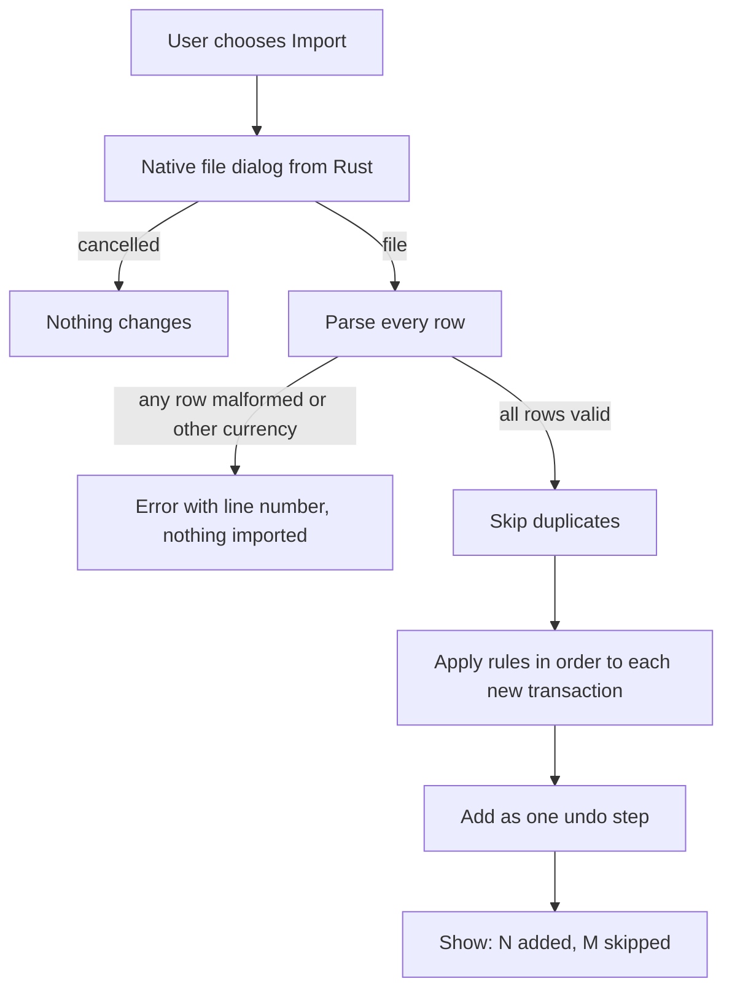
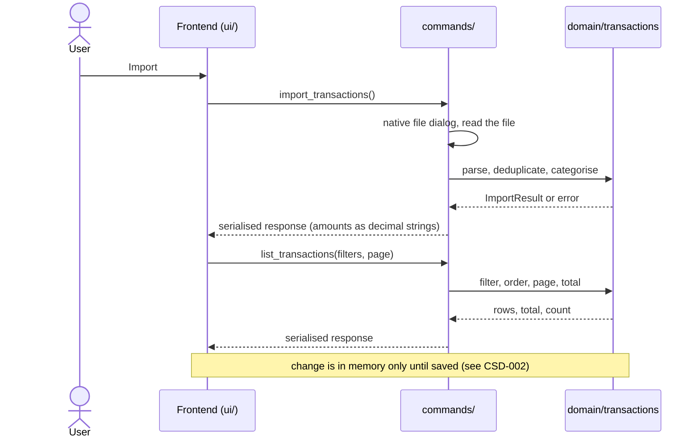
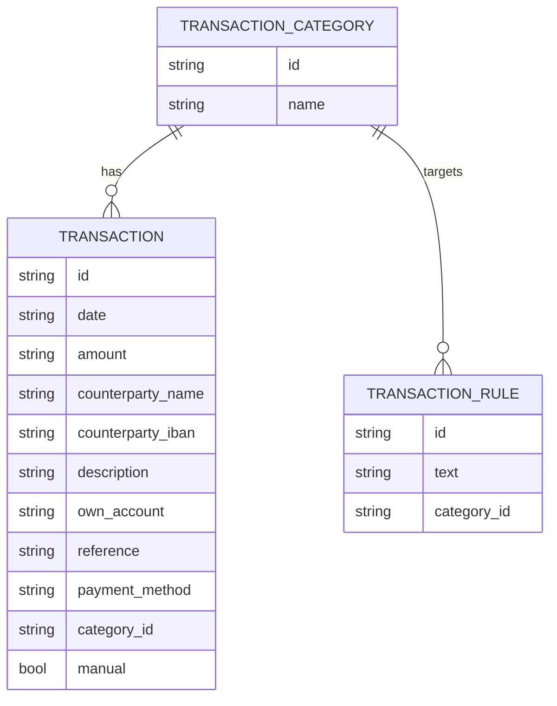

# CSD-032: Transactions

## 1. Intent
The app tracks what the user owns, owes and has spent on notable purchases, but not what the bank account itself shows: the daily stream of payments, incomes and direct debits. Typing those in is not realistic. This capability lets the user import the transactions of a bank export into the project, have each one categorised automatically by simple rules, and browse, filter and correct them on a new Transactions page. It is for a single person keeping a private, local history. It comes from GitHub issue 70, and it deliberately reverses the earlier decision that the app has no transaction model (`CLAUDE.md`, CSD-009 NG-1, CSD-013 NG-9, CSD-024 NG-2). Transactions stand on their own: they feed no balance, no net worth figure and no expense.

## 2. Scope
### 2.1 In scope
- Importing the transactions of a Knab CSV export into the open project, with duplicate skipping and all-or-nothing error handling.
- A list of user-defined categories (seeded with defaults) and an ordered list of text rules that assign a category on import.
- Changing the category of a transaction by hand, re-applying the rules, and deleting a transaction.
- A Transactions page with an Overview tab (yearly totals, the paged list, the table filters of CSD-028 and a filtered total) a tab for the management of categories and rules, and the Insights tab of CSD-033.
- Storage of transactions, categories and rules as sections of the project file (CSD-002), and the consequences for undo (CSD-027), the currency confirmation (CSD-003), Discrete mode (CSD-030) and the example project.

### 2.2 Non-goals
- NG-1: Banks and formats other than the Knab CSV, and PDF statements. A parser per format is a follow-up.
- NG-2: Charts and the Insights tab: they are CSD-033. The yearly totals of REQ-24 are a table, not Insights.
- NG-3: A link to the bank accounts of CSD-009, to expenses (CSD-013), to net worth or to the dashboard. Importing never changes a balance or creates an expense. Detecting or netting transfers between own accounts.
- NG-4: Adding a transaction by hand, and editing its date, amount, counterparty, description or any field other than the category.
- NG-5: Regular expressions, amount or date conditions, and any learning in the rules. A rule is a text pattern with `*` as its only wildcard.
- NG-6: Several categories per transaction, tags, sub-categories, splitting a transaction, and budgets.
- NG-7: A currency per transaction, and conversion. All amounts are in the project currency (CSD-003).
- NG-8: Importing from a folder, importing several files at once, a preview step before the import, and a partial import.
- NG-9: Hiding counterparty names, descriptions and IBANs in Discrete mode (CSD-030 NG-1 stays).
- NG-10: Export of transactions, bulk delete, and sorting by anything but date (newest first).
- NG-11: Remembering the filters or the loaded pages between sessions (CSD-028 REQ-13).

## 3. Definitions
| Term | Meaning |
|---|---|
| **Transaction** | One booked bank line: a date, a signed amount, a counterparty, a description, the own account, a bank reference and a payment method, plus one category. |
| **Amount** | Signed, in the project currency: a debit ("Afschrijvingen") is negative, a credit ("Bijschrijvingen") is positive. |
| **Date** | The `Transactiedatum` of the export, shown as `dd/mm/yyyy` and stored as ISO 8601. |
| **Counterparty** | The name (`Tegenrekeninghouder`) and IBAN (`Tegenrekeningnummer`) of the other side. Either can be empty. |
| **Own account** | The IBAN (`Rekeningnummer`) of the account the export belongs to, kept as text. It is not a link to a bank account of CSD-009. |
| **Bank reference** | The `Referentie` column, the bank's own id of the booking. |
| **Duplicate** | A row of an import that matches a stored transaction under REQ-5. |
| **Category** | A user-defined name (REQ-8). "Uncategorized" is built in. |
| **Rule** | An ordered pair of a text and a category (REQ-9). |
| **Manual** | A transaction whose category the user set by hand (REQ-11). Rules never overwrite it. |
| **Import** | One run of REQ-1 on one file. |

## 4. Requirements

### 4.0 Overview flow




### 4.1 Importing

**REQ-1: Import a Knab CSV** *(event-driven)*
When the user chooses Import on the Transactions page and picks a file, the app shall add every transaction of the file that is not a duplicate to the project, categorise each by REQ-10, and show how many were added and how many were skipped as duplicates.

```gherkin
@AC-1.1
Scenario: A file of three new transactions
  Given a project without transactions
  And a Knab CSV with 3 valid rows
  When the user imports the file
  Then the project holds 3 transactions
  And the app shows "3 added, 0 skipped as duplicates"
  And the unsaved indicator is shown

@AC-1.2
Scenario: Cancelling the file dialog
  Given a project with 2 transactions
  When the user chooses Import and cancels the file dialog
  Then the project still holds 2 transactions
  And the unsaved indicator is unchanged

@AC-1.3
Scenario: The import has no effect outside transactions
  Given a project with a bank account balance of 1,000.00 and an expense "Example Bike"
  When the user imports a file with 3 valid rows
  Then the balance is 1,000.00 and the expense "Example Bike" is unchanged

@AC-1.4
Scenario: An empty file
  Given a Knab CSV with only the header row
  When the user imports the file
  Then the app shows "0 added, 0 skipped as duplicates"
```

**REQ-2: The Knab CSV format** *(ubiquitous)*
The app shall read a file as semicolon-separated text (UTF-8, with CRLF or LF line endings) whose first row is the Knab header, and shall take from each row the date (`dd-mm-yyyy`), the direction (`Afschrijvingen` or `Bijschrijvingen`), the amount (digits and one decimal comma, for example `23,97`), the currency, the own account, the counterparty name and IBAN, the description, the bank reference and the payment method.

```gherkin
@AC-2.1
Scenario: A debit and a credit
  Given a row dated 30-10-2026 with direction "Afschrijvingen" and amount "23,97"
  And a row dated 28-10-2026 with direction "Bijschrijvingen" and amount "1250,00"
  When the user imports the file
  Then the first transaction has date 30/10/2026 and amount -23.97
  And the second transaction has date 28/10/2026 and amount 1,250.00

@AC-2.2
Scenario: A row without counterparty
  Given a row whose counterparty IBAN is one space and whose counterparty name is empty
  When the user imports the file
  Then the transaction has an empty counterparty name and an empty counterparty IBAN

@AC-2.3
Scenario: Windows line endings
  Given a file with CRLF line endings
  When the user imports the file
  Then no stored field ends with a carriage return

@AC-2.4
Scenario: A semicolon inside a quoted field
  Given a row whose description is "Example; Shop" in double quotes
  When the user imports the file
  Then the description is "Example; Shop"
```

**REQ-3: All-or-nothing on malformed input** *(unwanted behaviour)*
If the header is not the Knab header, or a row has a wrong number of columns, a date that is not a real `dd-mm-yyyy` date, a field longer than 1,000 characters, a direction other than `Afschrijvingen` or `Bijschrijvingen`, an empty or unparsable amount, or an amount that is 0,00 or has more than two decimals, or an empty bank reference, then the app shall import nothing and shall show the error code and the line number of the first offending line.

```gherkin
@AC-3.1
Scenario Outline: One bad row imports nothing
  Given a file of 5 rows where line 4 has <fault>
  When the user imports the file
  Then it is rejected with error code "<code>" naming line 4
  And the project holds no new transaction

  Examples:
    | fault                      | code                          |
    | the date 31-04-2026        | TRANSACTION_IMPORT_DATE       |
    | the direction "Anders"     | TRANSACTION_IMPORT_DIRECTION  |
    | the amount "abc"           | TRANSACTION_IMPORT_AMOUNT     |
    | the amount "0,00"          | TRANSACTION_IMPORT_AMOUNT     |
    | the amount "1,234"         | TRANSACTION_IMPORT_AMOUNT     |
    | 14 columns instead of 15   | TRANSACTION_IMPORT_COLUMNS    |
    | a field of 1001 characters | TRANSACTION_IMPORT_FIELD      |
    | an empty bank reference    | TRANSACTION_IMPORT_REFERENCE  |

@AC-3.2
Scenario: A file with another header
  Given a file whose first row is "Datum;Bedrag"
  When the user imports the file
  Then it is rejected with error code "TRANSACTION_IMPORT_FORMAT"
  And the project holds no new transaction

@AC-3.3
Scenario: The error is shown without the file path
  Given a rejected file
  Then the message shows the line number and never the path of the file
```

**REQ-4: The currency must match** *(unwanted behaviour)*
If any row has a currency code other than the project currency (CSD-003), then the app shall import nothing and shall show the error code `TRANSACTION_IMPORT_CURRENCY` with the line number of the first such row.

```gherkin
@AC-4.1
Scenario: A row in another currency
  Given the project currency is EUR
  And a file whose line 3 has currency "USD"
  When the user imports the file
  Then it is rejected with error code "TRANSACTION_IMPORT_CURRENCY" naming line 3
  And the project holds no new transaction

@AC-4.2
Scenario: The project currency is compared, not a fixed EUR
  Given the project currency is USD
  And a file with rows in "EUR"
  When the user imports the file
  Then it is rejected with error code "TRANSACTION_IMPORT_CURRENCY"
```

**REQ-5: Skip duplicates** *(event-driven)*
When a row of an import has the same own account and bank reference as a stored transaction (or earlier row of the same file), the app shall skip it and count it as a duplicate.

```gherkin
@AC-5.1
Scenario: Re-importing an overlapping export
  Given a project with the 3 transactions of the file "October.csv"
  And "October-full.csv" holds those 3 rows and 2 new rows
  When the user imports "October-full.csv"
  Then the project holds 5 transactions
  And the app shows "2 added, 3 skipped as duplicates"

@AC-5.2
Scenario: The same reference on another account
  Given a stored transaction with own account "NL00EXAM0000000001" and reference "REF0001"
  When the user imports a row with own account "NL00EXAM0000000002" and reference "REF0001"
  Then the row is added

@AC-5.3
Scenario: A repeated row inside one file
  Given a file with two identical rows
  When the user imports the file
  Then 1 transaction is added and 1 is skipped as a duplicate

@AC-5.4
Scenario: A deleted transaction can be imported again
  Given the user deleted a transaction that came from "October.csv"
  When the user imports "October.csv" again
  Then that transaction is added again
```

**REQ-6: One import is one undo step** *(ubiquitous)*
The app shall record an import that added at least one transaction as one undo step labelled "Import Transactions", and shall record nothing for an import that added none or was rejected (CSD-027 REQ-1, REQ-7).

```gherkin
@AC-6.1
Scenario: Undo removes the whole import
  Given a project with 2 transactions
  When the user imports a file that adds 3 transactions
  And chooses Edit > Undo
  Then the project holds 2 transactions
  And the menu item Redo reads "Redo Import Transactions"

@AC-6.2
Scenario: A rejected import records no step
  Given a file with a malformed row
  When the user imports the file
  Then the menu item Undo is unchanged
```

**REQ-7: What is stored** *(ubiquitous)*
The app shall store for each transaction only: an id, the date, the signed amount, the counterparty name, the counterparty IBAN, the description, the own account, the bank reference, the payment method, the category and whether the category was set by hand. It shall not store the other columns of the export.

```gherkin
@AC-7.1
Scenario: Dropped columns are not stored
  Given a row with a mandate number "MANDATE-1" and a creditor id "CRED-1"
  When the user imports the file and saves the project
  Then the project file contains neither "MANDATE-1" nor "CRED-1"

@AC-7.2
Scenario: Counterparty and description are stored as imported, trimmed
  Given a row with the counterparty name " Example Shop " and the description "Pas 0000 Example Town"
  When the user imports the file
  Then the counterparty name is "Example Shop" and the description is "Pas 0000 Example Town"
```

### 4.2 Categories and rules

**REQ-8: Categories** *(event-driven)*
When the user adds, renames or deletes a category, the app shall apply the change, and shall reject a name that is empty after trimming, longer than 50 characters or equal (ignoring case) to another category or to "Uncategorized". The category "Uncategorized" is built in and cannot be renamed or deleted. A new project holds the categories Salary, Groceries, Housing, Utilities, Insurance, Transport, Eating out, Shopping, Health, Leisure, Subscriptions, Savings & transfers, Taxes and Other, as stored text the user may change.

```gherkin
@AC-8.1
Scenario: A new project has the default categories
  When the user starts a new project
  Then the categories are Salary, Groceries, Housing, Utilities, Insurance, Transport, Eating out, Shopping, Health, Leisure, Subscriptions, Savings & transfers, Taxes and Other
  And "Uncategorized" is also offered, first, and cannot be edited or deleted

@AC-8.2
Scenario: Add and rename
  When the user adds the category "Example Pets"
  And renames it to "Pets"
  Then the category "Pets" exists
  And the transactions and rules that used it show "Pets"

@AC-8.3
Scenario Outline: Invalid names rejected
  When the user adds a category named "<name>"
  Then it is rejected with error code "<code>"

  Examples:
    | name                 | code                        |
    | (empty)              | TRANSACTION_CATEGORY_NAME_REQUIRED |
    | (51 characters)      | TRANSACTION_CATEGORY_NAME_TOO_LONG |
    | groceries            | TRANSACTION_CATEGORY_NAME_TAKEN    |
    | uncategorized        | TRANSACTION_CATEGORY_NAME_TAKEN    |

@AC-8.4
Scenario: Uncategorized is protected
  When the user tries to rename or delete "Uncategorized"
  Then it is rejected with error code "TRANSACTION_CATEGORY_PROTECTED"
```

**REQ-9: Rules** *(event-driven)*
When the user adds, edits, reorders or deletes a rule, the app shall apply the change. A rule has a text of 1 to 100 characters after trimming (empty only for a rule with a period, REQ-32) and one category (not "Uncategorized"); no two rules have the same text, ignoring case and the spaces around it, and the same period, whatever their categories, so adding or editing a rule to a text another rule has shall be rejected, and the rules are kept in an order the user can change. A new project holds about 15 seed rules for well-known Dutch chains, which the user may change. When the user adds a rule, the category choice also offers "New category…" as its last option (not when editing a rule); choosing it asks for the name of a new category, and saving adds that category and the rule as one change, or neither when the text or the name is invalid.

```gherkin
@AC-9.1
Scenario: Add a rule
  When the user adds the rule "Example Market" with category "Groceries"
  Then the rule list ends with "Example Market" → Groceries

@AC-9.2
Scenario: Reorder by dragging
  Given rules A, B and C in that order
  And every row starts with a handle of three horizontal lines, on the left, and has no arrow buttons
  When the user grabs the handle of C and drops it above A
  Then the order is C, A, B
  And while dragging, the row follows the pointer and nothing is sent until the drop
  And dropping a row where it was, or pressing Escape, changes nothing
  And with the handle focused, the arrow keys up and down move the rule one place

@AC-9.3
Scenario Outline: Invalid rules rejected
  When the user adds a rule with text "<text>" and category "<category>"
  Then it is rejected with error code "<code>"

  Examples:
    | text            | category      | code                          |
    | (empty)         | Groceries     | TRANSACTION_RULE_TEXT_REQUIRED |
    | (101 characters)| Groceries     | TRANSACTION_RULE_TEXT_TOO_LONG |
    | Example         | Uncategorized | TRANSACTION_RULE_CATEGORY_INVALID |
    | Example         | Nonexistent   | TRANSACTION_RULE_CATEGORY_INVALID |

@AC-9.10
Scenario: Duplicate rule text rejected
  Given the rule "Example Market" → Groceries
  When the user adds the rule " example market " with category "Leisure"
  Then it is rejected with error code "TRANSACTION_RULE_TEXT_TAKEN" and no rule or category is added
  And editing the rule "Example Cafe" to the text "EXAMPLE MARKET" is rejected the same way
  And saving the rule "Example Market" with its own text is accepted

@AC-9.6
Scenario: A rule creates its category
  When the user adds the rule "Example Gym", chooses "New category…" and types the name "Example Sport"
  And saves
  Then the category "Example Sport" exists and the rule "Example Gym" names it
  And one Edit > Undo removes both

@AC-9.7
Scenario: A rejected name adds nothing
  When the user adds the rule "Example Gym", chooses "New category…" and types the name "groceries"
  And saves
  Then it is rejected with error code "TRANSACTION_CATEGORY_NAME_TAKEN"
  And neither a category nor a rule is added

@AC-9.8
Scenario: The name field only shows for a new category
  When the user opens the dialog of a new rule
  Then the last option of the category choice is "New category…" and no name field is shown
  When the user chooses "New category…"
  Then the name field is shown
  When the user opens the dialog to edit a rule
  Then there is no option "New category…"

@AC-9.4
Scenario: A new project has seed rules
  When the user starts a new project
  Then the rule list holds seed rules that each name an existing category
```

**REQ-10: Categorise on import** *(event-driven)*
When a transaction is added by an import, the app shall give it the category of the first rule, in order, whose text fits, ignoring case and the spaces around the field, the whole counterparty name or the whole description (each on its own), and "Uncategorized" if no rule matches. Unless the rule has a period (REQ-32), in which case the transaction's day also has to be in it, a text without a star is the exact text: `CA` matches only a field that is `CA`. A star (`*`) stands for any run of characters, none included: `CA*` matches a field that starts with `CA`, `*CA` one that ends with it and `*CA*` one that contains it; the parts between the stars have to be found in that order. The seed rules of a new project end with a star, so they match the start of a name.

```gherkin
@AC-10.1
Scenario: First matching rule wins
  Given the rules "Example Market*" → Groceries and "Example*" → Shopping, in that order
  When the user imports a row with counterparty "EXAMPLE MARKET Town"
  Then the transaction has category "Groceries"

@AC-10.4
Scenario: A star is a wildcard
  Given the rule "Albert Heijn*" → Groceries and the rule "Albert*1157" → Shopping
  Then "Albert Heijn B.V." and "Albert Heijn 1157" both match "Albert Heijn*"
  And "Albert Heijn 1157" matches "Albert*1157", but "1157 Albert Heijn" does not
  And "Albert Heijn" matches "*Heijn" and "*Heijn*", but not "Albert*1157"
  And a star never joins the counterparty and the description: "Albert*1157" does not match counterparty "Albert" with description "Heijn 1157"

@AC-10.5
Scenario: A rule without a star is the exact text
  Given the rule "CA" → Groceries
  Then the counterparties "CA", "ca" and " Ca " match, and so does a description that is exactly "CA"
  And "CAFE", "ACA", "CA 1157" and "Example CA" do not
  And "CA*" matches "CAFE" but not "ACA", "*CA" matches "ACA" but not "CAFE", and "*CA*" matches "Example CA Town"

@AC-10.2
Scenario: The description is matched too
  Given the rule "Rent October*" → Housing
  When the user imports a row with an empty counterparty and the description "Rent October 2026"
  Then the transaction has category "Housing"

@AC-10.3
Scenario: No rule matches
  Given no rule matches a row
  When the user imports the file
  Then the transaction has category "Uncategorized"

@AC-10.4
Scenario: Matching ignores case but not the text itself
  Given the rule "example market" → Groceries
  When the user imports a row with counterparty "Example Mkt"
  Then the transaction has category "Uncategorized"
```

**REQ-11: Change a category by hand** *(event-driven)*
When the user sets the category of a transaction, the app shall store it and mark the transaction manual, and shall never change a manual transaction's category by a rule, "Apply rules" or an import; only "Apply rules including manually set" (REQ-12) does. While a transaction is manual, its row in the list shall show the badge "Manual", with the explanation that applying the rules leaves it as it is, so it is clear which transactions "Apply rules" skips. When the user chooses the badge, the app shall ask for a confirmation that names the category that stays, and when the user confirms, take the manual mark off that transaction and leave its category as it is, as one undo step; from then on the rules may change its category again.

```gherkin
@AC-11.1
Scenario: A manual choice sticks
  Given a transaction "Example Shop" in "Uncategorized"
  When the user sets its category to "Shopping"
  And adds the rule "Example Shop" → Leisure and applies the rules
  Then the transaction has category "Shopping"

@AC-11.4
Scenario: Manual transactions carry a badge
  Given a transaction "Example Shop" whose category the user set by hand
  And a transaction "Example Cafe" whose category a rule set
  Then the row of "Example Shop" shows the badge "Manual" and the row of "Example Cafe" does not
  When the user sets the category of "Example Cafe"
  Then its row shows the badge "Manual" too

@AC-11.5
Scenario: Unsetting manual keeps the category
  Given a transaction "Example Shop" in the category "Shopping" that is manual
  When the user chooses the badge "Manual" on its row
  Then a popup "Unset manual?" names the category "Shopping"
  When the user confirms
  Then the transaction is in the category "Shopping" and has no badge
  And one Edit > Undo makes it manual again
  When the rule "Example Shop" → "Leisure" exists and the user applies the rules
  Then the transaction is in "Leisure"

@AC-11.6
Scenario: Cancelling changes nothing
  Given a manual transaction
  When the user chooses the badge and cancels the popup
  Then the transaction is still manual

@AC-11.7
Scenario: A stale screen
  Given the user chose the badge of a transaction that was deleted in the meantime
  When the user confirms
  Then it is rejected with error code "TRANSACTION_NOT_FOUND"

@AC-11.2
Scenario: Back to Uncategorized by hand
  Given a manual transaction in "Shopping"
  When the user sets its category to "Uncategorized"
  Then it has category "Uncategorized" and is still manual

@AC-11.3
Scenario: A stale screen
  Given the user opened a transaction and it was deleted in the meantime
  When the user sets its category
  Then it is rejected with error code "TRANSACTION_NOT_FOUND"
```

**REQ-12: Apply the rules** *(event-driven)*
The Rules tab shall have two buttons. "Apply rules" shall run REQ-10 on every transaction that is not manual, "Apply rules including manually set" on every transaction, manual ones too; each as one change that shows how many changed category. A manual transaction whose category a rule changes shall lose its manual mark, because the rule now sets the category. Before "Apply rules including manually set" changes anything, the app shall ask for a confirmation that says the categories set by hand can change.

```gherkin
@AC-12.1
Scenario: Including manually set
  Given the transaction "Example One" is manual in "Shopping" and a rule matches it with category "Leisure"
  When the user applies the rules
  Then "Example One" is still in "Shopping" and still manual
  When the user applies the rules including manually set and confirms
  Then "Example One" is in "Leisure" and no longer manual
  And the app shows "1 changed"

@AC-12.2
Scenario: Apply rules
  Given 2 uncategorized transactions and 1 non-manual transaction in "Shopping", none manual
  And a new rule that matches all three with category "Leisure"
  When the user applies the rules
  Then all three are in "Leisure"
  And the app shows "3 changed"

@AC-12.3
Scenario: Nothing matches
  When the user applies the rules and no transaction would change
  Then the app shows "0 changed" and records no undo step

@AC-12.4
Scenario: Including manually set asks first
  When the user chooses "Apply rules including manually set" and cancels
  Then no transaction changes
```

**REQ-13: Deleting a category** *(event-driven)*
When the user confirms deleting a category, the app shall move its transactions to "Uncategorized" (keeping their manual flag) and delete the rules that name it, in one change.

```gherkin
@AC-13.1
Scenario: Deleting a used category
  Given the category "Leisure" with 4 transactions and 2 rules
  When the user deletes "Leisure" and confirms
  Then the 4 transactions have category "Uncategorized"
  And the 2 rules are gone

@AC-13.2
Scenario: Cancelling changes nothing
  When the user starts deleting "Leisure" and cancels
  Then the category, its transactions and its rules are unchanged
```

**REQ-14: Delete a transaction** *(event-driven)*
When the user confirms deletion of a transaction, the app shall remove that transaction and no other data.

```gherkin
@AC-14.1
Scenario: Confirmed deletion
  Given transactions "Example Shop" and "Example Cafe"
  When the user deletes "Example Shop" and confirms
  Then only "Example Cafe" remains

@AC-14.2
Scenario: Cancelled deletion
  When the user starts deleting a transaction and cancels
  Then it still exists
```

### 4.3 The Transactions page

**REQ-15: The list** *(ubiquitous)*
The Transactions page shall show an Overview tab with the transactions newest first (equal dates in the order they were added, newest added first), 200 rows at a time with a "Load more" control, the filters of CSD-028 (the period of this list goes down to the day, AC-15.7, it has an amount filter, AC-15.8, and a text filter on the counterparty and on the description, AC-15.9) with Rust computing the filtered rows and the total of the amounts over all matching transactions, and the empty state "No transactions yet" with the Import button when there are none.

```gherkin
@AC-15.1
Scenario: Newest first and paged
  Given 450 transactions
  Then the list shows 200 rows, newest first
  When the user chooses "Load more"
  Then 400 rows are shown
  When the user chooses "Load more" again
  Then 450 rows are shown and "Load more" is gone

@AC-15.2
Scenario: The total covers all matches, not the loaded rows
  Given 450 transactions in "Groceries" and the filter category "Groceries"
  Then the filtered total sums all 450 transactions

@AC-15.3
Scenario: Empty state
  Given no transactions
  Then the page shows "No transactions yet" and the Import button

@AC-15.7
Scenario: The period filter goes down to the day
  Given transactions on 01/10/2026, 15/10/2026, 31/10/2026 and 30/09/2026
  When the user opens the period filter of the list
  Then its fields are "From date" and "To date", typed as dd/mm/yyyy
  When the user sets from "01/10/2026" and to "15/10/2026"
  Then the transactions of 01/10/2026 and 15/10/2026 are listed, both ends included
  And a from day after the to day lists nothing
  And a day that is not on the calendar, such as "31/02/2026", is ignored
  And the filtered total, the count and "select all in the filter" (REQ-28) follow the same days

@AC-15.8
Scenario: The amount filter
  Given the transactions -100.00, -10.00, -10.00 and 2,500.00
  When the user opens the filter in the header of the column Amount
  Then its fields are "From amount" and "To amount", typed in the number format of the app
  When the user sets from "-100" and to "-10"
  Then the three debits are listed, both ends included
  And "From amount" 0 lists only the credit
  And a from amount above the to amount lists nothing
  And text that is not an amount leaves that end open
  And the filtered total, the count and "select all in the filter" (REQ-28) follow the same range
  And the amounts are signed, as the list shows them: a debit is negative

@AC-15.9
Scenario: The text filters on counterparty and description
  Given the transactions "Example Shop" / "Weekly groceries", "Example Cafe" / "Coffee at the shop" and "Other Place" / ""
  When the user opens the filter in the header of the column Counterparty
  Then its field is "Counterparty (* is any text)"
  When the user types "CA"
  Then only the transactions whose counterparty is exactly "CA" are listed, ignoring case and surrounding spaces
  When the user types "CA*", "*CA" or "*CA*"
  Then the counterparties that start with, end with or contain "CA" are listed
  And the same filter in the header of the column Description looks only in the description, with the same rules
  And when both are set, a transaction has to match both
  And an empty field leaves that column unfiltered
  And the filtered total, the count and "select all in the filter" (REQ-28) follow the same text

@AC-15.4
Scenario: Editing keeps the filter
  Given the filter category "Groceries" is active
  When the user changes a transaction's category to "Shopping"
  Then the filter is still active and the row is no longer listed
```

**REQ-16: The page in the navigation** *(ubiquitous)*
The left pane shall list Transactions as the last item of the group Finance (CSD-024 REQ-1), and the page shall have four tabs, left to right "Categories", "Rules", "Overview" and "Insights" (the last is CSD-033). The Overview tab, which is the one shown first, holds the list and the Import button. The Categories tab holds the management of categories and the Rules tab the management of rules and the two apply buttons of REQ-12. The message of an import or a re-apply is shown as a notification at the bottom right of the window, in the style of the notification after an undo but yellow, and goes away by itself like that one.

```gherkin
@AC-16.1
Scenario: Transactions is in the left pane
  When the user opens the app
  Then the left pane lists "Transactions" after "Income" and "Expenses" in the group "Finance"
  And choosing it shows the Overview tab
  And the tabs are, left to right, "Categories", "Rules", "Overview" and "Insights"

@AC-16.3
Scenario: Categories and rules are on their own tabs
  Given the Transactions page is open on the Overview tab
  Then the list and the Import button are shown, and the categories, the rules and the two apply buttons are not
  When the user chooses the tab "Categories"
  Then the categories are shown, and the rules, the two apply buttons, the list and the Import button are not
  When the user chooses the tab "Rules"
  Then the rules and the two apply buttons are shown, and the categories, the list and the Import button are not

@AC-16.4
Scenario: A re-apply message is a notification
  Given the user chose "Apply rules" on the tab "Rules"
  Then the yellow notification "2 changed" is shown at the bottom right

@AC-16.2
Scenario: The import result is a notification
  When an import adds 3 transactions and skips 2
  Then the yellow notification "3 added, 2 skipped as duplicates" is shown at the bottom right
```

### 4.4 Project file and neighbouring capabilities

**REQ-17: The project file** *(ubiquitous)*
The project file shall hold the required sections `transactions`, `transaction_categories` and `transaction_rules` in addition to the sections of CSD-002 REQ-16, with `format_version` 3, and the strict schema of CSD-002 REQ-17 shall apply to them. The script of CSD-002 REQ-20 shall upgrade a version 2 file by adding the three sections (the default categories and rules, and no transactions) and setting the version to 3, after writing its `.bak`.

```gherkin
@AC-17.1
Scenario: A saved new project has the sections
  When the user saves a new project
  Then the file has "format_version" 3
  And the file has the sections "transactions", "transaction_categories" and "transaction_rules"

@AC-17.2
Scenario: A version 2 file is invalid until upgraded
  Given a version 2 project file
  When the user opens it
  Then it is rejected with error code "PROJECT_INVALID_FILE"

@AC-17.3
Scenario: The script upgrades a version 2 file
  Given a version 2 project file "old.varde"
  When the script runs on it
  Then "old.varde.bak" is the original
  And "old.varde" has "format_version" 3 and no transactions
  And the app opens it

@AC-17.4
Scenario: A transaction with an unknown category in the file
  Given a project file with a transaction whose category id is not in "transaction_categories"
  When the user opens it
  Then it is rejected with error code "PROJECT_INVALID_FILE"

@AC-17.5
Scenario: An amount with three decimals in the file
  Given a project file with a transaction amount "-23.975"
  When the user opens it
  Then it is rejected with error code "PROJECT_INVALID_FILE"
```

**REQ-18: Currency confirmation** *(event-driven)*
When the user changes the project currency in a project that holds at least one transaction, the app shall show the confirmation of CSD-003 REQ-5, and shall count transactions as entries.

```gherkin
@AC-18.1
Scenario: Transactions count as entries
  Given a project whose only entry is one transaction
  When the user changes the currency
  Then the confirmation is shown
```

**REQ-19: Undo memory** *(ubiquitous)*
The app shall keep the undo history of CSD-027 within a memory budget of about 200 MB, and shall drop the oldest steps first when a step would exceed it, even before the 100-step limit of CSD-027 REQ-6 is reached.

```gherkin
@AC-19.1
Scenario: Undo of an import still works with a large project
  Given a project with 20,000 transactions
  When the user changes the category of one transaction and chooses Edit > Undo
  Then the category is as before

@AC-19.2
Scenario: The budget drops the oldest steps
  Given a project large enough that 100 steps would exceed the budget
  When the user makes 100 changes
  Then fewer than 100 steps can be undone
  And the most recent step can always be undone
```

**REQ-20: Discrete mode** *(state-driven)*
While Discrete mode is on (CSD-030), the Transactions page shall hide every amount (rows and filtered total), and shall show counterparty names, descriptions, IBANs and category names as they are.

```gherkin
@AC-20.1
Scenario: Amounts are hidden, names are not
  Given Discrete mode is on and a transaction "Example Shop" of -23.97
  Then the amount shows "•••••"
  And "Example Shop" is shown
```

**REQ-21: Language** *(ubiquitous)*
The app shall translate the labels of the Transactions page, the error messages and the built-in "Uncategorized" through the language setting (CSD-022), and shall show category names and rule texts as stored, untranslated.

```gherkin
@AC-21.1
Scenario: Dutch labels, stored names unchanged
  Given the language is Dutch
  Then the page shows the Dutch label for Import and for "Uncategorized"
  And the category "Groceries" is shown as "Groceries"
```

**REQ-22: Example project and fixtures** *(ubiquitous)*
The example project (CSD-002 REQ-21) shall hold synthetic transactions, and every test fixture shall be an obviously fake export (for example the bank "Example Bank", the own account "NL00EXAM0000000001", round amounts); the repository shall never hold a real bank export.

```gherkin
@AC-22.1
Scenario: The example project has transactions
  When the example project is generated
  Then it holds transactions whose counterparties are all fake

@AC-22.2
Scenario: Bank exports are git-ignored
  Then "git check-ignore" reports a file "Knab Export.csv" and a file "Rekeningafschrift 202610.pdf" as ignored
  And the fixtures under "src-tauri/fixtures/" are not ignored
```

**REQ-23: Add a rule from a transaction** *(event-driven)*
When the user chooses "Add a rule from this transaction" on a row of the list, which sits left of the delete button, the app shall open the dialog of a new rule with the counterparty name of that transaction (its description when the counterparty is empty) as the text and its category as the category, both editable, and shall store nothing until the user saves the dialog. Saving follows REQ-9.

```gherkin
@AC-23.1
Scenario: The dialog starts from the transaction
  Given a transaction with counterparty "Example Market Town" in the category "Groceries"
  When the user chooses "Add a rule from Example Market Town" on its row
  Then the dialog "Add rule" is open with the text "Example Market Town" and the category "Groceries"
  And no rule exists yet

@AC-23.2
Scenario: Without a counterparty or a category
  Given a transaction with an empty counterparty, the description "Rent October 2026" and no category
  When the user chooses the button on its row
  Then the text is "Rent October 2026" and the category is the first category of the list

@AC-23.3
Scenario: Saving and cancelling
  Given the dialog was opened from a transaction
  When the user changes the text to "Example Market" and saves
  Then a rule "Example Market" is added at the end of the rules
  When the user opens the dialog again and cancels
  Then no rule is added
```

**REQ-24: Yearly totals** *(ubiquitous)*
The Overview tab shall show, above the list, a table "Yearly totals" with one row per calendar year that has at least one transaction, newest year first, with the income (the sum of the credits), the spent amount (the sum of the debits, as a positive amount) and the net (income minus spent) of that year. The totals cover every transaction, whatever the filters of the list are, and a year without transactions has no row. Rust computes the figures.

```gherkin
@AC-24.1
Scenario: Income, spent and net per year
  Given the transactions of 30/10/2026 debit 23.97, 28/10/2026 credit 2,500.00, 30/12/2025 debit 100.00 and 15/12/2025 debit 50.00
  Then the table shows, newest year first, the rows
    | Year | Income   | Spent  | Net      |
    | 2026 | 2,500.00 | 23.97  | 2,476.03 |
    | 2025 | 0.00     | 150.00 | -150.00  |

@AC-24.2
Scenario: No transactions, no totals
  Given no transactions
  Then the table is hidden and the note "No totals yet. Totals appear once there is a transaction." is shown

@AC-24.3
Scenario: A filter does not change the totals
  Given the list is filtered on the category "Groceries"
  Then the yearly totals still cover every transaction

@AC-24.4
Scenario: A change updates the totals
  Given the only transaction of 2025 is deleted
  Then the row of 2025 is gone

@AC-24.5
Scenario: Discrete mode hides the amounts
  Given Discrete mode is on
  Then the income, spent and net of every year are hidden and the years are shown

**REQ-25: Delete all transactions** *(event-driven)*
The Overview tab shall have a button "Delete all transactions". When the user confirms, the app shall remove every transaction, whatever the filters of the list are, and no other data: the categories and the rules shall stay. The deletion shall be one undo step "Delete Transactions" (CSD-027).

```gherkin
@AC-25.1
Scenario: Everything goes, categories and rules stay
  Given transactions, the category "Leisure" and a rule for "Example Cafe"
  When the user deletes all transactions and confirms
  Then no transaction remains
  And the category "Leisure" and the rule for "Example Cafe" are unchanged

@AC-25.2
Scenario: One undo step
  Given all transactions were deleted
  When the user undoes
  Then every transaction is back

@AC-25.3
Scenario: Cancelled
  When the user starts deleting all transactions and cancels
  Then every transaction still exists
```

**REQ-26: Manual only** *(event-driven)*
The Overview tab shall have a checkbox "Manual only" above the list. While it is on, the list, its count and its filtered total shall cover only the transactions whose category was set by hand (the ones with the badge "Manual"), together with the filters of CSD-028. The choice shall not be remembered when another project is opened. Rust applies it; the checkbox only sends it. When no transaction is manual, the list shall show "No transactions match the filters." and the checkbox stays reachable.

```gherkin
@AC-26.1
Scenario: Only the hand-set transactions
  Given the transactions "Example Shop" (manual), "Example Cafe" and "Example Bakery"
  When the user turns on "Manual only"
  Then only "Example Shop" is listed and the filtered total is its amount
  When the user turns it off
  Then all three are listed

@AC-26.2
Scenario: Combined with the other filters
  Given "Manual only" is on and the category filter is "Leisure"
  Then only manual transactions in "Leisure" are listed

@AC-26.3
Scenario: No manual transactions
  Given no transaction is manual
  When the user turns on "Manual only"
  Then the note "No transactions match the filters." is shown, not "No transactions yet"
```

**REQ-27: Transactions per rule** *(ubiquitous)*
Every rule in the list on the Rules tab shall show how many transactions it categorises: the number of transactions that are not manual and for which it is the first matching rule, in the order of the list (REQ-10), as "N transactions" ("1 transaction" for one). A rule that another rule above it already covers, or that matches nothing, shows 0. Rust counts them and the count follows every change of the rules, the categories and the transactions.

```gherkin
@AC-27.1
Scenario: The first match counts
  Given the rules "Example Market", "Example*" and "Nothing Matches This", in that order
  And the transactions "Example Market One", "Example Market Two", "Example Cafe", "Example Bakery" and "Other Place"
  Then the counts are 2, 2 and 0
  When the category of "Example Cafe" is set by hand
  Then the counts are 2, 1 and 0

@AC-27.2
Scenario: The list shows the counts
  Given the counts 3 and 1
  Then the rows of the Rules tab show "3 transactions" and "1 transaction"

@AC-27.3
Scenario: The count comes with the rule list
  When the frontend asks for the rules
  Then every rule carries its transaction count
```

**REQ-28: Bulk select** *(state-driven)*
The Overview tab shall have a button "Bulk select" that switches bulk select on and off (it is off when the page opens and after another project is opened). While it is on, every row of the list shall have a checkbox, the table header shall have a checkbox that selects every transaction the filters show (the filter of CSD-028 and "Manual only"), also the ones the list has not loaded yet, and a bar above the list shall show how many are selected, a choice of category with the button "Set category", and the button "Delete selected". "Set category" shall set the category of every selected transaction by hand (REQ-11) and show how many changed; "Delete selected" shall, after a confirmation that says how many, delete them. Each is one undo step and all or nothing. Changing a filter, switching bulk select off or finishing a bulk change shall clear the selection, and a change that takes a selected transaction out of the filters or deletes it shall drop it from the selection. Rust names the ids of the filter and makes the changes; the page only sends them.

```gherkin
@AC-28.1
Scenario: Off until enabled
  Given the Overview tab is open
  Then no row has a checkbox and the bulk bar is hidden
  When the user chooses "Bulk select"
  Then every row has a checkbox, the header has one, and the bulk bar shows "0 selected" with the buttons disabled
  When the user chooses "Bulk select" again
  Then the checkboxes and the bar are gone

@AC-28.2
Scenario: One row, or all in the filter
  Given bulk select is on
  When the user ticks the checkbox of "Example Shop"
  Then "1 selected" is shown and the header checkbox is in between
  When the user ticks the header checkbox
  Then every transaction the filters show is selected
  When the user unticks it
  Then none is selected

@AC-28.3
Scenario: All in the filter includes rows not loaded
  Given 450 transactions and 200 rows loaded
  When the user ticks the header checkbox
  Then "450 selected" is shown

@AC-28.4
Scenario: The selection follows the filter
  Given bulk select is on and "Manual only" is on
  When the user ticks the header checkbox
  Then only the manual transactions are selected
  When the user turns "Manual only" off
  Then nothing is selected

@AC-28.5
Scenario: Delete asks first
  Given 2 transactions are selected
  When the user chooses "Delete selected" and cancels
  Then nothing is deleted and 2 are still selected
  When the user chooses it again and confirms
  Then the 2 transactions are deleted and nothing is selected

@AC-28.6
Scenario: All or nothing
  Given a selection that holds an unknown transaction or a category that does not exist
  When Set category or Delete selected runs
  Then nothing changes and the error code is TRANSACTION_NOT_FOUND or TRANSACTION_CATEGORY_NOT_FOUND

@AC-28.7
Scenario: One undo step each
  When the user sets the category of 2 selected transactions
  Then one Edit > Undo restores both
  When the user deletes 2 selected transactions
  Then one Edit > Undo brings both back
```

**REQ-29: Suggest rules from the transactions** *(event-driven)*
The Rules tab shall have a button "Suggest rules" next to "Add rule". It opens one dialog with a field "Minimal count" (a whole number of 1 or more, 5 when the dialog opens, not remembered) and, below it, a list of suggested rules that follows the field as the user types.

Rust shall build the suggestions from every transaction, manual and already categorised ones included, skipping those without a counterparty:
1. The counterparty name is normalised: trailing words that contain a digit and a trailing legal form (B.V., BV, N.V., NV, V.O.F., VOF, ignoring case) are dropped, repeatedly, then trailing `.`, `,` and `-` are trimmed. A name that is empty afterwards is skipped.
2. Transactions with the same normalised name, ignoring case, form one suggestion. Its text is the most frequent spelling of the normalised name, followed by `*` when a name of the group had something dropped.
3. The count of a suggestion is the number of transactions the rule with that text would match, by the matching of REQ-10 on the counterparty and the description, whatever their category or manual mark. A suggestion is listed when its count is at least the minimal count.
4. A suggestion whose text equals the text of an existing rule, ignoring case, is not listed.
5. The suggestions are sorted by count, highest first, then by text, and at most 100 are shown, with the note "N more not shown: raise the minimal count" when there are more.
6. The suggested category is the one most used among the categorised transactions the rule would match (a tie goes to the category listed first), and none when none of them has a category.

Every row shall start with a checkbox that is not ticked when the dialog opens and can be ticked only while the row has a category (clearing the category unticks it), and shall show the text (an editable field), the count and a choice of category ("—" for none, then the categories). When the user edits the text, the count of that row shall be recounted by Rust after a short pause; an edited row stays in the list whatever its new count is. When the minimal count changes, the ticked rows shall stay, with the text the user typed, even when they are no longer suggested. The dialog shall show "N rules chosen" for the ticked rows and the button "Add N rules", disabled while N is 0; a suggested category alone never adds anything. The dialog shall be tall by default, 1,000 pixels high at most and 96 pixels lower than the window when the window is lower than that, so it scales with the window, and the list of suggestions shall fill it and scroll inside it, with its header row in view, so that every row can be reached however small the window is. When the user chooses it, the app shall add the rules of the ticked rows at the end of the rule list, in the order of the list, and apply the rules to the transactions that are not manual (REQ-12), as one undo step, and show the notification "N rules added, M transactions categorised". When a row is invalid (REQ-9: empty text, too long, a text another rule has, or a text two chosen rows have), nothing shall be added or applied, the dialog shall stay open and the text field of the first invalid row shall be marked with the error message.

```gherkin
@AC-29.1
Scenario: The dialog opens with 5 and a live list
  When the user chooses "Suggest rules"
  Then the dialog shows "Minimal count" with 5 and the suggestions with a count of at least 5
  When the user types 2
  Then the list shows the suggestions with a count of at least 2

@AC-29.2
Scenario: Store numbers and legal forms are dropped
  Given the counterparties "Albert Heijn 1157" (3 times), "Albert Heijn 2210" (2 times), "Albert Heijn B.V." (1 time) and "Example Cafe" (4 times)
  When the minimal count is 5
  Then the list shows "Albert Heijn*" with count 6 and not "Example Cafe"
  When the minimal count is 4
  Then the list shows "Albert Heijn*" and "Example Cafe", the latter without a star

@AC-29.3
Scenario: The count is what the rule matches
  Given the suggestion "Example Cafe" and two more transactions with the counterparty "Example Cafe Amsterdam", one of them manual, in categories
  Then the count of "Example Cafe" does not include them, and the count of "Example Cafe*" does
  And a transaction whose counterparty is empty is not counted for a suggestion, but is counted by the rule "*Example Cafe*" when its description contains the text, while the rule "Example Cafe" counts only the exact counterparty (or description)

@AC-29.4
Scenario: Nothing to suggest
  Given a transaction without a counterparty and a counterparty that is only digits
  Then neither gives a suggestion
  And with the rule "Example Cafe" existing, "Example Cafe" is not listed, while "Example Cafe*" is

@AC-29.5
Scenario: Order and cap
  Given 130 suggestions with a count of at least 1
  Then 100 are listed, highest count first, equal counts by text
  And the note "30 more not shown: raise the minimal count" is shown

@AC-29.6
Scenario: The most used category is suggested, nothing is ticked
  Given the matching transactions of "Example Cafe" are in "Leisure" (3 times), "Shopping" (1 time) and "Uncategorized" (2 times)
  Then the row of "Example Cafe" starts on "Leisure"
  And a row whose transactions are all uncategorized starts on "—"
  And no row is ticked

@AC-29.7
Scenario Outline: A minimal count that is not a whole number of 1 or more
  When the user types "<text>" in "Minimal count"
  Then the list is not changed and a message "Enter a whole number of 1 or more." is shown
  Examples:
    | text |
    | (empty) |
    | 0 |
    | 2.5 |
    | abc |

@AC-29.8
Scenario: Editing a text recounts it
  When the user changes the text of a row from "Albert Heijn*" to "Albert*"
  Then after a short pause the count of that row is the number of transactions "Albert*" matches
  And the row stays even when the new count is below the minimal count

@AC-29.12
Scenario: Ticked rows stay
  Given the user ticked the suggestion "Example Cafe" with a count of 4
  When the user changes the minimal count to 5
  Then "Example Cafe" is still listed, ticked, with its category

@AC-29.13
Scenario: The dialog is tall and the list scrolls
  Given the window is 900 pixels high
  Then the dialog is about 800 pixels high and the list takes the room left in it
  When the window is made lower or higher
  Then the dialog follows, up to 1,000 pixels, and stays inside the window
  And with more suggestions than fit, the list scrolls inside the dialog and its header row stays in view

@AC-29.9
Scenario: Adding the chosen rules
  Given 3 rows ticked and 2 rows not ticked
  Then the dialog shows "3 rules chosen" and the button "Add 3 rules"
  When the user chooses it
  Then the 3 rules are the last 3 rules of the list, in the order of the dialog
  And the rules are applied to the transactions that are not manual
  And the notification shows "3 rules added, 40 transactions categorised"
  And one Edit > Undo removes the rules and restores the categories

@AC-29.10
Scenario: An invalid row adds nothing
  Given two ticked rows with the text "Example Cafe"
  When the user chooses "Add 2 rules"
  Then no rule is added, no category changes and the dialog stays open
  And the text of the first of the two rows is marked with the error message

@AC-29.11
Scenario: Nothing ticked
  Given rows with a suggested category and no row ticked
  Then the dialog shows "0 rules chosen" and "Add 0 rules" is disabled
  And a row without a category cannot be ticked, and clearing the category of a ticked row unticks it
```

**REQ-30: Transactions per category** *(ubiquitous)*
Every category in the list on the Categories tab shall show how many transactions are in it, whoever set the category (the rules or the user), as "N transactions" ("1 transaction" for one). Rust counts them and the count comes with the category list, so it follows every change of the transactions, the rules and the categories. "Uncategorized" shows no count.

```gherkin
@AC-30.1
Scenario: Counts per category
  Given the categories "Groceries" and "Leisure"
  And two transactions in Groceries (one set by hand), one in Leisure and one uncategorized
  Then the counts are 2 and 1
  When the category of the uncategorized transaction is set to Leisure
  Then the counts are 2 and 2

@AC-30.2
Scenario: The list shows the counts
  Given the counts 3 and 1
  Then the rows of the Categories tab show "3 transactions" and "1 transaction"

@AC-30.3
Scenario: The count comes with the category list
  When the frontend asks for the categories
  Then every category carries its transaction count

**REQ-31: Categorized share** *(ubiquitous)*
The Overview tab shall show, right-aligned in the header of the Yearly totals panel, a line with the percentage of the transactions that have a category, so 100% is the best and the numbers behind it, as "87.50% of the transactions are categorized (35 of 40)". Rust counts and computes the percentage (two decimals, half-up, CSD-000 CON-8), and the line follows every change of the transactions, the rules and the categories. While there are no transactions the line is not shown.

```gherkin
@AC-31.1
Scenario: The share of categorized transactions
  Given 8 transactions of which 7 have a category
  Then the summary is 7 of 8 and "87.50%"
  When 3 more transactions without a category are imported
  Then the summary is 7 of 11 and "63.64%"
  And with no transactions there is no percentage

@AC-31.2
Scenario: The Overview tab shows the line
  Given the summary 35 of 40 and "87.50%"
  Then the Yearly totals panel of the Overview tab shows "87.50% of the transactions are categorized (35 of 40)"
  And the line is hidden while there are no transactions

**REQ-32: Rules for a period** *(ubiquitous)*
A rule may be limited to a period: an optional "From date" and an optional "To date" (typed `dd/mm/yyyy`, both days included, one of them may be left empty to leave that end open). A rule with a period applies to a transaction only when the transaction's date is in the period and, when the rule has a text, the text fits as in REQ-10. A rule with a period and no text applies to every transaction in its period, so one rule can categorise a holiday. A rule without a period needs a text; a rule with neither is rejected, as is one whose from date is after its to date, or a date that is not on the calendar. Two rules are the same rule only when their text (ignoring case) and their period are both equal (REQ-9). Rules with a period stand in the one ordered list of REQ-9 and follow REQ-10 to REQ-12 in every way: the first rule that applies wins, so the user drags the rule above the others to let it win; manual categories stay; "Apply rules" and an import use them; the transaction count of REQ-27 counts them. The rule list shows the period (as "01/07/2026 – 15/07/2026", "from …" or "until …") and names a rule without text "Any transaction". In the project file a rule with a period has the optional ISO dates `from` and `to` (REQ-17); a rule without a period writes neither, and a file whose rule has an empty text and no period, or `from` after `to`, is invalid.

```gherkin
@AC-32.1
Scenario: A rule without a text categorises its whole period
  Given the rule "" from 01/07/2026 to 15/07/2026 → Leisure
  And transactions on 30/06, 01/07, 15/07 and 16/07/2026
  When the user applies the rules
  Then the transactions of 01/07 and 15/07 are in Leisure, both ends included, and the other two are not
  And the rule's count is 2, and a new import of a transaction on 10/07/2026 also gets Leisure

@AC-32.2
Scenario: Text and period both have to fit
  Given the rule "Example Hotel" from 01/07/2026 to 15/07/2026
  Then "Example Hotel" on 15/07/2026 matches, "Example Shop" on 01/07/2026 does not,
  And "Example Hotel" on a day outside the period does not

@AC-32.3
Scenario: One end may be open
  Given the rule "" from 15/07/2026 and no to date
  Then every transaction from 15/07/2026 on matches and the earlier ones do not
  And a rule with only a to date matches every transaction up to and including that day

@AC-32.4
Scenario: The order decides
  Given the rule "Example Shop" → Shopping above the rule "" from 01/07/2026 to 15/07/2026 → Leisure
  Then "Example Shop" on 01/07/2026 is Shopping
  When the user drags the period rule to the top
  Then it is Leisure, and "Example Shop" on 30/06/2026 is still Shopping
  And a category set by hand stays

@AC-32.5
Scenario: Invalid rules are rejected
  Then a rule with from 15/07/2026 and to 01/07/2026 is rejected with "TRANSACTION_RULE_PERIOD_INVALID"
  And a rule with no text and no period is rejected with "TRANSACTION_RULE_TEXT_REQUIRED"
  And a date that is not dd/mm/yyyy or not on the calendar is rejected with "TRANSACTION_RULE_DATE_INVALID"
  And the same day on both ends is accepted, as one day

@AC-32.6
Scenario: The same text with another period is another rule
  Given the rule "Example" from 01/07/2026 to 15/07/2026
  Then "EXAMPLE" with the same period is rejected as TRANSACTION_RULE_TEXT_TAKEN
  And "Example" with another period, and "Example" without a period, are accepted

@AC-32.7
Scenario: The project file
  Then a rule with a period is saved with the ISO dates "from" and "to", and one without writes neither
  And loading a file with an empty rule text and no period, or from after to, is invalid

@AC-32.8
Scenario: The commands take typed days and answer ISO days
  When the frontend adds a rule with from "01/10/2026" and to "31/10/2026"
  Then the rule list holds that rule with "from" "2026-10-01" and "to" "2026-10-31" and its count

@AC-32.9
Scenario: The list shows the period
  Then a rule with both ends shows "01/07/2026 – 15/07/2026 → Leisure", one with only a from date "from 01/07/2026 → Leisure", one with only a to date "until 15/07/2026 → Leisure", and a rule without a text is named "Any transaction"

@AC-32.10
Scenario: The rule form
  Then the form has the optional date fields "From date (optional)" and "To date (optional)", typed with the date mask, and sends them with the rule
  And editing a rule with a period fills them, and an error of Rust is shown in the dialog, in Dutch when the language is Dutch
```

## 5. Interfaces and contracts



Project file: three sections (REQ-17). `transactions` is an array, `transaction_categories` an array of `{ id, name }` (the built-in "Uncategorized" is not stored), `transaction_rules` an ordered array. Dates are ISO 8601, amounts decimal strings with at most two decimals (CSD-000 CON-8, CSD-002 REQ-19), ids are UUIDs.

Commands (names and payloads are indicative; the final signatures belong to the implementation):
`import_transactions()` → `{ added, skipped }`; `list_transactions(filters, limit)` → `{ rows, total, count }`; `yearly_transaction_totals()` → `[{ year, income, spent, net, transaction_count }]`; `set_transaction_category(id, category_id)`; `unset_transaction_manual(id)`; `delete_transaction(id)`; `list_transaction_categories()`; `add_`/`rename_`/`delete_transaction_category`; `list_transaction_rules()` (each rule with `text`, `category_id`, optional `from` and `to`, and its `transaction_count`); `add_`/`edit_`/`move_`/`delete_transaction_rule` (add and edit also take the typed days `from` and `to`); `reapply_transaction_rules(scope)` → `{ changed }`.

Error codes: `TRANSACTION_IMPORT_UNREADABLE` (the file cannot be read as UTF-8 text, or is larger than 50 MB), `TRANSACTION_IMPORT_FORMAT`, `_COLUMNS`, `_FIELD`, `_DATE`, `_DIRECTION`, `_AMOUNT`, `_REFERENCE`, `_CURRENCY`, `TRANSACTION_CATEGORY_NAME_REQUIRED`, `_NAME_TOO_LONG`, `_NAME_TAKEN`, `TRANSACTION_CATEGORY_PROTECTED`, `TRANSACTION_CATEGORY_NOT_FOUND`, `TRANSACTION_RULE_TEXT_REQUIRED`, `_TEXT_TOO_LONG`, `_TEXT_TAKEN`, `_CATEGORY_INVALID`, `TRANSACTION_RULE_NOT_FOUND`, `TRANSACTION_NOT_FOUND`, `TRANSACTION_DATA_INVALID`, `TRANSACTION_SUGGEST_MIN_COUNT` (the minimal count is 0). The built-in Uncategorized has no id: a transaction without a category holds `null`, and a filter, a rename and a delete name it `uncategorized`. The default categories and rules have fixed ids, so two new projects are equal.

## 6. Constraints
- CON-1: All parsing, deduplication, categorisation, filtering and totals are in Rust (`domain/transactions`); the frontend only displays and sends the user's choices. Rationale: `CLAUDE.md` layout rule.
- CON-2: The file is read in Rust after a native dialog opened from Rust, so no filesystem permission is added to the webview. Rationale: least privilege (`CLAUDE.md`).
- CON-3: No transaction data (names, amounts, descriptions, IBANs, file paths) is logged at `info` or above, and an error shown to the user names a line number but never a path. Rationale: `CLAUDE.md` privacy rules.
- CON-4: The transaction list is held behind shared references so the undo history shares it between steps and a step pays only for what it changes. Rationale: CSD-027 CON-1 sized the history for a 40 KB project; 100 full copies of 20,000 transactions would take hundreds of MB.
- CON-5: Target size is 20,000 transactions with the project file saved as one file, as today. Rationale: a few years of one account.
- CON-6: Amounts are `Money` (CSD-000 CON-8) and a file amount with more than two decimals is rejected, not rounded. Rationale: an export is data, not typed text (CSD-002 REQ-19).
- CON-7: Matching in REQ-10 is a plain case-insensitive substring test (no regular expression, no locale tricks). Rationale: predictable rules, no ReDoS.
- CON-8: Real bank exports never enter the repository: `.gitignore` covers them, and fixtures live in `src-tauri/fixtures/`. Rationale: the repo is public.

## 7. Verification
| ACs | Proven by |
|---|---|
| AC-1 to AC-7, AC-10 to AC-14, AC-17, AC-19 | `cargo test test_csd032_` (Rust, `domain/` and `storage/` tests on synthetic fixtures in a temporary directory) |
| AC-8, AC-9 | `cargo test test_csd032_ac_8_`, `test_csd032_ac_9_` |
| AC-15, AC-16, AC-18, AC-20, AC-21 | `npm test` (DOM tests in `ui/tests/`, fake Tauri bridge fed with golden files); AC-18.1 also in Rust |
| AC-17.3 | `node --test scripts/tests/` |
| AC-22.1 | `EXAMPLE_UPDATE=1 cargo test example` and review of the diff |
| AC-22.2 | `git check-ignore` run by hand |
| Golden files | `GOLDEN_UPDATE=1 cargo test golden` for the new read commands, diff reviewed |

## 8. Open questions
- OQ-1: Does Knab write amounts of 1,000 or more with a thousands separator ("1.000,00")? The sample file has none. REQ-2 accepts only digits and one comma until this is known. Owner: Thijs. Blocks: REQ-2, REQ-3.
- OQ-2: Can a Knab export legitimately contain a 0,00 line? REQ-3 rejects it. Owner: Thijs. Blocks: REQ-3.
- OQ-3: Which exact chain names go into the seed rules (REQ-9)? Owner: Thijs. Blocks: REQ-9, AC-9.4.
- OQ-4: Is "Uncategorized" a valid filter value in the category filter of CSD-028? Proposed: yes. Owner: Thijs. Blocks: REQ-15.

## 9. Changelog
- 0.32 (16/11/2026): A rule may be limited to a period, with an optional from and to date, and without a text it categorises every transaction in the period, for example a holiday (new REQ-32, AC-32.1 to AC-32.10; REQ-9, REQ-10, REQ-17). Owner request. My choices: the period rules share the one ordered list and its first-match-wins order, instead of being a separate kind; both ends are included and either may be open; the project file gets the optional `from` and `to` on a rule (format version stays 3, older files load as they are). Back to `draft` until re-approved.
- 0.31 (16/11/2026): Rules are ordered by dragging a handle of three horizontal lines at the left of the row, instead of the arrow buttons; the arrow keys work on the handle (REQ-9, AC-9.2). The categorized share moves from the Rules tab to the header of the Yearly totals panel on the Overview tab, right-aligned (REQ-31, AC-31.2). Owner requests. Back to `draft` until re-approved.
- 0.30 (16/11/2026): The line on the Rules tab gives the percentage of categorized transactions, 100% being the best, instead of the uncategorized share (REQ-31, AC-31.1, AC-31.2). Owner request. Back to `draft` until re-approved.
- 0.29 (16/11/2026): The uncategorized share is shown in an area of its own above the Rules panel, not inside it (REQ-31). Owner request. Back to `draft` until re-approved.
- 0.28 (16/11/2026): Rules and the text filters match strictly: a text without `*` is the exact counterparty or description, `*` is the only wildcard (starts with, ends with, contains), and a rule no longer matches across the counterparty and the description joined (REQ-10, AC-10.1 to AC-10.5, AC-15.9, AC-29.3). The seed rules end with `*`. Existing rules keep their text and so match strictly from now on. Owner request. Back to `draft` until re-approved.
- 0.27 (16/11/2026): The Rules tab shows the percentage of uncategorized transactions (REQ-31, AC-31.1, AC-31.2). Owner request. Back to `draft` until re-approved.
- 0.26 (16/11/2026): Every category on the Categories tab shows the number of transactions in it (REQ-30, AC-30.1 to AC-30.3). Owner request. Back to `draft` until re-approved.
- 0.25 (16/11/2026): The Transactions list has a text filter on the counterparty and one on the description, each a case-insensitive "contains" in its own column header (REQ-15, AC-15.9). Owner request; plain "contains" without `*` is my choice. Back to `draft` until re-approved.
- 0.24 (16/11/2026): Every suggestion has a checkbox that is not ticked by default, and only ticked rows are added (REQ-29, AC-29.6, AC-29.9 to AC-29.12). The dialog is tall by default and follows the window, and the list of suggestions scrolls inside it (AC-29.13). Owner request. Back to `draft` until re-approved.
- 0.23 (16/11/2026): New REQ-29 (AC-29.1 to AC-29.11): "Suggest rules" proposes rules from the counterparties of the existing transactions, with a minimal count, and adds the chosen ones. From the grill-me interview of 16/11/2026. Back to `draft` until re-approved.
- 0.22 (16/11/2026): The Transactions list has a filter on the amount ("From amount", "To amount") in the header of the Amount column, on the signed amount (REQ-15, AC-15.8). Owner request; filtering on the signed amount, not its size, is my choice. Back to `draft` until re-approved.
- 0.21 (12/11/2026): The period filter of the Transactions list goes down to the day ("From date", "To date", dd/mm/yyyy) instead of the month; only this list does (REQ-15, AC-15.7). CSD-028 REQ-3 keeps the month for the other tables. Owner request. Back to `draft` until re-approved.
- 0.20 (12/11/2026): Bulk select (REQ-28, AC-28.1 to AC-28.7): a button switches on checkboxes on the Overview tab, with a header checkbox that selects everything in the filter, and bulk "Set category" and "Delete selected". Owner request; the two bulk actions are my choice, as the request named none. Back to `draft` until re-approved.
- 0.19 (12/11/2026): Every rule shows the number of transactions it categorises (REQ-27, AC-27.1 to AC-27.3). Owner request. Back to `draft` until re-approved.
- 0.18 (12/11/2026): A star in a rule text is a wildcard for any run of characters (REQ-10, AC-10.4); a text without a star behaves as before, so existing rules are unchanged. Owner request. Back to `draft` until re-approved.
- 0.17 (12/11/2026): A rule whose text another rule already has (ignoring case and surrounding spaces) is rejected with `TRANSACTION_RULE_TEXT_TAKEN`, when adding and when editing (REQ-9, AC-9.10). Owner request. Back to `draft` until re-approved.
- 0.16 (12/11/2026): New REQ-26 (AC-26.1 to AC-26.3): a checkbox "Manual only" on the Overview tab lists only the transactions whose category was set by hand. Owner request. Back to `draft` until re-approved.
- 0.15 (12/11/2026): The two re-apply buttons "Apply to uncategorized" and "Apply to all non-manual" become "Apply rules" (non-manual transactions) and "Apply rules including manually set" (every transaction, with a confirmation; a changed manual transaction loses its mark), and move from the Overview tab to the Rules tab (REQ-11, REQ-12, REQ-16, AC-12.1 to AC-12.4, AC-16.3, AC-16.4). Owner request. Back to `draft` until re-approved.
- 0.14 (12/11/2026): The tab "Categories and rules" is split into the tabs "Categories" and "Rules" (REQ-16, AC-16.1, AC-16.3); CSD-033 REQ-9 follows. Owner request. Back to `draft` until re-approved.
- 0.13 (12/11/2026): New REQ-25 (AC-25.1 to AC-25.3): a button deletes all transactions and keeps the categories and the rules. Owner request. Back to `draft` until re-approved.
- 0.12 (12/11/2026): The page has a third tab "Insights" (CSD-033, REQ-16); NG-2 points to it. Owner request. Back to `draft` until re-approved.
- 0.11 (12/11/2026): The badge "Manual" is a button that, after a confirmation, unsets manual and keeps the category (REQ-11, AC-11.5 to AC-11.7). Owner request. Back to `draft` until re-approved.
- 0.10 (12/11/2026): A table "Yearly totals" (income, spent, net per year) on the Overview tab, like the other pages (REQ-24, AC-24.1 to AC-24.5). Owner request. Back to `draft` until re-approved.
- 0.9 (12/11/2026): A manual transaction shows the badge "Manual" (REQ-11, AC-11.4). The idea that Cancel while naming a new category goes back to the rule (AC-9.9) was dropped at the owner's request. Back to `draft` until re-approved.
- 0.8 (12/11/2026): The dialog of a new rule offers "New category…", which creates the category and the rule as one change (REQ-9, AC-9.6 to AC-9.8). Owner request. Back to `draft` until re-approved.
- 0.7 (12/11/2026): The notification of an import or a re-apply is yellow (#ffbb00, dark text) instead of orange (REQ-16, AC-16.2, AC-16.4). Owner request. Back to `draft` until re-approved.
- 0.6 (12/11/2026): The message of an import or a re-apply becomes an orange notification at the bottom right, like the undo notification, instead of a note on the page (REQ-16, AC-16.2, AC-16.4). Owner request. Back to `draft` until re-approved.
- 0.5 (12/11/2026): The two re-apply buttons move from the tab "Categories and rules" to the top of the Overview tab (REQ-16, AC-16.3, AC-16.4). Owner request. Back to `draft` until re-approved.
- 0.4 (12/11/2026): New REQ-23 (AC-23.1 to AC-23.3): a button on a transaction row starts a new rule from that transaction. Owner request. Back to `draft` until re-approved.
- 0.3 (12/11/2026): The categories, the rules and the re-apply actions move to their own tab "Categories and rules", left of the Overview (REQ-16, new AC-16.3 and AC-16.4); the result message sits above the tabs. Owner request. Back to `draft` until re-approved.
- 0.2 (12/11/2026): Clarifications found while implementing, no change of behaviour: a field over 1,000 characters (REQ-3, `TRANSACTION_IMPORT_FIELD`), an unreadable file (`TRANSACTION_IMPORT_UNREADABLE`), the undo label is "Import Transactions" in title case like the other labels (AC-6.1), the file amount example is "-23.975" because "-23.970" is the same value as "-23.97" and the file reader accepts trailing zeros (CSD-002 REQ-19), the ids of the default categories and rules are fixed, and `TRANSACTION_CATEGORY_NOT_FOUND`, `_RULE_NOT_FOUND` and `_DATA_INVALID` are listed.
- 0.1 (12/11/2026): initial draft from the grill-me interview of 12/11/2026 (GitHub issue 70). Companion amendments: `CLAUDE.md`, CSD-002 (format 3, sections), CSD-003 (entries), CSD-009 NG-1, CSD-013 NG-9, CSD-024 NG-2, CSD-027 (CON-1, REQ-6).
