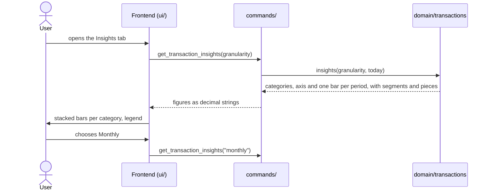

# CSD-033: Transaction insights

## 1. Intent
The Transactions page (CSD-032) lists what the bank account shows and totals it per year, but a table does not show how spending develops or what it went to. This capability adds an Insights tab to the Transactions page: one chart of what was spent, stacked from one segment per category, with what came in drawn as a marker across each bar, and with one bar per calendar year or, when the user chooses, one bar per month, so the user sees at a glance whether more was spent than came in. It is the standard Insights chart of the app (CSD-014, CSD-025) with one addition: the choice between Yearly and Monthly. It is for the owner looking at their own spending, and it follows the categories the owner keeps.

## 2. Scope
### 2.1 In scope
- The "Insights" tab on the Transactions page, right of "Overview" (CSD-032 REQ-16).
- A stacked bar chart of the spending (the debits) per category, with the income (the credits) as a marker across the bar, per calendar year or per month, a legend of the categories and of the income, a tooltip and the highlight of one category. What every yearly chart shares (motion, look, size, short axis labels) is in CSD-025.
- The choice between Yearly and Monthly, and the empty state.

### 2.2 Non-goals
- NG-1: Income per category (stacked), a net figure, and any other comparison of spending with income than the marker.
- NG-2: Any other granularity than a calendar year and a month, and a choice of the period shown (zooming, scrolling to a year).
- NG-3: A filter, a selection or a hiding of categories, years or months, and any link with the Overview tab or its filters.
- NG-4: Any figure other than the amount per category and the total of a bar: no average, percentage or forecast.
- NG-5: Click-through, zooming, exporting the chart, a chart library or any other dependency.
- NG-6: Letting the user choose the colour of a category.
- NG-7: Remembering the choice between Yearly and Monthly between sessions or projects.
- NG-8: A marker or line for the total of a bar.

## 3. Definitions
| Term | Meaning |
|---|---|
| **Spending** | The sum of the debits (negative amounts) as a positive amount. Credits are not part of it. |
| **Income** | The sum of the credits (positive amounts) in a bar, whatever their category. |
| **Bar** | One calendar year (Yearly) or one month (Monthly), from the date of the transactions in it. |
| **Segment** | The part of a bar that belongs to one category (or to Uncategorized): the sum of the spending of that category in that bar. A category without spending in a bar has no segment in it. |
| **Current bar** | The bar of today's year, or of today's month. It runs up to today, so it is partial. |
| **Colour slot** | The number 0 to 7 of a category: the places 1 to 8 of the category list give 0 to 7 and the list starts again after eight; Uncategorized always has slot 7. |

## 4. Requirements

### 4.0 Overview flow


**REQ-1: Bars** *(ubiquitous)*
The chart shall have one bar per calendar year (Yearly) or per month (Monthly), oldest first, from the earliest period with a transaction up to and including the later of the current period and the latest period with a transaction. A period without transactions in between is a zero bar with no segments and no marker.

```gherkin
@AC-1.1
Scenario: Yearly bars
  Given debits in 12/2024 and in 10/2026, and today is 15/10/2026
  Then the bars are 2024, 2025 and 2026, and 2025 is a zero bar with no segments

@AC-1.2
Scenario: Monthly bars
  Given a debit in 12/2024 and in 10/2026, and today is in 12/2026
  Then the bars run from 2024-12 to 2026-12, 25 bars, and 2025-01 is a zero bar
```

**REQ-2: At most 36 months** *(ubiquitous)*
The Monthly series shall hold at most 36 months, counted back from its last month. A debit older than that has no bar.

```gherkin
@AC-2.1
Scenario: Older debits have no bar
  Given a debit in 01/2020, a debit in 10/2026 and today is in 06/2026
  Then the Monthly series ends with 2026-10 and has 36 bars, the first of which is 2023-11
```

**REQ-3: The current bar and later bars** *(state-driven)*
While the chart shows the current year or month, the app shall mark its bar as partial. A debit dated after today gets its own bar, which is not partial.

```gherkin
@AC-3.1
Scenario: A month after the current one
  Given a debit in 03/2027 and today is in 12/2026
  Then the Monthly series ends with 2027-03 and that bar is not partial

@AC-3.2
Scenario: The current bar is partial
  Given today is 15/10/2026 and there is a debit in 10/2026
  Then the bar 2026 (Yearly) is labelled "2026 YTD" and the bar 2026-10 (Monthly) "2026-10 MTD"
```

**REQ-4: Segments are the spending per category, the marker is the income** *(ubiquitous)*
Each segment shall be the spending of one category in the bar, stacked in the order of the categories with Uncategorized last, and the credits shall not be counted in them or in the total of the bar. When the bar has income, the app shall show it as a marker across the bar at the height of the income, with its short label (CSD-025 REQ-7); a bar without income has no marker. Rust delivers the axis and the stacked pieces; the frontend draws them as received (CSD-025 REQ-5).

```gherkin
@AC-4.1
Scenario: A bar is stacked from its segments
  Given in 2026 the spending Groceries 15.00 and Uncategorized 7.50
  Then the bar of 2026 shows Groceries from 0.00 to 15.00 and Uncategorized from 15.00 to 22.50

@AC-4.2
Scenario: No transactions, no bars
  Given no transactions
  Then the chart has no bars

@AC-4.3
Scenario: Income is a marker
  Given a credit of 2,500.00 and debits of 22.50 in 2026
  Then the total spent of 2026 is 22.50, its bar is 22.50 high and a marker with the label "2.5k" stands across it at 2,500.00
  And the axis reaches the marker
  And a bar without a credit has no marker

@AC-4.4
Scenario: Income without spending
  Given only a credit of 9.00 in 2026
  Then the bar of 2026 has no segments, a marker at 9.00, and its tooltip says "No spending"

@AC-4.5
Scenario: Spending alone
  Given only debits in 2025
  Then the bar of 2025 has no marker
```

**REQ-5: Yearly or Monthly** *(event-driven)*
When the user opens the Insights tab, the app shall show the Yearly chart and a choice "Yearly | Monthly" in which Yearly is pressed. When the user chooses the other option, the app shall ask Rust for that granularity and draw the answer, and shall change the title of the panel to "Spending and income per year" or "Spending and income per month". Choosing the option that is already shown shall change nothing. The choice stays while the user goes to another tab and comes back, and is not remembered after that (NG-7).

```gherkin
@AC-5.1
Scenario: The chart opens on the years
  When the user opens the Insights tab
  Then "Yearly" is pressed, the title is "Spending and income per year" and Rust was asked for "yearly"

@AC-5.2
Scenario: Choosing Monthly
  When the user chooses "Monthly"
  Then Rust is asked for "monthly", the bars are labelled 2026-09 and 2026-10 MTD, "Monthly" is pressed and the title is "Spending and income per month"

@AC-5.3
Scenario: Choosing the shown option again
  When the user chooses "Yearly" while Yearly is shown
  Then Rust is not asked again

@AC-5.4
Scenario: The choice is kept while the tab is reopened
  Given the user chose "Monthly"
  When the user goes to the Overview tab and back to the Insights tab
  Then the Monthly chart is shown

@AC-5.5
Scenario: An unknown granularity
  When Rust is asked for the granularity "weekly"
  Then it is rejected and nothing changes
```

**REQ-6: A fixed colour per category** *(ubiquitous)*
Each category shall have one colour slot (section 3) in every bar and in the legend, and a category keeps its colour while others are added.

```gherkin
@AC-6.1
Scenario: Slots follow the list
  Given the 14 default categories
  Then the slots are 0 to 7 and 0 to 5 for the 14 categories and 7 for Uncategorized

@AC-6.2
Scenario: A new category does not change the others
  When the user adds the category "Example Pets"
  Then the other categories keep their slots
```

**REQ-7: Legend of categories** *(ubiquitous)*
The panel shall show a legend with a swatch and the name of every category, also those without spending, with Uncategorized last. The legend shall end with an item "Income" with the marker swatch. Hovering or focusing a legend item highlights that category, or the markers, in every bar.

```gherkin
@AC-7.1
Scenario: Every category is listed
  Given the categories Groceries and Shopping
  Then the legend lists Groceries, Shopping, Uncategorized and Income, in that order
```

**REQ-8: Details of a bar** *(event-driven)*
When the user hovers or focuses a bar, the app shall show a tooltip with its label, a note while it is partial, one row per segment in the order of the bar from top to bottom with its amount, the total spent and, when there is income, the income. A bar without a debit shows the note "No spending". The tooltip shall never be taller than the chart: when not every segment fits, it shows the segments from the top of the bar that fit, measured on the real tooltip (at least one) and a last row "and N more categories", and the total spent still covers all of them. Rationale: a tooltip that sticks out below the chart gives the chart a scrollbar and shifts the page while the pointer moves over the bars.

```gherkin
@AC-8.1
Scenario: Tooltip of a year
  Given the bar of 2026 with Groceries 15.00 and Uncategorized 7.50, which is partial
  When the user hovers it
  Then the tooltip reads "2026 YTD", "Partial year: spending so far", Uncategorized 7.50, Groceries 15.00, Total spent 22.50 and Income 30.00

@AC-8.3
Scenario: A tooltip that would be taller than the chart
  Given a bar with 6 segments in a chart that is 200 high, where each row of the tooltip is 24 high
  When the user hovers it
  Then the tooltip shows the 2 segments from the top of the bar, the row "and 4 more categories", the total spent and the income, and is no taller than the chart
  And the chart and the page do not change size

@AC-8.2
Scenario: Tooltip of a month
  Given the bar of 2026-10, which is partial
  When the user hovers it
  Then the tooltip reads "2026-10 MTD" and "Partial month: spending so far"
```

**REQ-9: The Insights tab** *(ubiquitous)*
The Transactions page shall have the tabs, left to right, "Categories", "Rules", "Overview" and "Insights"; the Overview is shown first.

```gherkin
@AC-9.1
Scenario: Four tabs
  When the user opens Transactions
  Then the tabs are "Categories", "Rules", "Overview" and "Insights", the Overview is shown, and choosing "Insights" shows the chart
```

**REQ-10: Motion, look and size** *(ubiquitous)*
The chart shall follow CSD-025 for its motion, reduced motion, look, short axis labels, accessible segments and size, like every yearly chart.

**REQ-12: No transactions yet** *(state-driven)*
While there is no transaction, the panel shall show the note "No transactions yet. The chart appears once there is a transaction." and no chart.

```gherkin
@AC-12.1
Scenario: Nothing to chart
  Given no transactions
  Then the note is shown and the chart is not
```

**REQ-13: Current figures** *(event-driven)*
When the user opens the Insights tab, and after a project is opened or the language changes while it is shown, the app shall compute the chart from the project as it is now, saved or not.

```gherkin
@AC-13.1
Scenario: Opening the tab again
  When the user goes to another tab and back to the Insights tab
  Then Rust is asked again
```

**REQ-14: Language** *(ubiquitous)*
The app shall show the texts of the chart in the language setting (CSD-022), and the name of a category as stored, except Uncategorized, which is translated.

```gherkin
@AC-14.1
Scenario: Dutch
  Given the language is Dutch
  Then the title is "Uitgaven en inkomsten per jaar", the choice reads "Jaarlijks | Maandelijks" and Uncategorized is "Zonder categorie"
```

**REQ-15: Discrete mode** *(state-driven)*
While Discrete mode is on (CSD-030), the amounts in the tooltip and in the accessible names of the segments shall be hidden; the shape of the bars stays (CSD-030 NG-2).

```gherkin
@AC-15.1
Scenario: Amounts are hidden
  Given Discrete mode is on
  Then the accessible name of a segment holds no amount
```

## 5. Interfaces and contracts
Command `get_transaction_insights(granularity)` with `granularity` `"yearly"` (default) or `"monthly"` returns:

```json
{
  "granularity": "yearly",
  "categories": [{ "id": "…", "name": "Groceries", "colour_slot": 0 }, { "id": "uncategorized", "name": "Uncategorized", "colour_slot": 7 }],
  "axis": { "ticks": [{ "value": "0.00", "label": "0" }] },
  "years": [{ "year": 2026, "month": null, "total": "22.50", "income": "30.00", "transaction_count": 4, "is_partial": true,
              "segments": [{ "category": "…", "amount": "15.00" }], "pieces": [], "marker": { "value": "30.00", "label": "30.00" } }]
}
```

The list is called `years` and a bar `year` because the frame of the yearly charts reads those names (CSD-025); `month` is 1 to 12 for a Monthly bar and `null` for a Yearly one. `total` is the spending, `income` the sum of the credits and `transaction_count` counts debits and credits. `pieces`, `marker` and `axis` are those of CSD-025 section 5. The segment key and the legend key of a category are `category-<id>`.

## 6. Constraints
- CON-1: The figures are computed in Rust (`domain/transactions/insights.rs`); the frontend only draws what it receives. Rationale: `CLAUDE.md` layout rule.
- CON-2: The chart reuses the frame of the yearly charts (`createYearlyChart`) with the arguments of the command as the one addition. Rationale: one look and one behaviour for every chart (CSD-025).
- CON-3: The golden files do not hold this command, because the ids of its categories would renumber the ids of the other areas; the IPC and DOM tests cover it. Rationale: the numbering follows the first appearance of an id.

- CON-4: The scroll boxes of the chart never change size because of a tooltip or a scrollbar: the chart box scrolls sideways only, the box of the chart clips what sticks out of it, and the page keeps the room of its scrollbar (`scrollbar-gutter: stable`). Rationale: a scrollbar that came and went changed the width of the chart, redrew it, closed the tooltip and made the scrollbar come and go again. These rules are shared CSS and apply to every chart (CSD-025).

## 7. Verification
| ACs | Proven by |
|---|---|
| AC-1.1 to AC-4.2, AC-4.4, AC-4.5, AC-5.5, AC-6.1, AC-6.2 | `cargo test test_csd033_` (Rust, `domain/transactions` and `ipc_transactions_tests`) |
| AC-4.1, AC-4.3, AC-4.4, AC-5.1 to AC-5.4, AC-7.1, AC-8.1, AC-8.2, AC-9.1, AC-12.1, AC-13.1, AC-14.1, AC-15.1 | `npm test` (`ui/tests/ac-i-transaction-insights.test.js`) |
| Look, motion, tooltip placement | manual checklist of CSD-025 |

## 8. Open questions
- OQ-2: Is 36 months the right length of the Monthly chart? Owner: Thijs. Blocks: REQ-2.

## 9. Changelog
- 0.5 (12/11/2026): The tab "Categories and rules" is split into "Categories" and "Rules" (REQ-9, AC-9.1), following CSD-032 v0.14. Owner request. Back to `draft` until re-approved.
- 0.4 (12/11/2026): The tooltip is fitted by measuring it, not by an estimate (REQ-8, AC-8.3), and the scroll boxes of the charts are made steady: sideways scrolling only, a clipped chart box and a stable page scrollbar gutter (new CON-4). The first fix did not stop the scrollbars from appearing and disappearing in the owner's window. Owner report. Back to `draft` until re-approved.
- 0.3 (12/11/2026): The tooltip is never taller than the chart: segments that do not fit are counted in a last row "and N more categories" (REQ-8, AC-8.3). A tall tooltip made the chart box scroll and shifted the page while hovering. Owner report ("the chart is unstable"). Back to `draft` until re-approved.
- 0.2 (12/11/2026): The income (the credits) is drawn as a marker across each bar, with an "Income" item in the legend and a row in the tooltip; bars also exist for periods with only income; the panel is titled "Spending and income per year" or "per month"; the empty note is about transactions (REQ-4, REQ-7, REQ-8, REQ-12). Owner request. Back to `draft` until re-approved.
- 0.1 (12/11/2026): initial draft. A spending-per-category chart on a new Insights tab of the Transactions page, per year or per month. Owner request.
