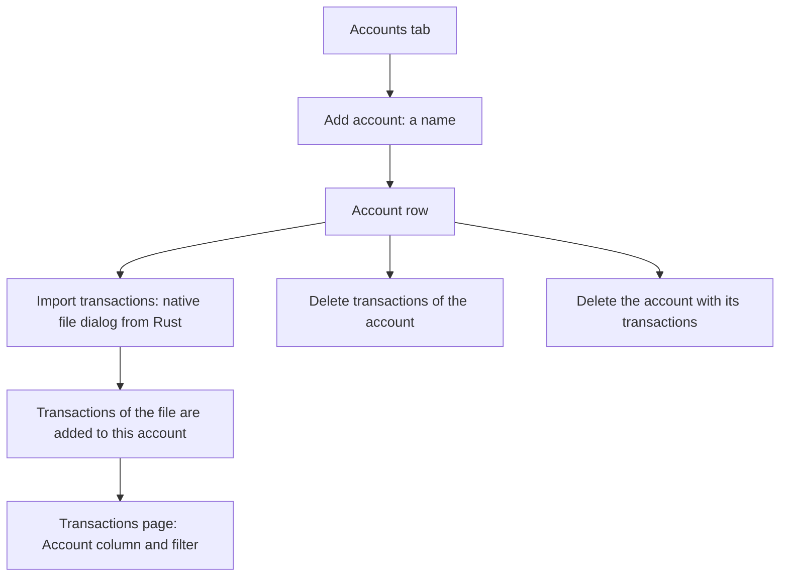

# CSD-034: Transaction accounts

> Tabs: the tabs of this page are set by CSD-035 (Page tabs). Where this CSD says "Overview tab", lists the Overview sections, or selects the Overview tab in an AC, CSD-035 REQ-1 to REQ-3 govern instead.

## 1. Intent
The transactions of CSD-032 come from different banks and accounts, and the import only knows a file, not where it belongs. This capability adds an Accounts tab to the Transactions page. An account is a name the user chooses; every transaction belongs to exactly one account, and transactions are imported into, and deleted from, an account on that tab. The Overview tab then shows the account of each transaction and can filter on it.

## 2. Scope
### 2.1 In scope
- The Accounts tab of the Transactions page: the list of accounts, adding, renaming and deleting an account, importing transactions into an account and deleting the transactions of an account.
- The account of every transaction, in the project file, in the import, in the duplicate check and in the list of the Transactions page (a column and a filter).
- The consequences for the project file (CSD-002) and for undo (CSD-027).

### 2.2 Non-goals
- NG-1: A link between a transaction account and the bank accounts of CSD-009. Transaction accounts hold no balance and never change one (CSD-032 NG-3 stays).
- NG-2: Moving a transaction to another account, and merging accounts.
- NG-3: Creating an account from a file. The user adds the account first and imports into it.
- NG-4: Opening a project file of before this capability that holds transactions. Such a file has no accounts and is not supported (REQ-7).
- NG-5: A note, a bank name, a currency or a colour per account. An account is a name.
- NG-6: Charts or figures per account: the Insights tab, the totals and the share of categorized transactions cover all accounts.
- NG-7: Importing into several accounts at once, and choosing the account by the account number in the file.

## 3. Definitions
| Term | Meaning |
|---|---|
| **Account** | A name chosen by the user. It holds transactions; it is not a bank account of CSD-009. |
| **Own account number** | The account number the bank writes in an export (CSD-032 REQ-7). It is kept on the transaction and is not the account of this CSD. |

## 4. Requirements

### 4.0 Overview flow


**REQ-1: The Accounts tab** *(ubiquitous)*
The Transactions page shall have a tab "Accounts", the first of its tabs, left of "Categories" (CSD-032 REQ-16); the Overview tab stays the one shown first and the left pane has no item for accounts. The tab shall have a panel "Accounts" with the button "Add account" and one row per account, in the order the accounts were added. A row shall show the name, the number of transactions of the account ("N transactions", "1 transaction" for one) and the buttons "Import transactions", "Edit" and "Delete". While there is no account, the tab shall say "No accounts yet. Add an account, then import the transactions of a bank into it." Rust counts the transactions.

```gherkin
@AC-1.1
Scenario: The tab and its rows
  Given the accounts "Example Bank" with 3 transactions and "Example Savings" with 1
  When the user opens the Accounts tab
  Then the rows show "Example Bank", "3 transactions" and "Example Savings", "1 transaction"
  And each row has the buttons "Import transactions", "Edit" and "Delete"

@AC-1.2
Scenario: No account yet
  Given a project without accounts
  When the user opens the Accounts tab
  Then the tab shows "No accounts yet. Add an account, then import the transactions of a bank into it."

@AC-1.3
Scenario: The tab
  Then the tabs of the Transactions page are, left to right, "Accounts", "Categories", "Rules", "Overview" and "Insights"
  And the left pane has no item "Accounts"
```

**REQ-2: Adding, renaming and deleting an account** *(event-driven)*
When the user adds or renames an account, the app shall apply the change and shall reject a name that is empty after trimming, longer than 50 characters or equal, ignoring case, to the name of another account. When the user deletes an account, the app shall ask for a confirmation that says how many transactions go with it, and when the user confirms, delete the account and all its transactions as one undo step; the categories and the rules stay (REQ-5).

```gherkin
@AC-2.1
Scenario: Add and rename
  When the user adds the account "Example Bank" and renames it to "Example Current"
  Then the list shows "Example Current"

@AC-2.2
Scenario Outline: Invalid names are rejected
  When the user adds an account with the name "<name>"
  Then it is rejected with error code "<code>"
  Examples:
    | name                     | code                              |
    | (empty)                  | TRANSACTION_ACCOUNT_NAME_REQUIRED |
    | 51 characters            | TRANSACTION_ACCOUNT_NAME_TOO_LONG |
    | example bank (existing)  | TRANSACTION_ACCOUNT_NAME_TAKEN    |

@AC-2.3
Scenario: An account may keep its own name
  When the user renames "Example Bank" to "EXAMPLE BANK"
  Then the account is renamed

@AC-2.4
Scenario: Deleting an account
  Given "Example Bank" with 3 transactions and "Example Savings" with 1
  When the user deletes "Example Bank" and confirms
  Then the project holds the account "Example Savings" and 1 transaction
  And the confirmation said "3 transactions"
  And the categories and rules are unchanged
  And one Edit > Undo restores the account and its 3 transactions
```

**REQ-3: Import into an account** *(event-driven)*
When the user chooses "Import transactions" on the row of an account, or in the dialog of the account, the app shall open the file dialog and import the file as CSD-032 REQ-1 to REQ-7 describe, with every added transaction belonging to that account. The project currency (CSD-003) is checked as before. The result is shown as "N added, M skipped as duplicates". The Import button of the Transactions page is gone (REQ-6).

```gherkin
@AC-3.1
Scenario: The transactions land in the chosen account
  Given the accounts "Example Bank" and "Example Savings"
  When the user imports a file with 3 valid rows into "Example Savings"
  Then "Example Savings" holds 3 transactions and "Example Bank" holds none
  And the app shows "3 added, 0 skipped as duplicates"

@AC-3.2
Scenario: The dialog of the account has the import
  When the user opens the dialog of an account
  Then it shows the name, the number of transactions and the buttons "Import transactions" and "Delete transactions"

@AC-3.3
Scenario: Cancelling the file dialog
  When the user chooses "Import transactions" and cancels the file dialog
  Then nothing changes

@AC-3.4
Scenario: A rejected file adds nothing
  When the user imports a file with a malformed row
  Then the error of CSD-032 REQ-3 is shown and no transaction is added to any account
```

**REQ-4: Delete the transactions of an account** *(event-driven)*
When the user chooses "Delete transactions" in the dialog of an account, the app shall ask for a confirmation that says how many transactions go, and when the user confirms, delete every transaction of that account as one undo step; the account, the other accounts, the categories and the rules stay. This replaces "Delete all transactions" of CSD-032 REQ-25.

```gherkin
@AC-4.1
Scenario: Delete the transactions of one account
  Given "Example Bank" with 3 transactions and "Example Savings" with 1
  When the user deletes the transactions of "Example Bank" and confirms
  Then "Example Bank" holds 0 transactions and "Example Savings" still holds 1
  And one Edit > Undo brings the 3 back

@AC-4.2
Scenario: Cancelled
  When the user cancels the confirmation
  Then nothing changes
```

**REQ-5: Every transaction has exactly one account** *(ubiquitous)*
Every transaction shall belong to exactly one existing account. Importing needs an account (an import without an account is refused with `TRANSACTION_ACCOUNT_NOT_FOUND`), a transaction cannot be left without one, and deleting an account deletes its transactions (REQ-2). The duplicate check of CSD-032 REQ-5 works within one account: a row is a duplicate when the same account already holds a transaction with the same own account number and bank reference, so the same file may be imported into two accounts.

```gherkin
@AC-5.1
Scenario: Duplicates are per account
  Given "Example Bank" holds the transactions of a file
  When the user imports the same file into "Example Bank"
  Then 0 are added and all are skipped as duplicates
  When the user imports the same file into "Example Savings"
  Then all are added

@AC-5.2
Scenario: An unknown account
  When an import names an account that does not exist
  Then it is refused with error code "TRANSACTION_ACCOUNT_NOT_FOUND" and nothing is added
```

**REQ-6: The Transactions page** *(ubiquitous)*
The Overview tab of the Transactions page shall show the account of each transaction in a column "Account" directly after the date, and shall have a filter on that column like the filter on the category column (CSD-028 REQ-2): one checkbox per account, with the accounts that have no transactions included. The buttons "Import transactions" and "Delete all transactions" are no longer on the page. While the project holds no transaction, the page shall say "No transactions yet. Add an account on the Accounts tab and import a file into it." The filter takes part in the filtered total, the count, "Select all in the filter" and "Manual only" like every other filter. Categories, rules, the share of categorized transactions, the yearly totals and the Insights tab cover all accounts.

```gherkin
@AC-6.1
Scenario: The account column
  Given a transaction in "Example Bank" and one in "Example Savings"
  Then the rows show the account names directly after the dates

@AC-6.2
Scenario: The filter on account
  When the user chooses "Example Savings" in the filter of the column Account
  Then only the transactions of "Example Savings" are listed, with the filtered total, the count and "select all in the filter" following

@AC-6.3
Scenario: The buttons are gone and the empty state points to Accounts
  Then the Transactions page has no "Import transactions" and no "Delete all transactions" button
  And while there is no transaction it says "No transactions yet. Add an account on the Accounts tab and import a file into it."

@AC-6.4
Scenario: Totals cover all accounts
  Then the yearly totals, the share of categorized transactions and the Insights chart count the transactions of every account
```

**REQ-7: The project file** *(ubiquitous)*
The project file shall hold the required section `transaction_accounts`, an array of `{ id, name }`, and every transaction shall carry an `account_id` of an existing account; `format_version` is 4 and the strict schema of CSD-002 REQ-17 applies. A file with another account name than a valid one, two accounts with the same name ignoring case, two with the same id, or a transaction whose account does not exist is invalid. A project file of an older version is rejected as before (CSD-002 REQ-20); there is no migration of its transactions. The upgrade script of CSD-002 REQ-20 upgrades a version 3 file by adding an empty `transaction_accounts` section and removing its transactions, writing the `.bak` first and saying how many transactions it removed, so that the rest of the file can be used.

```gherkin
@AC-7.1
Scenario: A saved project
  When the user saves a project with an account and a transaction
  Then the file has "format_version" 4, a "transaction_accounts" section and the "account_id" on the transaction

@AC-7.2
Scenario: Invalid files
  Then a file with a transaction whose account does not exist, with two accounts with the same name or the same id, or without the section, is invalid

@AC-7.3
Scenario: A version 3 file
  Then the app rejects it as it rejects any older file
  And the upgrade script writes "<file>.bak", gives the file an empty "transaction_accounts" section, removes its transactions and says how many it removed
```

**REQ-8: Undo, language and the example project** *(ubiquitous)*
Adding, renaming and deleting an account, importing and deleting the transactions of an account shall each be one undo step with a label ("Add Transaction Account", "Edit Transaction Account", "Delete Transaction Account", "Import Transactions", "Delete Transactions"), recorded only when something changed (CSD-027). Every text of the page and every error code shall have a Dutch version (CSD-022). The example project (CSD-002 REQ-21) shall hold the accounts of its transactions.

```gherkin
@AC-8.1
Scenario: Undo labels
  When the user adds an account
  Then the menu item Undo reads "Undo Add Transaction Account"

@AC-8.2
Scenario: Dutch
  Given the language is Dutch
  Then the texts of the Accounts tab and the error codes of REQ-2 and REQ-5 are in Dutch

@AC-8.3
Scenario: The example project
  Then examples/example.varde holds accounts and every transaction of it belongs to one
```

**REQ-9: The page loads from one state** *(ubiquitous)*
The accounts with their counts shall come in the answer that CSD-032 REQ-33 describes (`get_transactions_overview`), and the Accounts tab shall be drawn from it, so the tabs of the Transactions page always show the same accounts.

```gherkin
@AC-9.1
Scenario: One answer
  When the frontend asks for the overview of the transactions
  Then the answer holds "accounts" with every account and its "transaction_count", as the command of its own returns it
```

## 5. Interfaces and contracts
Project file: the section `transaction_accounts` (an ordered array of `{ id, name }`) and `account_id` on every transaction (REQ-7).

Commands (names and payloads are indicative): `list_transaction_accounts()` → `[{ id, name, transaction_count }]`; `add_transaction_account(name)`, `rename_transaction_account(account_id, name)`, `delete_transaction_account(account_id)` → how many transactions went; `import_transactions(account_id)` → `{ added, skipped }` or nothing when cancelled; `delete_account_transactions(account_id)` → how many were deleted. `list_transactions` and `list_transaction_ids` take `account_ids` in the filter. Errors: `TRANSACTION_ACCOUNT_NAME_REQUIRED`, `TRANSACTION_ACCOUNT_NAME_TOO_LONG`, `TRANSACTION_ACCOUNT_NAME_TAKEN`, `TRANSACTION_ACCOUNT_NOT_FOUND`.

## 6. Constraints
- CON-1: All checks, counts and the duplicate check are in Rust (`domain/transactions`); the frontend displays and sends the user's choices (CSD-032 CON-1).
- CON-2: The file is read in Rust after a native dialog opened from Rust (CSD-032 CON-2).
- CON-3: No account name is logged at `info` or above (`CLAUDE.md`).

## 7. Verification
| ACs | Proven by |
|---|---|
| AC-2, AC-4, AC-5, AC-7.1, AC-7.2, AC-9 | `cargo test test_csd034_` (Rust domain, storage and command tests) |
| AC-1, AC-3, AC-6, AC-8.2 | `npm test` (DOM tests in `ui/tests/`) |
| AC-7.3 | `node --test scripts/tests/` |
| AC-8.1, AC-8.3 | `cargo test test_csd034_ac_8_` and `EXAMPLE_UPDATE=1 cargo test example` |
| Golden files | `GOLDEN_UPDATE=1 cargo test golden`, diff reviewed |

## 8. Open questions
- None.

## 9. Changelog
- 0.3 (18/11/2026): The Overview tab is split into one tab per panel and removed; CSD-035 (Page tabs) governs the tabs of this page (GitHub issue 73). No other change. Back to `draft` until re-approved.
- 0.2 (17/11/2026): The accounts are a tab of the Transactions page, not a page of the left pane (REQ-1, REQ-6, REQ-9). Owner request.
- 0.1 (17/11/2026): First draft. Owner request: an Accounts page (since 0.2 a tab) where the user adds an account, imports transactions into it and deletes the transactions; every transaction belongs to exactly one account. Owner answers of 17/11/2026: the user adds the account first and imports inside the account dialog; transactions of older project files are not supported; the Transactions page loses its import and delete-all and gets an account column and filter; deleting an account deletes its transactions after a confirmation. My choices: the project file version goes to 4 and the script drops the transactions of a version 3 file instead of leaving the whole file unusable; the duplicate check is per account; the page loads from the overview of CSD-032 REQ-33.
