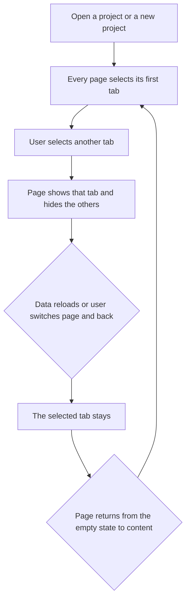

# CSD-035: Page tabs

## 1. Intent
Every data page has an Overview tab and an Insights tab, and the Overview tab stacks two or three different features: on Income it holds the jobs, the yearly totals and the paychecks and statements, one below the other. That makes the page long and hides which feature is which (GitHub issue 73). This capability gives every panel of the Overview its own tab, so each tab holds one feature, and removes the Overview tab. The panels themselves do not change; only where they are shown does.

## 2. Scope
### 2.1 In scope
- The tabs of Income, Investments, Bank accounts, Houses, Debts, Expenses and Transactions: which tabs a page has, in which order, what each holds and which one is shown first.
- Which tab is selected while the app runs.
- The consequences for the CSDs that name the Overview tab (CON-1).

### 2.2 Non-goals
- NG-1: A change to the content of a panel: its title, buttons, columns, filters, empty notes and behaviour stay as the owning CSD says.
- NG-2: Tabs on the Dashboard, Net worth, Ratios and Settings pages. They keep their layout (CSD-004, CSD-017, CSD-018, CSD-003).
- NG-3: Remembering the selected tab between sessions or in the project file (as CSD-024 NG-6 for the page).
- NG-4: A new item in the left pane, and any change to the Insights tabs, their charts or their texts.
- NG-5: Splitting a panel in two, or merging panels of different pages.

## 3. Definitions
| Term | Meaning |
|---|---|
| **Panel** | A titled block with a header, as the Overview tab holds today ("Jobs", "Yearly totals", ...). |
| **First tab** | The leftmost tab of a page, except on the Transactions page (REQ-3). |
| **Empty state** | The "add your first ..." prompt a page shows while it holds no job, account, house or debt (CSD-001, CSD-005, CSD-009, CSD-011, CSD-015). |

## 4. Requirements

### 4.0 Overview flow


**REQ-1: The tabs of each page** *(ubiquitous)*
Each of the pages below shall have exactly the tabs listed, left to right, each tab holding exactly the panel of the same name (the tab Insights holds the chart of its Insights CSD), and no tab named "Overview".

| Page | Tabs, left to right |
|---|---|
| Income | Jobs, Yearly totals, Paychecks and statements, Insights |
| Investments | Accounts, Yearly totals, Statements, Insights |
| Bank accounts | Accounts, Yearly totals, Entries, Insights |
| Houses | Houses, Yearly values, Valuations, Insights |
| Debts | Debts, Yearly totals, Statements, Insights |
| Expenses | Yearly totals, Expenses, Insights |
| Transactions | Accounts, Categories, Rules, Yearly totals, Transactions, Insights |

```gherkin
@AC-1.1
Scenario Outline: The tabs of a page
  Given a project that holds data for the page "<page>"
  When the user opens "<page>"
  Then the tabs are, left to right, <tabs>
  And there is no tab "Overview"

  Examples:
    | page          | tabs                                                                    |
    | Income        | "Jobs", "Yearly totals", "Paychecks and statements", "Insights"         |
    | Investments   | "Accounts", "Yearly totals", "Statements", "Insights"                   |
    | Bank accounts | "Accounts", "Yearly totals", "Entries", "Insights"                      |
    | Houses        | "Houses", "Yearly values", "Valuations", "Insights"                     |
    | Debts         | "Debts", "Yearly totals", "Statements", "Insights"                      |
    | Expenses      | "Yearly totals", "Expenses", "Insights"                                 |
    | Transactions  | "Accounts", "Categories", "Rules", "Yearly totals", "Transactions", "Insights" |

@AC-1.2
Scenario: One panel per tab
  Given the Income page with the job "Example Employer" and a paycheck for 2026-10
  When the user selects the tab "Yearly totals"
  Then only the panel "Yearly totals" is shown
  And the panels "Jobs" and "Paychecks and statements" are not shown

@AC-1.3
Scenario: Pages without tabs stay as they are
  Then the pages Dashboard, Net worth, Ratios and Settings have no tabs
```

**REQ-2: The panels move unchanged** *(ubiquitous)*
Each panel shall keep its title, header button, empty notes, columns, filters and behaviour from the owning CSD; the only change is that it sits on its own tab. The categorized share of CSD-032 is in the header of the panel "Categories"; the tab "Categories" also holds the panel "Spending per category" of CSD-032 REQ-35 above it, the one tab with two panels; and the buttons "Bulk select" and "Manual only" stay in the header of the panel "Transactions".

```gherkin
@AC-2.1
Scenario: Buttons stay in their panel
  When the user opens the tab "Paychecks and statements" of Income
  Then the header of its panel shows the button "Add entry"
  When the user opens the tab "Jobs"
  Then the header of its panel shows the button "Add job"

@AC-2.2
Scenario: Filters stay with their table
  Given a filter on the column Job of the paychecks table
  When the user selects the tab "Jobs" and back to "Paychecks and statements"
  Then the filter is still set (CSD-028 REQ-13)

@AC-2.3
Scenario: Transactions panels
  When the user opens the tab "Categories" of Transactions
  Then its header shows the categorized share, for example "87.50% of the transactions are categorized (35 of 40)"
  And the panel "Spending per category" with the two donut charts of CSD-032 REQ-35 is shown above it
  When the user opens the tab "Transactions"
  Then its header shows the buttons "Bulk select" and "Manual only"
```

**REQ-3: The first tab opens with a project** *(event-driven)*
When the user opens a project file or starts a new project, the app shall select the first tab on every page, and shall select the tab "Transactions" on the Transactions page, as it opened on the transaction list before. If a project is opened while another is open, then the tab selected on the old project shall not carry over.

```gherkin
@AC-3.1
Scenario Outline: The tab shown first
  Given a project with data for the page "<page>"
  When the user opens the project and then "<page>"
  Then the tab "<first>" is selected

  Examples:
    | page          | first        |
    | Income        | Jobs         |
    | Investments   | Accounts     |
    | Bank accounts | Accounts     |
    | Houses        | Houses       |
    | Debts         | Debts        |
    | Expenses      | Yearly totals |
    | Transactions  | Transactions |

@AC-3.2
Scenario: Another project resets the tabs
  Given the user selected the tab "Insights" on Income
  When the user opens another project file
  Then the tab "Jobs" is selected on Income
```

**REQ-4: The selected tab is kept while the app runs** *(state-driven)*
While a project is open, the app shall keep the selected tab of each page when the data of the page reloads (for example after adding, changing or deleting an item) and when the user goes to another page and back.

```gherkin
@AC-4.1
Scenario: Adding an entry keeps the tab
  Given the Income page with the tab "Paychecks and statements" selected
  When the user adds a paycheck of 3000.00 for 2026-10
  Then the tab "Paychecks and statements" is still selected
  And the new paycheck is listed

@AC-4.2
Scenario: Switching pages keeps the tab
  Given the tab "Statements" is selected on Debts
  When the user opens "Bank accounts" and then "Debts"
  Then the tab "Statements" is selected on Debts

@AC-4.3
Scenario: Nothing is stored
  When the user quits the app and opens the project again
  Then every page shows its first tab (AC-3.1) and no file holds the selected tab
```

**REQ-5: Empty states stay as they are** *(state-driven)*
While a page holds no job, investment account, bank account, house or debt, the page shall show its empty state of the owning CSD and no tabs; the pages Expenses and Transactions shall always show their tabs. When such a page goes from its empty state to showing its tabs, the app shall select its first tab.

```gherkin
@AC-5.1
Scenario: No tabs while empty
  Given a new project without jobs
  When the user opens Income
  Then it shows "No jobs yet. Add your first job to start tracking your monthly paychecks." and no tabs

@AC-5.2
Scenario: The first item shows the first tab
  Given the Income page in its empty state
  When the user adds the job "Example Employer"
  Then the tabs are shown and the tab "Jobs" is selected

@AC-5.3
Scenario: Expenses and Transactions always have tabs
  Given a new project
  When the user opens Expenses and Transactions
  Then Expenses shows the tabs "Yearly totals", "Expenses" and "Insights"
  And Transactions shows its six tabs
```

**REQ-6: Selecting a tab** *(event-driven)*
When the user selects a tab with the mouse, or moves between the tabs with the left and right arrow keys, the app shall show that tab's panel and hide the other panels of the page, and for the tab Insights shall request the figures again as CSD-025 REQ-15 says.

```gherkin
@AC-6.1
Scenario: Mouse
  When the user clicks the tab "Entries" on Bank accounts
  Then the tab "Entries" is selected, its panel is shown and the panels "Accounts" and "Yearly totals" are hidden

@AC-6.2
Scenario: Arrow keys wrap around
  Given focus is on the tab "Insights" of Debts
  When the user presses the right arrow
  Then focus moves to the tab "Debts" and it is selected

@AC-6.3
Scenario: Insights shows fresh figures
  Given the user changed the 2026 balance of a statement on the tab "Statements"
  When the user selects the tab "Insights"
  Then the chart shows the changed figure (CSD-025 AC-15.3)

@AC-6.4
Scenario: One tab can be tabbed to
  Then on every page only the selected tab is in the tab order, and the others are reached with the arrow keys
```

**REQ-7: Texts** *(ubiquitous)*
The label of a tab shall be the title of its panel, so the tabs need no text of their own beyond those the panels already have, and every tab label shall have a Dutch version (CSD-022).

```gherkin
@AC-7.1
Scenario: Dutch
  Given the language is Dutch
  When the user opens Income
  Then the tab labels are the Dutch titles of the panels "Jobs", "Yearly totals" and "Paychecks and statements" and of "Insights"
```

## 5. Interfaces and contracts
No Rust command, IPC payload or project file field changes (NG-1, NG-3); Rust still computes every figure. In `ui/` each tab and its panel is an element with `role="tab"` and `role="tabpanel"` as today, wired by `ui/shared/tabs.js`; ids are indicative, for example `income-tab-jobs` with panel `income-jobs`. The selected tab is held in memory by the frontend (REQ-4).

## 6. Constraints
- CON-1: This CSD governs the tabs of these pages. Where another CSD says "Overview tab", lists the Overview sections, or has an AC that selects the Overview tab (CSD-001, CSD-005, CSD-006, CSD-007, CSD-009, CSD-010, CSD-011, CSD-012, CSD-013, CSD-014, CSD-015, CSD-016, CSD-025, CSD-032, CSD-033, CSD-034), REQ-1 to REQ-3 govern instead; each of those CSDs points here. Rationale: one place for the tab structure instead of seven near-identical edits, and no contradiction between approved CSDs.
- CON-2: No new network access, dependency, capability or Tauri permission. Rationale: this is a layout change in `ui/` only.
- CON-3: No `style=` attributes or `<style>` blocks in `ui/` (`CLAUDE.md`, CSP). Rationale: the strict CSP.

## 7. Verification
| ACs | Proven by |
|---|---|
| AC-1 to AC-7 | `npm test`: DOM tests in `ui/tests/`, titled `test_csd035_ac_n_m_...`; the existing tests that select the Overview tab (for example `tabs.test.js`, `empty-states.test.js` and the `ac-*` insights tests) are updated to the new tabs, none is deleted or weakened |
| Golden files | `cargo test golden` must pass unchanged: no Rust output changes |
| Manual | Open the example project (`examples/example.varde`) and visit every page once |

## 8. Open questions
- None.

## 9. Changelog
- 0.3 (22/11/2026): The tab "Categories" of Transactions also holds the panel "Spending per category" of CSD-032 REQ-35 above the Categories panel (REQ-2, AC-2.3), following CSD-032 v0.47. GitHub issue 78, owner request. Back to `draft` until re-approved.
- 0.2 (19/11/2026): The categorized share of CSD-032 is in the header of the Categories panel, not of the Yearly totals panel (REQ-2, AC-2.3), following CSD-032 v0.45. Owner request. Back to `draft` until re-approved.
- 0.1 (18/11/2026): First draft, from GitHub issue 73 and the grill-me interview. Owner answers: one tab per panel; all seven pages with an Overview of more than one panel; no "Overview" tab, the page opens on its first tab, Transactions on the transaction list; empty states unchanged; the selected tab is remembered for the session only; tab labels are the panel titles; one new CSD with pointer notes in the CSDs that name the Overview tab.
