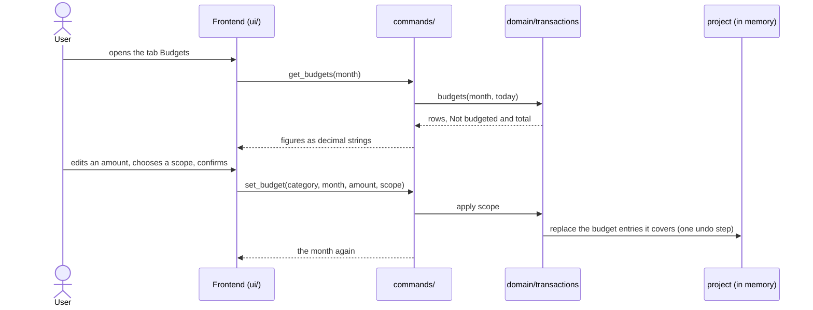

# CSD-036: Budgets

> Tabs: the tabs of the Transactions page are set by CSD-035 (Page tabs). This CSD adds the tab "Budgets" there (REQ-1).

## 1. Intent
The Transactions page (CSD-032, CSD-033) shows what was spent per category, but not what the owner meant to spend. This capability lets the owner set a monthly budget per category and see, for one month at a time, how much of each budget is spent and what is left. A budget is not always the same every month, so the owner chooses when setting it whether the amount holds for this month only, from this month on, or for all months. It comes from GitHub issue 82, and it reverses the earlier non-goal on budgets (CSD-032 NG-6). It is for one person keeping a private, local history, and it follows the categories the owner already keeps.

## 2. Scope
### 2.1 In scope
- The tab "Budgets" on the Transactions page: one month at a time, a row per category with its budget, the spending, what remains and a bar, a row "Not budgeted" and a total.
- Setting and removing the budget of a category for this month only, from this month on, or for all months.
- Storage of the budgets as a section of the project file (CSD-002), and the consequences for category changes (CSD-032), undo (CSD-027), the currency confirmation (CSD-003), Discrete mode (CSD-030), the language (CSD-022) and the example project.

### 2.2 Non-goals
- NG-1: Carrying unused budget over to the next month.
- NG-2: Alerts and notifications when a budget is nearly spent or exceeded.
- NG-3: Forecasts and projections.
- NG-4: Budgets for income, and credits counted against a budget.
- NG-5: A budget line or marker on the Insights chart of CSD-033.
- NG-6: Yearly, weekly or any other period than a calendar month.
- NG-7: A budget for a group of categories, a separate overall budget, and a budget for "Uncategorized".
- NG-8: Copying a budget from another month, a range of months other than the three scopes of REQ-6, and a history list or timeline of the changes.
- NG-9: Budgets for expenses (CSD-013), bank accounts (CSD-009) or any figure other than the debits of transactions.
- NG-10: Exporting budgets, and remembering the month shown between sessions.

## 3. Definitions
| Term | Meaning |
|---|---|
| **Budget month** | A calendar month (`YYYY-MM`), taken from the date of a transaction. |
| **Budget** | An amount of 0.00 or more in the project currency for one category in one budget month, or no budget. |
| **No budget** | A category with no amount in a month. Its spending has no limit. It is not the same as a budget of 0.00. |
| **Spent** | The sum of the debits (negative amounts) of the category in the month, as a positive amount. Credits are not part of it (CSD-033 Spending). |
| **Remaining** | The budget minus the spent amount, rounded as CSD-000 CON-8 says. It is negative when the category is over budget. |
| **Over budget** | Spent is more than the budget. A budget of 0.00 with any spending is over budget. |
| **Scope** | What a change of a budget covers: "Only this month", "From this month on" or "All months" (REQ-6). |
| **Single-month amount** | A budget set with the scope "Only this month". |
| **Budgetable category** | A category of CSD-032 other than "Uncategorized". |

## 4. Requirements

### 4.0 Overview flow


**REQ-1: The tab Budgets** *(ubiquitous)*
The Transactions page shall have the tabs, left to right, "Accounts", "Categories", "Rules", "Yearly totals", "Transactions", "Insights" and "Budgets", the tab "Transactions" is selected when a project is opened, and the tab "Budgets" holds one panel "Budgets".

```gherkin
@AC-1.1
Scenario: Seven tabs
  When the user opens Transactions
  Then the tabs are "Accounts", "Categories", "Rules", "Yearly totals", "Transactions", "Insights" and "Budgets"
  And the tab "Transactions" is selected
  And choosing "Budgets" shows the panel "Budgets"

@AC-1.2
Scenario: No Budget page in the left pane
  Then the left pane has no item "Budget"
```

**REQ-2: One month at a time** *(state-driven)*
While the tab "Budgets" is shown, the app shall show one budget month, which is the current month when the tab is first opened for a project, with buttons "Previous month" and "Next month" that move it by one month. Back shall stop at the earliest month that holds a transaction or a budget entry (the current month when there is none), and forward shall have no limit. The month is written `YYYY-MM`, and while it is the current month the panel says that it is partial ("MTD", as CSD-033 REQ-3).

```gherkin
@AC-2.1
Scenario: Opens on the current month
  Given today is 15/10/2026
  When the user opens the tab "Budgets"
  Then the month "2026-10 MTD" is shown

@AC-2.2
Scenario: Moving between months
  Given the earliest transaction is dated 12/08/2026 and today is 15/10/2026
  When the user chooses "Previous month" twice
  Then the month "2026-08" is shown and "Previous month" is disabled
  When the user chooses "Next month" four times
  Then the month "2026-12" is shown and "Next month" is still enabled

@AC-2.3
Scenario: Nothing to go back to
  Given no transactions and no budgets, and today is 15/10/2026
  Then "Previous month" is disabled in the month "2026-10 MTD"

@AC-2.4
Scenario: The month stays while the tab is reopened
  Given the user moved to the month "2026-08"
  When the user goes to the tab "Insights" and back to "Budgets"
  Then the month "2026-08" is shown, and after another project is opened it is the current month again
```

**REQ-3: What a month shows** *(ubiquitous)*
For the month shown, the panel shall list every budgetable category in the order of the category list of CSD-032, each as a row with its budget, the spent amount, the remaining amount and a bar. The panel shall end with a row "Not budgeted" that holds the spending of "Uncategorized", and a row "Total" with the sum of the budgets and the sum of the spent amounts and remaining amounts of the categories that have a budget. A category with no budget shows its spent amount, no remaining amount and no bar, and a button "Set budget" in place of the budget. Rust computes every figure and the frontend draws what it receives.

```gherkin
@AC-3.1
Scenario: A month with budgets
  Given the budgets Groceries 400.00 and Leisure 100.00 for 2026-10
  And debits in 2026-10 of Groceries 150.00, Leisure 120.00 and Uncategorized 30.00, and of Shopping 45.00 (no budget)
  Then the row Groceries shows 400.00, 150.00 and 250.00
  And the row Leisure shows 100.00, 120.00 and -20.00 and its bar is marked as over budget
  And the row Shopping shows 45.00 and "Set budget", with no remaining amount and no bar
  And the row "Not budgeted" shows 30.00
  And the row "Total" shows 500.00, 270.00 and 230.00

@AC-3.2
Scenario: The bar
  Given the budget Groceries 400.00 and spending of 100.00
  Then the bar of Groceries is a quarter full
  And with spending of 400.00 it is full and not marked, and with 450.00 it is full and marked as over budget

@AC-3.3
Scenario: A budget of 0.00
  Given the budget Leisure 0.00 for 2026-10
  Then with spending of 0.00 the row shows 0.00, 0.00 and 0.00, an empty bar and is not marked
  And with spending of 5.00 the row shows 0.00, 5.00 and -5.00 and is marked as over budget

@AC-3.4
Scenario: A month without transactions
  Given the budget Groceries 400.00 and no transaction in 2026-11
  Then in the month 2026-11 the row Groceries shows 400.00, 0.00 and 400.00
```

**REQ-4: What counts as spent** *(ubiquitous)*
The spent amount of a category in a month shall be the sum of its debits dated in that month, and credits shall not be counted in it or netted against it.

```gherkin
@AC-4.1
Scenario: Credits are ignored
  Given in 2026-10 the debits Groceries 150.00 and a credit Groceries 20.00 (a refund)
  Then Groceries shows spent 150.00

@AC-4.2
Scenario: The month comes from the date
  Given a debit of Groceries 10.00 dated 31/10/2026 and one of 20.00 dated 01/11/2026
  Then Groceries shows spent 10.00 in 2026-10 and 20.00 in 2026-11
```

**REQ-5: Which budget a month has** *(ubiquitous)*
The budget of a category in a month shall be the amount last set for that month by one of the three scopes of REQ-6 and REQ-7, in the order they were applied, and the month has no budget when the last such change removed it or none covers it.

```gherkin
@AC-5.1
Scenario: Later changes win
  Given the user sets Groceries to 400.00 for all months
  And then sets 450.00 from 2026-10 on
  Then Groceries has 400.00 in 2026-09 and 450.00 in 2026-10 and in 2027-03

@AC-5.2
Scenario: No budget until one is set
  Given a category that never had a budget
  Then it has no budget in any month and shows "Set budget"
```

**REQ-6: Set a budget with a scope** *(event-driven)*
When the user chooses "Set budget" on a row, or edits its budget, the app shall open a dialog with the amount and the options "Only this month", "From this month on" and "All months", in which "From this month on" is selected, and when the user confirms, the app shall apply the amount to the month M shown and the category with the chosen scope. "Only this month" shall set M alone and leave every other month as it was. "From this month on" shall set M and every later month, replacing every amount that was set for a month after M, and leave earlier months as they were. "All months" shall set every month, earlier and later, and replace every amount of that category.

```gherkin
@AC-6.1
Scenario: The dialog
  When the user chooses "Set budget" on the row Groceries of 2026-10
  Then a dialog asks for the amount and shows the options "Only this month", "From this month on" (selected) and "All months"
  And nothing changes before the user confirms, and cancelling changes nothing

@AC-6.2
Scenario: Only this month
  Given Groceries has 400.00 in every month
  When the user sets 500.00 for 2026-10 with "Only this month"
  Then Groceries has 400.00 in 2026-09, 500.00 in 2026-10 and 400.00 in 2026-11

@AC-6.3
Scenario: From this month on
  Given Groceries has 400.00 in every month and 700.00 only in 2026-12
  When the user sets 450.00 for 2026-10 with "From this month on"
  Then Groceries has 400.00 in 2026-09, and 450.00 in 2026-10, 2026-11, 2026-12 and 2027-01

@AC-6.4
Scenario: All months
  Given Groceries has 400.00 until 2026-09, 450.00 from 2026-10 on and 700.00 only in 2026-12
  When the user sets 500.00 for 2026-10 with "All months"
  Then Groceries has 500.00 in every month, including 2025-01 and 2026-12

@AC-6.5
Scenario: Only this month does not touch what follows
  Given Groceries has 450.00 from 2026-12 on and nothing before
  When the user sets 300.00 for 2026-10 with "Only this month"
  Then Groceries has no budget in 2026-09, 300.00 in 2026-10, no budget in 2026-11 and 450.00 in 2026-12

@AC-6.6
Scenario: The amount is rounded
  When the user sets 400.505 with any scope
  Then the budget is 400.51
```

**REQ-7: Remove a budget** *(event-driven)*
When the user chooses "Remove budget" on a row that has a budget, the app shall open the dialog of REQ-6 without an amount and, when the user confirms, remove the budget of that category with the chosen scope, so that the months covered have no budget (not 0.00), by the same rules as REQ-6.

```gherkin
@AC-7.1
Scenario: Remove from this month on
  Given Groceries has 400.00 in every month
  When the user removes the budget for 2026-10 with "From this month on"
  Then Groceries has 400.00 in 2026-09 and no budget in 2026-10 and later

@AC-7.2
Scenario: Remove for this month only
  Given Groceries has 400.00 in every month
  When the user removes the budget for 2026-10 with "Only this month"
  Then Groceries has no budget in 2026-10 and 400.00 in 2026-09 and 2026-11

@AC-7.3
Scenario: Remove for all months
  Given Groceries has 400.00 until 2026-09 and 450.00 from 2026-10 on
  When the user removes the budget for 2026-10 with "All months"
  Then Groceries has no budget in any month

@AC-7.4
Scenario: 0.00 is not no budget
  Given the budget Leisure 0.00 for 2026-10
  Then the row shows the budget 0.00, and after "Remove budget" for 2026-10 it shows "Set budget"

@AC-7.5
Scenario: No remove button without a budget
  Given Shopping has no budget in 2026-10
  Then its row has "Set budget" and no "Remove budget"
```

**REQ-8: The label for a single month** *(state-driven)*
While the budget of a category in the month shown is a single-month amount, the app shall show the label "This month only" next to it.

```gherkin
@AC-8.1
Scenario: A single-month amount is labelled
  Given Groceries has 400.00 in every month and 500.00 for 2026-10 set with "Only this month"
  Then the row Groceries in 2026-10 shows "This month only" and in 2026-11 it does not

@AC-8.2
Scenario: A later scope replaces the label
  Given the label "This month only" on Groceries in 2026-10
  When the user sets 450.00 for 2026-10 with "From this month on"
  Then the label is gone
```

**REQ-9: Invalid input** *(unwanted behaviour)*
If the amount is not a plain number, is negative after rounding or exceeds 1,000,000,000.00, or the category is "Uncategorized" or does not exist, or the month is not a valid `YYYY-MM`, or the scope is not one of the three, then the app shall reject the change with an error code and a safe message, store nothing and record no undo step. A typed amount with more than two decimals is rounded, not rejected (CSD-000 CON-8), and 0.00 is valid.

```gherkin
@AC-9.1
Scenario Outline: Invalid changes are rejected
  When the user tries to set <what>
  Then it is rejected with error code "<code>"
  And no budget changes and no undo step is recorded

  Examples:
    | what                                  | code                      |
    | the amount "abc"                      | BUDGET_AMOUNT_INVALID     |
    | the amount "-5.00"                    | BUDGET_AMOUNT_INVALID     |
    | the amount "1000000000.01"            | BUDGET_AMOUNT_INVALID     |
    | a budget for "Uncategorized"          | BUDGET_CATEGORY_PROTECTED |
    | a budget for a category that is gone  | BUDGET_CATEGORY_UNKNOWN   |
    | the month "2026-13"                   | BUDGET_MONTH_INVALID      |
    | the scope "sometimes"                 | BUDGET_SCOPE_INVALID      |

@AC-9.2
Scenario: Rounding to zero is valid
  When the user sets "0.004"
  Then the budget is 0.00
```

**REQ-10: Category changes** *(event-driven)*
When the user renames a category, its budgets shall stay with it, and when the user confirms deleting a category, the app shall delete its budgets in the same change as the move of its transactions (CSD-032 REQ-13), so that one undo restores them together.

```gherkin
@AC-10.1
Scenario: Rename keeps the budget
  Given Groceries has 400.00 in every month
  When the user renames it to "Food"
  Then "Food" has 400.00 in every month

@AC-10.2
Scenario: Delete removes the budget, undo restores it
  Given Groceries has 400.00 in every month and transactions
  When the user confirms deleting Groceries
  Then no budget remains for it and its transactions are Uncategorized
  When the user chooses Edit > Undo
  Then Groceries, its transactions and its budget are back
```

**REQ-11: Undo** *(ubiquitous)*
Setting or removing a budget shall be one undo step (CSD-027 REQ-3), whatever the scope, and a rejected change shall record none.

```gherkin
@AC-11.1
Scenario: One step for any scope
  Given Groceries has 400.00 in every month
  When the user sets 450.00 from 2026-10 on and chooses Edit > Undo once
  Then Groceries has 400.00 in every month
  And Edit > Redo sets the 450.00 again
```

**REQ-12: The project file** *(ubiquitous)*
The project file shall hold the required section `budgets` in addition to the sections of CSD-002 REQ-16, with `format_version` 5, and the strict schema of CSD-002 REQ-17 shall apply: the file is rejected with `PROJECT_INVALID_FILE` when a budget names an unknown category or "Uncategorized", holds a negative amount or one with more than two decimals, a malformed month, or two amounts for the same category and month. A version 4 file shall be opened as a version 5 project with no budgets and written as version 5 on the next save (CSD-002 REQ-30).

```gherkin
@AC-12.1
Scenario: A saved new project has the section
  When the user saves a new project
  Then the file has "format_version" 5 and the section "budgets", which is empty

@AC-12.2
Scenario: A version 4 file is upgraded on opening
  Given a version 4 project file without budgets
  When the user opens it
  Then the project opens with no budgets (CSD-002 AC-30.1)

@AC-12.3
Scenario: The first save writes version 5
  Given the project of AC-12.2 is open
  When the user saves it
  Then the file has "format_version" 5 and the section "budgets", and the original is kept as ".bak" (CSD-002 AC-30.2)

@AC-12.4
Scenario Outline: Invalid budgets in the file
  Given a project file whose budgets hold <what>
  When the user opens it
  Then it is rejected with error code "PROJECT_INVALID_FILE"

  Examples:
    | what                                           |
    | a category id that does not exist              |
    | the category "Uncategorized"                   |
    | the amount "-1.00"                             |
    | the amount "400.005"                           |
    | the month "2026-13"                            |
    | two amounts for Groceries and 2026-10          |

@AC-12.5
Scenario: Budgets survive saving and opening
  Given Groceries has 400.00 in every month and 500.00 for 2026-10 only
  When the user saves the project and opens it again
  Then the months show the same budgets and "This month only" on 2026-10
```

**REQ-13: Currency confirmation** *(event-driven)*
When the user changes the project currency in a project that holds at least one budget, the app shall show the confirmation of CSD-003 REQ-5, and shall count budgets as entries; the budgets are not converted.

```gherkin
@AC-13.1
Scenario: Budgets count as entries
  Given a project whose only entry is one budget
  When the user changes the currency
  Then the confirmation is shown
```

**REQ-14: Discrete mode** *(state-driven)*
While Discrete mode is on (CSD-030), the panel shall hide the budget, spent and remaining amounts and the total, and blur the amount in the dialog (CSD-030 REQ-9), and the bars and the over-budget mark stay visible.

```gherkin
@AC-14.1
Scenario: Amounts are hidden, bars are not
  Given Discrete mode is on and Groceries with a budget of 400.00 and spent 150.00
  Then the budget, spent and remaining show "•••••"
  And the bar is drawn and the page text and accessible names hold no digit of the amounts
```

**REQ-15: Language and number format** *(ubiquitous)*
The app shall show the texts of the tab in the language setting (CSD-022), the name of a category as stored, except "Uncategorized", which is translated, amounts in the number format the user chose (CSD-029) and months as `YYYY-MM`.

```gherkin
@AC-15.1
Scenario: Dutch
  Given the language is Dutch
  Then the tab reads "Budgetten", the row "Not budgeted" reads "Niet begroot" and "Uncategorized" is "Zonder categorie"
```

**REQ-16: No categories and fresh figures** *(state-driven)*
While the project has no budgetable category, the panel shall show the note "No categories yet. Add a category on the tab Categories to set a budget." and no table. When the user opens the tab, and after a project is opened, the language changes or a change is applied, the app shall compute the figures from the project as it is now, saved or not.

```gherkin
@AC-16.1
Scenario: No categories
  Given every user-defined category was deleted
  Then the note is shown and the table is not

@AC-16.2
Scenario: Reopening the tab
  Given a transaction was recategorized on the tab "Transactions"
  When the user selects the tab "Budgets"
  Then Rust is asked again and the spent amounts show the change
```

**REQ-17: Example project** *(ubiquitous)*
The example project (CSD-002 REQ-21) shall hold budgets for a few categories, one of them with a different amount from a month on and one with a single-month amount, and every test fixture shall be obviously fake.

```gherkin
@AC-17.1
Scenario: The example project has budgets
  When the example project is generated
  Then it holds budgets for at least three categories and a single-month amount
```

## 5. Interfaces and contracts
Commands (indicative names; the owner of the code may rename them):

- `get_budgets(month?)` where `month` is `YYYY-MM` (default: the current month) returns:

```json
{
  "month": "2026-10", "is_partial": true, "earliest_month": "2026-08",
  "rows": [{ "category": "…", "budget": "400.00", "single_month": false, "spent": "150.00", "remaining": "250.00", "bar_percent": "37.50", "over": false },
           { "category": "…", "budget": null, "single_month": false, "spent": "45.00", "remaining": null, "bar_percent": null, "over": false }],
  "not_budgeted": "30.00",
  "total": { "budget": "500.00", "spent": "270.00", "remaining": "230.00" }
}
```

- `set_budget(category, month, amount, scope)` and `remove_budget(category, month, scope)` with `scope` `"month"`, `"from"` or `"all"`; both return the month as `get_budgets` does.
- Error codes: `BUDGET_AMOUNT_INVALID`, `BUDGET_CATEGORY_UNKNOWN`, `BUDGET_CATEGORY_PROTECTED`, `BUDGET_MONTH_INVALID`, `BUDGET_SCOPE_INVALID`.
- Project file section `budgets`, one entry per category that has any: `{ category_id, from: [{ month, amount }], only: [{ month, amount }] }`. In `from` a `month` of `null` means "since the first month" (the scope "All months") and an `amount` of `null` means "no budget"; the entry with the latest `month` at or before the budget month applies, and an `only` entry for the month wins over `from`. The scopes of REQ-6 replace entries as follows: "All months" clears both lists and sets `from` to one entry with month `null`; "From this month on" removes the `from` and `only` entries of M and later and adds a `from` entry at M; "Only this month" sets the `only` entry of M.

## 6. Constraints
- CON-1: The figures are computed in Rust (`domain/transactions/budgets.rs`); the frontend only draws what it receives (`CLAUDE.md` layout rule). Rationale: the frontend never computes financial figures.
- CON-2: Amounts are `Money` (2 decimals, half-up, CSD-000 CON-8), never floats. Rationale: `CLAUDE.md` money rules.
- CON-3: No new dependency, Tauri permission or network access, and no `style=` attributes in `ui/`. Rationale: `CLAUDE.md` Tauri security.
- CON-5: The golden files do not hold `get_budgets` (the project file holds the budgets), because the ids of its categories would renumber the ids of the other areas in `ipc-reads.json`; the IPC and DOM tests cover it. Rationale: the numbering follows the first appearance of an id, as for CSD-033 CON-3.
- CON-4: Budgets are never part of net worth or the dashboard, and no budget ever changes a transaction. Rationale: transactions stand apart from the rest of the app (CSD-032 NG-3).

## 7. Verification
| ACs | Proven by |
|---|---|
| AC-2.1 to AC-2.3 (month range), AC-3.1 to AC-3.4, AC-4.1, AC-4.2, AC-5.1, AC-5.2, AC-6.2 to AC-6.6, AC-7.1 to AC-7.5, AC-9.1, AC-9.2, AC-10.1, AC-10.2, AC-11.1, AC-12.1 to AC-12.5, AC-13.1, AC-17.1 | `cargo test test_csd036_` (Rust, `domain/transactions` and `storage/project`, with IPC tests) |
| AC-1.1, AC-1.2, AC-2.1 to AC-2.4, AC-3.1 to AC-3.3, AC-6.1, AC-8.1, AC-8.2, AC-14.1, AC-15.1, AC-16.1, AC-16.2 | `npm test` (`ui/tests/`, titled `test_csd036_ac_n_m_...`) |
| Golden files | `GOLDEN_UPDATE=1 cargo test golden` once, then the diff reviewed by the owner |
| Manual | open `examples/example.varde`, visit the tab "Budgets", set and remove a budget with each scope |

## 8. Open questions
- OQ-1 (resolved 22/11/2026): Does a version 4 file need the upgrade script? Answer: no. The first release is out, so the app opens a version 4 file, adds the empty section in memory and writes version 5 on the next save (REQ-12, CSD-002 REQ-30). The section is still required in every file the app writes.
- OQ-2 (resolved 22/11/2026): Does "Not budgeted" hold the spending of categories without a budget? Answer: no. Every budgetable category is its own row, and "Not budgeted" holds only the spending of "Uncategorized" (REQ-3), so nothing is counted twice.
- OQ-3 (resolved 22/11/2026): Is a single-month amount that equals its neighbours still labelled? Answer: yes, the label follows how the amount was set, not its value (REQ-8).

## 9. Changelog
- 0.3 (22/11/2026): OQ-2 and OQ-3 resolved by the owner: the drafted answers stand (REQ-3, REQ-8). No other change.
- 0.2 (22/11/2026): A version 4 file is opened and upgraded in the app instead of through the script (REQ-12, AC-12.2, AC-12.3; CSD-002 REQ-30). OQ-1 resolved. Owner decision.
- 0.1 (22/11/2026): First draft, from GitHub issue 82 and the grill-me interview. Owner answers: a new CSD and a tab "Budgets" on the Transactions page (last tab), a monthly amount per category, scopes "Only this month", "From this month on" and "All months" with a dialog that preselects "From this month on", debits only, no budget for "Uncategorized", no separate total, the budget follows a rename and goes with a deleted category in one undo step, Discrete mode hides amounts and keeps the bars.
