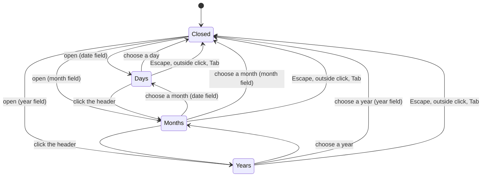

# CSD-036: Date picker

## 1. Intent
Every date in the app is typed as `dd/mm/yyyy` and every month as `yyyy-mm`, with a mask that adds the separators (GitHub issue 83). Typing is exact but slow, and the user cannot see which weekday a date is or how far a month lies from today. This capability adds one date picker to every field that asks for a date or a month: the days of a month with the month and year in the header, an overview of the months of a year, and an overview of the years of a decade. The user still can type; the picker is a second way to fill the same field. It is for the owner filling in forms and filters.

## 2. Scope
### 2.1 In scope
- A picker for every full date field (`dd/mm/yyyy`) and month field (`yyyy-mm`) of the forms and of the table filters (CSD-028), and, where a field asks for only a year, a picker that opens on the decade overview.
- A picker that offers only some periods, the other ones grey and not selectable (REQ-12), used by the year and month fields of the donut charts of CSD-032 REQ-35.
- How the picker opens and closes, its three views and how the user moves between them, what a pick writes into the field, its keyboard use, its place on the screen, and its texts.

### 2.2 Non-goals
- NG-1: Selecting a range of dates, a time of day, or several dates. A picker selects one date, one month or one year.
- NG-2: Blocking or greying out dates in the fields of forms and filters, for example before a purchase date or in the future. Those pickers allow every real date and Rust judges (REQ-8). Only a field that is given the periods it offers (REQ-12) greys out the others.
- NG-3: The browser's own `<input type="date">`, and any change to the typed formats, the mask or the validation in Rust.
- NG-4: A "Clear" button, week numbers, a choice of the first weekday, and remembering the view between openings.
- NG-5: A change to what a field means: which fields are required, their labels, and their errors stay as the owning CSD says.

## 3. Definitions
| Term | Meaning |
|---|---|
| **Field** | A text input that holds a date (`dd/mm/yyyy`), a month (`yyyy-mm`) or a year (`yyyy`). |
| **Level** | The view of the picker: **days** (the days of one month), **months** (the 12 months of one year) or **years** (the 10 years of one decade, written `2020 – 2029`). |
| **Pick** | The user chooses a day, a month or a year in the lowest level the field needs (REQ-1), which fills the field and closes the picker. |
| **Today** | The day of the clock of the computer, in its own time zone. |

## 4. Requirements

### 4.0 Overview flow


**REQ-1: Which fields have a picker** *(ubiquitous)*
Every date field, every month field and every year field of the app, in forms and in the filters of the statement tables, shall have a picker that opens on its own level: the days for a date field, the months for a month field and the years for a year field, and a pick in the lowest level that field needs fills it. A year field shows only the years level, the decades, and never the days or the months; a field that is a month field or a year field by what the form asks, such as the period of a statement, follows the kind it has when the picker opens.

```gherkin
@AC-1.1
Scenario Outline: Every field has a picker on its own level
  Given the field "<field>"
  When the user opens its picker
  Then the picker shows the level "<level>"

  Examples:
    | field                                    | level  |
    | the start date of a job                  | days   |
    | the purchase date of a house             | days   |
    | the date of a transaction rule period    | days   |
    | the period of a paycheck                 | months |
    | the "from" month of a statement filter   | months |
    | a field that asks for only a year        | years  |

@AC-1.3
Scenario: A year field shows only the decades
  Given the period field of a yearly statement, which asks for a year
  When the user opens its picker
  Then the picker shows "2020 – 2029" and its header is not a button
  And the arrows go ten years at a time
  When the user chooses 2031
  Then the field holds "2031" and no month is ever shown
  And the same field of a monthly statement opens on the months

@AC-1.2
Scenario: No field is left without a picker
  Then every input with a date or month mask in the app has a calendar button
```

**REQ-2: Opening the picker** *(event-driven)*
When the user clicks the field, clicks the calendar button at the right end of the field, or presses Down or Alt+Down in it, the app shall open the picker below the field, on the level of REQ-1, showing the month, year or decade of the date in the field when that text is valid and the month, year or decade of today otherwise; focusing the field with the Tab key alone shall not open it.

```gherkin
@AC-2.1
Scenario: Click, button and key open it
  Given an empty date field and today is 22/11/2026
  When the user clicks the field
  Then the picker shows the days of November 2026
  And clicking the calendar button, or pressing Down in the closed field, does the same

@AC-2.2
Scenario: The field's own date is shown
  Given the field holds "15/03/2025"
  When the user opens the picker
  Then the days of March 2025 are shown with the 15th marked as selected

@AC-2.3
Scenario: Tab alone does not open it
  When the user tabs into the field
  Then the picker stays closed
```

**REQ-3: Closing the picker** *(event-driven)*
When the user presses Escape, clicks outside the picker and its field, tabs out of the field or makes a pick, the app shall close the picker; on Escape the focus shall return to the field and the key shall close only the picker, not the dialog or filter panel it is in.

```gherkin
@AC-3.1
Scenario: Escape closes only the picker
  Given a form dialog with an open picker on a date field
  When the user presses Escape
  Then the picker is closed, the dialog is still open and the field has the focus

@AC-3.2
Scenario Outline: Other ways to close it
  Given an open picker
  When the user <action>
  Then the picker is closed

  Examples:
    | action                                   |
    | clicks outside the picker and the field  |
    | presses Tab in the field                 |
    | picks a day                              |
    | closes the dialog the field is in        |
```

**REQ-4: The days level** *(ubiquitous)*
The days level shall show, centred in its header, the month name and the year ("November 2026") with an arrow button to its left that goes to the previous month and one to its right that goes to the next month, then the short weekday names with Monday first, and the days in a grid of six rows; the days of the neighbouring months fill the grid dimmed and may be chosen, today is marked, and the date in the field is shown as selected.

```gherkin
@AC-4.1
Scenario: The grid of November 2026
  Given today is 22/11/2026
  When the user opens the picker on an empty date field
  Then the header reads "November 2026" with a previous arrow left of it and a next arrow right of it
  And the weekdays read Mon Tue Wed Thu Fri Sat Sun
  And the grid has 6 rows, the first row starts with the dimmed 26th of October and the 1st of November is under "Sun"
  And the 22nd is marked as today

@AC-4.2
Scenario: A neighbouring day can be chosen
  Given the days of November 2026
  When the user chooses the dimmed 1st of December
  Then the field holds "01/12/2026"

@AC-4.3
Scenario: The arrows change the month
  Given the days of November 2026
  When the user clicks the next arrow twice
  Then the header reads "January 2027"
  And the previous arrow goes back to "December 2026"
```

**REQ-5: The months and years levels** *(event-driven)*
When the user clicks the header of the days level, the app shall show the months level with the year in the header, 12 months in a grid and arrows that go one year back or forward; when the user clicks the header of the months level, the app shall show the years level with the decade (`2020 – 2029`) in the header, 10 years in a grid and arrows that go ten years back or forward; choosing a month on the months level of a date field shall show the days of that month, and choosing a year shall show the months of that year; the header of the years level is not a button.

```gherkin
@AC-5.1
Scenario: From days to months to years and back
  Given the days of November 2026
  When the user clicks the header "November 2026"
  Then the months level shows "2026" in the header and 12 months, Jan to Dec, with Nov marked as current
  When the user clicks the header "2026"
  Then the years level shows "2020 – 2029" in the header and the years 2020 to 2029
  When the user chooses 2024
  Then the months of 2024 are shown
  When the user chooses "Mar"
  Then the days of March 2024 are shown

@AC-5.2
Scenario: The arrows step by the size of the level
  Given the months level of 2026
  When the user clicks the next arrow
  Then the header reads "2027"
  When the user opens the years level and clicks the previous arrow
  Then the header reads "2010 – 2019"

@AC-5.3
Scenario: The ends of the calendar
  Given the months level of year 1
  Then the previous arrow is disabled
  And the next arrow of the year 9999 is disabled
```

**REQ-6: A pick fills the field** *(event-driven)*
When the user makes a pick, the app shall write the date as `dd/mm/yyyy`, the month as `yyyy-mm` or the year as `yyyy` into the field, with the same input event that typing fires, so that the mask, the form and the filters react as they do to typed text.

```gherkin
@AC-6.1
Scenario Outline: What a pick writes
  Given an empty "<kind>" field
  When the user picks "<choice>"
  Then the field holds "<text>"
  And an input event was fired on the field

  Examples:
    | kind  | choice           | text       |
    | date  | 5 March 2026     | 05/03/2026 |
    | month | March 2026       | 2026-03    |
    | year  | 2026             | 2026       |

@AC-6.2
Scenario: A filter reacts to a pick
  Given the period filter of the Transactions table
  When the user picks 01/07/2026 as the "from" date
  Then the table is asked again with the from date 2026-07-01
```

**REQ-7: Typing keeps working** *(state-driven)*
While the picker is open, the app shall keep the field editable with the mask of CSD-022, and shall move the picker to the date, month or year of the text as soon as that text is a valid date, month or year, and to the month, year or decade of today while it is not.

```gherkin
@AC-7.1
Scenario: The picker follows what is typed
  Given an open picker on an empty date field
  When the user types "15/03/2025"
  Then the picker shows the days of March 2025 with the 15th selected
  When the user deletes the last digit
  Then the picker shows the month of today and nothing is selected
```

**REQ-8: Every real date is allowed** *(ubiquitous)*
Unless the field is given the periods it offers (REQ-12), the picker shall offer every real calendar date from 01/01/0001 to 31/12/9999 and shall not grey out or block any of them; whether a date is acceptable stays Rust's decision when the form is saved, with the error the owning CSD gives.

```gherkin
@AC-8.1
Scenario: A sell date before the purchase date can be picked
  Given the purchase date 01/06/2026 in a house form
  When the user picks 01/05/2026 as the sell date
  Then the field holds "01/05/2026" and no day is disabled
  And saving shows the error of CSD-019, not the picker
```

**REQ-12: A field may offer only some periods** *(optional)*
Where a field is given the months or the years it offers, or the first month or year it offers with no last one, the picker shall show every other month or year grey and not selectable, in the months level and in the years level, with a name that says it is not available; its arrows shall not go past the earliest period offered, nor past the latest one when there is a last one; and it shall open on the period in the field, or on the latest period offered (the current one when there is no last one) while the field is empty. Such a field is read-only and shows its period as the year ("2026") or as the month name and the year ("November 2026"); it has the calendar button and the keys of REQ-10, and no typing (REQ-7 does not apply).

```gherkin
@AC-12.1
Scenario: Only the months with data can be chosen
  Given a field that offers the months 2026-11, 2026-10 and 2025-03
  When the user opens its picker on the months of 2026
  Then "Oct" and "Nov" can be chosen and the other ten months are grey and disabled
  When the user clicks the header "2026"
  Then in the years level 2025 and 2026 can be chosen and the other years are grey and disabled

@AC-12.2
Scenario: The arrows stop at the ends of the data
  Given a field that offers the years 2025 and 2026
  When the user opens its picker on the years
  Then the previous and the next arrow are disabled, as 2020 – 2029 holds the earliest and the latest year offered
  And given the months 2026-11 and 2025-03 the previous arrow of the months level of 2025 is disabled

@AC-12.3
Scenario: Opening and choosing
  Given a field that offers the years 2025 and 2026 and holds 2025
  When the user opens its picker
  Then 2025 is shown as selected
  When the user chooses 2026
  Then the field shows "2026" and the picker is closed
  And a field that is empty opens on the latest period offered

@AC-12.4
Scenario: The field is read-only
  Given such a field
  When the user types in it
  Then its text does not change

@AC-12.5
Scenario: Only a first period, no last one
  Given a field that offers the months from 2026-08 on and today is 15/10/2026
  When the user opens its picker on the months of 2026
  Then "Aug" to "Dec" can be chosen and "Jan" to "Jul" are grey and disabled
  And the next arrow is enabled and the months of 2030 can be chosen
  And the previous arrow of 2026 is disabled and the years level greys 2025 and every earlier year
```

**REQ-13: The Today button** *(event-driven)*
When the user presses the button "Today" at the bottom of the picker, the app shall move the picker to today on the level it shows, the days of the current month on the days level, the months of the current year on the months level and the decade of the current year on the years level, and shall keep the picker open; it shall not write anything into the field. On the days level the focus moves to today's day cell. A field that offers only some periods (REQ-12) moves the same way, and a period it does not offer stays grey.

```gherkin
@AC-13.1
Scenario: Today on the days level
  Given today is 22/11/2026 and the picker shows the days of March 2025
  When the user presses "Today"
  Then the picker shows the days of November 2026 with the 22nd marked as today
  And the picker is still open and the field is unchanged

@AC-13.2
Scenario: Today on the months and years levels
  Given a month field whose picker shows the months of 2019
  When the user presses "Today"
  Then the picker shows the months of 2026 and is still open
  When the user opens the years level and moves to 2010 – 2019 and presses "Today"
  Then the picker shows 2020 – 2029 and is still open
  And in a year field the picker shows 2020 – 2029 and the field is unchanged

@AC-13.3
Scenario: Today in a limited field
  Given a field that offers only 2025 and the picker shows the months of 2025
  When the user presses "Today"
  Then the months of 2026 are shown, all grey, and the picker is still open

@AC-13.4
Scenario: The button is translated
  Given the language is Dutch
  Then the button reads "Vandaag"
```

**REQ-9: Place on the screen** *(ubiquitous)*
The picker shall be a child of the dialog or panel of its field, so a modal dialog does not hide it, shall open below the field and shall open above the field when there is not enough room below, and shall stay in the window.

```gherkin
@AC-9.1
Scenario: Inside the dialog
  Given a modal form dialog with a date field
  When the picker opens
  Then the picker is inside that dialog

@AC-9.2
Scenario: No room below
  Given a field near the bottom edge of the window
  When the picker opens
  Then it is above the field and inside the window
```

**REQ-10: Keyboard and screen reader** *(ubiquitous)*
The picker shall be a dialog labelled by its header, the days a grid of day cells with an accessible name each ("22 November 2026"), the header and the arrows buttons with accessible names ("Previous month", "Next month", "Choose a month", "Choose a year"); in the grid the arrow keys shall move the focus by one day or one week, Home and End to the start and end of the week, PageUp and PageDown by one month, Enter and Space shall make the pick, and Escape shall close it (REQ-3).

```gherkin
@AC-10.1
Scenario: The roles and names
  When the picker is open on the days level
  Then it has the role "dialog" labelled by its header and holds a "grid" of day cells
  And the arrows are buttons named "Previous month" and "Next month"

@AC-10.2
Scenario Outline: Moving by keys
  Given the focus is on the 15th of March 2026
  When the user presses <key>
  Then the focus is on <result>

  Examples:
    | key      | result            |
    | Right    | 16 March 2026     |
    | Left     | 14 March 2026     |
    | Down     | 22 March 2026     |
    | Up       | 8 March 2026      |
    | PageDown | 15 April 2026     |
    | PageUp   | 15 February 2026  |

@AC-10.3
Scenario: Enter picks
  Given the focus is on the 15th of March 2026
  When the user presses Enter
  Then the field holds "15/03/2026" and the picker is closed
```

**REQ-11: Language and Discrete mode** *(ubiquitous)*
The month names, the weekday names and the names of the buttons shall follow the chosen language (CSD-022), and the picker shall not be blurred or hidden in Discrete mode, as the date fields are not (CSD-030).

```gherkin
@AC-11.1
Scenario: Dutch
  Given the language is Dutch and today is 22/11/2026
  When the user opens the picker on an empty date field
  Then the header reads "november 2026" and the weekdays read ma di wo do vr za zo

@AC-11.2
Scenario: Discrete mode
  Given Discrete mode is on
  When the user opens the picker
  Then no part of the picker is blurred
```

## 5. Interfaces and contracts
The picker is frontend only: there is no Rust command, no change to the project file and no error code. Rust still reads the text of the field as before (CSD-000 CON-7).

## 6. Constraints
- CON-1: The picker is built in `ui/` with plain JavaScript in one shared file and no dependency, and does not use the browser's `<input type="date">`. Rationale: the app has no runtime npm dependency (CLAUDE.md) and the native control cannot show the format of the app or follow its language.
- CON-2: The picker sets no `style` attribute and no `<style>` block; its position is set through the CSSOM (`element.style.x`). Rationale: the strict CSP, `style-src 'self'` (CLAUDE.md).
- CON-3: A date is built from its year, month and day, never from a time stamp or an ISO string with a time, so no time zone shifts a day. Today is read from the clock of the computer. Rationale: a picked 01/07/2026 must stay the 1st of July at every offset.
- CON-4: The calendar logic is display logic only; Rust remains the only place that decides whether a text is a valid date (CSD-000 CON-7). Rationale: `CLAUDE.md` layout rule.

## 7. Verification
| ACs | Proven by |
|---|---|
| AC-1 to AC-13 | `npm test`: DOM tests in `ui/tests/`, titled `test_csd036_ac_n_m_...`, with a fixed clock for today |
| CON-2 | The existing CSP test of `ui/tests/csp.test.js`, which also reads the new file |
| Manual | Open the example project and the picker of a form in a dialog, a filter and a date near the bottom of the window |

## 8. Open questions
- OQ-2: Resolved (22/11/2026): in a month or year field "Today" only shows the current year, it does not write into the field (REQ-13, AC-13.2).
- OQ-1: Resolved (22/11/2026): year fields do exist, the period of a yearly statement (a month field whose length becomes 4), and they show only the years (REQ-1, AC-1.3).

## 9. Changelog
- 0.5 (22/11/2026): A picker may be given only the first period it offers, with no last one (REQ-12, AC-12.5), for the month and year of the Budgets tab (CSD-037 REQ-2, REQ-19). Owner request. Back to `draft` until re-approved.
- 0.4 (22/11/2026): A button "Today" at the bottom of the picker moves it to today on the level it shows, without writing into the field and without closing it (new REQ-13, AC-13.1 to AC-13.4; NG-4). Owner request. In a month or year field the button only shows the current year, nothing is written into the field (owner answer, OQ-2).
- 0.3 (22/11/2026): A picker may be given the months or years it offers; the others are grey and not selectable (new REQ-12, AC-12.1 to AC-12.4; NG-2, REQ-8), for the year and month fields of the donut charts of CSD-032 REQ-35. Owner request. Back to `draft` until re-approved.
- 0.2 (22/11/2026): A year field shows only the years level, never the months (REQ-1, AC-1.3), and the kind of a field is read when the picker opens, so the period of a yearly statement is a year field. Owner request. Back to `draft` until re-approved.
- 0.1 (22/11/2026): First draft, from GitHub issue 83 and the grill-me interview. Owner answers: a picker on every date field, month field and filter field, each opening on its own level; click, calendar button or Down opens it, Escape, outside click, Tab or a pick closes it, and typing keeps working; days, months and years levels with arrows left and right of the centred header; Monday first, six rows, dimmed neighbouring days that can be chosen, today marked, no extra buttons; every real date allowed; keyboard and accessibility as a dialog with a grid; translated and never blurred; frontend only with no Rust and no new dependency; the picker lives in the dialog of its field and flips above when there is no room.
