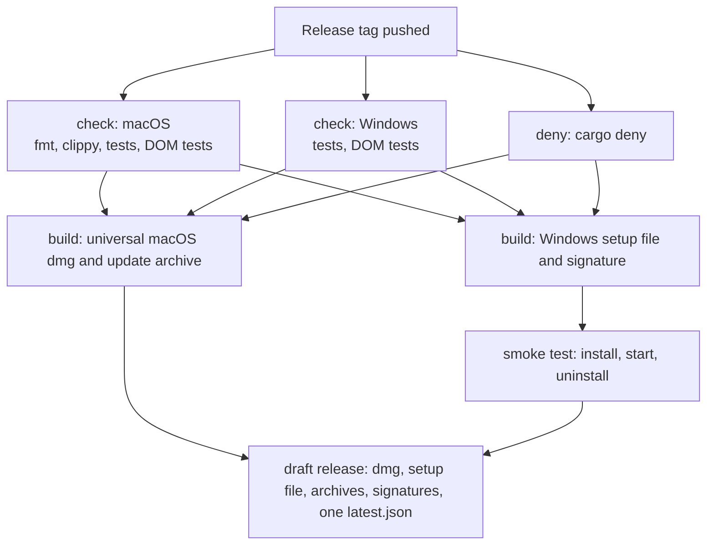

# CSD-038: Windows support

## 1. Intent
Varde is built, released and documented for macOS only. People on Windows cannot install it, update it or use its keyboard shortcuts, which are written for the Mac (⌘). This capability makes Varde run on Windows 10 and 11 (x64): the release pipeline builds an installer, the installed app updates itself like the Mac app, and the menu, the shortcuts and the texts follow Windows conventions. It is for the owner and the few people who use the app. It is GitHub issue 86, refined in a grill-me interview of 26/11/2026. It replaces the "macOS only" rule of `CLAUDE.md` and CSD-021 NG-3; the amendments are listed in section 5.

## 2. Scope
### 2.1 In scope
- A Windows x64 installer (NSIS `.exe` setup, per-user) and its signed update file, built in the release run of CSD-021 and attached to the same draft release.
- The Windows entry in `latest.json`, so the in-app update of CSD-023 works on Windows.
- Running the Rust tests and the frontend DOM tests on Windows as well as on macOS.
- An install, start and uninstall smoke test of the installer on a Windows runner.
- Windows menu layout, keyboard shortcuts and the shortcut texts in the app (English and Dutch, CSD-022).
- The README: install steps for Windows, including the SmartScreen warning.
- A manual workflow that builds the unsigned setup file of a branch as a downloadable artifact, to try it on a Windows PC without building there.

### 2.2 Non-goals
- NG-1: Authenticode code signing. Builds are unsigned, like on macOS (CSD-021 NG-2).
- NG-2: An ARM64 build. Windows on ARM runs the x64 app by emulation.
- NG-3: An MSI installer, a portable zip, or a machine-wide (all users) install.
- NG-4: The `.varde` file association (double-click to open a project). macOS has none either; a follow-up issue covers both platforms.
- NG-5: A manual end-to-end checklist or hard gate before the first Windows release.
- NG-6: Linux.
- NG-7: A "Check for updates" menu item (CSD-023 NG-2 stays).
- NG-8: Windows-specific changes to the screens, other than the shortcut texts (REQ-6).

## 3. Definitions
| Term | Meaning |
|---|---|
| **Windows build** | The x64 build of the app (`x86_64-pc-windows-msvc`) and its NSIS setup file. |
| **Setup file** | `Varde_<version>_x64-setup.exe`, the installer. It is also the update file of the Windows app. |
| **Smoke test** | Installing the setup file silently, starting the app, and uninstalling it silently, on a Windows runner. |
| **App data** | The files the app keeps for itself in `%APPDATA%`: the last-opened project path, the theme and the language. |

## 4. Requirements

### 4.0 Overview flow


**REQ-1: A Windows setup file** *(event-driven)*
When the release run builds the app, the pipeline shall build an unsigned per-user NSIS setup file for Windows x64 and attach it to the draft release.

```gherkin
@AC-1.1
Scenario: The draft release has the setup file
  Given the tag "v0.2.0" matches the app version "0.2.0"
  When the release run finishes
  Then the draft release holds "Varde_0.2.0_x64-setup.exe"
  And it holds no ".msi" file

@AC-1.2
Scenario: Installing needs no administrator rights
  Given a Windows user without administrator rights
  When the user runs "Varde_0.2.0_x64-setup.exe"
  Then Varde installs under the user's own folders without an administrator prompt
  And a Start menu entry "Varde" exists

@AC-1.3
Scenario: The Windows build fails
  Given the Windows build fails
  When the release run ends
  Then no draft release is created
```

**REQ-2: Windows update file and latest.json** *(event-driven)*
When the release run builds the Windows build, the pipeline shall sign the setup file with the updater key of CSD-021 and list it in the one `latest.json` of the draft release under `windows-x86_64`, next to the two Mac entries.

```gherkin
@AC-2.1
Scenario: One latest.json lists all three platforms
  Given the tag "v0.2.0"
  When the release run finishes
  Then the draft release holds one "latest.json" with version "0.2.0"
  And its platforms are "darwin-aarch64", "darwin-x86_64" and "windows-x86_64"
  And the "windows-x86_64" url points to "Varde_0.2.0_x64-setup.exe" in the release "v0.2.0"
  And the draft release holds "Varde_0.2.0_x64-setup.exe.sig"

@AC-2.2
Scenario: The signature verifies
  Given the draft release "v0.2.0"
  When the signature file is checked against the public key in "tauri.conf.json"
  Then it verifies
```

**REQ-3: Tests on both platforms** *(event-driven)*
When the release run starts, the pipeline shall run the Rust tests and the DOM tests on macOS and on Windows, and shall run the format check, clippy and `cargo deny` on macOS only.

```gherkin
@AC-3.1
Scenario: A Windows-only test failure stops the release
  Given a Rust test that passes on macOS and fails on Windows
  When the release run executes the checks
  Then the Windows check fails
  And no build starts and no draft release is created

@AC-3.2
Scenario: The format check runs once
  When the release run executes the checks
  Then "cargo fmt --all --check" ran on macOS and not on Windows
```

**REQ-4: A smoke test gates the release** *(event-driven)*
When the Windows build is made, the pipeline shall install the setup file silently on a Windows runner, start the app, check that it is still running after 10 seconds, uninstall it silently and check that its install folder is gone, before the draft release is created.

```gherkin
@AC-4.1
Scenario: Install, start, uninstall
  Given the Windows build "Varde_0.2.0_x64-setup.exe"
  When the smoke test runs it with "/S"
  Then "Varde.exe" is installed in the per-user install folder
  And "Varde.exe" is still running after 10 seconds
  And after the silent uninstall the install folder does not exist

@AC-4.2
Scenario: The app exits at start
  Given an app that exits within 10 seconds of starting
  When the smoke test runs
  Then the run fails
  And no draft release is created
```

**REQ-5: Updating on Windows** *(ubiquitous)*
The in-app update of CSD-023 shall work on Windows as it does on macOS: check, download, signature check, replace and restart, with the same results, texts and errors.

```gherkin
@AC-5.1
Scenario: A newer Windows version is installed
  Given Varde "0.1.0" on Windows
  And "latest.json" lists "0.2.0" under "windows-x86_64" with a valid signature
  When the user installs the update from Settings
  Then the app is replaced by "0.2.0" and restarts

@AC-5.2
Scenario: An update without a valid signature
  Given "latest.json" lists "0.2.0" under "windows-x86_64" with an invalid signature
  When the user installs the update from Settings
  Then nothing is installed
  And the app shows the update code of CSD-023 REQ-12
```

**REQ-6: Shortcut texts follow the platform** *(state-driven)*
While the app runs on Windows, every shortcut shown in a text shall use Windows notation (`Ctrl+O`, `Ctrl+Shift+S`), and while it runs on macOS the texts shall stay as they are (`⌘O`, `⇧⌘S`). This holds in English and in Dutch.

```gherkin
@AC-6.1
Scenario Outline: The welcome text on each platform
  Given the app runs on <platform> in <language>
  When the empty-state text is shown
  Then it contains "<open>" and "<save>"

  Examples:
    | platform | language | open   | save   |
    | Windows  | English  | Ctrl+O | Ctrl+S |
    | Windows  | Dutch    | Ctrl+O | Ctrl+S |
    | macOS    | English  | ⌘O     | ⌘S     |
    | macOS    | Dutch    | ⌘O     | ⌘S     |

@AC-6.2
Scenario: No Mac symbol on Windows
  Given the app runs on Windows
  When any page or dialog is shown
  Then no text contains "⌘" or "⇧"
```

**REQ-7: Windows menu layout** *(state-driven)*
While the app runs on Windows, the native menu shall have no app menu: Settings… (Ctrl+,) shall be in the File menu above Exit, and a Help menu shall hold About Varde (CSD-031). On macOS the menu shall stay as it is (CSD-024 REQ-5).

```gherkin
@AC-7.1
Scenario: Settings in File on Windows
  Given the app runs on Windows
  When the user opens the File menu
  Then it lists New, Open…, Save, Save As…, Settings… and Exit
  And Settings… comes directly above Exit

@AC-7.2
Scenario: About in Help on Windows
  Given the app runs on Windows
  When the user chooses Help > About Varde
  Then the About window of CSD-031 opens

@AC-7.3
Scenario: macOS is unchanged
  Given the app runs on macOS
  When the user looks through the native menu bar
  Then Settings… and About Varde are in the Varde menu and there is no Help item for About

@AC-7.5
Scenario: Help holds one About item on Windows
  Given the app runs on Windows
  When the user opens the Help menu
  Then it has one item, "About Varde", and no second default "About"
```

**REQ-8: Windows shortcuts** *(ubiquitous)*
On Windows the menu items shall use these shortcuts: New Ctrl+N, Open… Ctrl+O, Save Ctrl+S, Save As… Ctrl+Shift+S, Settings… Ctrl+Comma, Undo Ctrl+Z, Redo Ctrl+Shift+Z, Discrete Mode Ctrl+Shift+D. The webview keeps these keys from the native menu on Windows, so the page shall also catch them and run the same item, once; Undo and Redo in a text field stay with the browser. On macOS the page does nothing with them.

```gherkin
@AC-8.1
Scenario Outline: A shortcut runs its menu item
  Given the app runs on Windows
  When the user presses <keys>
  Then the app runs <item>

  Examples:
    | keys         | item          |
    | Ctrl+N       | New           |
    | Ctrl+O       | Open…         |
    | Ctrl+S       | Save          |
    | Ctrl+Shift+S | Save As…      |
    | Ctrl+,       | Settings…     |
    | Ctrl+Shift+D | Discrete Mode |

@AC-8.2
Scenario: The key is pressed while the page has the focus
  Given the app runs on Windows and the focus is in the window's page
  When the user presses Ctrl+O
  Then the Open dialog opens once
  And the browser does not handle the key itself

@AC-8.3
Scenario: macOS is unchanged
  Given the app runs on macOS
  When the user presses ⌘O
  Then only the native menu handles it
```

**REQ-9: Ctrl+Y redoes** *(event-driven)*
When the user presses Ctrl+Y on Windows, the app shall do what Redo does: redo the text in a text field, nothing while a dialog is open, otherwise redo the project step (CSD-027 REQ-11).

```gherkin
@AC-9.1
Scenario: Redo a project step
  Given the app runs on Windows
  And the user undid "Add account" with Ctrl+Z
  When the user presses Ctrl+Y outside a text field
  Then the step "Add account" is redone

@AC-9.2
Scenario: Redo in a text field
  Given the app runs on Windows and the user is typing in a text field
  When the user presses Ctrl+Y
  Then the text is redone and the project is unchanged

@AC-9.3
Scenario: Ctrl+Y on macOS
  Given the app runs on macOS
  When the user presses Ctrl+Y outside a text field
  Then nothing is redone
```

**REQ-10: Uninstall keeps the user's data** *(event-driven)*
When the user uninstalls Varde on Windows, the uninstaller shall remove the app and shall keep the app data and every project file; it shall not offer to delete the app data by default.

```gherkin
@AC-10.1
Scenario: Reinstall keeps the preferences
  Given Varde on Windows with language "Dutch" and the project "C:\Users\Example\varde\example.varde"
  When the user uninstalls Varde and installs it again
  Then the language is "Dutch"
  And "example.varde" still exists and is unchanged
```

**REQ-11: Project files are the same on both platforms** *(ubiquitous)*
A project file saved on one platform shall open on the other, and saving over an existing project file on Windows shall replace it completely or leave it unchanged (CSD-002 atomic save).

```gherkin
@AC-11.1
Scenario: A Mac file opens on Windows
  Given the project file "examples/example.varde" saved on macOS
  When it is opened on Windows
  Then the project loads and shows the same figures as on macOS

@AC-11.2
Scenario: Saving over an existing file on Windows
  Given the project file "example.varde" exists
  When the project is saved to the same path on Windows
  Then the file holds the new content and no temporary file remains in its folder

@AC-11.3
Scenario: The file is open in another program
  Given "example.varde" is locked by another program
  When the project is saved to that path on Windows
  Then the save fails with the existing safe error of CSD-002
  And the file is unchanged
```

**REQ-12: README for Windows** *(ubiquitous)*
The README shall say that Varde runs on macOS and on Windows 10 and 11 (x64), how to install it on Windows, how to get past the SmartScreen warning of an unsigned app ("More info" then "Run anyway"), and the Windows shortcuts.

```gherkin
@AC-12.1
Scenario: The README names Windows
  When a reader opens the README
  Then it no longer says "macOS only"
  And it has Windows install steps with the SmartScreen steps
```

**REQ-13: Manual Windows test build** *(event-driven)*
When the owner starts the "Windows test build" workflow by hand, the system shall build the unsigned Windows setup file of the chosen branch and keep it as a downloadable artifact for 7 days, without a release, a tag or any secret. The workflow shall run on no other trigger.

```gherkin
@AC-13.1
Scenario: The test build gives a setup file
  Given the owner starts "Windows test build" on the "development" branch
  When the run ends
  Then it has an artifact with "Varde_<version>_x64-setup.exe"
  And no release and no tag were made

@AC-13.2
Scenario: A push does not start it
  When a commit is pushed to any branch or a pull request is opened
  Then "Windows test build" does not run
```

**REQ-14: About dialog with the icon** *(event-driven)*
When the user chooses Help > About Varde on Windows, the app shall show a dialog with the Varde icon, the name, the version, the description, the copyright, the licence and the website of CSD-031 REQ-1, taken from the same Rust constants. The dialog is the app's own because the Windows native About box is a message box that cannot show the app icon. On macOS the native panel of CSD-031 stays.

```gherkin
@AC-14.1
Scenario: The Windows About dialog shows the icon
  Given the app runs on Windows
  When the user chooses Help > About Varde
  Then a dialog shows the Varde icon, "Varde", the version, the description, the copyright, the licence and the website
  And the version is the one of the package

@AC-14.2
Scenario: macOS is unchanged
  Given the app runs on macOS
  When the user chooses "About Varde" in the Varde menu
  Then the native About panel of CSD-031 opens
```

## 5. Interfaces and contracts
- **Bundle (`tauri.conf.json`):** targets gain `nsis`; NSIS install mode is `currentUser`; the WebView2 install mode is `embedBootstrapper` (CON-8); no `wix`/MSI target. The `.sig` of the setup file comes from `createUpdaterArtifacts`.
- **Release run (`release.yml`):** a `build-windows` job on `windows-latest` (target `x86_64-pc-windows-msvc`), a smoke step, and one final step that writes the single `latest.json`. The `check` job runs on a macOS and a Windows runner (REQ-3).
- **Test build (`windows-test-build.yml`):** `workflow_dispatch` only, one job on `windows-latest`, `createUpdaterArtifacts` switched off by `--config` (no key), uploads the setup file as an artifact (REQ-13). CSD-021 NG-7 (no automatic checks on pull requests or pushes) stays: this run is started by hand.
- **About on Windows:** the Help item is Varde's own (`show-about`, forwarded to the frontend); the command `get_about_info` returns `ABOUT` of `menu.rs`; `ui/shared/about.js` shows the dialog with `ui/assets/app-icon.png`. No new permission, crate or CSP change (the CSP already allows `img-src 'self'`).
- **Menu (`menu.rs`):** the app-menu steps (Settings…, About) apply to macOS only; on Windows they go to File and Help (REQ-7).
- **Frontend:** one place decides the platform and gives the shortcut texts (REQ-6) and the Ctrl+Y key (REQ-9).
- **Amendments** (made in the same change, each back to `draft` until re-approved):
  - CSD-021: NG-3 loses Windows; CON-1, REQ-1, REQ-4, REQ-7 to REQ-9, REQ-12, the flow and section 7 follow REQ-1 to REQ-4 here.
  - CSD-023: the section 4.0 intro, REQ-12 and the endpoint note say `latest.json` also lists Windows.
  - `CLAUDE.md`: Project, Commands and Layout drop "macOS only"; Windows x64 is a supported platform; the "no Windows/Linux" rule is limited to Linux.
  - CSD-031: NG-1 is limited to macOS; Windows has its own About dialog (REQ-14).
  - CSD-024: REQ-5 says the menu differs on Windows (REQ-7 here).

## 6. Constraints
- CON-1: The Windows build and checks run on `windows-latest`, target `x86_64-pc-windows-msvc`, with the Rust version of `rust-toolchain.toml`. Rationale: the same compiler as the macOS checks (CSD-021 CON-8).
- CON-2: No new secrets, no new crates and no new Tauri plugins or permissions. The existing updater key signs the Windows file. Rationale: `CLAUDE.md` Ask first; CSD-021 REQ-10.
- CON-3: macOS behaviour does not change; the golden files (`src-tauri/golden/`) stay as they are. Rationale: this is an addition for a second platform.
- CON-4: Changes to `.github/workflows/` and `tauri.conf.json` need the owner's approval, given for the commits that make them. Rationale: `CLAUDE.md` and CSD-021 CON-3.
- CON-5: Every new third-party action is pinned to a full commit SHA and cargo commands use `--locked`. Rationale: CSD-021 CON-6 and CON-7.
- CON-6: The app makes no new network call. Rationale: CSD-023 NG-8; see OQ-1 for the installer.
- CON-7: The frontend does not compute figures; it only chooses the shortcut texts (REQ-6). Rationale: `CLAUDE.md` Layout.
- CON-8: The setup file carries Microsoft's WebView2 bootstrapper (`embedBootstrapper`), so installing needs no separate download of the bootstrapper. The bootstrapper still fetches the WebView2 runtime from Microsoft when the PC lacks it (Windows 11 and updated Windows 10 have it); this happens only at install time, never in the running app. Rationale: no network call in the app itself (CON-6), and the installer works the same wherever the runtime is present.

## 7. Verification
Tests are named `test_csd038_ac_<n>_<m>_<description>` (CSD-000 REQ-6).

| ACs | How |
|---|---|
| AC-6.1, AC-6.2, AC-9.1 to AC-9.3 | DOM tests in `ui/tests/` (`npm test`), with the platform set by the test harness. |
| AC-14.1 | DOM test in `ui/tests/` and a Rust test of the command (`cargo test test_csd038_ac_14_`); AC-14.2 is the unchanged macOS panel of CSD-031. |
| AC-8.2, AC-8.3 | DOM tests in `ui/tests/` (`npm test`). |
| AC-7.1 to AC-7.3, AC-7.5, AC-8.1 | Rust tests of the menu builder for both platforms (`cargo test test_csd038_`); AC-8.1 also checks the accelerator strings. |
| AC-11.1 to AC-11.3 | Rust storage tests in a temporary directory (`cargo test test_csd038_ac_11_`), run on macOS and Windows by the release run. |
| AC-3.1, AC-3.2, AC-1.3 | Push a throwaway tag on a scratch fork and read the run (CSD-021 method). |
| AC-1.1, AC-2.1, AC-2.2 | Open the first draft release that has a Windows file: file names, `latest.json`, and `minisign -V` with the public key. |
| AC-13.1, AC-13.2 | Start the workflow from the Actions tab and read the run; push a commit and see that it does not start. |
| AC-4.1, AC-4.2 | The smoke step of the release run; AC-4.2 with a scratch fork and a build that exits. |
| AC-1.2, AC-5.1, AC-5.2, AC-10.1, AC-12.1 | Not covered by an automated test: no manual checklist is run (NG-5). The smoke test (AC-4.1) is the only proof of install and uninstall. |

## 8. Open questions
- OQ-1: (resolved 26/11/2026) WebView2 install mode is `embedBootstrapper` (CON-8).
- OQ-2: (resolved 26/11/2026) No "Check for Updates" menu item: CSD-023 NG-2 and CSD-024 REQ-5 stay, Help holds About only (NG-7, REQ-7).
- OQ-3: (resolved 26/11/2026) Supported: Windows 10 and 11, x64 (REQ-12).

## 9. Changelog
- 0.6 (27/11/2026): new REQ-14 (Windows About dialog with the app icon, `show-about`, `get_about_info`); amends CSD-031 NG-1. Found on a Windows PC: the native About box showed a generic icon.
- 0.5 (27/11/2026): new AC-7.5: Help has one About item. Found on a Windows PC: the default "&About" stayed next to "About Varde", because its text carries a mnemonic marker on Windows.
- 0.4 (27/11/2026): REQ-8 adds that the page catches the Ctrl keys on Windows, because the webview keeps them from the native menu (found on a Windows PC: no shortcut worked); new AC-8.2, AC-8.3.
- 0.3 (27/11/2026): new REQ-13 (manual Windows test build, `windows-test-build.yml`) with AC-13.1, AC-13.2; sections 2.1, 5, 7.
- 0.2 (26/11/2026): OQ-1 to OQ-3 resolved with the owner's recommendations; new CON-8 (WebView2 `embedBootstrapper`); section 5 names the install mode.
- 0.1 (26/11/2026): initial draft (GitHub issue 86).
